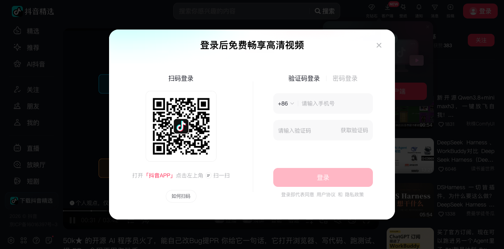

# OpenHands 开源 AI 程序员 — 三层架构与真实工作流

> 来源：抖音 @半个硅基（发布 2026-05-18，时长 3:42）
> 视频链接：https://v.douyin.com/vOxP1U-tLsk/ （视频ID 7641230809692638507）
> 数据核验：GitHub API 实时查询（归档日 2026-09-19）



## 视频概述

抖音科普视频：介绍 GitHub 爆火的开源 AI 程序员 OpenHands（开源版 Devin）。核心卖点：给它一句话，它自己打开浏览器、写代码、跑测试、提 PR，全程无人干预，本地就能跑。与 Cursor（$20/月）、Devin（$500/月）对比，OpenHands 免费且数据不出本地。

**发布时点数据（视频口径，2026-05-18）：50k⭐**
**归档日实测（2026-09-19，GitHub API）：88,459⭐ / 11,618 forks** —— 4 个月涨了 77%，热度和增速远超视频发布时。

## 章节要点（平台 AI 摘要 + 时间轴）

| 时间 | 章节 | 要点 |
|------|------|------|
| 00:00 | 引言 | 一句话任务 → 自主完成全流程 |
| 00:20 | OpenHands概述 | 开源版 Devin，本地部署，端到端解决任务、数据安全、社区活跃 |
| 00:57 | 实际演示 | 改 Bug → 提 PR 实操 |
| 01:46 | 架构 | 三层架构讲解 |
| 02:18 | 对比 | vs Cursor $20/月、Devin $500/月，OpenHands 免费 |
| 02:32 | 运行方式 | 本地/云端部署 |
| 03:16 | 优势与适用人群 | 爱折腾的开发者、重数据安全的企业团队、学 Agent 架构的工程师 |

作者评论区补充（回复"是否需要接 MCP"）：**不强制接 MCP。OpenHands 自带文件/Bash/浏览器/Jupyter 四件套，跑通常规"读代码、改代码、提 PR"完全够用。**

## 归档日实证：项目现状（2026-09-19）

视频发布后 4 个月，OpenHands 发生了重大架构演进——从"单体 AI 程序员"转型为 **Agent Canvas（self-hosted developer control center）**：

| 维度 | 视频时点（2026-05） | 归档日实测（2026-09） |
|------|---------------------|----------------------|
| 定位 | 开源版 Devin（AI 程序员） | Agent Canvas：开发者控制中心，可跑 OpenHands/Claude Code/Codex/Gemini 或任何 ACP 兼容 agent |
| Stars | 50k（视频口径） | **88,459**（GitHub API） |
| 主仓库 | All-Hands-AI/OpenHands 单体 | OpenHands/OpenHands（迁移+改名），Agent 拆到 software-agent-sdk |
| 架构 | Agent/事件流/Runtime 三层 | 多仓库：Agent Canvas（前端+编排）/ software-agent-sdk（Python SDK+Agent Server）/ automation（调度+webhook） |
| 安装 | Docker 一条命令 | npm `@openhands/agent-canvas`（Node 22+）/ Docker sandbox / 源码，状态 beta |
| License | MIT | MIT（主仓库+SDK 均 MIT） |

仓库活跃度：pushed_at 2026-09-18（昨天仍在更新），主语言 TypeScript。企业背书：TikTok、Netflix、Apple、NVIDIA、Google 等工程师在用（README 列示）。

## 三层架构（视频讲法 + 当前对应）

视频讲的经典三层（对应经典 OpenHands/当前 SDK 内核）：

1. **Agent 层**（大脑）：LLM 驱动的决策循环——读任务 → 思考 → 发出动作指令（Action）
2. **事件流层**（EventStream，神经）：所有动作与观察（Observation）以事件形式流经系统，UI 实时渲染、会话可回放——这是 OpenHands 可观测性的核心设计
3. **Runtime 层（沙箱）**（手脚）：Docker 容器内执行命令、编辑文件、跑浏览器——隔离执行环境，出错不伤宿主机

**当前演进**：这三层被重组进 `software-agent-sdk`（Agent/Conversation/Tool 的 Python SDK + Agent Server REST API），而主仓库变成 Agent Canvas 控制面——会话、沙箱选择、密钥、MCP、设置、集成都归控制面，代码执行全部下沉到数据面（与知识库 6-30 那篇《控制面/数据面拆分》的分析一致）。

## 真实工作流（视频演示 + 文档核实）

```
用户一句话任务
  → Agent 理解 → 生成行动计划
  → Runtime 沙箱内：读仓库代码 → 定位 Bug → 改代码
  → 跑测试验证 → 通过后 git commit
  → 调 GitHub 工具提 PR（带改动说明）
  → 事件流全程记录，用户在 UI 里看它"干活"
```

自带工具四件套（无需 MCP）：文件编辑、Bash 终端、浏览器（可看它操作网页）、Jupyter。通过 MCP/ACP 可扩展更多工具。

## 同类对比（视频 + 补充）

| 工具 | 定位 | 价格 | 数据安全 |
|------|------|------|----------|
| Devin（Cognition） | 全托管 AI 程序员 | $500/月 | 云端 |
| Cursor | AI 编辑器（人主导） | $20/月 | 代码上云（可选本地模式受限） |
| OpenHands | 开源自主 Agent | 免费 + 自付 LLM API | 本地部署，代码不出机器 |
| Claude Code/Codex | 终端 Agent（订阅制） | $20-200/月 | 云端为主 |

视频结论：OpenHands 适合 ① 喜欢折腾的开发者 ② 注重数据安全的企业团队 ③ 学习 Agent 架构的工程师（源码就是教材）。

## 关键洞察

- **视频讲的三层架构是理解 Agent 系统的通用骨架**：大脑（LLM决策）/神经（事件流）/手脚（沙箱执行）。Hermes Agent、DeepSeek Harness 都是这个模式的变体。
- **4 个月 50k→88k 星**：开源 Devin 替代的叙事仍有强劲吸引力，且项目在自我重构中保持增长（拆仓库反而没掉粉）。
- **从"AI 程序员"到"Agent 控制中心"**：OpenHands 的转型和 MOVO 的判断一致——Runtime 管执行，企业层管多人安全可控使用。Agent Canvas 直接把 Claude Code/Codex 当后端跑，自己升格为平台。
- **免费的真实成本**：工具免费但 LLM API 自付；真正价值在"数据不出本地"——对企业这是付费买不到的安全属性。

## 战略分析

**与现有体系的对照：**

| 维度 | OpenHands | Hermes Agent（本机） |
|------|-----------|---------------------|
| 定位 | 软件工程专用 Agent 平台 | 通用个人 Agent（生活+工作全场景） |
| 架构 | 控制面（Canvas）/数据面（SDK+沙箱）分离 | 单体 Runtime + skills + memory + channels |
| 工具 | 文件/Bash/浏览器/Jupyter 四件套 + MCP/ACP | 全量工具链（terminal/browser/MCP/子代理） |
| 执行隔离 | Docker 沙箱强隔离 | 本机直跑（信任模型不同） |
| 自主循环 | 一句话到 PR 端到端 | 幕僚长模式（人机协作过滤器） |

**借鉴点：**
1. **事件流（EventStream）作为一等公民**：所有动作/观察结构化落盘 → 会话回放、debug、评估都有据可查。Hermes 的会话记录可参考此设计做结构化增强。
2. **沙箱分级**：Docker 沙箱默认 + "直跑宿主机"要显式警告——信任边界做成产品语言，值得所有 Agent 产品学习。
3. **控制面/数据面拆分**是多 Agent 平台的成熟路径：会话/密钥/配置（控制面）与代码执行（数据面）解耦后，才能一个 Canvas 调度多种 agent 后端。

**知识库关联：**
- [[2026-06-30-OpenHands源码解析一-控制面数据面拆分]] — 深度源码分析（拆仓库细节），本篇是其入门前置
- [[2026-09-16-MOVO-基于DeepSeek-Harness的企业Agent平台]] — 同样的"Runtime+企业层"分层判断
- [[2026-09-04-OpenBot-每Agent独立电脑安全网关]] — 沙箱隔离的另一种极端做法

## 归档日志

- 2026-09-19 归档（抖音章节要点轻路径提取；ASR 通道被抖音 403 风控拦截，未做语音转录；GitHub API 实证 star/架构/多仓库现状）
