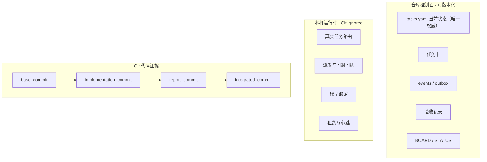

# AgentDesk：把 Git 仓库变成可审计的多 Agent 开发系统

> **一句话**：一个 Codex Skill（MIT，v0.2.0-beta），用任务卡、岗位协议、Git 证据、交付/验收门禁、运行时路由检查和恢复校验，把中大型 Git 仓库变成受控的、任务卡驱动的多 Agent 开发工作流。它不替代 Codex 运行时，也不自动获得额外权限。

## 项目定位

- **仓库**：github.com/LevixDD/AgentDeskSkill（v0.2.0-beta，legacy v0.1.0-beta）
- **本质**：Skill 形式的项目治理层——"自动化协调，而不是自动化权威"
- **解决的问题**：多 Agent 开发时——任务状态谁说了算？怎么证明 Agent 真的干了活？失败怎么恢复？跨会话怎么交接？
- **核心主张**：可观察的闭环不可协商：PM/Leader 任务 → 独立角色任务（`role_no . role_name`）→ 真实派发 → 专用 worktree 执行 + 报告 → Worker 主动回调 → PM 独立验收集成 → 依赖解锁 → 心跳仅作兜底

## 架构拆解：三层事实分离

**权威顺序**：`tasks.yaml` > `events/*.yaml` > 任务卡 > 交付报告 > 验收记录 > BOARD/STATUS 视图 > 聊天与通知（不裁决状态）。

- 看板与账本不一致 → 重新生成视图，不手改看板
- 账本与事件历史冲突 → 冻结派发，进入恢复流程
- 派发是"先提交意图，再执行传输"：dispatch_id + event + outbox + 账本 + 视图作为**同一个 commit** 提交，然后才发送消息——进程在发送前崩溃可安全重放，不产生第二个 attempt

## 核心特性

### 三种模式

| 模式 | 含义 | 前提 |
|---|---|---|
| **Standard** | 每个活跃岗位用真实独立 Codex 任务（标题字节级匹配 `role_no . role_name`）+ 专用 worktree + 主动回调 + 传输回执 | Codex Desktop 任务 API（创建/命名/读取/跨任务消息） |
| **Lite** | 人工接力或明确授权的同任务切换；不声称多任务闭环 | 任何 Codex 环境 |
| **Automated** | 租约续期、重试/死信、孤儿检测、指标、恢复自动化 | Standard 先跑通 |

创建用户可见的 Codex 任务**永远需要显式授权**——"开始开发"不算授权。

### 关键机制

- **30 条 Non-Negotiable Invariants**：派发绑定 `task_id+revision+attempt+dispatch_id+base_commit`；Accepted ≠ Integrated（默认依赖要求 Integrated）；报告≠回调（报告只是请求评审）；模型选择是派发门禁而非启动器；回调前必须持久化传输回执
- **18 个版本化 schema**：task-card/v2、tasks/v2、delivery-report/v2、acceptance/v2、routes/v2、transport-receipts/v1、outbox-message/v2、pm-lease/v1、role-policies/v1、consultation-* 等
- **版本隔离**：不可变 release-manifest.json + 项目内提交的 AGENTDESK.lock.json + bundle sha256；写入要求精确匹配 release/commit/bundle；legacy-unpinned 只能显式认领
- **写入门禁**：任何写操作前 `check_compatibility.py --operation write` 必须通过，失败即关闭
- **模型路由**：ROLE-POLICIES.yaml（vendor-neutral 角色模型策略：tier 分级 basic→expert、deliberation 分级 efficient/balanced/deep、风险地板 L0-L4、降级策略 block/allow_to_minimum/require_pm_approval）+ 本机 model-bindings.yaml 绑定；`select_model.py` 确定性选择，九字段快照在账本/outbox/报告三处一致
- **咨询圆桌（可选）**：V1 只读咨询，0-3 席、最多 2 轮、每席独立回传、Leader 综合分歧、**只有 Owner 确认才能变成决策或任务卡**；咨询输出永远只是建议
- **隐私边界**：任务卡/报告/事件只放逻辑证据；线程 ID、绝对路径、回执、租约等运行时数据只在 gitignored `.agentdesk/runtime/`

### 任务卡模板亮点

- **Context Budget 三级阅读清单**：Required（AGENTS.md + 任务卡 + 最小源码）/ Read if needed / Do not read by default——显式限制上下文加载，省 token
- 完整 frontmatter：task_id/revision/type/role_id/priority/risk/min_model_tier/depends_on/base_commit/allowed_paths/blocked_paths/conflict_surfaces（paths/symbols/contracts/migrations）/required_checks/owner_approval/callback 配置

## 技术栈

| 类别 | 内容 |
|---|---|
| 运行时 | Codex（需支持本地 Skill；Standard 需 Codex Desktop 任务 API） |
| 脚本语言 | Python 3.9+，**纯标准库** |
| 版本控制 | Git（真实仓库根目录，证据绑定不可变 commit） |
| 测试 | 7 个 unittest（版本锁/legacy 认领/运行时隐私/发布工具/release smoke） |
| CI | .github/workflows/validate.yml |
| 发布 | 固定 tag → 测试 → 构建只读 release → 原子激活（dry-run 先行） |

## 同类项目对比

| 维度 | AgentDesk | J-Space | Trellis | Hermes delegate_task |
|---|---|---|---|---|
| 层级 | 多 Agent 项目治理 | 单模型推理时控制 | 团队级 Harness 框架 | Agent 执行 |
| 任务权威 | tasks.yaml（唯一权威） | 工作空间账本（Goal/Core/Verified/Open/Next） | LLM Wiki | 会话内 subagent |
| 验收 | Git 证据 + 验收记录 | 测试通过才标 Verified | - | - |
| 恢复 | 检查点/恢复流程/租约 | 账本可恢复 | - | 中断即丢弃 |
| 隐私边界 | 运行时数据 gitignored | - | - | - |
| 模型门禁 | ROLE-POLICIES + select_model | fast/full/loop 分档 | - | 不可选 |
| 跨会话 | ✅ 完整（任务卡持久化） | 单任务 | ✅ | ❌ 同步一次性 |
| 依赖 | Codex Desktop 任务 API | 无（Skill 形式） | - | Hermes 内置 |

## 当前状态

- v0.2.0-beta：当前公开 beta，协议/schema 可能变化（v1.0.0 前），建议固定 tag + 非关键仓库试用
- v0.1.0-beta：legacy 基线，需显式认领（adopt_legacy_project.py 只读规划 + Owner 批准后原子应用）
- 测试：7 个 unittest 套件；探索时运行观察到：部分 release_tools 用例失败系本地手动跑测试生成的 `__pycache__` 污染"干净树"检查所致（非项目缺陷，官方安装脚本用 `PYTHONDONTWRITEBYTECODE=1` 防此）；另 `runtime_privacy` 的 dispatch 用例在本机挂起 >3 分钟，值得留意（beta 项目质量信号，未深究）
- 文档：12 篇（架构/上手/操作/证据链/角色模型运行时/验证恢复/看板路线图/分享移植/咨询圆桌/版本隔离升级/术语表）

## 文档体系亮点

- 完整中文用户文档（docs/README.md）+ 12 篇分主题文档 + GLOSSARY.md
- SKILL.md 本体 401 行：Outcome → 模式解析 → 渐进加载引用 → 不变量 → 初始化/迁移 → 操作 → 恢复，自包含可执行
- 渐进式引用加载：按当前模式只读所需 reference（protocol/schemas/runbooks/runtime-adapter/consultation/versioning），不默认全加载——与任务卡 Context Budget 同款省 token 设计

## 架构价值评估

**优势：**
1. 罕见的"Skill 工程化"范例：schema 版本化、release manifest、不可变 bundle、测试套件、原子激活、回滚流程——把 Skill 当软件工程做
2. 三层分离 + 隐私边界是教科书级设计：可审计事实进 Git，易变/敏感运行时数据隔离
3. outbox 先提交后发送的崩溃安全模式，可直接套用到任何 Agent 编排系统
4. 语义精确：Accepted ≠ Integrated、报告 ≠ 回调、咨询 ≠ 决策、模型强 ≠ 权限大——每一条都在防系统性幻觉

**可借鉴（对 Hermes 生态）：**
- 任务卡 Context Budget 三级阅读清单 → 可做成 Hermes Skill 模板，显式限制上下文加载
- 三层事实分离 → Obsidian 知识库同样适用（可版本化笔记 vs 运行时状态）
- 模型选择作为派发门禁 → 呼应 J-Space fast/full/loop 分档思路
- 版本隔离 → 对多版本 Skill 共存有直接参考价值

**注意/局限：**
- Standard 模式强依赖 Codex Desktop 任务 API，Hermes 无对应能力，不能直接迁移
- beta 阶段协议未稳定；legacy 迁移流程复杂（锁/清单/字节校验）
- 学习曲线陡：30 条不变量 + 18 schema + 8 脚本，小项目过重
- 中文文档为主，社区生态未知（1 个维护者，早期项目）

## 相关资源

- 仓库：https://github.com/LevixDD/AgentDeskSkill
- 文档：docs/README.md（中文用户文档）
- 技术栈：Python 3.9+ stdlib / Git / Codex Runtime
- 本地 clone：~/projects/AgentDeskSkill（探索用，保留供后续试用）

## 关联阅读

- [[2026-08-18-J-Space-DeepSeek-推理时认知控制套件]] — 单模型推理时控制 vs 多 Agent 项目治理，互补两层
- [[2026-07-15-拆完WorkBuddy-我看到了生产级Agent的完整形态-叶小钗]] — 生产级 Agent 六阶段演进，AgentDesk 是"能被治理"阶段的工程化实现

## 归档日志

- 2026-08-18 归档（探索 + 分析，clone 保留于 ~/projects/AgentDeskSkill）
