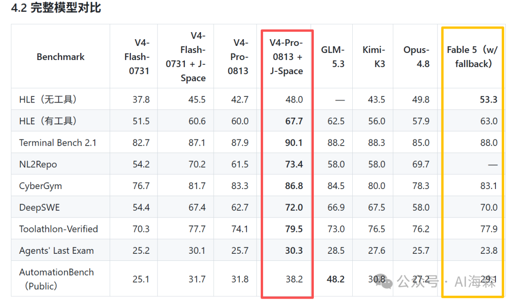

# J-Space：打开 DeepSeek-V4-Pro 的推理时认知控制套件

> **一句话**：一位中国网友用 J-Space（推理时认知控制套件）跑 DeepSeek-V4-Pro-0813，测评显示除 HLE（无工具）外各项指标均超过 Anthropic Fable 5，火上了热搜。J-Space 不是给模型加新能力，而是用一套系统化工作流程约束，让模型把已有能力发挥到极致。

## 背景：测评结论

- DeepSeek-V4-Pro-0813 发布 3 天即被曝出用 J-Space 加持后多项指标超越 Fable 5
- 唯一低于 Fable 5 的指标：HLE（无工具）——即"人类的最后考试"基准中不借助外部工具的纯记忆答题
- 测评报告（GitHub）：[DeepSeek-V4-J-Space-Capability-Realization-Report](https://github.com/Tiger3807861189/DeepSeek-V4-J-Space-Capability-Realization-Report)

## 第一章：J-Space 是什么？

- GitHub 项目：[J-Space-Cognition-Suite-V3.6](https://github.com/Tiger3807861189/J-Space-Cognition-Suite-V3.6)（1.1k 关注）
- 官方定位：*A model-agnostic inference-time control suite for deep reasoning, long-horizon work, tool use, verification, and recovery.*（面向深度推理、长程任务、工具调用、验证与恢复的模型不可知推理时控制套件）

**理解要点：**

- 一套"推理时的认知控制层"（inference-time cognitive control suite）
- 以 **Skill 形式封装**，不改模型权重，管理模型的工作空间（J-space）
- 目标用户：需要可靠多轮/跨文件推理与可验证流程的研究者、Agent 开发者、工程团队
- 解决的痛点：长任务中的**工作集过载、表征漂移、无控重试**，以及**把流畅输出误当成已验证完成**

## 第二章：为什么 J-Space 让 DeepSeek-Pro 变强？

### 比喻：超聪明但走神的学生 vs 严格班主任

| | 没有 J-Space | 加了 J-Space |
|---|---|---|
| 模型状态 | 超聪明但易走神的学生 | 配了严格班主任 |
| 问题 | 换出题方式就不知所措；难题要么乱做要么反复想；长篇论文忘了题目要求；改错了不记得错在哪 | 标准工作法（先看题→规划→执行→检查）；思考深度分级；工作笔记记录进度；每步有理由；强制验证答案 |
| 结果 | 60 分 | **60 分 → 80 分**——不是变聪明，是聪明劲被用对了地方 |

### 为什么 DeepSeek 强却不能完全发挥（4 个问题）

**问题 1：模型有能力，但指令很挑剔**
- 1.6T 参数、100 万 Token 上下文、会思考会用工具，但"后训练"把他训练得太依赖特定指令格式
- 给 Minimal schema（官方标准工具格式）→ 高质量配合；换 Standard schema → 换一种思考方式
- 一次给全部 100 个工具列表 → 乱套；先给 10 个再逐步解锁 → 稳定

**问题 2：思维链会"卡住"或"停不下来"（思维链二极管）**
- 想太少：不规划不验证，错了才知道
- 想太多：反复琢磨自言自语，推理越来越深却不行动
- 两种极端会随输入微调而跳跃切换，**没有稳定的中间态**

**问题 3：长任务时目标会"走丢"**
- 改 50 个文件的项目：第 1 步目标清晰 → 第 2 步开始忘为什么 → 第 3 步上下文堆满代码，大目标淡出，机械改到一半就停
- 关键：**1M Token 上下文再长也救不了"目标模糊"**——需要外部记账

**问题 4：工具调用的"缝隙"会漏掉关键信息**
- 查文件 → 发现 Bug → 但没记住"为什么查、Bug 是什么类型、影响哪些文件"
- 下一轮从头开始，没有诊断信息连贯性，反复浪费 Token 和思考力

### J-Space 释放能力的 5 个方法

**方法 1：规范第一人称，让模型知道自己在干什么**
- `I`（我个人）= 观察、判断或下决心
- `we`（我们）= 我和系统一起执行操作
- `we need` = 接下来必须做的事
- `let's` = 开始行动
- 效果：言行一致约束，说了 we need 就必须跟实际操作，模型不再"随意漂流"

**方法 2：分阶段控制推理深度，不要"一刀切"**
- `fast`（快速）：一句话能回答的问题，直接答不加机制（"1+1 等于几"→ 2）
- `full`（正常）：2-3 步任务，想一会儿、调一两次工具、验证一下
- `loop`（深度）：复杂任务（多文件/多工具/多轮），启用完整账本、检查点、恢复机制
- 效果：任务多复杂就用多深思考，避开"二极管"问题

**方法 3：用"工作空间"和"账本"让长任务不走丢**
- 工作笔记本记录 5 类：
  1. **Goal**（最终目标）：改这 50 个文件
  2. **Core**（核心约束）：保持 API 兼容、不能删注释
  3. **Verified**（已验证）：前 20 个文件改好，测试通过
  4. **Open**（待处理）：还有 30 个文件
  5. **Next**（下一步）：去改 file_21.js
- 效果：每次调用工具前看笔记本记起"我在做什么"；出错可从检查点恢复，不用从头开始

**方法 4：工具调用要"有诊断"，不要"空白重试"**
- 传统：查 database.js → 发现变量未定义 → 再查一次？（忘了第一次查的原因）
- J-Space：查 database.js（理由：找 User 函数定义）→ 发现问题（第 45 行 userID 未定义）→ 记账 → 去 userService.js 查来源 → 找到定义
- 效果：每次调用有"为什么"；失败知道"在哪失败"可针对性重试；不反复查同一处

**方法 5：强制"验证和确认"，别让模型自欺欺人**
- 模型说"改好了所有文件"，实际只改了一半 → 禁止
- J-Space 要求：改好一部分就运行测试 → 测试通过才标 **Verified** → 标 **Open** 必须明确列出剩余任务 → 最后才能说"做完了"
- 效果：防止"生成了流畅答案但实际没解决问题"

## 写在最后

> 太强了！终于找到了打开 DeepSeek-V4-Pro 的钥匙，马上可以一键接入地表最强 AI 模型！

## 战略分析

**J-Space 的本质是 Harness 层工作流工程**，与模型能力正交——这正是 Hermes Agent / Claude Code 这类工具链已经在做的事：

1. **"工作空间账本"= 显式化的工作记忆**：Goal/Core/Verified/Open/Next 五元组与 Hermes 幕僚长的"收尾包 + 待办清单 + 上下文交接"同构——都是把模型隐式的上下文状态变成显式的、可检查、可恢复的记录。
2. **fast/full/loop 深度分档**：可映射为 Hermes 的模型分层（快模型答简单问题、强模型深度推理），或同一模型的 token budget / 推理档位控制。
3. **"工具调用有诊断"**：对应 Agent 工具的 traceability 设计——每次调用带理由、失败记录可定位，减少无效重试的 Token 浪费。
4. **"强制验证"**：对应生产级 Agent 的验证门禁（测试通过才标完成），防止"流畅但错误"的输出——与幕僚长"目的优先于忙碌"的校验精神一致。
5. **与记忆系统的关系**：账本 = 短时工作记忆的显式化；长期记忆（如 TencentDB Memory / gbrain）负责跨会话，账本负责单任务内不丢失。两者互补而非替代。

**对 Hermes 生态的启发**：可以把 J-Space 的"账本协议"沉淀为 Skill 模板（Goal/Core/Verified/Open/Next 五段式），用于所有长任务型 Skill 的上下文管理——这是不依赖任何模型能力的通用收益。

**参考链接：**
- [J-Space-Cognition-Suite-V3.6](https://github.com/Tiger3807861189/J-Space-Cognition-Suite-V3.6)
- [DeepSeek-V4-J-Space-Capability-Realization-Report](https://github.com/Tiger3807861189/DeepSeek-V4-J-Space-Capability-Realization-Report)
