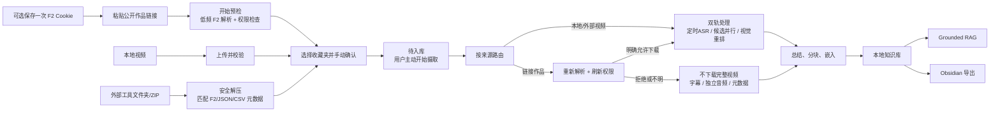

# TokBrain：抖音内容 → 本地多模态知识库 → Obsidian

> **一句话**：把你**有权处理**的抖音公开作品变成可搜索、可追溯的本地多模态知识库——链接预览/本地视频/文件夹ZIP 导入，经关键帧/OCR/ASR/AI摘要/Grounded RAG，最终导出到 Obsidian。UI、SQLite、索引、衍生知识全部留在本机。

## 项目定位

- **仓库**：github.com/fyfsxkh/TokBrain（MIT，48⭐，v1.0.0，2026-08-11 发布）
- **slogan**：Preserve knowledge, sustain wisdom forever.
- **平台**：⚠️ **Windows only**（v1.0.0）——密钥保护依赖 Windows DPAPI；localhost 单机单用户设计
- **技术栈**：FastAPI + SQLAlchemy + SQLite（后端）、Next.js 22（前端）、openai + dashscope（阿里云百炼：OCR/ASR/总结/向量/问答）、F2 0.0.1.7（--no-deps 装入 .vendor/）、FFmpeg、Python 3.12
- **一键安装**：`安装.cmd` → `setup.cmd` → `scripts/setup.ps1`（PowerShell）；日常用 安装/启动/停止/重启 四个 .cmd 入口

## 核心流程：从公开作品到本地知识

**关键设计（值得学习）：**

1. **权限感知处理**：预检先读作者下载权限——未授权**不下载媒体、不调 AI**；摄取前再刷新权限信号，权限变化则缩小处理范围
2. **受限媒体路径**：下载被拒/不明时，绝不下载完整视频或抽帧，降级为字幕 → 独立音频 → 基础元数据；临时文件处理后删除
3. **双轨多模态处理**：定时 ASR 与混合候选提取并行，再用"语音衍生的视觉需求 + OCR + 视觉描述 + 质量 + 时间线覆盖"对关键帧做**视觉重排**
4. **手动确认门禁**：预检只做预览，**不自动确认入库、不自动建 AI 任务**；确认进入 Pending 和开始摄取是两个独立用户动作——人始终在环
5. **数据卫生**：明确"作者允许下载只是技术路由信号，不是转发/商用/训练许可"

## 功能清单

| 能力 | 说明 |
|---|---|
| 链接预览 | 粘贴分享文本逐条解析，最多 10 条，手动确认后入库 |
| 本地视频导入 | 最多 10 个视频，走同一多模态处理路径 |
| 文件夹/ZIP 导入 | 最多 100 个外部工具获取的视频，识别 F2 SQLite/JSON/CSV/文件名元数据 |
| 高级批量 API | 同机工具 Bearer token 提交清单上传，每批最多 100 条 |
| 多模态处理 | 语音转录 + 关键帧提取 + OCR + 摘要 + 分块 + 嵌入 |
| 本地知识库 | 待入库/已索引/失败/归档四态 + 用户自建收藏夹 |
| Grounded RAG | 快速/深度双模式，答案链接回本地摘要与公开来源 |
| Obsidian 导出 | 结构化亮点 + Markdown + 本地图片导出 |
| 成本与健康 | 本地费用估算、可选官方计费、每日限额、任务状态、环境检查 |
| 个性化 | 13 套本地主题 + 背景强度调节 |

## 环境要求

| 项目 | 要求 |
|---|---|
| 操作系统 | **Windows**（DPAPI 密钥保护） |
| Python | 3.12（64 位，勾选 Add to PATH） |
| Node.js | 22+ / npm 10+ |
| FFmpeg | 完整视频处理需要，加入 PATH |
| API Key | **阿里云百炼**（OCR/ASR/总结/向量化/问答全部依赖；仅预检可暂不配置） |

## 战略分析

**1. 与本机（macOS）的关系——硬限制先行：** TokBrain v1.0.0 是 **Windows only**（DPAPI 依赖），本机 macOS 直接跑不了。要试需 Windows 机器/虚拟机。这不是"装一下就好"的事——@skhj 配置的一键安装是给 Windows 用户的。

**2. 与用户现有栈的对照：**

| 维度 | TokBrain | Hermes 现状（video-archiver + kb-archive-article） |
|---|---|---|
| 抖音摄取 | 产品化：链接/本地/批量三入口 | skill 方式：yt-dlp/douyin-scraper + ASR |
| 多模态 | 关键帧 + OCR + 视觉重排 | 无关键帧/OCR |
| 知识组织 | SQLite + 本地索引 + 收藏夹 | Obsidian 知识库（更强） |
| 问答 | Grounded RAG（百炼） | gbrain（pgvector + DeepSeek） |
| 导出 | Obsidian | 原生在 Obsidian |
| 平台 | Windows only | macOS 原生 |

**结论：能力重叠（抖音→转录→知识）但 TokBrain 的多模态深度（关键帧/OCR/视觉重排）是 Hermes 侧没有的；知识组织侧 Hermes+Obsidian 更强。**

**3. 值得借鉴的三个架构模式（与知识库最近的归档呼应）：**
- **权限感知 + 受限降级路径**：先检查再处理、被拒时优雅降级——负责任内容处理设计，与 AgentDesk"写入门禁"、Buzz"独立验收"同哲学
- **手动确认门禁**：预检≠入库、摄取是独立动作——人留在环，与轻量化业务应用"该人确认的节点就停下来"完全一致
- **双轨并行 + 视觉重排**：ASR 与视觉候选并行，用语音需求重排关键帧——多模态融合的实用工程，可借鉴到 video-archiver 升级（关键帧 + OCR 摘要）

**4. 落地建议：**
- 本机无法直接跑（Windows only + 百炼 Key 依赖）——如确有抖音知识库需求，考虑：①Windows 虚拟机试装；②或把 TokBrain 的关键帧/OCR/视觉重排模式移植为 Hermes video-archiver 的增强（macOS 可跑，符合"宁建新不改旧"）
- 若只是研究：读它的 app/services/content_pipeline.py（双轨管道）和 keyframes.py（视觉重排）是最高价值的两处

## 相关资源

- 仓库：https://github.com/fyfsxkh/TokBrain
- 中文 README：README.md（含完整安装说明）
- 一键安装：安装.cmd（Windows）
- 本地 clone：~/projects/TokBrain（研究用）

## 关联阅读

- [[2026-08-18-轻量化业务应用-四步渐进式验证框架]] — "手动确认门禁"与"该人确认的节点停下来"同构
- [[2026-08-18-AgentDesk-任务卡驱动多Agent开发工作流]] — 权限/门禁设计哲学
- 用户既有 video-archiver skill（B站/抖音 ASR 转录）——能力重叠与互补

## 归档日志

- 2026-08-18 归档（用户转发 @skhj 推荐："上 github 搜索 tokbrain，拉下来就好，一键自动安装"——已确认 Windows-only 限制）
