# Yao Meta Skill：Skill 的工厂与操作系统

> **一句话**：一个"元技能"（meta-skill）——把粗糙的工作流、提示词、SOP、脚本变成**可复用、可评估、可治理、可跨平台移植**的 Agent Skill。YAO = Yielding AI Outcomes：目标不是生成更多提示词文本，而是产出可复用的 AI 资产和真实运营结果。

## 项目定位

- **仓库**：github.com/yaojingang/yao-meta-skill（MIT，多语言文档 EN/中/日/法/俄）
- **规模**：19MB——174 个脚本、41 篇方法文档（references/）、87 个测试、147 份报告、完整 evals 体系
- **两代演进**：
  - **1.0**：把重复工作流变成可安装、可读、跨平台的 skill 包
  - **2.0（Skill OS）**：建模一次 → 编译多目标 → 测试行为 → 审查发布证据 → 追踪迭代——skill 的完整生命周期治理

## 架构拆解：Skill OS 2.0

```mermaid
flowchart LR
    A["输入<br/>workflow / prompt / transcript / docs / notes"] --> B["意图模型<br/>job / outputs / exclusions / standards"]
    B --> C["Skill IR<br/>trigger / contracts / resources / evidence"]
    C --> D["目标编译器<br/>OpenAI / Claude / generic / VS Code"]
    D --> E["Output Eval Lab<br/>trigger checks / assertions / blind review"]
    E --> F["Review Studio 2.0<br/>HTML 门禁页"]
    F --> G["证据与发布治理<br/>verify / simulate / probe / claim guard"]
    G --> H["SkillOps 循环<br/>telemetry / drift / curator reports"]
```

### 核心机制

1. **Skill IR（平台中立能力契约）**：skill 的中间表示，必填字段——`job_to_be_done`（任务）、`trigger_surface`（should_trigger / should_not_trigger / edge_cases）、`workflow`（steps / decision_points / failure_modes）、`resources`、`eval_plan`、`risk`、`governance`。建模一次，编译到任意平台
2. **目标编译器与适配器**：一个 skill 编译出 OpenAI / Claude / generic / Agent Skills / VS Code 多种形态
3. **Output Eval Lab**：触发检查、输出断言、执行/耗时/token 证据、基准可复现清单、盲审包 + 独立答案密钥 + 裁决报告
4. **Review Studio 2.0**：单个 HTML 门禁页聚合——意图、触发、输出评估、上下文成本、运行时检查、信任、Skill Atlas 信号、采纳漂移、豁免、注解、发布证据、警告、阻塞项、修复动作
5. **证据与发布治理**：包验证、安装模拟、运行时权限探测、证据一致性门禁、世界级证据台账（区分"已完成"与"待外部/人工证据"）、**公开声明守卫**（证据未齐时阻止过早宣称 completed/true）
6. **SkillOps 循环**：元数据级采纳漂移检测、遥测钩子（本地优先，不存原始内容）、自适应提案（审批门控）、每日/每周策展报告、组合级漂移信号
7. **失败与反模式库（failures/）**：4 个反模式家族——`one-off-vs-reusable`（一次性 vs 可复用）、`explain-not-package`（只解释不打包）、`document-export-vs-agent-skill`（文档导出 vs Agent Skill）、`future-outline-vs-build`（未来大纲 vs 实际构建）；每个带 `cases.json` 可跑自动化回归——反模式不止是散文，是回归测试
8. **注册表与信任**：registry audit（版本/所有者/许可/校验和/兼容矩阵）、trust check（脚本/依赖/网络/权限策略）、安全报告
9. **渐进门禁**：按模式（Scaffold 探索 / Production 团队 / Library 共享 / Governed 发布关键）选择最轻的门禁集，不默认全开

## 技术栈

| 类别 | 内容 |
|---|---|
| 语言 | Python（174 个脚本，含 yao.py CLI 主入口） |
| 测试 | 87 个测试 + `make ci-test` 全量验证 + 专门 verify 脚本（CLI/UX/overview/review studio/trust/package/registry/trigger holdout/provider matrix） |
| 评估 | evals/ 完整体系：train/dev/holdout 划分、盲测保留集、对抗用例、混淆路由、语义配置 |
| CI | GitHub Actions（test.yml 徽章） |
| 打包 | cross_packager.py 多平台编译 + simulate_install.py 安装模拟 + verify_package.py |
| 发布 | 不可变 release 包 + evidence-publication 协议 + 恢复机制 |

## 同类项目对比

| 维度 | Yao Meta Skill | AgentDesk | kb-archive-article (Hermes) | SkillCorpus |
|---|---|---|---|---|
| 定位 | Skill 的工程/治理/可移植系统 | 多 Agent 项目治理 Skill | 单领域归档 Skill | Skill 筛选框架 |
| 核心资产 | Skill IR 契约 + 评估体系 | 任务卡 + Git 证据 | 提取/清洗/索引流程 | 82万 Skill 打分流水线 |
| 评估 | Output Eval Lab + 盲审 + 基准复现 | unittest + 门禁检查 | 计数验证 + gbrain 校验 | AI 三围打分 + 安全硬线 |
| 多平台 | ✅ 编译到 5+ 目标 | ❌ Codex 专属 | ❌ Hermes 专属 | - |
| 治理 | 证据台账 + 声明守卫 + 注册表 | 版本锁 + 写入门禁 | skill patch 维护 | - |
| 失败库 | ✅ 4 家族 + 自动化回归 | 无 | 有 pitfalls 章节 | - |
| 重量级 | ⚠️ 极重（174 脚本） | 重（8 脚本） | 轻 | - |

## 当前状态

- **beta 待外部测试**：仓库明确区分"当前可验证的"与"待收集证据的"——provider 生产证据、人工盲审证据、原生权限执行、真实客户端遥测都被列为独立证据任务，**不把计划中的工作当已完成**
- 版本：VERSION 文件 + 迁移文档（1.2.0 / v2）
- 更新机制：`yao.py check-update` / `self-update` 自更新

## 架构价值评估

**优势：**
1. **"skill 当软件工程做"的极致形态**——比 AgentDesk 更彻底：Skill IR 中间表示、多目标编译、输出断言、盲审、注册表、信任检查、遥测、策展循环。这是目前见过最完整的 skill 生命周期治理系统
2. **反模式即回归测试**：failures/ 库把"skill 为什么会失败"变成可自动化的 cases.json——对 skill 作者培训、回归设计、触发边界调优三用
3. **证据纪律极强**："never fabricate evidence"、missing evidence 显式标注、公开声明守卫——防止自欺欺人，与 AgentDesk"报告≠回调"、J-Space"强制验证"哲学一脉相承
4. **渐进门禁**：不默认全开，按风险选最轻门禁——反"过度工程化"
5. **本地优先遥测**：元数据级（命令名+结果，不存参数/原始内容），隐私设计

**可借鉴（对 Hermes 生态）：**
- **Skill IR 四件套可当任何 Skill 的体检清单**：job_to_be_done + trigger_surface（should/should-not/edge cases）+ workflow（steps/decision_points/failure_modes）+ risk/governance——尤其 trigger_surface 的 should_not_trigger 和 edge_cases，是绝大多数 skill 缺失的
- **失败库模式**：kb-archive-article 的 pitfalls 章节可以升级为结构化 cases.json + 回归测试
- **证据纪律**：不虚构证据、区分"已完成/待收集"——对 gbrain/归档流程的可信度同样适用
- **SkillOps 循环**：采纳漂移 + 策展报告 = 定期 skill 健康检查的自动化版本

**注意/局限：**
- 极重：174 脚本 + 87 测试 + 147 报告，个人单 skill 场景过重（作者自己也说按模式选最轻门禁）
- 中文生态为主、社区规模未知；beta 阶段部分"世界级"声明仍证据门控
- 与 Hermes skill 体系不直接兼容——理念借鉴 > 直接安装使用

## 相关资源

- 仓库：https://github.com/yaojingang/yao-meta-skill
- 中文文档：docs/README.zh-CN.md
- 快速安装：`npx -y skills add yaojingang/yao-meta-skill -a '*' -g -y`
- 本地 clone：~/projects/yao-meta-skill（探索用）
- VERSION 1.2.0 / 2.0（Skill OS）

## 关联阅读

- [[2026-06-20-yao-meta-skill——元Skill创建框架-从Prompt工程到Skill工程]] — 同项目 1.0 时代的旧归档，本文为其 2.0（Skill OS）升级版：从"创建框架"演进到"全生命周期治理"
- [[2026-08-18-AgentDesk-任务卡驱动多Agent开发工作流]] — 同为"skill 工程化"，AgentDesk 管多 Agent 治理，Yao 管 skill 本身生命周期
- [[2026-07-24-SkillCorpus-智能体开源Skill筛选框架]] — 82万 skill 的筛选评估，与 Yao 的 eval 体系互补
- [[2026-08-18-轻量化业务应用-四步渐进式验证框架]] — 四步验证与 Yao 的渐进门禁同构
- [[2026-07-15-拆完WorkBuddy-我看到了生产级Agent的完整形态-叶小钗]] — 生产级 Agent 治理脉络

## 归档日志

- 2026-08-18 归档（用户口述 "yao-mate-skill" → 实际为 yao-meta-skill，GitHub API 确认无 mate 同名仓库；clone 于 ~/projects/yao-meta-skill）
