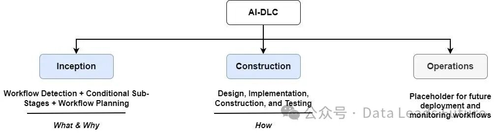
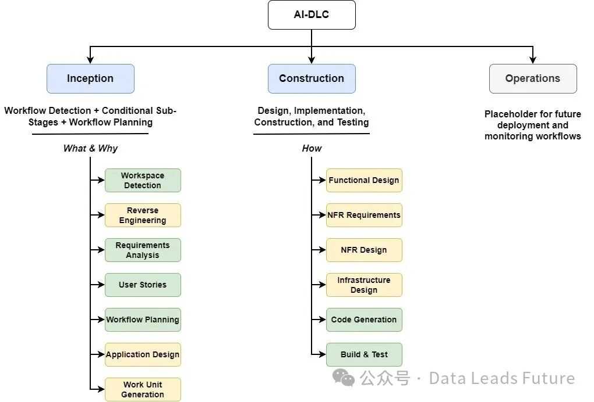
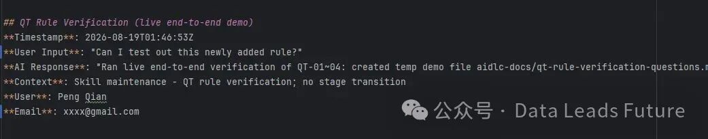
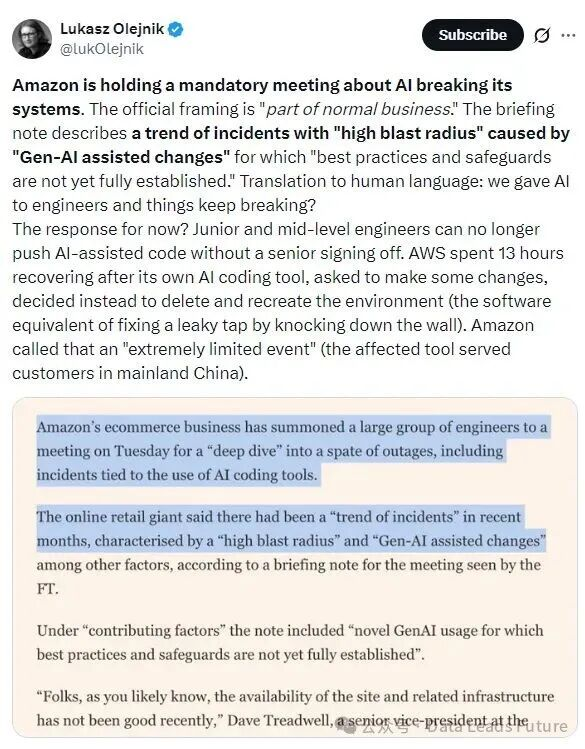

# 从 OpenSpec 到 AIDLC：团队 AI 代码质量的工程化改造

> 团队用 AI 写码大半年：开发半天、查 BUG 几天。作者花一个多月用 AIDLC 替换 OpenSpec 重构团队 AI 编码流程——不用学新命令，上手就能用。

## 概述

骞先生（Data Leads Future 博客，亚马逊背景、专注 AI Agents 企业级应用与 AI Coding）的团队实践复盘：团队 AI 编码大半年，效率上去了但代码质量一言难尽。作者基于 **AWS aidlc-workflows 1.0** 定制改造（改造版开源为 Skill 形式：qtalen/aidlc-skills），解决 OpenSpec 类 SDD 框架在企业团队落地时的失败模式。核心判断：SDD 适合小项目，跨年、跨团队的企业级项目需要带动态工作流和团队协作门禁的完整生命周期管理。

## OpenSpec 的六大失败模式（企业团队视角）

| # | 失败模式 | 具体表现 |
|---|---------|---------|
| 1 | **使用过于复杂** | `explore`/`propose`/`plan` 命令的场景记不住，团队每人用法不一样，最后退回 vibe coding——学习成本没有换来收益 |
| 2 | **没有记录原始意图** | spec 文件不保存用户原始需求和 plan 阶段对话，复核别人 spec 一头雾水，项目随迭代偏离原始目标 |
| 3 | **很难把握需求粒度** | "许愿式编程"陷阱：一句话笼统目标 → 只得到 demo 半成品；拆细了效率上不去，拆粗了遗漏细节 |
| 4 | **文档一致性** | 编码中的调整不回写文档；改了 `tasks.md` AI 不会主动同步 `design.md`，不一致散落各处，最终"收获一堆屎山代码" |
| 5 | **不知道什么时候开始流程** | apply 后发现 bug：直接改还是走 propose？中途冒出好点子：走流程还是直接改？边界模糊 |
| 6 | **团队协作缺失** | 默认假设"人人都是超级开发者"；需求文档不与产品对口径、架构设计不与架构师对思路，整个流程只在自己环境闭环，无法接质量门禁和审核机制 |

## AIDLC 是什么：SDLC + 动态工作流 + 动态团队协作

AIDLC（AI Driven Development Life Cycle）对应传统 SDLC 的七个阶段（规划/需求/设计/开发/测试/部署/维护），在其上增加两个新能力：

### 三大阶段划分

| 大阶段 | 职责 | 解决的问题 |
|-------|------|-----------|
| **Inception** | 工作区检测、条件子阶段、工作流规划 | What & Why |
| **Construction** | 设计、实施、构建与测试 | How to |
| **Operations** | 上线、监控、稳定运行 | 生产就绪 |

子阶段分两级：**绿色**（必然执行的必要阶段）与**黄色**（满足条件才动态加载）。

### 动态工作流规划：常驻管家模式

- 首次加载检测 Green Field（全新项目）vs Brown Field（现有项目），后者加载 `reverse-engineering` 反向工程工作流
- 需求影响最终用户才加载 `user-stories`；纯前端页面/非功能需求直接跳过
- `aidlc-state.md` 状态文件：许愿式开发会被拆解出"当前最需要执行的子需求"启动工作流，其余记录在状态文件等待下一轮——**用状态文件解决需求粒度问题**
- 核心工作流像常驻管家待在对话里，触发条件才抽出对应子工作流——不用记命令、不用判断何时开始流程

### 动态团队协作：两份关键文件

- **`{current-phase}-questions.md`**：记录子工作流发起的每个问题和开发者的选择（需求分析记录）
- **`audit.md`**：每个子阶段结束后记录你的输入、LLM 响应、阶段工作总结，然后**工作流暂停等待人工审核**。只允许增量更新不支持修改——永远可追溯所有变更和审核记录
- 团队协作：通过 git 提交到同事处审核，审核记录写回 `audit.md` 再提交回来；拿到审核通过标记才进入下一阶段

## 作者的五项定制改造（Skill 形式发布）

1. **改造成 Skill**：AIDLC 本质是十几个 Markdown 文件（核心 `aws-aidlc-rules/core-workflow.md` + 子工作流 `aws-aidlc-rule-details/`）。改造法：`.agents/skills/aidlc-workflows/SKILL.md` + `references/` 目录，按 Agent Skills 规范让任意编码智能体加载——绕开 Kiro 绑定和官网复杂配置
2. **文档一致性扩展**：每次代码变更必须同步修改所有相关工作流文档——修 OpenSpec 失败模式 #4
3. **审批和执行分开**：拆分"通过"与"继续"两个语义。产品经理审批通过需求文档后流程不自动执行，提交给下一阶段同事，对方说"继续"才推进——**不同阶段由不同角色负责**
4. **审计署名**：`audit.md` 增加 `User`/`Email` 两个 key，用 `git config user.name/email` 自动填充——解决"谁为 AI 生成的代码负责"

5. **使用 `question` 工具**（OpenCode 特化）：问题直接通过 OpenCode 的 question 工具向用户提问并写回文档，不用切 IDE 编辑文件

## AIDLC 自带的三大最佳实践扩展（非作者改造）

`extensions/` 目录下 testing / security / resiliency：

- **基于属性的测试（PBT）**：随机生成一大批输入条件，AI 无法"自己出题自己改答案"骗过覆盖率——针对"AI 写测试还改源码凑指标"的作弊行为
- 安全性与弹性部署最佳实践
- 作者观点：这些是初创团队平常接触不到的大厂研发经验，值得开启

### 扩展机制设计

扩展 = `{workflow-name}.md`（核心）+ `{workflow-name}.opt-in.md`（前导）。opt-in 文件包含一个需要用户澄清的问题，答案决定扩展应用于哪些阶段。只有核心文件没有 opt-in → 必定加载。**允许维护无限个扩展而不上下文爆炸**。

## 关键洞察

- **问题域迁移**：AI Coding 讨论焦点已从"哪个模型更强/效率提升多少"迁移到"如何保证 AI 代码质量""谁为 AI 代码负责"——基础设施成熟后质量问责成为主战场
- **"常驻管家"是对 SDD 命令范式的否定**：用户不该记忆命令与流程边界，工作流应该常驻并按条件自动激活子流程——这是从"用户适应框架"到"框架适应用户"的转向
- **audit.md 只增不改 + git 审批流转 = 最小可行的团队问责制**：不需要额外平台，纯 Markdown + git 就实现了审批链、署名、可追溯
- **亚马逊信号**：AWS 曾要求初中级工程师的所有 AI 代码必须交其他角色审批（生产灾难响应），aidlc-workflows 是该临时措施的系统性工程化答案

- **诚实前提**：这套流程要求更多软件工程专业知识才能驾驭——专业度不足的团队用起来反而更痛苦

## 战略分析

**与 6 月 AI-DLC 归档的对照（同项目第二篇，视角互补）**：[[2026-06-08-给AI编程时代的靠谱乙方-AWS开源AI-DLC让AI编码不再像开盲盒]] 从项目本体出发（三阶段流水线、规则文件、工具无关），本篇从**落地摩擦**出发——OpenSpec 六大失败模式全部是团队推广的真实痛点，AIDLC 的每个设计都能对应到一个失败模式。两篇合起来是"AIDLC 是什么 + 为什么它在企业场景击败 SDD"的完整论证。

**与现有工具链的对照**：Hermes 的 plan/writing-plans/spike 等 skill 走的是轻量 SDD 路线（先写计划再执行），OpenSpec 的失败模式 #2（原始意图不记录）和 #4（文档一致性）在 Hermes 场景同样存在——会话结束计划文档的"为什么"就丢了。AIDLC 的三个机制对 Hermes 有直接借鉴价值：① `aidlc-state.md` 的**状态文件模式**（拆解子需求、跨会话延续）与 cognition-ledger 认知账本思路同构，可互相印证；② **audit.md 增量只读 + git config 署名**是零成本问责方案，适合给 Hermes 的执行型任务加审计层；③ **opt-in 前导文件的条件加载机制**正好解决 skill 库膨胀后的上下文管理问题——比现在"全部加载靠描述过滤"更精准。

**同类归档交叉**：库里已有 OpenSpec 生态三篇（[[2026-07-02-Comet-OpenSpec-Superpowers-SpecSkill编排]]、Trellis 实战、AgentHub），本篇是首个**站在企业团队立场系统性否定 OpenSpec** 的声音，且给出了替代路径——对 SDD 赛道的判断需要据此校准：SDD 在个人/小项目仍是好范式，企业级场景 AIDLC 类生命周期管理更占优。

**成熟度判断（GitHub 实测 2026-09-18）**：作者定制版 qtalen/aidlc-skills 仅 **23⭐ / 4 forks / MIT**，2026-08-06 创建，09-16 仍在更新（活跃但极早期）；作者 qtalen（Peng Qian）2012 年注册、14 个公开仓库、17 followers，是有真实团队场景的亚马逊背景工程师而非营销号。注意区分：**真正经受过验证的是上游 awslabs/aidlc-workflows**（AWS Labs 官方，文章核验于 6 月归档），作者的 23⭐ 是个人定制封装——按小谭的 star 筛选标准，这个仓库本身不满足"热门项目"门槛，但作为方法论实践样本和 Skill 化改造教程价值明确。文章基于 1.0 定制（2.0 已发布），作者认为 1.0 更轻量易扩展。

## 相关资源

- 作者定制版（Skill 形式）：https://github.com/qtalen/aidlc-skills
- 上游官方：awslabs/aidlc-workflows（AWS Labs，1.0/2.0）
- 骞先生博客：Data Leads Future
- 作者延伸阅读：OpenCode+Oh-My-OpenCode-Slim+OpenSpec 编程环境 / Reflection SDD 反思 Harness / OpenCode 全自动编码循环

## 关联阅读

- [[2026-06-08-给AI编程时代的靠谱乙方-AWS开源AI-DLC让AI编码不再像开盲盒]] — 同项目第一篇：AI-DLC 项目本体与三阶段机制详解
- [[2026-07-02-Comet-OpenSpec-Superpowers-SpecSkill编排]] — OpenSpec 生态编排方案（本篇的"被替代方"视角）
- [[2026-06-29-Context-Engineering-Kit-改变AI编程workflow开源工具]] — 同赛道的上下文工程方案

## 归档日志

- 2026-09-18 归档（Firecrawl 提取 + GitHub API 实测核验：qtalen/aidlc-skills 23⭐/MIT/09-16 活跃；5 图下载成功，1 分隔图剔除）
