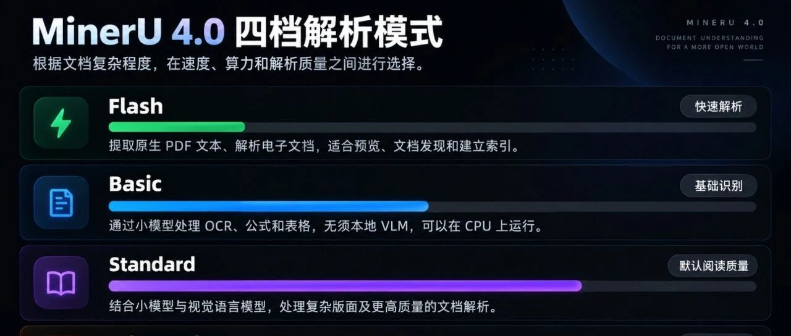
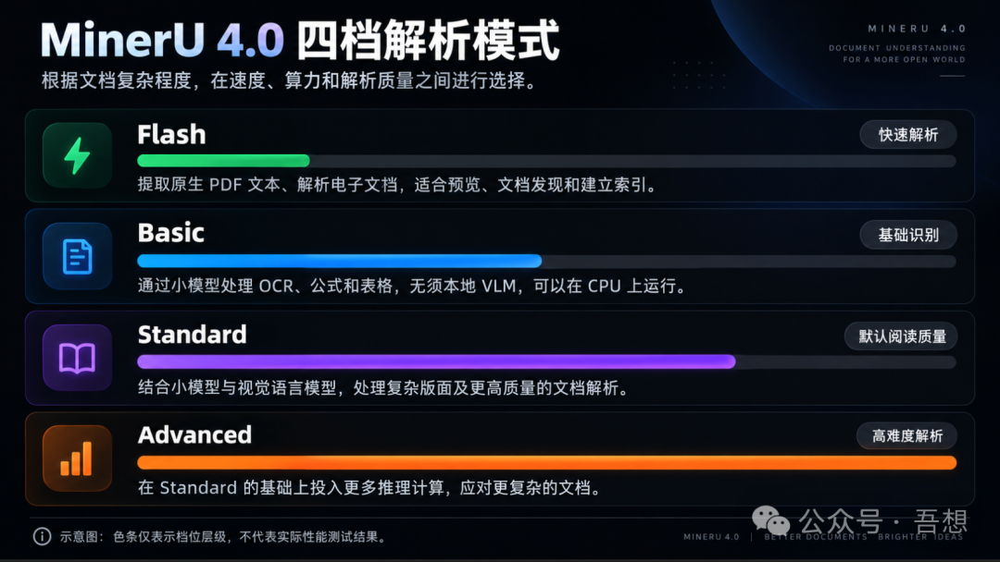
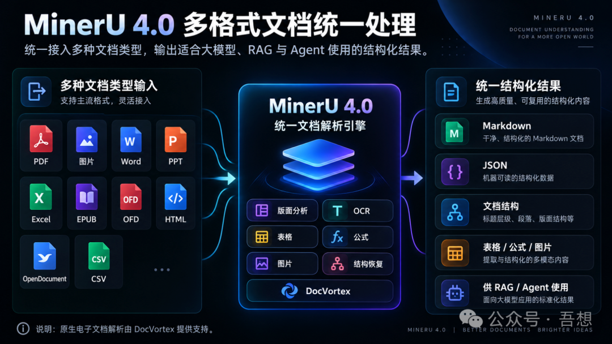

# MinerU 4.0 发布：从 PDF 解析工具到 AI Agent 的文档阅读基础设施

> 从 PDF 解析工具，到 AI Agent 的文档阅读基础设施。



## 概述

GitHub **80,145 ⭐**（2026-09-18 实测核验，opendatalab/MinerU，6689 forks）的文档解析开源项目 MinerU 于 2026 年 9 月 16 日发布 4.0 大版本。与以往围绕解析精度和模型能力的升级不同，这次重构了整个产品形态：四档解析质量、原生多格式支持、本地文档库，以及专门面向 AI Agent 的渐进式阅读能力。核心命题从"能不能解析"转向"当 Agent 需要读成百上千份文档时，如何准确找到信息、按需阅读、并追溯答案来源"。

## 背景：文档解析为什么难

做过 RAG 知识库的人都遇到过：双栏论文被识别成一整行、表格数字与表头对不上、扫描版 PDF 提取不出文字。开发者被迫花大量时间在文档清洗、OCR、版面分析和数据转换上，真正做 AI 功能的时间反而被压缩。文档解析是 AI 应用中看似不起眼却关键的环节——**模型决定 AI 能思考到什么程度，文档处理质量决定它拿到什么信息**。

## 核心亮点

### 1. 四档解析质量：按需分配计算资源

| 档位思路 | 适用场景 |
|---------|---------|
| Flash（低档） | 有原生文本层的电子 PDF/图片，快速提取 |
| 更高档位（OCR/VLM） | 公式、复杂表格、低质量扫描件 |

- 十万份企业历史文档建索引：先用 Flash 快跑有文本层的，需要时再上高档位——**"值得花多少计算资源解析"取代"能不能解析"**
- 注意：四档主要面向 PDF 和图片；Office 等原生电子文档走 Flash 解析（由 DocVortex 支持），不能随意切换四档



### 2. 原生多格式统一流水线

支持 PDF、图片、Word、PowerPoint、Excel、EPUB、OFD、HTML、OpenDocument、CSV。原生电子文档解析由 DocVortex 提供支持，**不再需要先统一转成 PDF**。企业知识库/合同审核/技术资料检索场景中，MinerU 成为统一文档处理入口，开发者可以把精力放回业务逻辑和检索策略。



### 3. Agent 文档库（本次最值得关注）

面向 Agent 的本地文档库：文件发现、搜索、缓存、按页阅读、按块阅读、稳定定位。三个关键设计：

**① 渐进式阅读——不再一次性读整本 PDF**
- `mineru parse` 默认只读前 10 页，返回"继续阅读请求"
- Agent 按需翻页，像人读技术手册：先看目录和 relevant 章节，再翻具体内容
- 一次性转换工具 `mineru-kit parse` 仍默认处理全部页面

**② 稳定定位符——答案可追溯到页和块**

```
doc:ab12cd3/tier:standard/page:12/block:5
```

Agent 先搜索关键内容 → 回到对应位置取完整上下文 → 必要时导出页面/内容块图片检查。企业用户不满足于"看似正确"，还要知道结论来自哪份文档哪一页。

**③ 解析结果缓存复用**
- 同一文件不重复解析，本地文档库提供搜索/读取/缓存更新命令
- MinerU 从单次执行的转换程序，变成持续管理文档解析结果的基础组件

官方明确边界：MinerU **不是**完整的 RAG 框架、向量数据库或问答应用——检索策略、推理流程、业务应用仍需开发者构建。

### 4. 平台化：统一入口 + 独立解析服务

- 统一 Python SDK、批量转换、HTTP API、WebUI，统一结构化结果模型
- HTTP 服务升级 V1 接口（健康检查/档位查询/上传/任务/文件管理）；旧版 `/file_parse`、`/tasks` 接口**已移除**（破坏性升级）
- 小模型（ONNX/Torch）与 VLM（llama.cpp/vLLM/LMDeploy）配置分离，适合 GPU 服务器内网部署

## 快速上手

```bash
pip install uv
uv venv .mineru --python 3.12   # 要求 3.10 ≤ Python < 3.15
source .mineru/bin/activate
uv pip install -U "mineru>=4.0,<5"

# 一次性转换
mineru-kit parse document.pdf -o document.md --tier standard

# WebUI
mineru-kit webui

# Agent 模式（结构化响应：解析内容+定位信息+继续阅读请求）
mineru parse document.pdf --json
```

官方还提供了 **MinerU Skill**，可安装到兼容的 Agent 环境，让 Agent 遇到 PDF/图片/Office 文档时自动调用 MinerU。

## 关键洞察

- **行业趋势**：模型能力越强，应用效果越依赖模型之外的基础设施。长上下文 ≠ 把所有资料塞进去就是最好方案；企业应用需要完整信息处理链路（解析→可检索结构→按需阅读→带出处的答案）
- **渐进式阅读是 Agent 工程的正确方向**：默认只读前 10 页 + 继续阅读请求，本质是把人类的阅读策略（目录→章节→按需翻阅）工程化为 Agent 协议
- **定位符是引用溯源的结构化方案**：`doc/tier/page/block` 四级定位让"答案来自哪里"从模糊的引用变成可机器回访的坐标
- **诚实的边界声明**：官方自己说不是 RAG 框架/向量库/问答应用；复杂表格、低质量扫描件、公式仍需针对实际数据做准确率测试
- **升级有代价**：4.0 是破坏性升级，旧命令/配置/接口变化；AMD 和部分厂商加速卡适配停留在 4.0 之前版本；默认本地解析，远程选项需显式启用

## 战略分析

**与现有工具链的对照**：Hermes 当前的 PDF 处理依赖 ocr-and-documents skill（pymupdf/marker-pdf 路线），属于"一次性转换"范式。MinerU 4.0 的 Agent 文档库代表另一种范式——文档不是转完就扔的一次性 Markdown，而是可持续访问、可定位、可缓存的信息资源。这与小谭知识栈的演化路径同构：Obsidian + gbrain 也是把"归档"变成"可检索、可回访的资产"。定位符设计（doc/tier/page/block）对 Hermes 的文档类任务有直接借鉴价值——归档文章引用原文时目前只有 URL 级粒度。

**与已归档文章的交叉对比**（本次升级改变了旧结论）：

| 已归档文章 | 当时观点 | MinerU 4.0 后 |
|-----------|---------|--------------|
| [[2026-06-17-一个月拿下1500star-MetaStructure]] | "MinerU 只把 PDF 变成 Markdown"，Knowhere 补解析后接入 RAG/Agent 的链路 | 4.0 的文档库+渐进式阅读+定位符正是在补这一环，Knowhere 的差异化窗口收窄 |
| [[2026-07-15-Docling-63KStar-企业文档进AI的开源管道]] | Docling 63K⭐ 是 IBM 系企业文档入口 | MinerU 80K⭐ + Agent 阅读能力，两者正面竞争加剧；MinerU 在 Agent 侧更激进 |
| [[2026-06-14-MinerU-Web-PDF-Markdown-查错与溯源工作台]] | MinerU 生态的校验/溯源工作台 | 4.0 内置定位符后，第三方溯源工具的价值部分被吸收 |

**差距与借鉴点**：① 四档解析质量的成本分层思路，值得移植进 Hermes 的文档处理 skill（电子 PDF 不必上重型管线）；② 官方 MinerU Skill 面向 Agent 环境发布，可直接评估装入 Hermes skill 库，替换/增强现有 PDF 解析路径；③ `mineru parse --json` 的结构化响应（内容+定位+继续阅读请求）是标准的 Agent 工具接口设计，未来写 Hermes skill 时可参考这个模式。

**成熟度判断**：文章发布于 4.0 发布次日（09-16 发布、09-17 发文），属时效性新闻稿，实测细节有限（作者自己注明命令来自官方 Quick Start 非实测）。实测核验：80,145 ⭐（09-18），4.0 发布后 24 小时内连发 4.0.1/4.0.2 补丁，维护响应极快。4.0 破坏性升级意味着社区生态（教程、集成、第三方工具）需要时间跟上——生产系统不应假设向后兼容。方向判断：从"解析工具"向"Agent 文档基础设施"演进是确定性趋势，MinerU 是目前该赛道热度最高的玩家。

## 相关资源

- 项目地址：https://github.com/opendatalab/MinerU
- 版本：MinerU 4.0（2026-09-16 发布，09-17 已快速迭代至 4.0.2）
- Python 要求：3.10 ≤ 版本 < 3.15
- License：**MinerU Open Source License（Apache 2.0 + 附加条款，非 OSI 标准开源）**——MAU 超 1 亿或月收入超 2000 万美元需另行商业授权；基于 MinerU 提供在线服务必须在界面/文档中显著标注；违反条款授权自动终止。个人与绝大多数企业使用不受影响
- 仓库活跃度：2024-02 创建，Python 主语言，最近 push 2026-09-17（4.0 发布次日连发 4.0.1/4.0.2 补丁）

## 归档日志

- 2026-09-18 归档（Firecrawl 提取，3 图下载成功 1 图防盗链失败；GitHub API 实测核验补录：80,145⭐/6,689 forks/Apache2.0+附加条款/4.0.2 补丁节奏）
