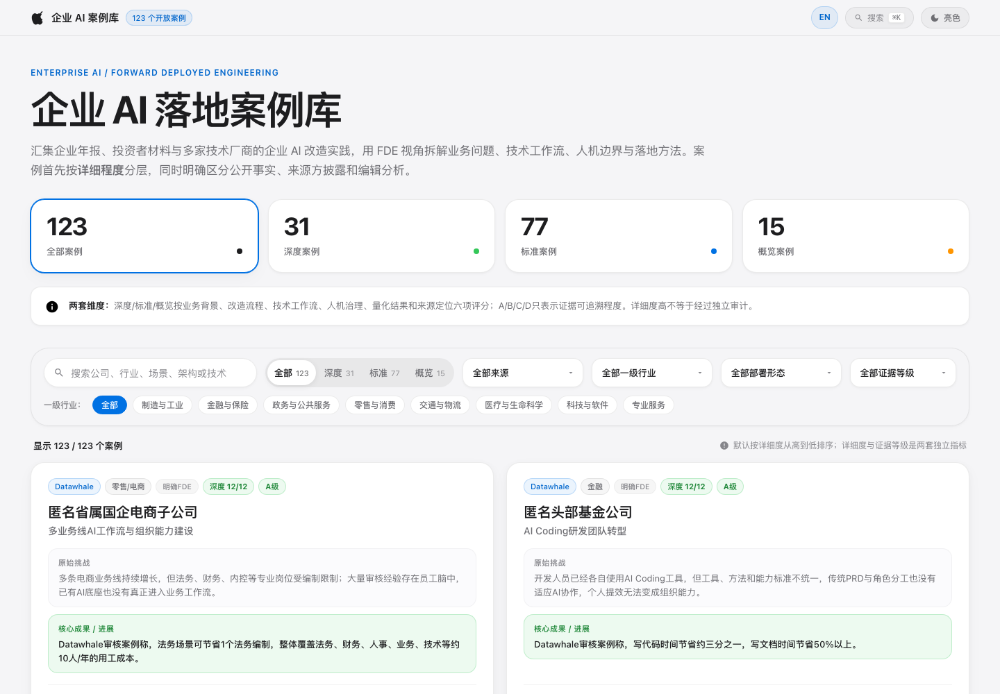

# FDE案例库：127条企业AI落地案例的可检索证据库

> 来源：guminghao-avi｜GitHub 2026-09-19 首次公开（v0.2.0）
> 仓库：[guminghao-avi/FDE-case-library](https://github.com/guminghao-avi/FDE-case-library)
> 在线页：GitHub Pages（`index.html` 中文 / `index.en.html` 英文，中英双语可切换）
> 归档方式：GitHub REST API + raw 文件读取，全量 `cases.json`（532KB / 127条）逐字段分析，未 clone



## 一、项目定位

一句话定位：**一个面向公开学习和检索的企业 AI 部署案例库——不只收集"用了什么模型"，而是尽量还原完整交付链路：业务问题 → 现场发现与方案设计 → 技术工作流 → 人机责任边界 → 上线与采用 → 业务结果 → 可复用经验。**

与常见"客户故事合集"的本质区别：每条案例都带**来源账本、证据等级、字段边界标注和核验笔记**，明确区分"公开事实 / 来源方披露 / 编辑分析"三类内容。它自称方法论核心是"证据边界"（evidence boundary）——效果数字绝大多数是项目参与方自报，未独立审计。

## 二、规模与构成（截至 2026-09-23，commit 8d64b）

| 维度 | 数据 |
|------|------|
| 案例总数 | **127 条**（README 与数据一致） |
| ⭐ / Fork | 15 ⭐ / 1 fork（2026-09-19 创建，4 天新仓） |
| License | MIT（原创代码+结构化数据+编辑内容；第三方来源材料权利保留） |
| 主语言 | HTML（静态站）+ Node.js 校验脚本 |
| 深度/标准/概览 | 35 / 77 / 15 |
| 技术方案参考（⚙） | 18 条（技术工作流满分且技术组件有案例级公开材料支撑） |
| 证据等级 | A级 104 / B级 23（无 C/D 级） |
| 独立核验 | **0 条**（AUDIT.md 明确记录） |

### 来源构成（7 类）

| 来源 | 条数 | 性质 |
|------|------|------|
| Palantir 客户部署 | 45 | 典型 Forward Deployed 模式 |
| OpenAI 客户部署 | 34 | Codex/ChatGPT 企业采用 |
| Datawhale《FDE案例100》官方 PDF | 24 | 全部匿名脱敏案例（德国零部件/央国企/律师团队等），主链接直跳 PDF 物理页码（printed_page 与 pdf_page 差1） |
| 企业原始材料（工程博客/内部复盘/投资者材料） | 16 | Uber/Grab/Bosch/BMW/McKinsey/Block/Telstra/DoorDash/Bayer/Nubank/Meta/Doctolib/DBS/Vodafone/Walmart/BBVA |
| IBM/Microsoft/AWS/Google Cloud 逐案例材料 | 8 | Medtronic/Syneos Health/Jabil/Altisource 等 |
| 行业组 | 11 组 | 制造与工业 24 最多，其后零售17、医疗16、金融16、科技16 |
| 署名公司 | 103 家 | Airbus、BMW、Bayer、Bosch、DBS、Klarna、Lowe's、McKinsey、Moderna、Morgan Stanley、Nubank、Palantir 客户（Tyson/PG&E/Rio Tinto/Walmart）、SAP、Telstra、Uber、Walmart… |

## 三、数据模型拆解（本项目最有含金量的部分）

每条案例 30 个字段，构成完整的"证据链 schema"：

```
身份层    id / company / industry / industry_group / scenario / source / fde / fde_relation
叙事层    problem / solution / human / result / maturity / maturity_stage / case_summary
技术层    architecture[] / components[] / fde_actions[] / reusable[]
证据层    evidence / evidence_level / evidence_label / source_record{} / additional_sources[]
          analysis_boundary{} / verification_notes[] / independently_verified
详细度    detail_score / detail_level / detail_label / detail_dimensions{} / missing_details[]
          technical_reference
```

五个值得借鉴的 schema 设计：

1. **`source_record` 来源账本**：每条案例记录 title/publisher/url/source_type/directness/claim_origin/accessed_at，Datawhale 案例还带 collection_title/case_number/printed_page/pdf_page。引用时建议带上案例 ID（如 `openai-034`）+ 数据版本 + 主来源 + "来源方称"限定语。
2. **`analysis_boundary` 字段边界**：business_problem/solution/architecture/fde_actions/result 五个字段分别标注来源是"公开披露 / 结构化整理 / 编辑推演 / 来源方披露"——把"编辑脑补"和"官方说的"在字段级分开，这是对 AI 案例报道普遍夸大问题的结构性解法。
3. **六维详细度评分（可复算）**：业务背景/改造流程/技术工作流/人机治理/量化结果/来源可定位性，各 0-2 分满分 12。10-12=深度、7-9=标准、0-6=概览。详细度是编辑指标不是成功评分，`npm run classify:detail` 可重算。
4. **`technical_reference: true` 严格子集**：只授予技术工作流满分且技术组件有案例级公开材料支撑的案例，"仅靠通用模板或编辑推演补齐的架构不标记"。
5. **证据等级 A/B/C/D 的诚实定义**：A级=案例级直接来源（可定位复核），**不等于真实性评分、不代表独立审计**。当前 127 条独立核验数为 0，AUDIT.md 明确列出缺口（11 条 Palantir 首页复用待替换、5 条 OpenAI 汇总页复用、独立证据缺失）。

## 四、18 条"技术方案参考"清单（最有实操价值的子集）

| 案例 | 公司 | 场景 |
|------|------|------|
| datawhale-023 | 匿名汽车零部件供应链企业 | 制造经营流程透明化与异常闭环 |
| datawhale-024 | 匿名食品消费品企业 | 产品研发协同与包装智能审核 |
| ibm-medtronic-001 | Medtronic | 工程图纸原材料与零件号智能提取 |
| microsoft-syneos-health-001 | Syneos Health | 临床试验选址、预测与文档工作流 |
| aws-jabil-001 | Jabil | 全球制造数据底座与智能车间助手 |
| aws-altisource-001 | Altisource | 生成式AI驱动遗留Java应用现代化 |
| enterprise-uber-genie-001 | Uber | 值班工程支持与内部知识问答 Genie |
| enterprise-grab-llm-kit-001 | Grab | 从技术支持Bot演进为企业Agent开发平台 LLM-Kit |
| enterprise-bosch-visual-inspection-001 | Bosch | 生成式合成缺陷数据与定子焊点视觉质检 |
| enterprise-bmw-factory-genius-001 | BMW Group | 生产设备维护知识助手 Factory Genius |
| enterprise-mckinsey-lilli-001 | McKinsey & Company | 企业知识与Agent平台 Lilli |
| enterprise-block-goose-g2-001 | Block | Goose通用Agent与G2持久化工作流应用 |
| enterprise-telstra-ai-001 | Telstra | 数据底座、员工知识助手与网络自愈的企业AI组合 |
| enterprise-doordash-eval-flywheel-001 | DoorDash | 客服LLM的离线仿真与评测飞轮 |
| enterprise-bayer-prince-001 | Bayer | PRINCE：临床前研究资料检索与多Agent研究助手 |
| enterprise-nubank-support-agents-001 | Nubank | 五类生产客服Agent：评测驱动的迭代与A/B上线 |
| enterprise-meta-expert-second-brain-001 | Meta | 面向特定合规领域的专家知识Agent与反馈修正闭环 |
| enterprise-doctolib-ai-factory-001 | Doctolib | 从分散AI产品到共享Data & AI平台及Agent黄金路径 |

## 五、仓库架构与工程实践

```text
数据流：data/cases.json（唯一事实源，127条）
  → scripts/build-data.mjs 校验 + 生成 cases.js（浏览器加载）
  → scripts/build-english-data.mjs 校验中英 ID/顺序一致 → cases.en.json/js
  → scripts/build-english-page.mjs 从中文页生成英文页
  → scripts/refine-english-cases.mjs 重点案例术语人工精修
  → index.html / index.en.html（静态双语站，GitHub Pages）
校验：npm test = build:data + check:html（零第三方运行时依赖，只需 Node.js）
CI：.github/workflows/validate.yml 单一流水线
```

工程亮点：数据与展示分离（JSON 唯一事实源，HTML 产物化生成）；零依赖校验（必填字段、HTTPS、证据等级合法、详细度一致性、来源账本一致、中英数量/ID/顺序 parity、来源复用检测——防止单一链接被过多案例复用）；migrate-legacy 脚本只用于首次导入且检测到 cases.json 后拒绝覆盖；npm run link:datawhale-pdf 维护 24 条 PDF 页码映射。5 个 commit 全部来自单人（guminghao-avi），v0.2.0，仍处快速演进期。

## 六、同类项目对比

| 维度 | FDE-case-library | Datawhale FDE100 | Palantir/OpenAI 官方案例页 | 咨询报告（麦肯锡等） |
|------|------------------|------------------|---------------------------|---------------------|
| 案例数 | 127 | 100 | 各自几十条 | 数百条但粒度浅 |
| 结构化 | 30字段JSON+schema | PDF 文集 | 网页 | 报告 |
| 证据分级 | A/B/C/D+独立核验标记 | 无系统分级 | 无 | 少量 |
| 人机边界 | 逐字段 analysis_boundary | 部分提及 | 少量 | 少量 |
| 技术方案可复用 | ⚙ 18条严格子集 | 无此分层 | 无 | 无 |
| 中英双语 | 全量镜像+人工精修重点 | 中文 | 英文 | 英文 |
| 数据可编程获取 | MIT JSON | PDF | 需爬取 | 付费墙 |

## 七、战略分析

### 与现有工具链的对照

| 维度 | FDE案例库 | 我的体系 |
|------|-----------|----------|
| 案例检索 | 静态页搜索+筛选 | gbrain query 语义检索 |
| 证据边界 | 字段级标注 | 无（归档文档靠行文自律） |
| 详细度评分 | 六维可复算 | 无 |
| 数据获取 | MIT cases.json 可直接下载 | — |
| 更新频率 | 活跃（4天5 commit） | — |

### 差距与借鉴点

1. **最大借鉴——`analysis_boundary` 字段级证据边界**：我在做技术文章归档时，"原文说的"和"我分析的"混在同一行文里。这个项目证明了字段级拆分的可行性：每个论断字段单独标注来源层级，机器可校验。kb-archive-article 的文档结构可以吸收这一点（在"战略分析"章节前置"证据边界"小节）。
2. **六维详细度评分可直接复用**：评估任何"实践案例"类内容（文章/视频/仓库）的质量时，这套"业务背景/改造流程/技术工作流/人机治理/量化结果/来源可定位性"框架比主观"干货多/少"判断硬得多。
3. **来源账本 + accessed_at + 失效处理原则**（来源失效保留原记录+补存档链接）：对付 link rot 的正路，值得进归档流程。
4. **诚实声明的价值**：A级≠真、独立核验0条都写在明面上。这是反"AI 落地案例"浮夸风的样板——厂商故事读起来都像成功学，这个库的结构让你能一眼看出"哪些是宣称，哪些是事实"。

### 与小谭业务方向的关联

小谭在参加 AI 业务落地方法论课程（四步渐进式验证框架），有业务画布作业。这个库是**现成的"业务画布素材库"**：127 条案例每条都有 problem（业务问题）/solution（方案）/human（人机边界）/result（结果）字段，天然对应业务画布的问题-方案-边界-结果结构；24 条 Datawhale 国内匿名案例（央国企/律师团队/车管所/外贸企业）比 Palantir 海外大厂案例更贴近国内中小企业语境，可直接当课程作业的参照系和"真实业务方向"的选题灵感库。

### 整合可能性

1. **cases.json → gbrain 知识库**：MIT 许可，532KB 结构化数据。每条深度案例可建一个 gbrain entity 页（或合并进现有主题页），让"AI 落地案例"查询走语义检索而不是翻静态页。价值密度最高的切法：先只入 35 条深度案例 + 18 条技术参考。
2. **静态站本地化**：clone 后 `python3 -m http.server` 即可离线用，无任何依赖。
3. **作为 FDE 方法论的对偶件**：与已归档的《2026-06-22-FDE-大家都在吹的FDE又是什么万能解药》形成"理论→案例"配对，后者讲 FDE 是什么，前者提供可检索的 127 个落地样本。

## 八、术语表

| 术语 | 含义 |
|------|------|
| FDE | Forward Deployed Engineer，前向部署工程师。深入客户现场做方案落地的工程角色，Palantir 起源、AI 时代复兴 |
| Forward Deployed | 前向部署模式，厂商工程师驻场与客户共建的工作方式（45 条 Palantir 案例的标签） |
| 证据等级 A/B/C/D | 来源可定位性与直接性分级。A=案例级直接来源，B=官方汇总来源。**不衡量真实性，不代表独立审计** |
| analysis_boundary | 字段级证据边界：标记每个论断字段（problem/solution/architecture/fde_actions/result）是"公开披露/结构化整理/编辑推演" |
| technical_reference | 技术方案参考标识：仅授予技术工作流满分且有案例级公开材料支撑的 18 条案例 |
| 六维详细度 | 业务背景/改造流程/技术工作流/人机治理/量化结果/来源可定位性，各 0-2 分，10-12=深度案例 |
| source_record | 来源账本：每条案例的发布方、URL、直接性、声明来源、查阅日期、页码映射 |
| 黄金路径（Golden Path） | Doctolib 案例中的概念：平台团队预置的可复用 Agent 开发模板与标准流程 |
| 评测飞轮 | DoorDash 案例的离线仿真+评测迭代机制 |
| PRINCE | Bayer 临床前研究多 Agent 助手项目（与 Thoughtworks 合著，martinfowler.com 技术复盘） |

## 九、相关文档

- [[技能文档/2026-06-22-FDE-大家都在吹的FDE又是什么万能解药]] — FDE 角色理论拆解（四真、三块能力、14岗转型方向），与本库形成理论-案例配对
- [[技能文档/2026-09-07-跨境电商AI客服Agent生产级建设实践]] — 生产级客服 Agent 实录，与 Nubank/DoorDash 客服类案例同题
- [[技能文档/2026-09-05-从OpenSpec到AIDLC团队AI代码质量实践]] — 团队 AI 工程实践，与 Uber/Grab/Block 内部平台案例同题
- [[技能文档/2026-07-27-StaffDeck-企业级AI数字员工平台-OpenBMB]] — SOP→状态机数字员工平台

---

## 归档日志

- 归档日期：2026-09-23 12:36
- 归档方式：GitHub REST API（repo meta / contents / commits）+ raw.githubusercontent 全量读取 cases.json（532KB/127条）、METHODOLOGY.md、AUDIT.md、package.json
- 数据核验：README 声称 127 条 = cases.json 实际 127 条 = AUDIT.md 记录 127 条，三方一致；18 条技术参考、35 深度/77 标准/15 概览、104A/23B 均与 JSON 实测一致
- 图片：docs/images/home-zh.png（1440×1000）→ assets/2026-09-23-FDE案例库/img_001.png
- 备注：仓库 2026-09-19 创建，15⭐ 单人维护 4 天 5 commit，v0.2.0 快速演进期，数据以线上为准
