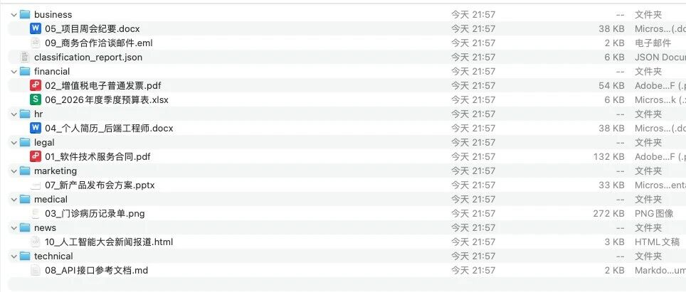
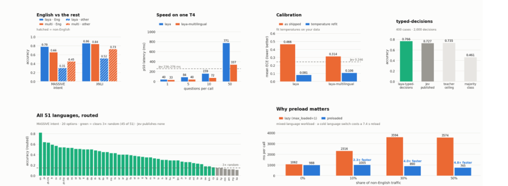
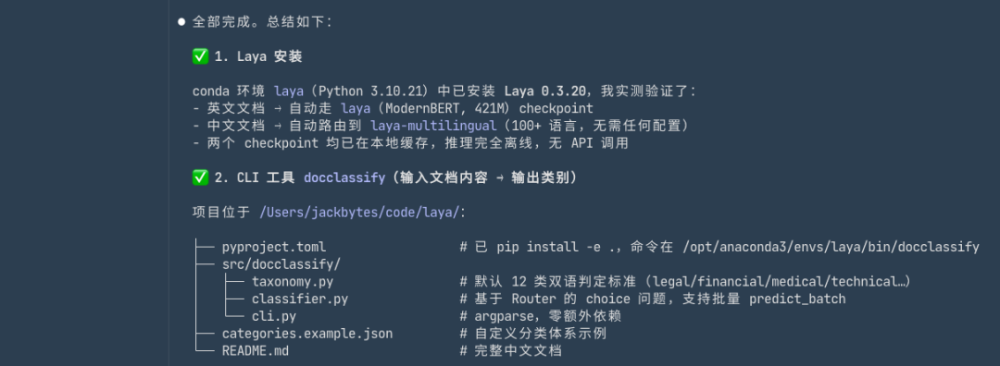
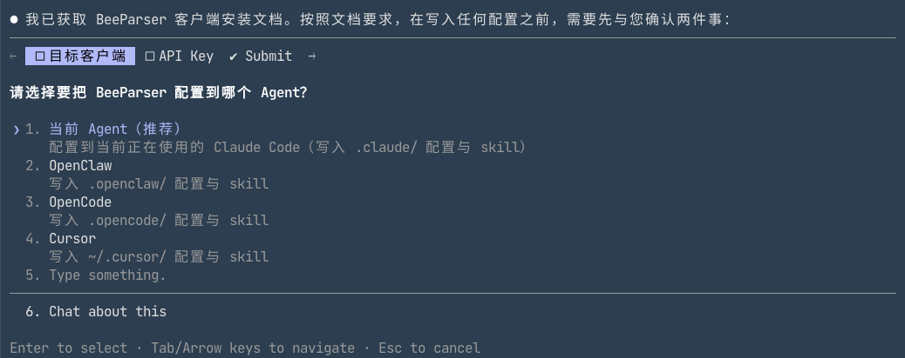
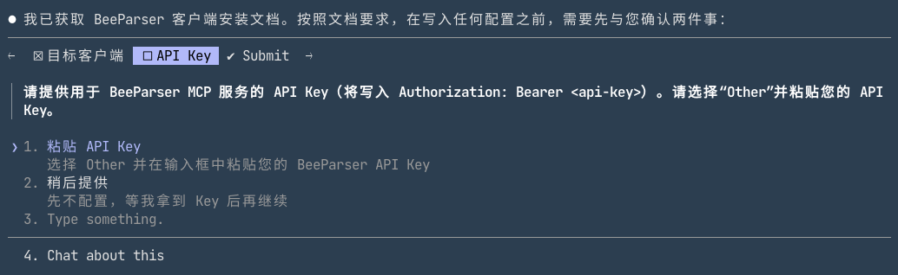
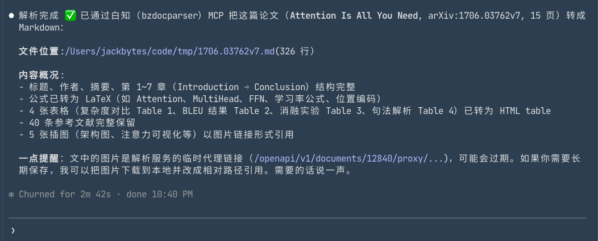
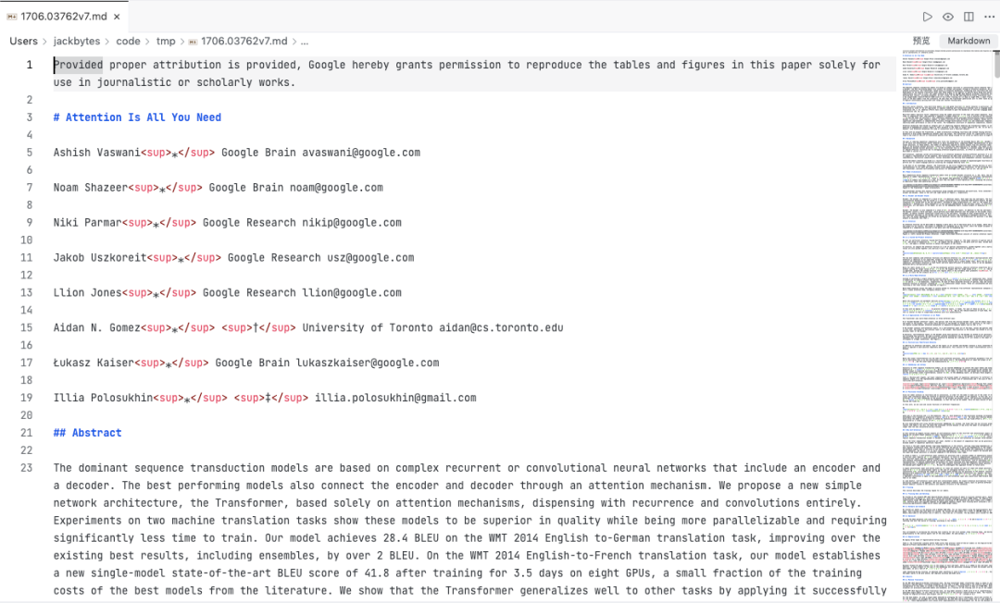
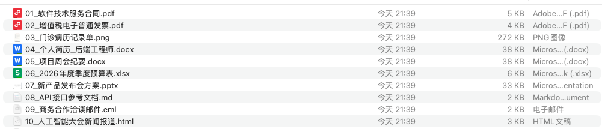
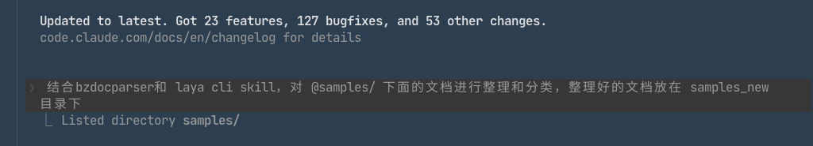

# 用 Jev（Laya）实现毫秒级文档自动分类整理

> 来源：Jack Bytes｜微信公众号 2026-09-24 10:04
> 原文：[文档太乱太多？用 Jev 实现毫秒级自动分类整理，支持本地部署！支持不同类型的文档](https://mp.weixin.qq.com/s/kbQQUssahBxg2yur0Tl1aA)
> GitHub：[NandhaKishorM/laya](https://github.com/NandhaKishorM/laya)



## 概述

Jev 爆火后（本库 09-22 已实测归档原版），开源复刻赛道迅速跟进。本文介绍的 **Laya** 是目前最火的开源复刻：截至归档日 **23,065⭐**（文章口径 22.1K，三天涨了约 1K），2026-09-18 创建，Apache-2.0。文章展示了一个完整的"文档自动分类"落地场景：Laya（决策）+ 百智云文档解析（PDF/Word/PNG 等多格式转结构化文本）+ Claude Code（编排），把杂乱文档目录毫秒级自动归类。

一句话定位：**非自回归 System 1 决策引擎——单选、布尔、打分、路由、风控过滤这类结构化决策，一次前向传播直接出概率，不走文本生成路线。**



## 核心能力（文章 + README 双口径）

| 特性 | 说明 |
|------|------|
| **超低延迟** | 单次推理约 33ms；非自回归，一次前向传播出结果；T4 显卡可流畅跑 |
| **模型规格** | 322M / 421M 两种参数量，低配硬件可部署 |
| **多语言** | 原生支持 100+ 种语言 |
| **训练技术** | RLCD 强化学习校准训练，输出校准过的概率（置信度可靠） |
| **输出形态** | 不生成文本，只输出布尔/选项/量表分数等结构化结果——从根源规避幻觉与 JSON 解析失败 |
| **部署** | `pip install laya`；权重托管 HuggingFace；提供在线 Demo、微调 Notebook、基准测试套件 |
| **路由器** | 内置 router 按请求自动选 checkpoint（README 口径） |

## 三步落地：文档自动分类

### 第一步：安装 Laya（让 Claude Code 干活）

```text
根据下面的链接的内容帮我安装 Laya，并写一个cli 工具和 skill，
核心任务对文档进行分类，用户的输入是文档内容，输出是文档类别:
https://github.com/NandhaKishorM/laya/blob/main/README.md
```



### 第二步：接文档解析（百智云 beeparser）

文档分类的前提是先把 pdf/word/png 变成文本。文章用百智云文档解析服务（商业服务，非开源）：
- 响应 <100ms，支持 10+ 格式，多语言识别准确率 99%
- Agent 接入同样是"一句话安装"：`请按照以下文档完成客户端配置：https://beeparser.app.baizhi.cloud/docs/agent_installation.md`









### 第三步：组合两者分类

```text
结合bzdocparser和 laya cli skill，对 @samples/ 下面的文档进行整理和分类，
整理好的文档放在 samples_new目录下
```







## 关键洞察

- **"一句话安装"正在成为 Agent 时代的标准接入方式**：Laya 和百智云都提供"把 README/安装文档链接丢给 Agent 就自动装好"的路径——与 douyin-mcp（同日归档）的"Agent 安装协议"不谋而合。文档的第一读者已经是 Agent。
- **决策模型的最小落地场景就是"分类"**：不需要复杂 Agent 框架，"解析→分类→归档"三步就是一个完整可用的生产力工作流。33ms 的延迟让它在文件管理、工单路由、风控过滤这类高频场景可以直接替换 LLM 调用。
- **生态爆发速度惊人**：Laya 09-18 创建、一周 23K⭐；衍生项目已有 laya-mlx（6.2K⭐，原生 MLX 运行时、Mac 上 7-14ms）、receptron/laya（Node.js 绑定）、laya-playground（benchmark+agent skill）——Jev 复刻已形成小生态。
- **开源复刻 + 商业服务组合**是自媒体技术布道的常见结构：Laya（开源免费）+ 百智云（商业 API）组合成完整方案，注意文章后半段实质是广告。

## 战略分析

### 与现有工具链的对照

| 维度 | Laya | 现有栈 |
|------|------|--------|
| 决策模型 | 非自回归，33ms，输出校准概率 | 无——Hermes 依赖 LLM 文本推理做决策 |
| 文档分类 | pip install laya + 微调 | 现有分类靠 LLM prompt（慢且贵）或人工 |
| 文档解析 | 文章用百智云（商业） | 已有 MinerU（80K⭐，开源）、marker、ocr-and-documents skill 栈 |
| Mac 本地推理 | laya-mlx 7-14ms | 本机 Ollama 栈（nomic-embed 等） |

### 差距与借鉴点

- **与 09-22 Jev 实测归档直接呼应**：Jev 原版实测 p50=385ms（CDP 连真实 Chrome），Laya 宣称 33ms 且可本地 pip 装——复刻版把门槛从"实验级"降到"pip 一装"。测试口径不同（Jev 实测是完整浏览器决策循环，Laya 是纯模型推理），不能直接对比。
- **Hermes 场景的可落地判断**：本机高频小决策（如归档路由：这篇文章进哪个目录、这条消息是否需要升级）目前都走 LLM。若引入 Laya/laya-mlx，可把"路由/过滤/分类"这类决策从 LLM 调用里剥离，省 token 且延迟降一个数量级。
- **注意宣传口径**：文章是公众号软文结构（开源项目引流 + 百智云广告），22.1K→23K 的增长真实但"毫秒级分类"的完整链路还包含文档解析（百智云是云服务，有隐私外发问题）。本地部署仅指决策模型部分。

### 整合可能性

- **低门槛试用**：`pip install laya` 或 laya-mlx（Mac 原生），跑官方 demo 验证 33ms 延迟与中文效果；重点测"知识库归档路由"场景——用 Laya 决定新文章进哪个分类目录，替代每次问 LLM。
- **与 MinerU 组合**可完整替代文章的"百智云"环节，实现全本地文档分类流水线（MinerU 解析 + Laya 分类），无隐私外发。

## 相关文档

- [[技能文档/2026-09-22-Jev决策模型实测-jev-ultrafast浏览器Agent每步385ms]] — Jev 原版实测（决策模型鼻祖）
- [[技能文档/2026-09-25-Kuhakucai创作者工具三件套-douyin-mcp-Oula-Skills-Creator-Pro]] — 同日归档，"Agent 安装协议"写法互证
- [[技能文档/MinerU4.0-新版本解析]] — 本地文档解析替代百智云的开源选项

## 归档日志

- 2026-09-25 归档。Firecrawl 抓取正文（metadata 带 og:title/author 确认 Jack Bytes 2026-09-24 发布）；GitHub API 核实 NandhaKishorM/laya：23,065⭐ / 1,983 fork / Apache-2.0 / 2026-09-18 创建 / 09-24 仍在 push；生态核实 laya-mlx 6,225⭐。图片 12+封面：5 张被微信 CDN 拦截（243B 占位），curl 重试仅补回 1 张，最终以"浏览器强制 data-src→src 加载 + CDP Page.getResourceContent 提取缓存字节"组合拳全数取回（与 09-21 AgentGit 归档同款方法）。
