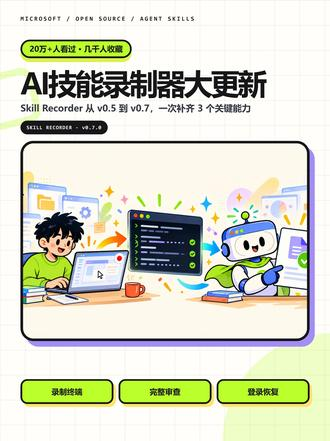

# Skill Recorder v0.5→v0.7 更新：从录屏工具到完整工作流捕获器

> 来源：猴子AI笔记｜抖音 2026-09-24（4.0万赞）
> 原视频：[20万+人看过的Skill Recorder又更新了](https://www.douyin.com/video/7689006882136018203)
> GitHub：[microsoft/skill-recorder](https://github.com/microsoft/skill-recorder)（归档日实测 4,097⭐，MIT）

## 概述

微软开源的 **Skill Recorder**：录一次你在屏幕上的真实操作，GitHub Copilot CLI 把它重构成"意图 + 有序步骤"，再一键生成 Agent 可复用的 **Skill**（SKILL.md）或 **Automation**（定时/触发执行）。猴子AI笔记这条视频讲的是 v0.5→v0.7 的进化：**不再只是录屏——补上了终端录制、完整 SKILL.md 审查和登录恢复，能更完整地理解一条真实工作流**。当前仍是源码发布，需要 GitHub Copilot 权限。

一句话定位：**"教 Agent 最自然的方式不是写文档，是做给它看"——演示一次，复用无限次。**

## 核心机制（README 核实）

### 四步工作流

1. 🔴 **录制**（⌘⇧R / Ctrl+Shift+R 全局快捷键）：本地后台捕获屏幕+活动。置顶控制条实时显示捕获/麦克风状态。
2. 🎛️ **控制**：随时静音/切麦，录坏可丢弃（带确认）。
3. 🧠 **分析**：Copilot 重构整体意图+有序步骤，可审查编辑。
4. ✨ **创建**：生成 Skill 或 Automation。

### 捕获了什么

| 数据 | 说明 |
|------|------|
| 窗口追踪 | 活跃应用/窗口切换 |
| 浏览器 URL | 当前页面（macOS） |
| 屏幕视频 | Chromium 录制，仅屏幕变化时保留低频快照 |
| 剪贴板 | 复制文本短预览，串联步骤 |
| 语音解说（可选） | 设备端 Whisper 转录，99 种语言，首次 ~252MB 模型 |
| **终端**（v0.6+） | 视频口径：新增终端录制 |

### 隐私设计（关键卖点）

- 录制/存储/帧提取/语音转录**全在本地**，录制时零外发
- 只有点 **Analyze** 才把事件时间线+截图+解说文本发 GitHub 云端
- 每次录制前提醒：不要录入密码/token/API key

### 关键设计：泛化 + 原生工具优先

录一次提交某个表单 → 生成的 Skill 泛化为"提交表单"能力；生成的 Skill **优先调用 Agent 原生工具**（gh CLI、web_fetch）而不是回放 UI 点击——比坐标回放可靠得多。目标平台：Microsoft Scout / Copilot Cowork / Copilot Studio。

## v0.5 → v0.7 版本演进（release notes 核实）

| 版本 | 日期 | 核心更新 |
|------|------|---------|
| **v0.5.0** | 08-12 | 屏幕选择器持久化（按显示器录制）、稳定显示器身份解析 |
| **v0.6.0–0.6.2** | 09-16 | **终端录制**加入；登录恢复重做：企业 SSO→浏览器 OAuth 无需 device code，Copilot CLI 钉到 1.0.78（支持 --web-flow）；Windows 便携 npm 依赖修复 |
| **v0.7.0** | 09-21 | **Review SKILL.md**：只读弹窗审查完整生成文件（含 frontmatter 和替换值）再安装/导出；所见即所装，不再多一次模型调用；取消/过期预览恢复 |

视频的总结准确：v0.5 只会记录屏幕，v0.7 已经能"更完整地理解一条真实工作流"——屏幕+终端+语音三通道输入，登录链路修好，生成物安装前可审查。

## 技术架构（博客园拆解 + README）

- **Electron + TypeScript**，Node.js 24，源码发布模式（curl 一条命令，commit-pinned 本地构建，不装全局）
- `common/sensitive.ts` 敏感信息检测（分析前防线）
- `common/describe.ts` 意图+步骤重构；`common/skill.ts` / `automation.ts` 生成
- `electron/architectures/catalogues/` 目标平台目录——每平台一个 catalogue 定义通用步骤→平台格式的映射，加新平台容易
- `evals/` 评估框架：describer 和 builder 都有 fixture 基准（`npm run eval` / `eval:builder`）——不只发工具，还发了衡量工具质量的框架
- v0.7 验证规模：267 测试 + 285 包许可证清单 + 四平台 CI

## 关键洞察

- **"录一次=写一个 Skill"改写了技能沉淀的经济学**。知识库人工归档一条工作流要几十分钟；Skill Recorder 把成本压到"做一遍任务本身"。对 Hermes 生态的意义：skill_manage 写 skill 的流程可以被"演示→生成→审查→入库"替代。
- **微软在推 Agent Skills 开放标准**（agentskills/agentskills）：Skill Recorder 是标准的生产端工具，Scout/Cowork/Studio 是消费端——录屏→SKILL.md→分发，这是微软版的"技能应用商店"管道。
- **两周 2.8K⭐ → 归档日 4.1K⭐**：需求真实存在。"写文档教 Agent"的痛点被"演示教学"直接消灭。
- **v0.7 的 Review 环节是对 AI 生成物的信任设计**：生成的 SKILL.md 安装前可全文审查、所见即所装（不再多一次模型调用）——与知识库"归档日志可追溯"的纪律同源。

## 战略分析

### 与现有工具链的对照

| 维度 | Skill Recorder | 现有栈 |
|------|---------------|--------|
| Skill 生产 | 录屏+终端+语音 → AI 重构 → SKILL.md | 手写 SKILL.md（skill_manage / skill-creator） |
| 录屏捕获 | Electron 本地捕获，Analyze 才上云 | macos-computer-use / browser_exec 有捕获能力但无"重构"环节 |
| 依赖 | GitHub 账号 + Copilot 权限（Analyze 发 GitHub 云） | 本地 Hermes 无外部依赖 |
| 目标格式 | Agent Skills 开放标准（Scout/Cowork/Studio） | Hermes skills 格式（同为 SKILL.md 系） |

### 差距与借鉴点

- **现有栈缺"演示→Skill"的转换器**。Hermes 的 skill 沉淀全靠手写或会话内总结；Skill Recorder 证明了录屏重构路线可行。直接装它需要 Copilot 权限且 Analyze 阶段数据出本机（隐私边界）。
- **可借鉴的设计**：①"意图+有序步骤"中间表示——审查点放在人能看懂的结构层，而不是直接跳到 SKILL.md；②敏感信息检测前置（分析前扫描录制内容）；③生成物安装前只读预览+所见即所装。
- **macOS 主目标平台**，与本地环境匹配，装一套试录真实可行。

### 整合可能性

- **试录一条真实工作流**（如"归档一篇微信文章到知识库"全程录屏+终端），看 Copilot 重构出的步骤质量——与现有 kb-archive-article skill 的步骤对照，找盲区。
- 中期思路：Skill Recorder 生成 SKILL.md（开放标准）→ 人工审查 → 适配入 Hermes skills 目录——录一次，双生态受益。

## 相关文档

- [[技能文档/2026-07-22-微软Resource2Skill把教程代码文档炼成Agent-Skill]] — 微软另一条"素材→Skill"路线（文档蒸馏 vs 录屏演示）
- [[技能文档/2026-08-18-Yao-Meta-Skill-Skill-OS-技能工厂与治理系统]] — Skill 工厂与治理对照
- [[技能文档/2026-09-21-Agent时代的开源GitHub]] — 同为"过程资产化"命题

## 归档日志

- 2026-09-25 归档。视频页需登录：douyin-tiktok-scraper API 报 NoneType（需 cookie），走浏览器 meta 提取 fallback（lark:url:video_title + description 拿到完整视频描述）；GitHub API 核实 microsoft/skill-recorder：4,097⭐/429 fork/MIT/TypeScript/2026-07-29 创建/09-23 仍在 push；v0.5/v0.6.x/v0.7 release notes 逐一核对视频口径（终端录制/登录恢复/SKILL.md 审查均属实）；封面图自 lark:url:video_cover_image_url 下载。视频本体未转录（需登录），内容口径以视频文字描述+官方 README/release notes 双源核实。
