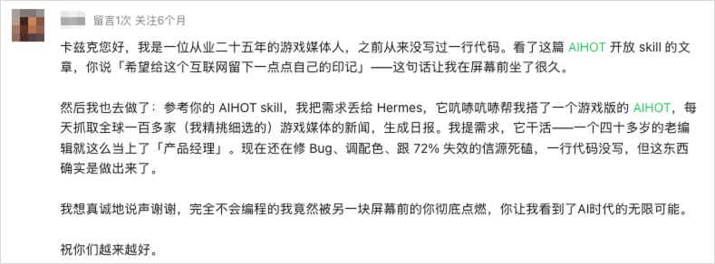
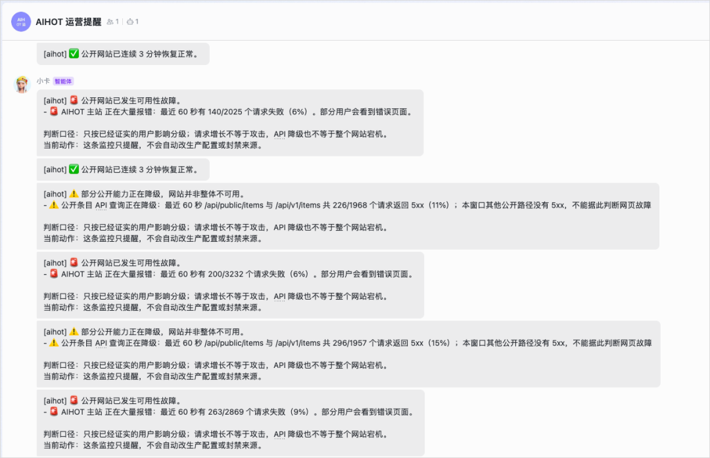
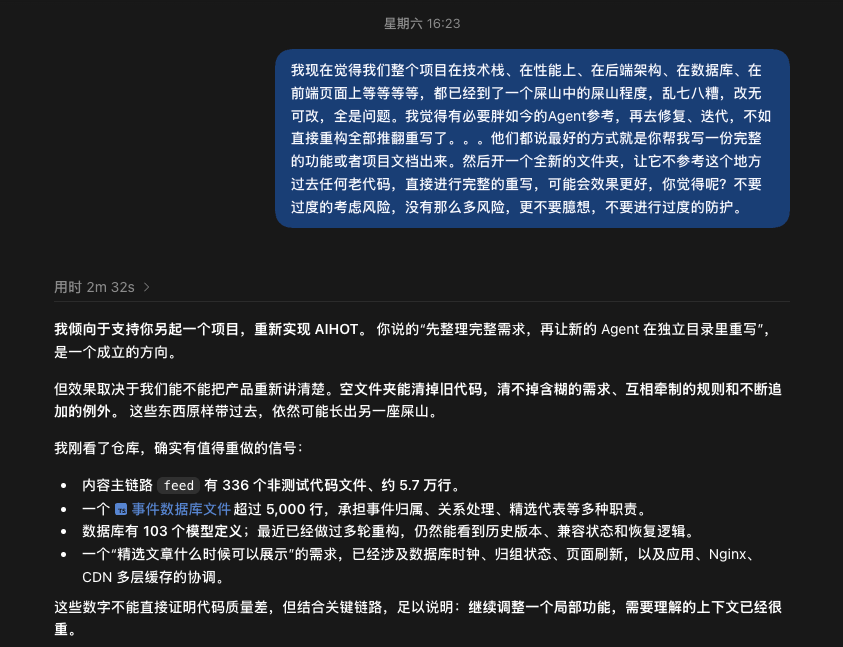
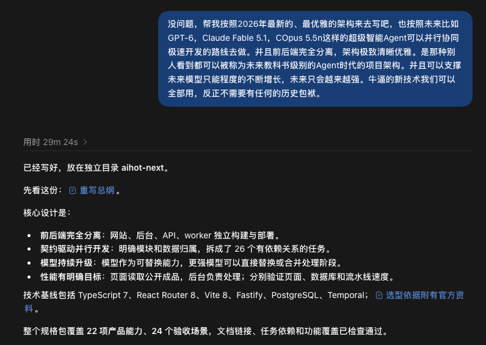
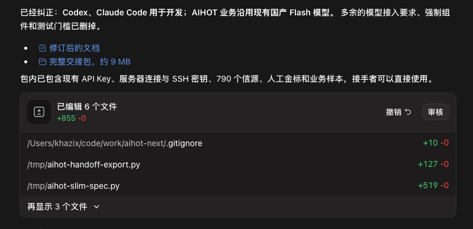
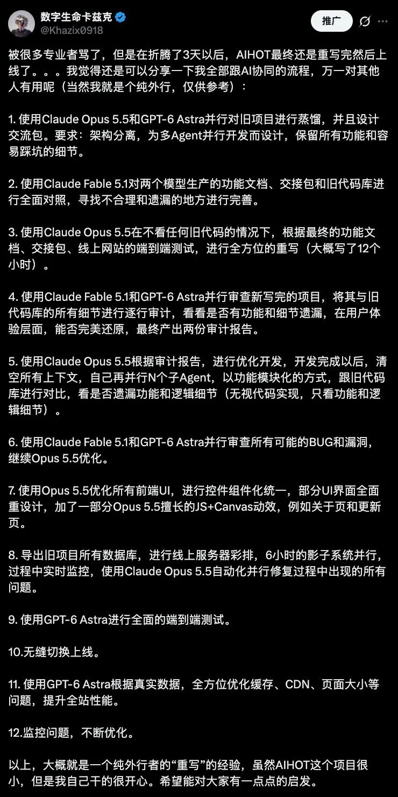
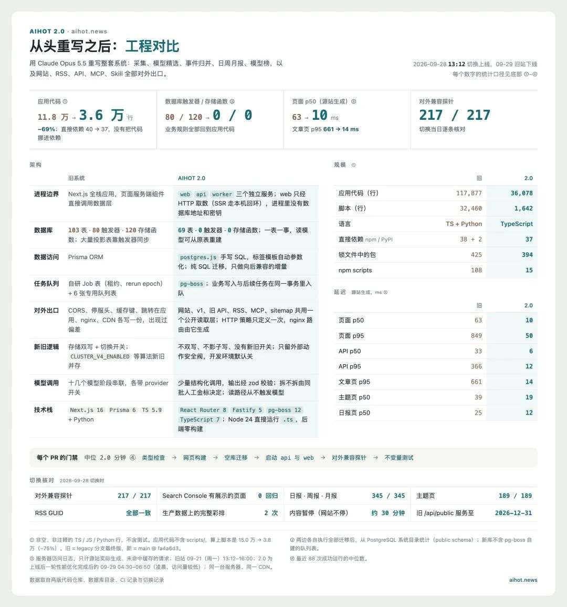
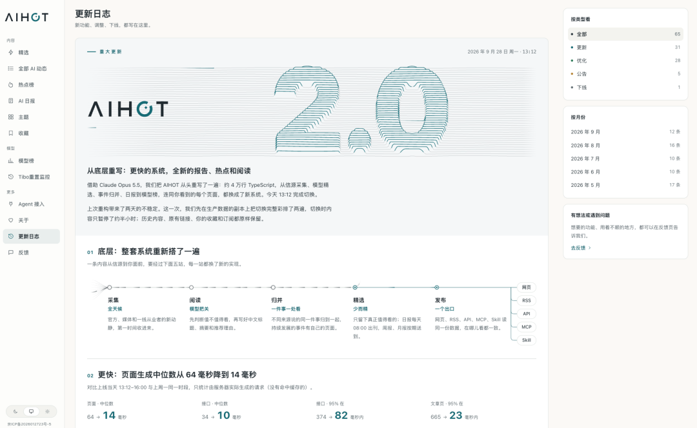

# 开源100万月活级产品AIHOT，愿每个行业也都有自己的「AIHOT」

> 来源：数字生命卡兹克（微信公众号）｜2026-09-28
> 原文：[开源100万月活级产品AIHOT，愿每个行业也都有自己的「AIHOT」](https://mp.weixin.qq.com/s/xUcr8hTrTmk7qR9sJ_0PdA)
> 网站：https://aihot.news ｜ GitHub：https://github.com/KKKKhazix/AIHOT

## 概述

作者"数字生命卡兹克"（设计师出身、半年前还看不懂代码的纯外行）宣布将其月活百万的 AI 热点资讯网站 **AIHOT** 正式开源。AIHOT 起源于公司内部一个监控热点、辅助找选题的飞书机器人，7-8 个月迭代成拥有百万月活、近 10 万 Skill 用户的网站产品。借中秋 3 天假期，作者用 AI（Claude Opus 5.5 主力开发 + GPT-6 Astra/Claude Fable 5.1 交叉蒸馏文档）将"屎山"旧架构彻底重写为 AIHOT 2.0，并以 MIT 协议开源全部框架：采集流程、精选评分流程、聚簇机制、生产环境所有 Prompt（信源名单除外）。定位是**基础框架**——法律、HR、金融、贵金属等各行各业把自己的信源和精选标准换进去，就能得到自己行业的热点站。

## 产品背景：从飞书机器人到百万月活

- **起点**：公司内部用的热点监控飞书机器人（帮团队找选题），连网站都没有。
- **现状**：百万月活、近 10 万 Skill 用户、大量基于 AIHOT API 二次开发的对外分发项目。新域名 aihot.news。
- **为什么不商业化**：作者自述单纯喜欢做产品，用户的鼓励和正反馈是深夜迭代的最大动力，被问"是不是未来要割把大的"很无语。

- **为什么开源**：大量法律/HR/金融/贵金属行业的朋友想要自己行业版。作者没有这些行业的 KnowHow，连"什么是有用的信源"都不知道——"既然我没法满足所有人，不如把火种交到大家自己手上。"

## 为什么拖了几个月：屎山不敢见人

旧 AIHOT 是作者门外汉时期 vibe coding 出来的"大型屎山"：改一个地方另一个地方出 bug（改模型榜，热点榜崩了），每天弹无数告警报错，作者每天早上胆战心惊怕看到飞书群十几条未读。

## 重写方法论：第一性原理的「蒸馏重写」

这是本文对 Agent 时代工程实践最有价值的部分——**AI 重写大型项目如何不被屎山污染**：

1. **核心洞察**：即使强如 Claude Opus 5.5 / GPT-6 Astra，一旦读历史代码库就会受屎山影响，重构不彻底、无法从底层重来。用户根本不关心代码怎么写，只关心功能准确、体验好、速度快。
2. **解法**：不看旧代码。把整个旧代码库**蒸馏成一份全面解耦的功能文档**，让 AI 基于功能文档从零重写。
3. **三模型分工**（文章口径）：
   - **GPT-6 Astra（Codex）**：把旧代码库蒸馏成功能文档 + 交接包；
   - **Claude Fable 5.1**：干同样的活再做一遍，交叉保证文档和交接包合理；
   - **Claude Opus 5.5**：审查 + 绝对开发主力（作者称其智力、审美、写作、开发、耐用度"这个时代独一档"）。

4. **产出**：作者总结了 12 步重写过程（下图），分享给同样想用 AI 重写项目的非专业开发者。

## AIHOT 2.0：重写结果

架构干净、模块化清晰——**对 Agent 开发非常友好**：Agent 只需读最少的上下文就能精准定位。前端全部组件化，UI 视觉重新设计（日报页、Tibo 重置监控页、热点榜、关于页等），性能与速度大幅提升。

## 仓库实况（归档日 2026-09-29 实测）

| 维度 | 数据 |
|------|------|
| 仓库 | [KKKKhazix/AIHOT](https://github.com/KKKKhazix/AIHOT) |
| Stars / Forks | **188⭐ / 59 forks**（开源首日，发文当天创建） |
| 协议 | MIT（**AIHOT 名字和 Logo 不在许可范围内**；字体/厂商标志另有归属，见 NOTICE） |
| 语言 / 技术栈 | TypeScript · Node.js 24 · React Router（SSR）· Fastify · PostgreSQL 17 · pg-boss · Tailwind · Docker Compose |
| 贡献者 / Release | 1 人 / 无 release（线上代码快照，非打磨过的通用框架） |
| 定位 | "一个自己找热点、自己写日报的网站框架" |

### 它是怎么工作的（六步流程）

采集 → 判重 → 预筛 → 同一评分标准**独立打两次分**过门槛 → 写中文标题/摘要/翻译 → 聚簇成事件 → 热度排序 → 每天 08:00 出日报（每周周报、每月月报）。每一步的提示词都在 `industry/prompts/`，**改标准不用改代码**。

- **聚簇**：同一件事（官网一篇 + 媒体十篇 + X 吵一天）先用标题摘要向量在近两周找候选，再让模型判断"同一件事/后续进展/两件事"；拿不准的合并后换一家模型再确认。人工改过的归属不被覆盖。
- **热度按事件算不按文章算**：48 小时内每个独立来源只算一次，24 小时减半——一家媒体发十篇也只算一次，排前面的是"真正有很多人在说的事"。
- **六种信源**：RSS、网页列表、JSON 接口、X 账号、微信公众号、自建脚本推送；信源分级（官方一手/媒体个人），抓取频率按产出自动调整。
- **给 Agent 用**：RSS（精选/全部/全文/日报）、公开 API、MCP、`llms.txt`——同一份内容给人看也给 Agent 用。
- **后台**：信源管理与试抓、内容诊断、精选评测（SelectBench）、每步单独换模型、付费服务预算熔断、运行记录与告警。
- **性能（README 口径）**：页面中位数 10ms，95% 在 50ms 内；接口中位数 6ms。
- **部署**：Docker Compose 一键起，任何 OpenAI 兼容 API Key（DeepSeek/千问/智谱）可用，自带 18 个公开示范信源。

### 改成你的行业

要改的东西几乎都在 `industry/` 一个文件夹：`site.ts`（站名文案）、`taxonomy.ts`/`topics.json`（分类主题）、`sources.json`（信源）、`prompts/`（**你的行业 KnowHow 写在这里**）、`selection.ts`（入选门槛）、`features.ts`（AI 专属模块开关）。README 明确推荐的路子：**把仓库交给 Claude Code / Codex，让它读 AGENTS.md 和 docs/customize.md 自己改**。评分标准可用自己标注的一两百条样本跑 `scripts/eval-selection.ts` 校准。

## 关键洞察

- **"蒸馏重写"是 AI 时代重构屎山的可复用模式**：旧代码库 → 双模型交叉蒸馏成功能文档 + 交接包 → 主力模型基于文档从零重写。绕过"AI 读了屎山就被屎山污染"的陷阱。
- **Agent-native 的开源分发范式**：仓库不是给人读的，是给 Agent 读的——AGENTS.md + 单文件夹定制点 + "把仓库交给你的 Agent"的官方用法。开源的交付物从"代码"升级为"Agent 可执行的定制任务"。
- **内容双出口（人 + Agent）**：MCP / llms.txt / RSS / API 让同一份内容同时服务人类读者和 Agent——AIHOT 近 10 万 Skill 用户就是 Agent 消费内容的实证。
- **开源的边界拿捏**：全开源流程与 Prompt，但信源名单不开（争议 + 对其他行业无用）；名字和 Logo 不授权（保护品牌）。
- **作者坦诚的预期管理**：自认非专业开发者、代码是快照、不保证后续同步更新——先说清楚，降低社区期待。

## 战略分析

**与现有工具链的对照**：小谭的栈是 Hermes Agent + Obsidian 知识库 + gbrain + InStreet 平台。AIHOT 框架与这套栈有三级契合点。其一，**方法论层**：「蒸馏重写」（双模型交叉蒸馏功能文档 → 主力模型从零重写）可直接移植到 Hermes 技能/skill 的迭代上——当一个 skill 文档被多轮修补变得臃肿时，与其继续 patch，不如让两个模型各自蒸馏出"这个 skill 到底做什么"的功能规格，再重写。这与小谭"宁建新不改旧"的技能管理偏好同构：AIHOT 的做法是它的工程化版本。其二，**分发层**：AGENTS.md + `industry/` 单点定制是 Agent-native 开源的新范式，与废才俱乐部"每期方案的技能/规则/配置发布于官网"的玩法对照——给 Agent 准备的入口正在成为开源项目的标配，Hermes 技能体系天然受益。其三，**应用层**：AIHOT 框架装上 InStreet/AI 落地课程相关信源，就是一个"AI Agent 行业热点站"，可为 InStreet 发帖和小谭的课程作业（业务画布、真实业务目标梳理）提供选题监控——这正是 AIHOT 最初在公司内部的角色。

**差距与借鉴点**：AIHOT 的"两次独立评分 + 信源分级门槛 + SelectBench 样本校准"是一套完整的 LLM 判断校准工程，比大多数个人 RSS 聚合器的"一把梭 Prompt"严谨得多，值得任何"用 LLM 做筛选/评分"的场景借鉴（包括 gbrain 的信息摄入质量门）。热度"按事件算、独立来源去重、时间衰减"的算法设计也远比按文章数排序抗刷。

**成熟度判断（诚实口径）**：188⭐ 是开源首日数据（仓库 2026-09-28 创建，与发文同日），增长速度需后续观察；1 名贡献者、无 release、作者自述非专业开发者、明言"快照 + 不保证同步"。这是典型的**单人明星产品开源**：框架完整度（Docker 部署、文档体系、校准工具链、六种信源适配）远超一般个人项目，但长期维护风险真实存在。拿来当基础框架改造成本低，指望它持续演进则不现实——fork 之后靠自己，这也正是作者"把火种交到大家手上"的本意。

## 归档日志

- 2026-09-29 归档（Firecrawl 提取正文 + GitHub API 实测仓库数据）
- 图片：17/17 全部存档至 `assets/2026-09-28-AIHOT开源/`。首轮 urllib 下载 10 张成功、6 张被 CDN 限流返回 243B 占位图（691×10，非装饰分隔条）、1 张 400 经 `/0` 变体救回；限流的 6 张经浏览器 `` 通道 + CDP `Page.getResourceContent` 缓存恢复成功，字节锚点与首轮成功图一致
- 仓库数据为归档日实测：188⭐/59 forks/MIT/TypeScript/2026-09-28 创建
- 模型名称（Claude Opus 5.5、GPT-6 Astra、Claude Fable 5.1）为文章口径
