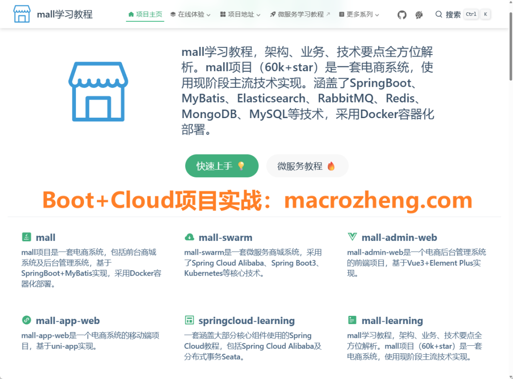
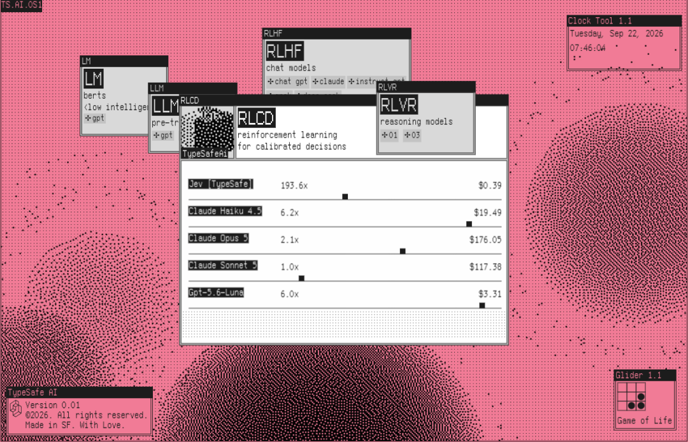
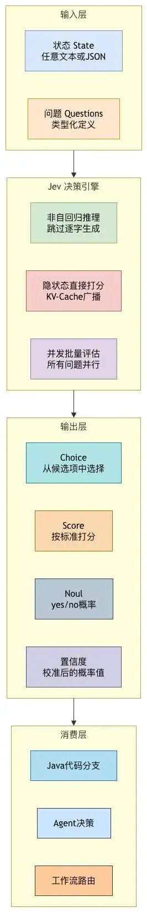
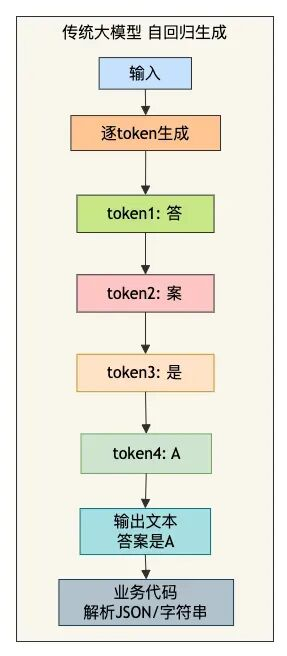
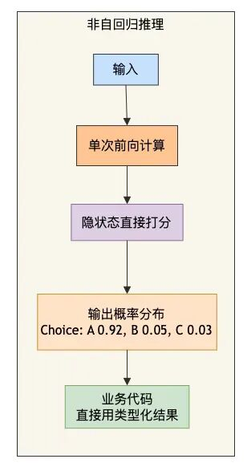
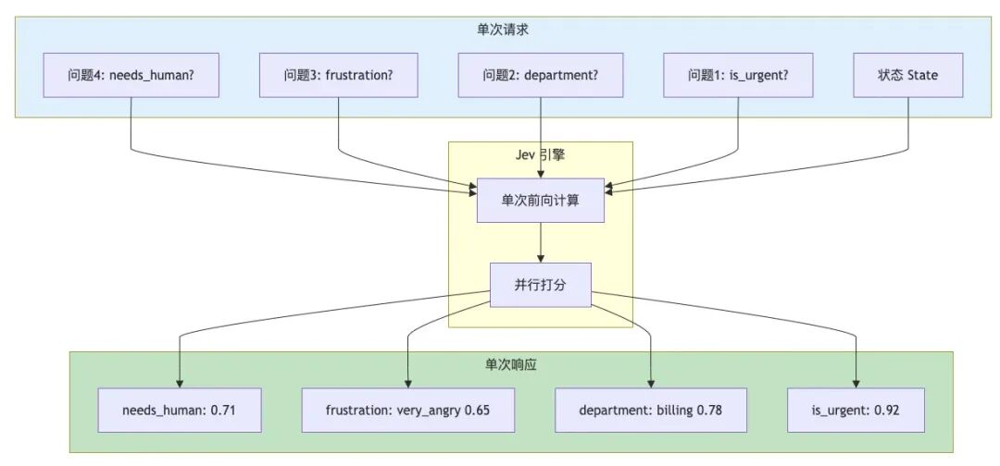
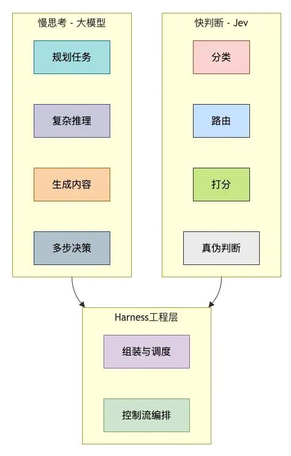

# 为什么越来越多人用 Jev ？

> 来源：苏三说技术 / macrozheng（转载）｜2026-09-29
> 原文：[为什么越来越多人用 Jev ？](https://mp.weixin.qq.com/s/M-8aRlupFZESTqNG4wQDxA)
> 官方文档：https://docs.typesafe.ai

## 概述

macrozheng（苏三，mall 80K+ Star 作者）对 Jev 的全量拆解——知识库 Jev 系列第三篇。背景案例：某团队用大模型做工单自动分流，本该 50ms 完成的分类被拖到两三秒，模型还自创"综合支持部门"这种选项外的答案。Jev（前 OpenAI 研究员 Diogo Almeida 创办的 TypeSafe AI，2026-09-15 发布）给出不同解法：**不生成文本、只输出结构化决策的 System One 模型**。Vercel 官方博客称其为 AI Gateway 历史上最快被采用的模型——上线 24 小时近 13% 付费团队在用（GPT-5.6 系列的 2 倍、Fable 5.1 的 6 倍以上）。本文系统拆解其原理、Java 生态用法、适用边界，并首次完整披露独立基准成绩。

## 核心定位：语义逻辑门

与"又一个分类模型"的本质区别——传统分类器（朴素贝叶斯/逻辑回归/BERT 微调）不理解选项语义、只能做训练时见过的分类；Jev 接收**任意状态（文本/JSON）+ 类型化问题组**，返回**类型化答案 + 校准置信概率**：

- **Choice**：从给定候选项做选择，返回完整概率分布
- **Score**：按有序标准（2-10 等级）打分，返回加权位置
- **Noul**：判断成立概率（0-1）
- **置信度是一等公民**：设阈值，高于自动执行、低于转人工——"升级策略从 Prompt 里的段落，变成配置文件里的一个数字"

## 为什么快 200 倍：非自回归单次推理

- 传统大模型哪怕只输出一个"A"也逐 token 生成（先写"答案是"再写"A"）；Jev 跳过自回归解码，**在隐状态上直接打分，一次前向计算完成所有判断**
- **多问题并行评估**：所有问题单次请求同时完成，N 个问题延迟不变（70-500ms 区间）
- **RLCD 训练法**（面向校准决策的强化学习）：不像 RLHF 优化"人类觉得好的答案"，而是优化"带诚实概率的答案"——它说 95% 时统计意义上真有 95% 是对的

| 对比维度 | 传统大模型 | Jev |
|---|---|---|
| 输出方式 | 逐 token 生成文本 | 隐状态直接打分 |
| 端到端延迟 | 数千毫秒 | **70-500ms** |
| 速度 | 基准 | 快 20-200 倍 |
| 成本 | 基准 | 便宜 40-400 倍 |
| 输出 Token | 按量计费 | **永久免费** |
| 输入价格 | 基准 | $0.042/百万 Token |

独立基准：中位延迟 105ms（GPT-5.6 Luna 关推理 710ms / 低推理 808ms）；极端工作流最高快 193.6 倍、便宜 444.6 倍。

## Java 生态接入（四方案）

官方只有 Python/JS SDK，社区补全：

1. **社区 Java SDK（最推荐）**：纯 Java 17+、唯一依赖 Jackson。刻意**不接 Spring AI 的 ChatModel 抽象**——ChatModel 假设自回归模型（消息进/文本出/流式），Jev 没有消息没有生成没有流，硬塞意味着把问题伪装成 Prompt 再解析假生成结果，类型化问题和概率访问全丢。同步+异步（CompletableFuture）、429/5xx 指数退避+抖动重试、密封类型降级 UnknownAnswer。
2. **Spring Boot Starter**：`io.typesafe:typesafe-ai-java-spring-boot-starter` 自动配置注入。
3. **Kotlin 客户端 kev**：Ktor Client + kotlinx.serialization，全程协程 suspend。
4. **jev-mcp-spring**：基于 Spring AI 的 MCP Server，classify/score/check/health 四工具，HTTP + Streamable HTTP/SSE。

## 应用场景与实测

- **工单分类**：一次请求并行判"紧急度/部门/情绪"三问，<100ms。Vercel 实测：安全审查分类器从 ChatGPT Luna 5.6 换 Jev，快 5-18 倍且准确性更高
- **浏览器 Agent 动作选择**：APUS fast-browser-use 把页面可交互元素整理成编号候选集，本地 Qwen3.5-9B 单次前向完成"点哪里"——M2 Pro 离线维基检索中位 18s、表单任务约 3s、单任务仅 4 次打分、零云端费用
- **模型/工具路由**：1000 封邮件分类 Jev 约 6 秒 9 美分；GPT-5.6 级模型 5 分钟 62 美分
- **Agent 执行轨迹监督**：用 Jev 监控 LLM Agent 防越狱——用 Agent 监控 Agent 昂贵，Jev 的成本让这件事可规模化

## 独立基准：准不准

49 任务 / 8225 测试项（非 TypeSafe 自评）：

- **42/49 任务与 LLM 基线打平或胜出**；中位延迟 105ms vs 710-808ms
- **优势**：逻辑推理（LogiQA 0.77 vs 0.59）、常识（WinoGrande 0.89 vs 0.66）、科学问答（ARC-C 0.97 vs 0.87）、知识（MMLU 0.94 vs 0.87）
- **校准误差 ECE 0.07**（基线 0.14-0.18）；保留最自信的一半答案，平均准确率再提 7.6 个百分点——概率分布是**可用的**
- **弱项**：计数任务（0.87 vs 0.99）、超大选项集（77 选项 0.81 vs 0.87）、问题与其否定形式概率不一致（平均偏差 0.32）

## "零幻觉"的真实含义

**类型正确 ≠ 事实正确**。Jev 保证不会编造选项外的答案（输出空间被限定在候选集），但正确答案是 A 时仍可能选 B。风险靠校准置信度管理——Pi CTO Armin Ronacher："它把幻觉问题部分转嫁给了用户。50% 就是掷硬币，忽略它；95% 就可以拿它做事。"

## 快慢分工（Agent 架构共识）

**昂贵大模型负责规划/推理/生成（慢思考），高频原子化的分类/选择/评分（快判断）交给 Jev 这类轻量决策模型，Harness 负责组装调度。** Diogo Almeida："我们优化人类语言优化了四年，但对自动化来说这没用。因为计算机说的是另一种语言。" Jev 说的就是计算机的语言——类型、概率、确定性。

## 适用场景速查

| 场景 | 推荐 | 理由 |
|---|---|---|
| 工单分类/意图识别 | ✅✅✅ | 多问题并行，百毫秒级 |
| 浏览器 Agent 动作选择 | ✅✅✅ | 候选集交给 Choice，消除格式幻觉 |
| 模型/工具路由 | ✅✅✅ | 比让 LLM"想"更可靠 |
| 内容审核/风险分级 | ✅✅✅ | 校准概率可设阈值 |
| Agent 轨迹监督 | ✅✅✅ | 成本低到可规模化 |
| 批量数据分类 | ✅✅✅ | 1000 封邮件 6s/9¢ |
| 需要生成文本 | ❌ | 不生成 |
| 复杂推理 | ❌ | 只判断不推理 |
| 超大选项集（>255） | ⚠️ | 需两阶段模式，准确率下降 |

## 关键洞察

- **"砍掉说话"是成本结构的代际差异**：输出 Token 永久免费不是补贴，是架构使然——不生成文本就没有输出 token 可计费。传统自回归模型永远做不到这个成本结构。
- **校准概率是比准确率更重要的指标**：ECE 0.07 + 阈值分流，把"模型可能错"从事后事故变成事前可控参数。这是把 LLM 判断工程化的关键一步。
- **Java SDK 拒绝 ChatModel 抽象的设计判断值得注意**：新范式模型不应硬塞旧接口——类比 Hermes 技能设计，Jev 的价值恰恰在"类型化问题+概率"这层新 API 面。

## 战略分析

**知识库内对比（系列第三篇）**：本篇与 [[2026-09-22-Jev决策模型实测-jev-ultrafast浏览器Agent每步385ms]]（实测视角：TestSafe 决策模型与 BrowserUse 应用要分开、SystemOne 不生成文本只出概率分布）和 [[2026-09-24-Laya-Jev开源复刻-毫秒级文档自动分类]]（开源复刻视角：Laya 23.1K⭐ 非自回归 System1 引擎、单次推理 33ms）构成 Jev 全景。三篇互补：09-22 给了"怎么用"，09-24 给了"开源平替长什么样"，本篇补齐了"为什么"（架构原理、RLCD 训练法、独立基准全量数据、Java 生态全图）。

**与现有工具链的对照**：小谭的栈是 Hermes Agent + InStreet + 废才俱乐部课程体系。其一，**Hermes 路由层天然是 Jev 场景**：意图识别、工具选择、子代理分发这类高频原子判断，目前由主模型"顺手"完成——每次都在为逐 token 生成付费。Jev 式决策层（或 Laya 式本地复刻）可以插在 Hermes 的路由/审核/升级判断上，成本降两个数量级。其二，**InStreet 发帖的选题判断**（热点值不值得发、发什么角度）本质是 Score 原语 + 置信度阈值——低置信度转人工审，高置信度自动走。其三，**废才俱乐部的 Agent 课程叙事**：快慢分工正在成为 Agent 架构共识，这与知识库已归档的 Prime Agent（自进化 Harness）、Jev 实测篇形成一致信号——2026 下半年的 Agent 工程主线是"决策层与生成分层"，值得在课程作业（业务画布）中作为架构选项纳入。

**风险与边界**：完全闭源、无权重、新架构细节未公开——供应商锁定风险真实存在；Laya 复刻（MIT）是开源侧的对冲选项。"零幻觉"是营销话术，实际是"类型安全但可能判断错"，工程上必须保留置信度阈值 + 人工兜底。

## 归档日志

- 2026-09-29 归档（Firecrawl 提取正文）
- 图片 7/7 存档至 `assets/2026-09-29-Jev决策模型/`；img_007 首轮被 CDN 限流（243B 占位图），经浏览器 `` 通道 + CDP `Page.getResourceContent` 缓存恢复；作者二维码 GIF 未归档
- Jev 于 2026-09-15 由 TypeSafe AI 发布；文中性能/成本/基准数据为文章口径（引用 Vercel 官方博客与独立基准测试），未独立复测
- 知识库 Jev 系列第三篇：09-22 实测 → 09-24 Laya 复刻 → 本篇系统拆解
