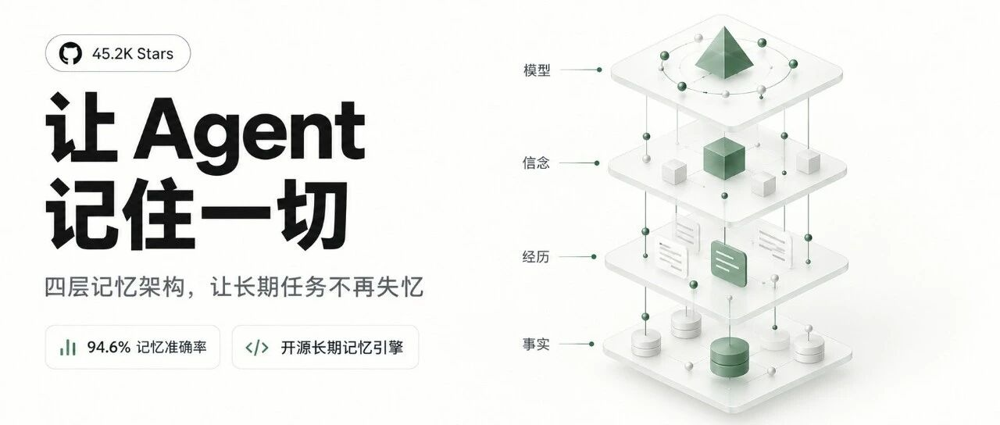
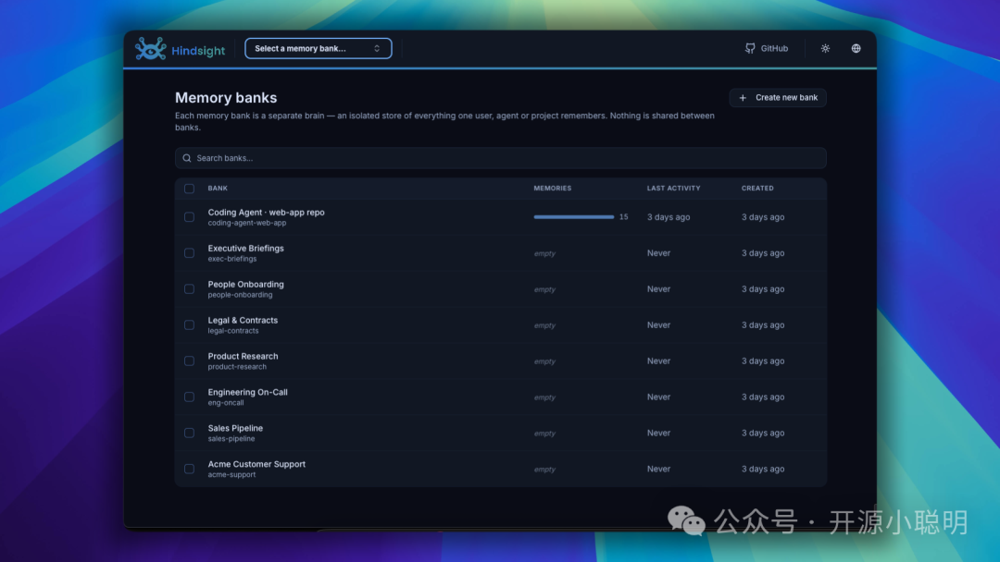
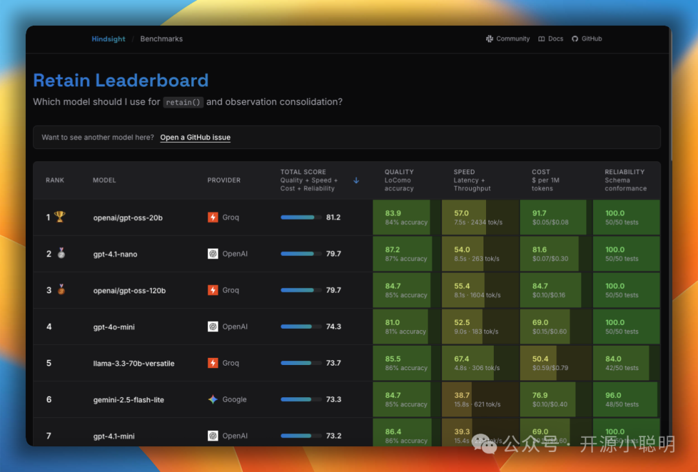
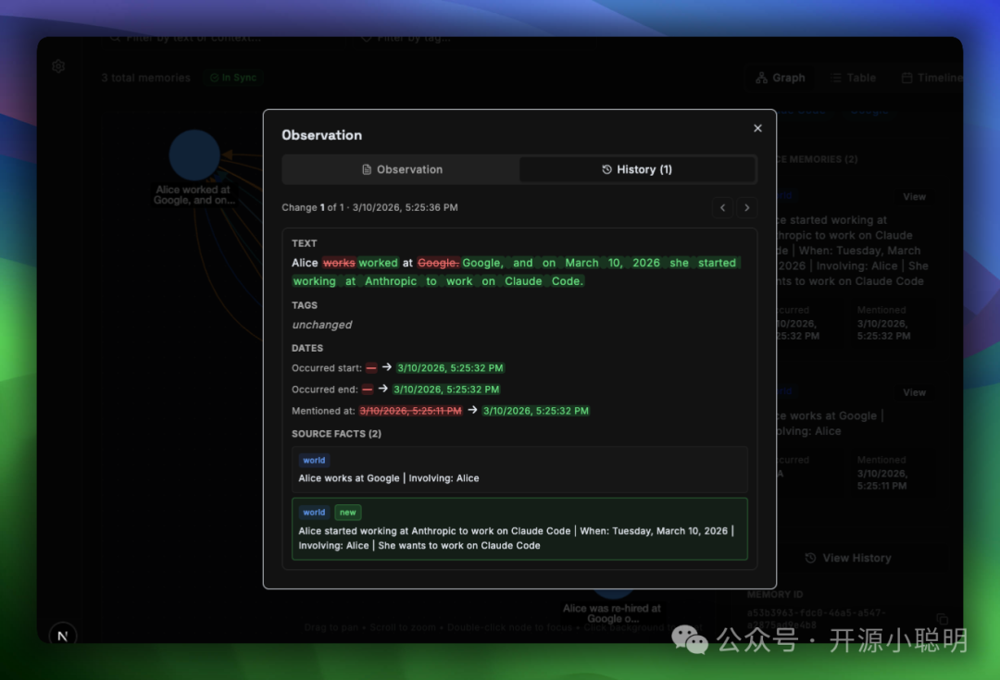

# Hindsight：Vectorize 开源 Agent 记忆引擎



## 概述

Vectorize 开源的 Agent 长期记忆引擎 **Hindsight**，GitHub 热榜项目。定位：解决 Agent 在长周期任务中的失忆与前后矛盾问题——上下文膨胀导致关键指令丢失、配置变更后新旧记录打架、排查过的故障经验无法沉淀。

**仓库实测（2026-10-07 归档日）**：46,409 ⭐（文章口径 45.2K，3 天涨约 1.2K）· 5,946 forks · 288 贡献者 · MIT License · Python · 2025-10-30 建库（约一年）· 最新版 v0.10.2（2026-09-29 发布）· 持续活跃（10-06 仍有 push）。

**成绩（LongMemEval 长期记忆评测）**：

| 方案 | 准确率 |
|------|--------|
| 原生 GPT-4o（无记忆处理） | 60.2% |
| Zep（常见记忆方案） | 71.2% |
| **Hindsight** | **94.6%** |

> README 口径：成绩由 Virginia Tech Sanghani Center 与《华盛顿邮报》独立复现，其他厂商分数为自报；持续更新榜单见 benchmarks.hindsight.vectorize.io。

## 核心设计

两个支柱：**分层认知架构** + **四路混合检索**。

### ① 四层记忆形态（每 Agent 独立 Memory Bank）



| 记忆层 | 内容 | 例子 |
|--------|------|------|
| 世界事实 World Facts | 不可变客观规则 | 生产数据库端口严禁对外暴露 |
| 执行经历 Experiences | Agent 跑过的真实轨迹 | 某次脚本因超时被熔断 |
| 观察信念 Observations | 后台 worker 异步提炼的高阶认知，带证据链 | 见下方"增量演化" |
| 心理模型 Mental Models | 常驻规则，启动时直接读库加载 | 用户编码偏好、团队规范（零额外推理耗时） |

### ② 像版本控制一样增量演化信念（最具特色）

新旧事实冲突时不粗暴覆盖，而是像 git 一样演化：旧认知"Alice 在 Google 工作"→ 新事实"Alice 跳槽 Anthropic"→ 旧认知标记为已解决的历史状态 + 保留演化过程与时间戳。解决时序冲突，也防止单次误判推翻长期结论。



### ③ 四路混合检索 + 三维星图

`recall` 同时发起四路查询，经倒数排名融合（RRF）汇总，再由重排模型筛选注入上下文：

- 向量语义检索
- BM25 关键词精确匹配（定位错误码、函数名）
- 实体图谱关联
- 时间范围过滤

控制台提供三维交互式记忆星图（语义/时序/实体/因果四类关联）；`reflect` 操作可遍历记忆网络做逻辑推导、排查矛盾。



### ④ 跨开发工具共享记忆

多个工具连同一 Memory Bank，共享同一项目的上下文与经验：Claude Code 里排查过的模块细节，切到 Cursor CLI 继续编码依然生效。支持 Claude Code、Cursor CLI、Codex 等终端工具一键装记忆插件。

## 快速上手

架构为 **server + client** 分离（README 核实）：

```bash
# 1. 起服务端（Docker 推荐 / pip / K8s Helm 三选一）
docker run -it --pull always --name hindsight --restart unless-stopped \
  -p 8888:8888 -p 9999:9999 \
  -e HINDSIGHT_API_LLM_API_KEY=$OPENAI_API_KEY \
  -v hindsight-data:/home/hindsight/.pg0 \
  ghcr.io/vectorize-io/hindsight

# 2a. Python 客户端：包装原有 client，不动业务逻辑
pip install hindsight-litellm
```

```python
from openai import OpenAI
from hindsight_litellm import wrap_openai

# 包装原有客户端，自动绑定独立记忆库
client = wrap_openai(OpenAI(), bank_id="dev-assistant")

# 提问前自动检索注入记忆，调用后后台自动沉淀
response = client.chat.completions.create(
    model="gpt-5-mini",
    messages=[{"role": "user", "content": "帮我梳理项目上周遗留的技术债务"}],
)
```

```bash
# 2b. 给本机编程工具一键装记忆插件（Claude Code / Cursor / Codex）
npx @vectorize-io/hindsight-coding-agents install all
```

**现实限制**：后台提炼事实与演化信念需轻量模型辅助，有少量额外 token 消耗；无跨会话需求的单步命令场景，引入整套系统是纯增配置成本。

## 与现有记忆栈对照

| 维度 | Hindsight | TencentDB Memory（本机在用） | GBrain（本机在用） | NexSandglass（已备份） |
|------|-----------|------------------------------|--------------------|------------------------|
| 定位 | Agent 长期记忆引擎（服务化） | 四层记忆系统 L0→L3（对话/事实/场景/人设） | 个人知识库 + 图谱记忆引擎 | 本地优先记忆系统 |
| 记忆结构 | 四层：事实/经历/信念/心理模型 | 四层：自动捕获→结构化提取→场景块→人设合成 | Markdown 页 + 向量 + 图谱（336页 vault） | 本地优先存储 |
| 冲突处理 | 信念版本化增量演化，保留时间戳（核心卖点） | 无显式信念演化层 | 有 find_contradictions 矛盾检测 | — |
| 检索 | 四路混合：向量+BM25+实体图谱+时序，RRF 融合+重排 | 语义搜索（memory_search） | 混合检索（向量+关键词+图遍历） | — |
| 自省能力 | reflect 遍历记忆网络逻辑推导 | 自动提取（被动） | advisor/gap analysis | — |
| 接入方式 | LiteLLM 包装器零侵入 + coding agents 插件 | Hermes 插件原生 | CLI + MCP | 独立系统 |
| 评测背书 | LongMemEval 94.6%，VT+华盛顿邮报独立复现 | 无公开基准 | 无公开基准 | 无公开基准 |
| 部署形态 | Docker/pip/Helm 自托管，MIT | 腾讯云 DB + 本地 gateway | 本机 PostgreSQL+pgvector+Ollama | 本地 |

## 关键洞察

- **记忆正在成为 Agent 的第二引擎**：文章点题——以前比 Prompt 和上下文长度，现在同一个模型有没有靠谱记忆系统，表现差出一大截。
- **"版本化信念演化"是真正的差异化**：大多数记忆方案（含本机 TencentDB Memory）止步于"存取"，Hindsight 把记忆当作带历史的认知对象，新旧冲突可追溯、可回放，这直接对应 Agent 长任务里最常见的"前后打架"病。
- **四路检索针对的是纯向量的真实短板**：错误码、函数名、时序筛选是语义相似度抓瞎的场景，BM25+图谱+时间过滤的 RRF 融合是工程上务实的选择。
- **成绩的可信度分层**：Hindight 的分数有第三方复现背书（VT + 华盛顿邮报），而对比分数是厂商自报——比大多数 benchmark 营销文严谨。

## 战略分析

**与本机栈的关系：互补大于替代。** Hindsight 的强项（信念演化、四路检索、reflect 自省、LongMemEval 成绩）恰好是 TencentDB Memory 四层架构未覆盖的能力；而 TencentDB Memory 的强项（与 Hermes 会话管道的原生集成、自动对话捕获、人设合成）是 Hindsight 作为通用引擎不具备的。GBrain 定位是个人知识库而非会话记忆，赛道不同。

**三个可借鉴点**：① 信念版本化演化——若 TencentDB Memory 后续要加 L2/L3 的冲突处理，"旧认知标记为已解决历史状态 + 保留演化链"是比覆盖写入更好的模型；② 四路混合检索的 RRF 融合——GBrain 已有向量+图谱，补 BM25 与时间过滤两路成本不高，收益在精确 token（错误码、函数名）场景；③ LiteLLM 包装器模式——不动业务代码给任意 OpenAI 兼容客户端挂记忆，接入摩擦极低，值得任何记忆系统学习。

**成熟度判断：可装可试，替换需谨慎。** 46.4K⭐ + 288 贡献者 + 一年历史 + MIT + v0.10.x 活跃维护 + Fortune 500 生产使用（README 口径），社区热度与工程成熟度都过了可信线；但架构要求自托管一个带 PostgreSQL 的服务端（docker volume `.pg0`），且信念提炼有额外 token 成本——对本机而言，作为**旁路实验引擎**接入（比如先给 Claude Code/Codex 装插件试跨工具记忆共享）比整体迁移合理。与 dsh-ontology（09-27 归档）思路呼应：一个是给记忆加本体约束，一个是给记忆加认知演化，同一问题的两条路线。

## 相关文档

- [[2026-07-22-GBrain-AI-Agent记忆系统深度解析]]
- [[2026-06-01-NexSandglass-沙漏记忆系统-本地优先AI-Agent记忆引擎]]
- [[2026-09-27-dsh-ontology实测-给Agent记忆装上本体约束]]

## 归档日志

- 2026-10-07 归档。Firecrawl 抓取正文；仓库数据 GitHub API 实测（46,409⭐/5,946 forks/288 contributors/MIT/v0.10.2/2025-10-30 建库）；LongMemEval 成绩为文章口径，README 证实"SOTA + VT/华盛顿邮报独立复现"但未在 README 正文列出 94.6% 具体数字（见 benchmarks.hindsight.vectorize.io）。
- 图片：封面 + 3 张内文图入库 assets/2026-10-04-Hindsight/；第 4 图（三维星图截图）CDN 400 拒绝全部 URL 变体，引用已移除，不影响正文完整性。
