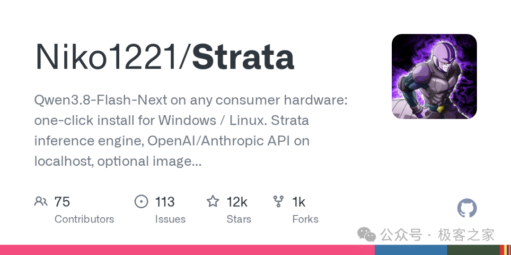
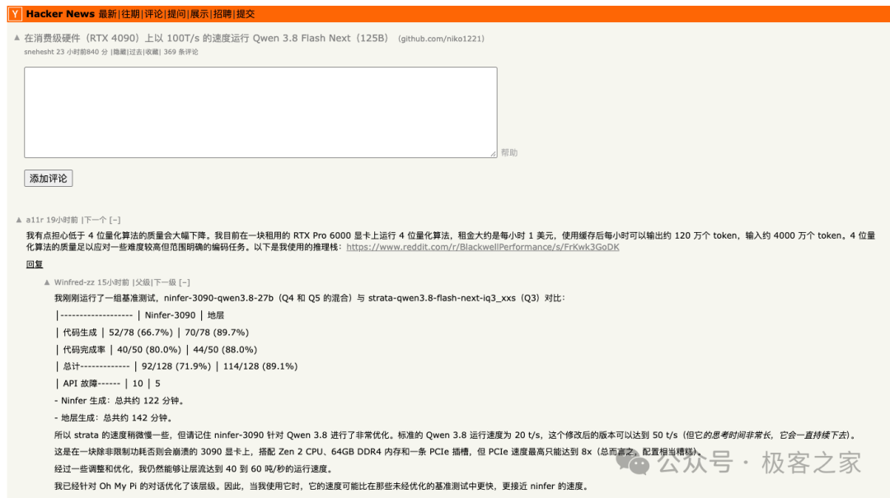
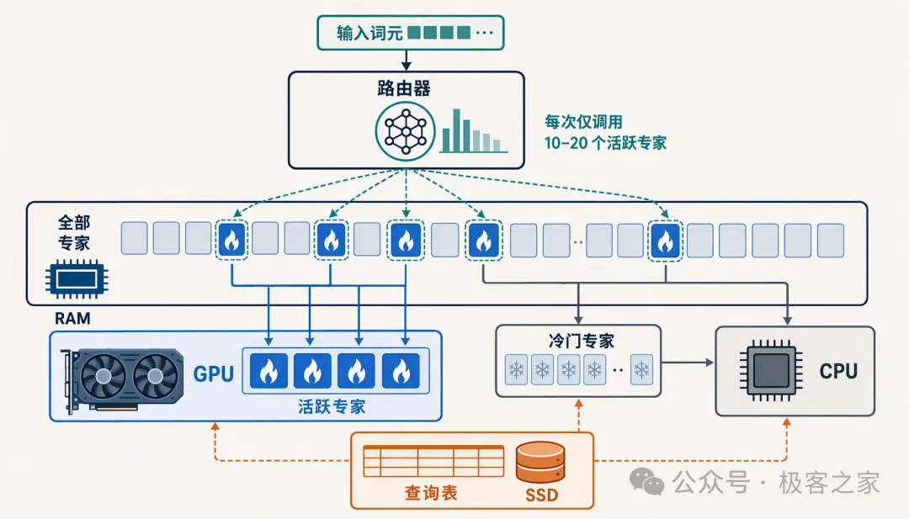
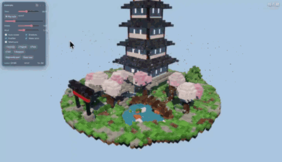
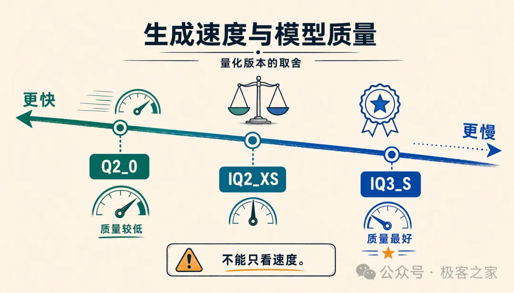
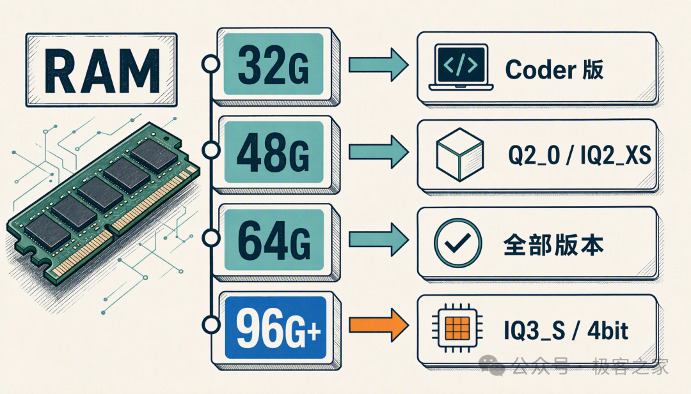
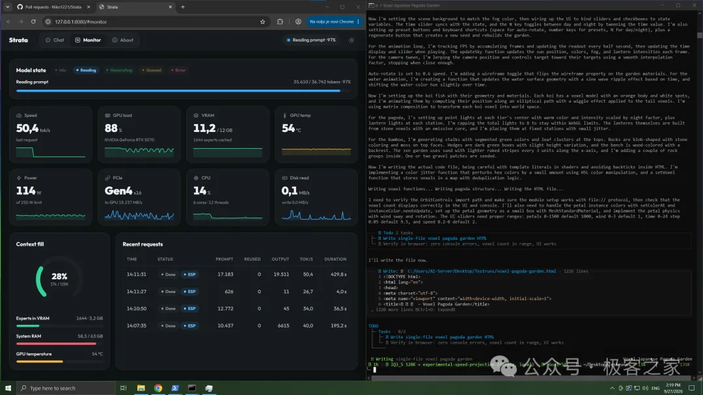
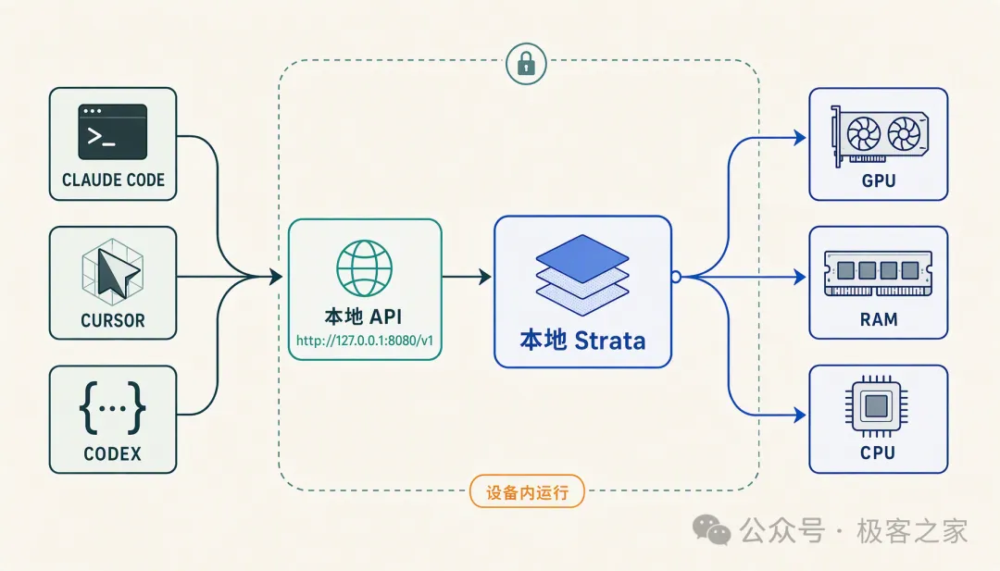

# Strata：一张游戏显卡跑 1250 亿参数大模型

> 来源：极客之家｜丛林 2026-10-06
> 原文：[一张游戏显卡跑1250亿参数的AI大模型，124 token/秒，这个开源项目火了](https://mp.weixin.qq.com/s/T4xBCm_ge42kHBAW3pCJvQ)
> GitHub：[Niko1221/Strata](https://github.com/Niko1221/Strata)（MIT，C++，2026-09-24 建库）

## 概述

Strata 是一个让消费级硬件跑 1250 亿参数 Qwen3.8-Flash-Next（MoE 架构）的开源推理框架，2026-09-24 建库，MIT 协议，主语言 C++。文章发布时称十来天 Star 破 1.2 万；**归档日（10-06）实测 14,211⭐ / 1,202 forks / 436 open issues / 87 watchers，10-04 仍在推送代码**——热度与活跃度均为一线水平。

起因是 Hacker News 一个高分帖子（一天 776 分，写稿时 831 分、三百多条评论）：发帖人用一张 RTX 4090 + 128G DDR5 内存 + 锐龙 7950X3D，跑出 **124 token/秒**。文章作者将其定位为"本地跑大模型从验证价值到使用价值"的分水岭——此前本地跑大模型普遍"显存不够加载不起来，加载起来的慢得离谱"。

## 核心机制：125B 模型怎么塞进游戏电脑

**MoE 专家分级放置。** 1250 亿参数听着吓人，但 MoE 架构里有两万四千多个"专家"，每吐一个词真正参与计算的只有十来个。Strata 的做法是把这批专家分开安置：

| 位置 | 放什么 | 干什么 |
|------|--------|--------|
| 显卡（显存） | 最忙的几千个热门专家 | 常驻，高速计算 |
| 内存 | 全部专家 | 完整备份 |
| CPU | 不忙的冷门专家 | 顺手算掉 |
| SSD | 专家查询表 | 快速路由该叫哪个专家干活 |

显卡、内存、CPU、SSD 全部用上，整机没有一个闲着的。

**投机解码。** 模型往外写字时，先让一个小模型猜后面几个词，大模型一次性验证。猜对了就一口气多出好几个词，速度提升 **1.6~1.8 倍**，输出与原来完全一致（无损）。

## 能做什么

- **聊天、写东西、读长文档**：上下文默认 128K、最长 256K，整本书或代码仓库可直塞。官方口径 32K 文档约一分钟读完。
- **写代码**：官方演示一句话提示生成可在浏览器拖拽查看的 3D 体素宝塔花园——单个 HTML 文件 1226 行一次写完（RTX 5070 上跑）。

- **看图**：截图、照片直接贴。限制：AMD 卡在 Linux 上走 CPU 处理图片，Windows 暂不支持。
- **给编程工具当本地后端**：本地起 OpenAI + Anthropic 双兼容 API，Claude Code、Cursor、Codex 把地址指过来就能用。模型跑在自己机器上，token 不花钱，代码不出本机。
- **思考深度可调**：off / low / medium / high 四档，闲聊关思考最快，难题开 high。

## 速度实测

官方双机（一 N 卡一 A 卡）生成速度：

| 量化版本 | RTX 5070（12G 显存+64G 内存） | RX 9070 XT（16G 显存+47G 内存） |
| :-- | :-- | :-- |
| Q2_0（压缩最狠） | 94 tok/s | 60 tok/s |
| IQ2_XS | 79 tok/s | 52 tok/s |
| IQ3_XXS | 62 tok/s | - |
| IQ3_S（质量最好） | 53 tok/s | - |
| Coder（写代码专用） | 55 tok/s | 44 tok/s |

⚠️ Q2_0 压缩最狠，跑得快但聪明程度打折最多——"表里那个 94 看看就好，质量和速度放在一起才有实际意义。不然就像那个小品：回答贼快，但都是错的。"

社区实测：

| 硬件 | 成绩 | 对照 |
|------|------|------|
| RTX 4090 + 128G 内存（HN 发帖人） | 124 tok/s | — |
| RTX 2060 8G 显存 | 33 tok/s（Q2_0） | — |
| RTX 5070 Ti 移动版 12G + 64G，43K 上下文 | 51 tok/s | 同模型 llama.cpp 仅 23 |
| RTX 3090 跑 IQ3_S 短问答 | 67 tok/s | 同硬件 llama.cpp 约 20 |

数字受 CPU、内存、量化版本影响很大，但大方向一致：**同一个模型，Strata 比通用方案快不少**（约为 llama.cpp 的 2~3 倍）。

## 硬件要求与版本选择

| 项目 | 要求 |
| :-- | :-- |
| 显卡 | NVIDIA RTX 20/30/40/50 系，或 AMD RX 7900 XT/XTX、7800 XT、9070 系、RX 6800/6900 系等，显存 12G 起步 |
| 内存 | 32G 起步，64G 能跑所有版本 |
| 硬盘 | 留 80G 空间，最好 SSD（首次加载快很多） |
| 系统 | Windows 10/11 或 Linux，显卡驱动要新 |

**能装哪个版本由内存决定**：32G 基本只能跑 Coder 版（若显存 24G 也可跑 Q2_0/IQ2_XS）；48G 跑 Q2_0 和 IQ2_XS；64G 全都能跑。老显卡（Tesla P40、GTX 10 系）有实验性支持，Intel Arc 在 Linux 可源码编译，均属折腾区。

首次启动会卡 1~3 分钟——要往内存灌 35~55G 并锁一部分给显卡，属正常现象，别当死机关窗口。

版本选择（安装器一般会推荐，听它的）：

- **32G 内存**：Coder 版。专为写代码砍了一半专家，SWE-bench Verified 保留完整模型 91% 能力（模型作者自测）。代价是代码以外能力弱，**中文尤其明显**（社区有专门反馈）。
- **48G**：IQ2_XS 或 Q2_0（Q2_0 更快）。
- **64G**：推荐 IQ2_XS；要质量选 IQ3_S（最好也最慢）。
- **96G+**：IQ3_S，或 Unsloth 4bit 版。

**主要用中文聊天就选保留全部专家的版本（Q2_0/IQ2_XS/IQ3_S），别碰 Coder。**

## 安装与使用

两种装法：

1. **让 AI 帮装**：用 Claude Code / Cursor / Codex 时直接丢仓库地址，让它读仓库里的 `AI_SETUP.md`，自动检查显卡/内存/硬盘、挑版本、装完告诉你怎么接工具。
2. **手动**：clone 或下载解压 → Windows 双击 `START-HERE.bat`，Linux 跑 `./setup.sh` → 问几个问题（模型/上下文/要不要读图），一路回车全是推荐值 → 下载约 70G 模型（断了重跑会断点续传）→ 装完自动打开 `127.0.0.1:8080`。以后每次跑一遍 START-HERE 即启动，不会重复下载。

使用形态：

- 浏览器 `8080` 端口是完整应用：聊天窗口 + 实时监控页（GPU 占用、显存、内存、每秒出词速度曲线）。
- 接现有工具：base URL 填 `http://127.0.0.1:8080/v1`，API key 随便填。Claude Code 设 `ANTHROPIC_BASE_URL` 指向它；Codex CLI 走 `/v1/responses`。

- 默认一次只处理一个请求，多出的排队。可改配置开并行，但 12G 显存卡上每个请求都会变慢。

## 局限

- 默认单请求，多人同时用要排队。
- CPU 和内存对速度影响很大——同一张显卡换台机器，速度可能差出好几倍。
- 项目建库仅十来天，属于早期快速迭代阶段（issue 区活跃，作者更新勤）。

## 战略分析

**定位判断：MoE 专家分级放置 = 本地推理的新范式。** Strata 本质是把 llama.cpp 这类通用推理引擎的"层间 offload"粗粒度策略，细化到 MoE 的"专家级"热度分级——热门专家进显存、冷门走 CPU/SSD。这是 2026 下半年"消费级硬件跑百亿~千亿 MoE"浪潮的代表性方案，同类信号还有：slotstream（420⭐，Mac 上流式跑 105GB 模型）、halogen-flash-server（857⭐，Strix Halo 专用）、各路 DGX Spark 单机部署 recipe。MoE 模型的稀疏激活特性天然适合这种异构放置，这条路会持续演化。

**对本机（macOS）的现实结论：装不了，先记录。** Strata 当前只支持 Windows 10/11 和 Linux + NVIDIA/AMD 显卡，没有 macOS/Apple Metal 支持。本机是 Apple Silicon Mac，想体验同思路需等 macOS 移植或用 llama.cpp Metal / MLX 社区方案替代。归档价值在于跟踪这个范式——一旦出 Mac 原生版（参考 laya-mlx 先例，生态通常几周内跟进），就是"本地免费编程后端 + 隐私敏感任务兜底"的直接候选。

**与现有工具链的对照：**

| 维度 | Strata | 当前体系（云端 API 为主） | 本机 Ollama（GBrain 嵌入） |
|------|--------|--------------------------|---------------------------|
| 定位 | 消费级硬件跑 125B MoE | Hermes 主力走云端 DeepSeek/GLM | 只跑 nomic-embed-text 小模型 |
| 速度 | 124 tok/s（4090+128G） | API 延迟低、无本地资源占用 | 嵌入用途，速度不敏感 |
| 成本 | 电费，token 免费 | 按 token 计费 | 免费 |
| 隐私 | 代码/数据不出本机 | 数据出本机 | 不出本机 |
| 编程后端 | OpenAI+Anthropic 双兼容，Claude Code/Codex 直连 | 云端订阅 | 无 |
| 平台 | Win/Linux + N/A 卡 | 全平台 | macOS 原生 |

**可借鉴点：** ① `AI_SETUP.md` 的"让 Agent 读仓库自装"模式——工具作者把安装协议写成 Agent 可执行文档，与本知识库已归档的 douyin-mcp"README 写成 Agent 安装协议"是同一趋势，自研工具分发时应采纳；② 投机解码 + 专家热度的组合拳值得在任何本地推理选型时作为评估维度；③ Coder 版"砍专家换显存、代码保 91%"的量化思路，说明 MoE 时代"裁剪"可以按能力域定向做，不再只是比特量化。

**风险：** 建库 12 天、单一主导作者、默认单请求并发；Q2 级量化的能力损失在中文场景更明显（Coder 版社区反馈）。适合"有一张闲置游戏卡的 Windows/Linux 用户"立即上手，不适合当生产依赖押注。

## 归档日志

- 2026-10-06 归档（Firecrawl 抓取正文与元数据；发布时间经浏览器复核为 2026-10-06 11:37，Firecrawl 显示的 Oct 5 为美东时区；GitHub 数据归档日实测 14,211⭐/1,202 forks/MIT；8 张配图下载时 5 张命中微信 CDN 限流占位符 + 1 张 HTTP 400，经浏览器页面内 fetch 缓存通道全部恢复，其中 4 张实际格式为 WebP、1 张 GIF，已按魔数改扩展名）
