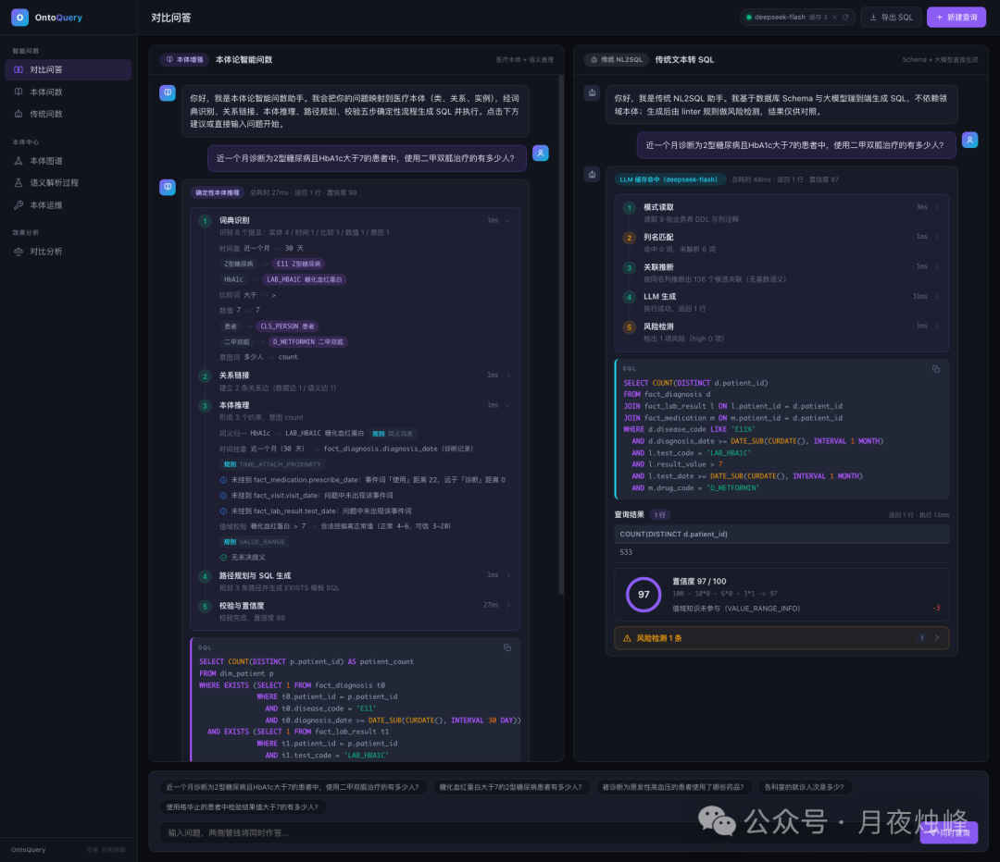
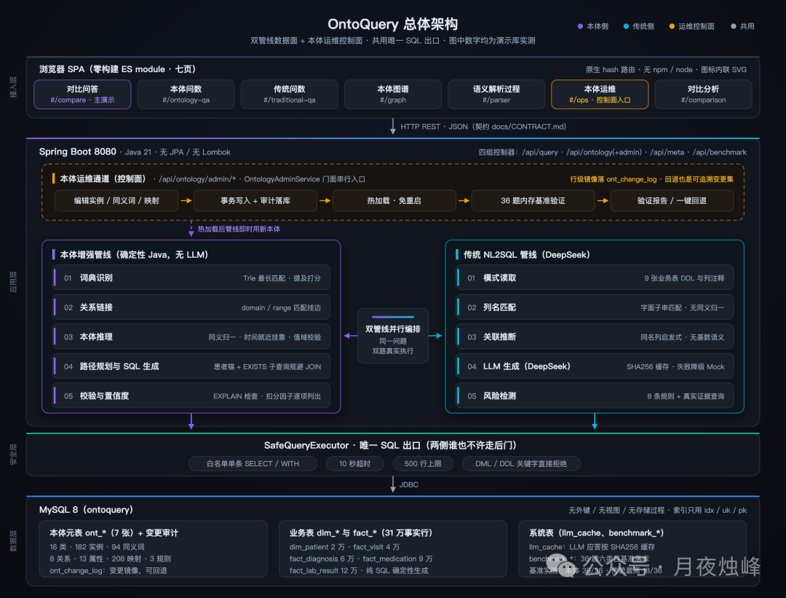
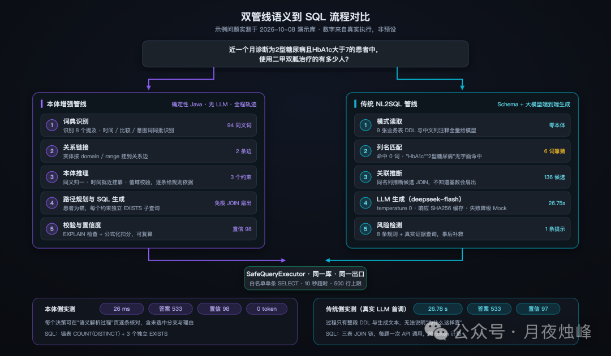
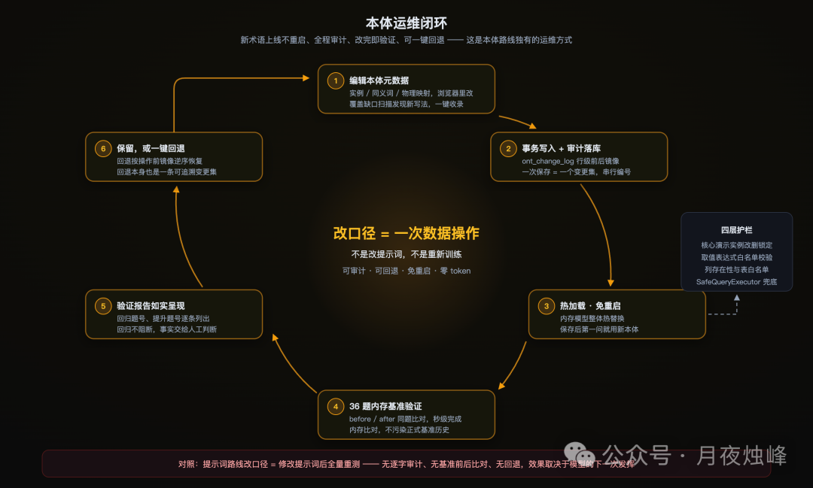
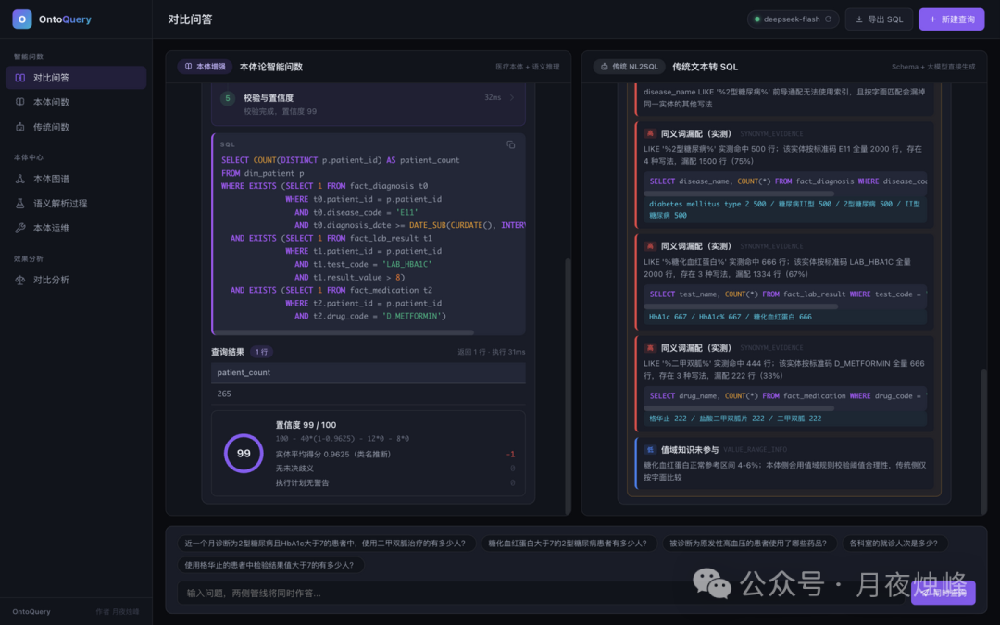
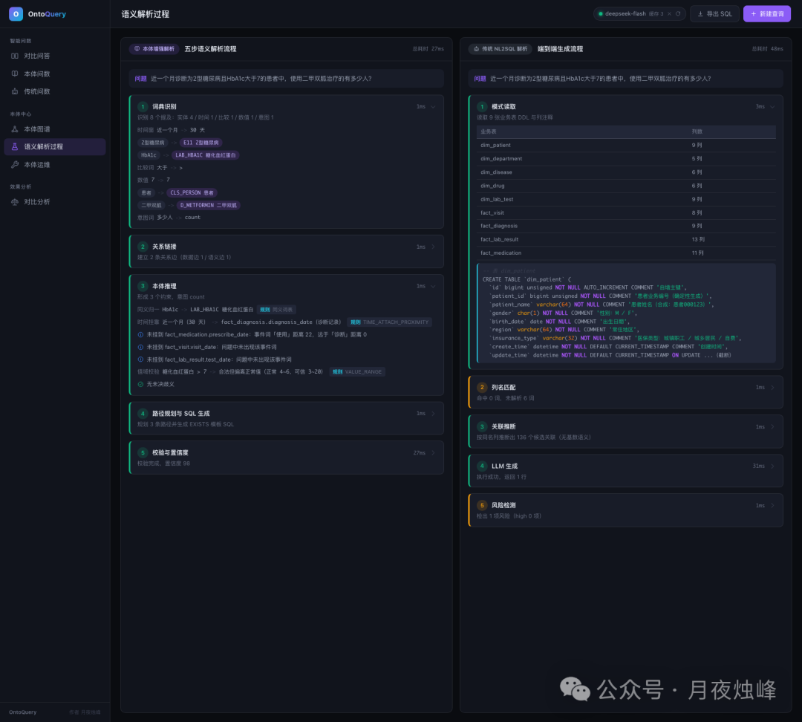
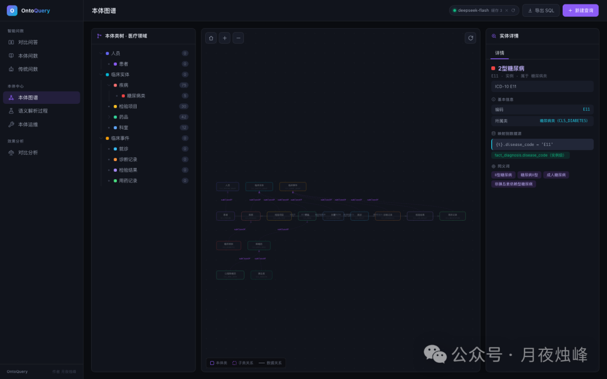
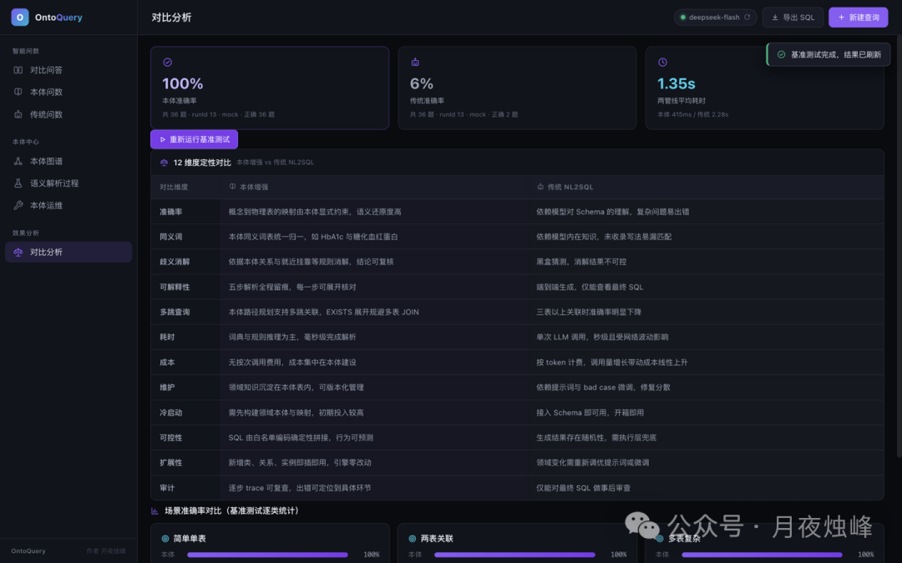

# OntoQuery — 基于本体论的智能问数系统（双管线对比）

> 来源：青鸟的记忆（公众号：月夜烛峰）· 2026-10-08
> 原文：[分享一个基于本体论的智能问数系统OntoQuery](https://mp.weixin.qq.com/s/eO7mkCCvzqofxIRDF7X5PA)
> GitHub：[yueyezhufeng/ontoquery](https://github.com/yueyezhufeng/ontoquery)（Apache-2.0，Java）

## 概述

OntoQuery 是作者"Ontology从概念到落地"系列的最新作品：一套把**领域知识显式建模成本体（Ontology）**的智能问数（NL2SQL）系统。核心卖点不是"又做一个 NL2SQL"，而是**同一个问题的两条管线并行真实执行、并排对比**——本体增强管线（确定性 Java，无 LLM）vs 传统 NL2SQL 管线（DeepSeek 生成）。演示数据中真实埋设了同义词散布、多表基数、时间挂靠歧义，两条管线处理结果产生真实差异；页面上每个数字都来自 SafeQueryExecutor 的真实查询，前后端不硬编码结果。

典型问题：「近一个月诊断为2型糖尿病且HbA1c大于7的患者中，使用二甲双胍治疗的有多少人？」

## 设计初衷：为什么把知识建模成本体

NL2SQL 产品化常见做法是把表结构+问题直接交给大模型生成 SQL，上手快，但真实业务库上有四类反复出现的问题：

| 问题类型 | 表现 |
|---------|------|
| 同一实体多种写法 | 字面匹配漏配（"HbA1c" ≠ "糖化血红蛋白"） |
| 时间修饰歧义 | 挂错列导致数字漂移 |
| 多表关联扇出 | 统计口径失真 |
| 端到端黑盒 | 无法审计无法解释 |

作者的核心论断：**这四类问题不是"模型不够聪明"，而是"领域知识没有地方放"**。哪几个词是同一个药、时间词该挂哪一列、患者和诊断是一对多——业务专家张口就来，但不可能靠模型乱猜。本体就是给这些知识一个显式、结构化、可维护的存放处。

## 架构设计

### 总体架构：双管线数据面 + 本体运维控制面

五层结构（自上而下）：

| 层 | 实现 |
|----|------|
| 前端 | 原生 ES module 单页应用，**零构建**——无 npm、无打包器、无第三方库，hash 路由七页面，深色主题，33 个内联 SVG 图标 |
| 应用层（数据面） | Spring Boot 3.5.16（Java 21），四组控制器：/api/query、/api/ontology、/api/meta、/api/benchmark，双管线并行编排（手建命名线程池） |
| 应用层（控制面） | 本体运维通道 /api/ontology/admin/*：编辑、事务写入加审计、热加载、36 题内存验证、验证报告与回退，五步串行 |
| 执行层 | **SafeQueryExecutor —— 两侧唯一 SQL 出口**：白名单单条 SELECT/WITH、10 秒超时、500 行上限、DML/DDL 关键字直接拒绝 |
| 数据层 | MySQL 8 单库 ontoquery：7 张 ont_* 本体元表 + ont_change_log 变更审计表 + 9 张 dim_/fact_ 业务表 + llm_cache / benchmark_* 系统表 |

**轻量关系型本体**：不用图数据库、不用三元组存储——本体就是 7 张 MySQL 元表（ont_class / ont_instance / ont_synonym / ont_relation / ont_attribute / ont_mapping / ont_rule），应用启动时全量加载进内存。演示规模：**16 类 / 182 实例 / 94 同义词 / 8 关系 / 13 属性 / 208 映射 / 3 规则**。

### 双管线流程

**本体增强管线（五步，确定性 Java，无 LLM）**：
1. **词典识别**：实例名、编码、同义词、类名、时间词、比较词、意图词构建 Trie，最长匹配；每个提及打分（精确实体 1.0 / 同义词 0.92 / 类名推断 0.85）。核心问题共识别 8 个提及
2. **关系链接**：按提及的类做 domain/range 匹配，实体挂到关系边
3. **本体推理**：六项能力（下一节），每个决策写入轨迹
4. **路径规划与 SQL 生成**：以患者为锚 BFS 关系图，每个约束展开为独立 EXISTS 子查询
5. **校验与置信度**：EXPLAIN 检查全表扫描，置信度按公式计算并逐项列扣分因子

**传统 NL2SQL 管线（同样五步）**：
1. **模式读取**：9 张业务表 SHOW CREATE TABLE（含中文列注释）全量交给模型
2. **列名匹配**：问题词与列名、注释做字面子串匹配——核心问题**命中 0 词**，"HbA1c""2型糖尿病"均无命中，这正是后续只能靠模型猜的根源
3. **关联推断**：同名列（patient_id / visit_id）推断候选 JOIN，无基数语义
4. **LLM 生成**：DeepSeek（OpenAI 兼容协议，model deepseek-flash，temperature 0，max_tokens 4000），输出经 SQL 抽取器规整；响应按 SHA256 缓存于 llm_cache 表；失败重试后降级确定性 Mock 生成器
5. **风险检测**：8 条规则，基于实际生成的 SQL 与真实证据查询

### 运维闭环

改口径对比：传统 NL2SQL 改口径只能改提示词然后全量重测，无逐字审计、无基准前后比对、无回退；**本体路线的改口径是一次可审计、可回退、免重启的数据操作**。

## 实测效果

### 基准设计

36 题基准，6 类目 × 6 题：简单单表 / 两表关联 / 多表复杂 / 同义词理解 / 时间修饰歧义 / 多层推理。每题黄金 SQL 与被测 SQL 同时执行、标量精确比对。

### 核心问题对比

| 维度 | 本体增强管线 | 传统管线（真实 LLM） |
|------|------------|---------------------|
| 答案 | 533 | 533 |
| 端到端耗时 | **26 ms**（多次实测 24-27 ms） | 首调 26.8 s（另一次 18.7 s）；缓存命中后毫秒级 |
| 置信度 | 98 | 97（值域知识未参与，VALUE_RANGE_INFO 扣 3） |
| SQL 形态 | 锚表 COUNT(DISTINCT) + 3 个独立 EXISTS 子查询 | 模型自由生成，三表 JOIN 链 |
| 决策可解释 | 五步轨迹，含时间挂靠未选分支与理由 | 建表语句原文 + 生成文本，无决策依据 |
| token 成本 | **0** | 每题一次 API 调用，按 token 计费 |

本体侧置信度 98 的扣分构成：实体平均得分 0.9425（同义词命中）扣 2 分；无未决歧义、无执行计划警告。

### 答案与风险

变体问题「近三个月诊断…糖化血红蛋白大于8…」：传统管线结果 265 与本体一致，但生成 SQL 用 `drug_name LIKE '%二甲双胍%'` 匹配名称列，风险检测给出 **5 条风险（4 条高危）**——答案对，SQL 质量差异可见，回答略显脆弱。

### 语义解析 / 本体图谱 / 效果分析

## 关键洞察

- **双管线对比本身就是最强论证**：不是单方面宣称本体好，而是让两条管线在同一问题、同一数据库上真实执行并排展示——耗时、置信度、SQL 形态、决策轨迹、token 成本逐项对比。这种"可证伪的对比设计"比任何架构图都有说服力
- **"领域知识没有地方放"是 NL2SQL 的本质矛盾**：字面匹配漏配、时间歧义、关联扇出、黑盒，根因都不是模型能力，而是业务知识无法注入。本体 = 领域知识的显式存放处
- **轻量关系型本体的务实选择**：不用图数据库不用三元组，7 张 MySQL 元表 + 内存全量加载。在演示规模（16 类/182 实例）下完全够用，运维复杂度趋近于零
- **SafeQueryExecutor 单一 SQL 出口**：白名单 SELECT + 超时 + 行数上限 + DDL/DML 拒绝——LLM 生成代码的沙箱化执行，是所有 Text2SQL/Agent 产品化的安全基线
- **运维闭环是本体路线的护城河**：改口径从"改提示词全量重测"变成"可审计、可回退、免重启的数据操作"——这正是传统路线永远做不到的

## 战略分析

### 与现有工具链的对照

| 维度 | OntoQuery | Hermes Agent 栈 | dsh-ontology（已归档） |
|------|-----------|----------------|----------------------|
| 定位 | 医疗领域 NL2SQL 对比演示系统 | 个人 AI 助理 + 技能体系 | Agent 记忆的本体约束 |
| 语义层 | 7 张 MySQL 元表轻量本体 | Obsidian wiki + gbrain（向量+全文混合检索） | 运行时本体校验插件 |
| 知识注入 | 同义词/时间/基数显式建模 | SKILL.md 过程性知识 + 记忆系统 | DSH 运行边界 + Ontology 语义边界 |
| 执行安全 | SafeQueryExecutor 白名单 | 无等价物（agent 直接执行 shell） | — |
| 评估 | 36 题基准 + 黄金 SQL 比对 | 无系统化评估 | — |

### 差距与借鉴点

1. **"领域知识没有地方放"同样是 Agent 栈的痛点**。Hermes 的技能系统是过程性知识（怎么做事），但**事实性/语义性知识**（实体别名、口径定义、业务规则）没有结构化存放处——目前散落在 memory 条目和 wiki 页面里。OntoQuery 的 7 表本体设计给出了一种极轻量的参照：不需要图数据库，关系型元表 + 内存加载即可
2. **双管线对比的评估方法论值得照搬**。36 题基准 + 黄金 SQL 标量精确比对 + 六类目覆盖（同义词/时间/多层推理），这套评估框架可以平移到 Agent 能力评估——当前 Hermes 栈缺少系统化的能力基线测试，"效果好不好"全靠体感
3. **SafeQueryExecutor 是 LLM 生成代码执行的安全基线**。白名单 + 超时 + 行数上限 + 关键字拒绝，四层防护的设计可以直接借鉴到任何 LLM 生成 SQL/命令的执行场景。Hermes 目前对生成命令的执行没有等价的白名单机制
4. **运维闭环（可审计/可回退/免重启）是知识资产化的前提**。wiki 和 gbrain 的每次编辑有 git 版本，但缺少"变更前后基准比对 + 一键回退"的闭环。本体运维的五步串行（编辑→审计→热加载→验证→回退）是知识库治理的成熟模式
5. **成熟度判断**：24⭐ / 15 fork / Apache-2.0 / 单贡献者，repo 与文章同日创建（2026-10-08）——这是**文章配套的演示项目**，不是社区驱动的开源产品。README 完整度高（操作手册/方案设计/API 契约/原型说明/演示讲稿五份文档），工程规范严格（嵩山版手册强制条目），但社区验证几乎为零，生产可用性未知。借鉴其设计思想价值大于直接引入代码

### 整合可能性

短期内无直接整合点（Java/Spring 技术栈与 Hermes 的 Python 生态不同构），但两个方向值得持续关注：
- **本体思想用于 gbrain/Obsidian 知识库治理**：把实体归一、同义词映射引入 wiki 索引，让"同一概念多种写法"不再依赖全文检索的模糊匹配
- **SafeQueryExecutor 模式用于 Agent 工具执行层**：给 LLM 生成的 SQL/shell 命令加白名单执行器，是 Agent 安全产品化的通用模式

## 关联阅读

- [[2026-09-27-dsh-ontology实测-给Agent记忆装上本体约束]] — 同为"本体论落地"主题：dsh-ontology 用本体约束 Agent 记忆，OntoQuery 用本体驱动 NL2SQL，互为印证
- [[2026-06-30-SAG-LLM-Wiki-最强知识库方法论]] — SAG 论文同样指出本体治理的代价："实体归一、关系定义、别名处理需持续投入"

## 归档日志

- 2026-10-11 归档。Firecrawl 提取正文与元数据；图片 9 张：6 张 curl 直下（Referer+UA），3 张（img_004/005/006）遭 CDN 限流返回 243B 占位图，通过浏览器 CDP `Page.getResourceContent` 从页面缓存补齐；封面 cover.jpg 未入正文。GitHub 仓库 yueyezhufeng/ontoquery 经 API 核实（24⭐/15 fork/Apache-2.0/2026-10-08 创建，与文章发布同日）
