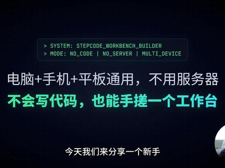

# 新手也能手搓一个手机上真正可用的工作台？

> 电脑端 + 手机端 + 平板端三端共用，Step Code + Step Page 使用体验
> 作者：李君陌（抖音「Hermes&DSH 实战入门」系列第 14 集）｜发布：2026-10-08 18:50｜时长 20:58｜赞 7.1万 / 收藏 94 / 评论 10 / 转发 75



## 一句话结论

这条视频**不是教你写提示词，而是演示一条"从提示词到固定网址上线"的完整链路**：Step Code（阶跃星辰的终端 AI 编程 Agent）里喊一句话生成单文件工作台 → 用内置的 **StepPage** 插件一键发布成静态站 → 三端（PC/手机/平板）通过同一个网址访问 + 加到桌面当 App。和你昨天归档的那份 PWA 工作台提示词正好是上下游关系：**那份是"生成什么"，这条是"怎么让它上线、怎么多端拿到"**。

## 章节要点（页面自动生成，非逐字转录）

| 时间 | 章节 | 内容 |
|------|------|------|
| 00:00 | 引言 | 如何使用 StepCode + StepPage 创建多端通用工作台（教室、招聘、记账、新媒体、装修等类型），新手靠提示词 + 参考设计即可定制；StepCode 还提供一键发布静态网站托管的能力，实现自动化运维和更新；另展示小游戏与 StepCode 配置 |
| 01:30 | 案例展示 | 教室工作台效果：今日总览、基本功能、随机点名、课堂测试计时器等 |
| 02:40 | 搭建过程 | StepCode 新建文件夹 → 输入提示词 → 选模型 → 执行 plan → 得到 HR 基础工作台 |
| 05:47 | 发布与上线 | 用 StepCode 提供的 IP（应为 StepPage 托管）服务发布网站，先拿预览链接，上线后得到**固定网址** |
| 11:50 | 其他工作台 | 招聘 / 记账 / 新媒体 / 装修工作台效果，强调**数据协同与多端同步** |
| 16:23 | 小游戏 | 疯狂贪吃蛇，电脑/手机/平板均可玩 |
| 17:37 | 安装与配置 | 安装 StepCode、创建账号、选模型、配置 MCP、发布站点 |
| 20:24 | 总结 | StepCode + MCP 服务，打通"开发 → 上线"全流程，方便新手 DIY |

## 官方口径补充（视频说不清、文档写清楚的）

视频口播只说了"用 IP 服务发布"，实际对应的是 **StepPage 静态托管插件**。以下来自 StepFun 官方文档（`platform.stepfun.ai/docs/en/step-code/reference/steppage`）与 GitHub 仓库，归档日实测数据：

### Step Code 是什么

- 阶跃星辰（StepFun）出品的**终端 AI 编程 Agent**：读代码、改文件、跑命令、跑测试，针对自家 Step 模型优化
- 仓库 `stepfun-ai/Step-Code`，**MIT 协议**，2026-06-01 建库，**归档日实测 1,019 ⭐ / 68 fork / 41 open issue**，昨日（10-25）仍有提交 —— 不是玩具项目，但也不是大盘项目，处于早期活跃期
- 安装：`curl -fsSL https://static-openapi.stepfun.com/stepcode/install.sh | bash`（Windows 用 PowerShell 版），装到 `~/.stepcode/bin` 并改 PATH
- 登录：四选一 —— Step Plan 国内 / Step Plan 海外 / Step Platform 国内 API Key / 海外 API Key；凭证存 `~/.stepcode/auth.json`（`0600`）
- 关键能力：`ultracode:` 前缀触发多 Agent 工作流编排；三档权限（Ask / Approve for Me / Full Access，`Shift+Tab` 切换）；`AGENTS.md` / `CLAUDE.md` 项目指令

### StepPage 是什么（这条视频的核心增量）

- `steppage` 是 Step Code 的**内置发布插件**，底层走 `steppage-mcp` 这个 MCP server，提供部署、站点查询、版本管理、promote、rollback
- **只接静态产物**（本地目录或 ZIP），不接后端和数据库 —— 这决定了它能做的工作台必须是纯前端 + localStorage 那一类
- 从 v0.1.1 起首次启动即预装；`/mcp` 查状态，缺失时 `/plugin install steppage`
- 依赖**外部 Node.js 20+**（不是 Step Code 本身依赖）；原生 Windows 不自动装 MCP，要走 WSL 或手动配
- 部署方式就是把话说明白：`Publish ./dist as a website and generate a preview link.` → 模型调 `page_deploy` → 返回预览链接 + 版本号 + 管理链接
- 站点管理后台：`platform.stepfun.com/sites`；**托管额度、访问规则、限制由静态托管配额决定，不占 Step Plan 的模型额度**

## 这条链路的技术拆解

### 它到底做了什么

```
Step Code (终端 Agent)
  └─ 生成单文件/单页 HTML（含 CSS/JS）
        └─ StepPage MCP → page_deploy 上传静态资源
              └─ 固定 URL（CDN 承载）
                    ├─ PC Chrome 直接开 / 建桌面快捷方式
                    ├─ 手机浏览器开 → 添加到主屏幕（PWA 效果）
                    └─ 平板同理
```

**"三端共用"的本质不是三套代码，而是一个 URL + 响应式布局。** 视频里 11:50 强调"数据协同与多端同步"——注意这里要说清楚：StepPage 只是静态托管，**没有后端就没有真正的服务端同步**，多端数据同步仍然要靠 localStorage + 导出/导入（就是上一份 PWA 提示词第 2 条的云剪贴板方案），或者你在前端接第三方 BaaS。

### 和已有归档的关系（衔接判断）

| 你已有的 | 这条视频补上了什么 |
|---|---|
| `2026-10-26-PWA移动APP工作台提示词`（飞书归档）——**生成什么**：8 条 PWA 硬约束 + 岗位描述模板 | **怎么上线**：StepPage 一键发布 → 固定网址 → 三端添加桌面；不用自己找服务器、不用 GitHub Pages、不用配域名 |
| 两者拼起来 = 完整闭环 | 提示词负责质量（全屏、图标、防缓存更新），StepPage 负责可达性（固定 URL + 版本回滚） |

**一个实用提醒**：StepPage 只托管静态文件，意味着"检查在线版本更新"（PWA 提示词第 5 条）必须由前端自己做——但静态托管天然带版本号（promote / rollback 机制），配合 `version.json` 或 HTML 内嵌版本号比自建服务器更容易做缓存失效，这是它相对"丢到自己服务器"的真实优势。

### 三个要留意的地方

1. **平台锁定**：StepPage 是阶跃星辰自家托管，站点管理、额度和访问控制都在 `platform.stepfun.com`。迁移走人 = 自己重新部署。要长期用的工作台，建议保留本地 `dist/` 副本 + git 版本化。
2. **纯静态的边界**：没有后端就没有真·多端实时同步、没有账号体系、没有服务端加密。装敏感数据（学生信息、家长联系方式、报价单）的工作台，最好别公开托管，或用带访问口令的方案。
3. **额度与合规**：托管额度和访问规则由静态托管配额决定，**和模型套餐分开计**——用量大时看静态托管文档而不是 Step Plan 文档。

## 应用价值（对你）

你手上正好有"工作台"这条线：昨天那份 PWA 提示词是**生成层**，这条视频给的是**分发层**。如果要真跑起来：

- 最低成本路径：Step Code 生成 → StepPage 发布 → 手机桌面添加 → 日常用，全程零服务器
- 想脱离平台：生成产物存 git，推到 Cloudflare Pages / Vercel 静态托管，URL 和额度都更宽松
- 想做真数据同步：静态层保持不动，前端接 Supabase（免费额度够个人用），提示词第 2 条的 JSON 导入导出作为离线兜底

**我的判断**：这条视频的价值不在 Step Code（终端 Agent 同质化严重，Claude Code / Codex 都能干），而在"**一键静态托管 + 固定 URL**"这一步把 vibecoding 的最后一公里补上了——新手最常死在"做好了怎么给手机装"。要不要我把 Step Code 装上试一遍这条链路（生成 → 发布 → 手机验证）？装的话走 `~/projects/`，用 Step Platform API Key。

## 归档说明

- **来源路径**：抖音视频页需登录→ 章节要点 + 元数据完整可取，走**轻路径**（页面 `章节要点` 结构化摘要是官方自动生成，非逐字转录）
- 页面 `innerText` 一次提取成功：标题、作者、发布时间 2026-10-08 18:50、互动数据、8 段带时间戳章节要点、顶部评论
- 视频时长 20:58，全程为单人讲解 + 录屏，**未做 ASR**（章节要点已足够还原信息骨架）
- 官方口径补充来源：`platform.stepfun.ai/docs/en/step-code/quickstart`、`.../reference/steppage`、`github.com/stepfun-ai/Step-Code`
- 封面图：页面 `lark:url:video_cover_image_url` 元数据下载（JPEG 440×330, 20KB）
- 评论区现状：多为"求分享"（作者回复"发你咯"），无实质技术讨论；作者为「Hermes&DSH 实战入门」系列作者，第 9-13 集分别讲 Hermes 进阶能力、ClawChat、anysearch、DSH 桌面端
- ⚠️ 视频内口播的"IP 服务"为作者口误/简写，正确名称是 **StepPage**
