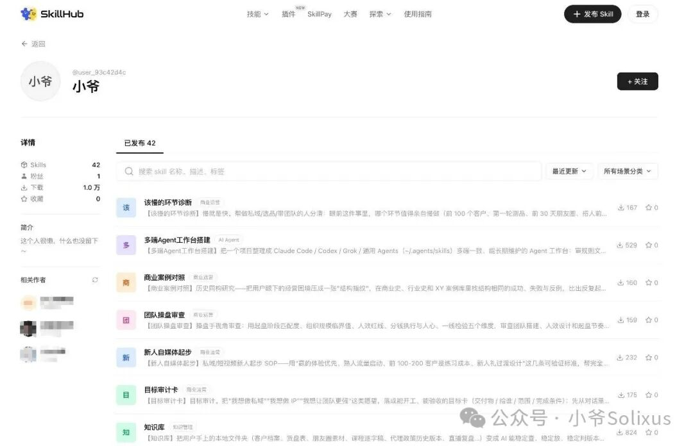

# 两个亿的操盘手，把自己蒸馏成了 48 个Skill

> 作者：小爷（公众号「小爷Solixus」，作者自称「小爷」/风物执守）
> 发布：2026-10-11 12:56
> 原文：[两个亿的操盘手，把自己蒸馏成了 48 个Skill](https://mp.weixin.qq.com/s/vGS1yZre0WT_q1YOPvAFDg)
> GitHub：[xyaz1313/xyskill](https://github.com/xyaz1313/xyskill)


## 概述

一位自称操盘过「两个亿」的私域/流量操盘手，把自己十几年在**私域、流量、成交、带团队、选品、做内容**上的经验，全部拆成 Skill（共 48 个，全部免费开源），背后是 **28,226 条知识原子**，在 SkillHub 上已被安装 10,000+ 次。

这篇文章是这 48 个 Skill 的**总索引 + 使用说明书**：每个 Skill 解决什么问题、什么时候触发、装好后应该对 AI 说什么话。作者的建议是先收藏，用的时候对着点名。

文章给出的核心主张是：**一个人 + 48 个 Skill = 一个团队**——运营、内容、成交、复盘、AI 各有人干。

## 十二大分类与 48 个 Skill

### 一、管理与复盘：结论怎么存、怎么续（7 个）

| # | Skill | 解决什么 | 触发话术 |
|---|-------|---------|---------|
| 1 | **xy-coach** | XY 操盘教练。恢复用户档案、判断业务阶段、只推进一步、调用对应 xy-\* skill、用原子库证据回答 | "带我做" / "我该怎么办" / "不知道从哪开始" / "你是我的教练" |
| 2 | **xy-archive** | 把本轮聊出的结论、否掉的路、待验证假设写成本地存档，下次接着用；管存档放哪 | "这个结论留着" / "存一下" / "存档放哪" |
| 3 | **xy-resume** | 把上次存的诊断存档拉出来，接着上次结论往下走（配合 xy-archive） | "接着上次" / "上次聊到哪了" / "续上" |
| 4 | **xy-brief** | 把多份 xy-archive 存档按时间线合成一份能发合伙人、能归档、能三个月后回看的诊断报告 | "出份报告" / "打包一下" / "整理成一份给合伙人看" |
| 5 | **xy-casefile** | 决策复盘立案：把一个要跟很久的域（一门私域生意/一个账号矩阵/一次换品）做成本地四层知识工程——事实、规律、定格、待解，带来源标签、写完不改的快照，可回填结果 | "这个决定要跟踪" / "立个案" / "结果出来了，回填一下" |
| 6 | **xy-course** | 交互式课程：把一个课题做成一套连着读的学习文章，每篇末尾设检查站，没吃透不进下一课 | "带我系统学一下私域成交" / "继续下一篇" / "给我做个课程" |
| 7 | **xy-atomize** | 原子入库：把本地逐字稿、文稿、推文按原子标准抽成 jsonl 写进 incoming/，先审计、抽 3 篇样本确认、再批量、去重、验收 | "把这些稿子做成原子" / "把我的逐字稿入库" |

### 二、认知与心态：想不清楚先来这（5 个）

| # | Skill | 解决什么 | 触发话术 |
|---|-------|---------|---------|
| 8 | **xy-roundtable** | 多视角圆桌讨论：抛议题 → 主持人拆出缺的判断变量 → 挑 3–5 套理论框架同台发言并裁定分歧。常驻「小爷」（9 信条+原子检索），另有「XY 深度分析」模式（人/钱/结构/红线四把尺） | "帮我想想" / "开个聊天室" / "四位思想家帮我分析" |
| 9 | **xy-precedent** | 商业案例对照：把眼下经营困境压成「结构指纹」，在商业史、行业史、XY 案例库里找结构相同的成功/失败/反例 | "以前有人遇到过吗" / "有没有经典解法" / "先帮我找类比" |
| 10 | **xy-slow-lane** | 该慢的环节诊断：分清哪个环节值得亲自慢做（前 100 个客户、第一轮测品、前 30 天朋友圈），哪个该快该外包该用工具 | "有没有更慢但更稳的方法" / "我是不是走捷径了" / "我想省事" |
| 11 | **xy-term-crack** | 概念拆解：把私域圈被说烂的词（私域、直营化、微商化、订单粉、人效、精神母体、被动收入…）拆到能落到动作和数字，并判断哪些是换皮的旧词 | "私域到底是什么" / "这个词什么意思" / "这算不算新东西" |
| 12 | **xy-kickoff** | 执行力诊断：辨认卡在六种「不开工」里的哪一种，按类型给最小开工动作（不打鸡血） | "我知道该做但就是不做" / "我总在准备" / "等我再打磨一下" |

### 三、新手起步：第一步怎么走（2 个）

| # | Skill | 解决什么 | 触发话术 |
|---|-------|---------|---------|
| 13 | **xy-newbie** | 新人起步 SOP：用「赢的体验优先、熟人流量启动、前 100-200 客户是练习成本、新人礼过渡设计」排出落地起步顺序，拦住"先搭体系""先学好了再动手" | "我是新人该怎么开始" / "第一批客户从哪来" / "朋友圈怎么发才不像卖货" |
| 14 | **xy-goal-card** | 目标审计卡：把"我想做私域"这类愿望落成能开工、能验收的目标卡（交付物/给谁/范围/完成条件），只补一个会改变做法的缺口 | "我想做…但不知从何开始" / "帮我把目标定一下" |

### 四、流量获取：怎么把人导进来（3 个）

| # | Skill | 解决什么 | 触发话术 |
|---|-------|---------|---------|
| 15 | **xy-traffic** | 导流诊断：平台风控差异、账号阶段导流强度、手法风险分级、流量质量筛选、后端承接五项检查；兼管短视频起号冷启动 | "新号没流量" / "怎么把流量导到微信" / "这样导流会不会有风险" |
| 16 | **xy-peer-pick** | 对标筛选：先过赚钱门槛、量级匹配、账号健康度三条硬线，再核对抄的是生意结构（人货场/定价/获客转化/交付复购）而非封面标题 | "帮我找对标" / "这个账号值得抄吗" / "帮我拆一下这个账号的生意" |
| 17 | **xy-playbook** | 赛道打法推演：输入行业/客单价/现状，输出钱从哪个心智阶段流出、内容三类职能配比、产品分层、流量怎么进私域、合规红线。内置 8 张赛道模板（减脂、中医养生精油、服装穿搭、微商转直营、知识付费小班课、大健康私域直营、留学、英语启蒙） | "我是做××的这个赛道怎么获客" / "帮我推一下这个赛道的打法" |

### 五、内容创作：选题、写稿、拍剪、发布（15 个，最重的一类）

| # | Skill | 解决什么 | 触发话术 |
|---|-------|---------|---------|
| 18 | **xy-content-scan** | 内容诊断：判断该做成什么形式、发哪个平台，用五维度（文字真实感/封面标题/表达效率/认知落差/内容职能匹配）过一遍。只诊断不代写 | "这条内容怎么做" / "这条该发抖音还是小红书" |
| 19 | **xy-opener** | 开头诊断与生成：先过闸门判断配不配好开头，再六维诊断现有开头，用挖稿/补事实/藏答案三法出 10–15 条候选并推荐 Top 3 | "前 3 秒留不住人" / "5 秒跳出太高" / "帮我改开场" |
| 20 | **xy-script-glue** | 逐字稿衔接检查：找出观众会在哪一秒跟不上——段间断没断、段内水不水、句子念不念得动；🔴🟡🟢三级给位置和改法 | "这稿顺不顺" / "哪里会划走" / "口播念着别扭" |
| 21 | **xy-echo-test** | 共鸣诊断与传播解码：①没发的稿子用五个传播学理论找核心机制、判哪维空了；②已跑起来的内容拆它替谁说了哪句话 | "这稿有没有共鸣" / "为什么这条能火" / "能不能发" |
| 22 | **xy-human-touch** | 去 AI 味：逐句扫 20 项机器痕迹（姿态/结构/用词/内容/私域群发味），按原文顺序出报告；默认只诊断不改 | "有没有 AI 味" / "这条朋友圈像不像群发" / "去一下 AI 味" |
| 23 | **xy-rednote-title** | 小红书标题公式匹配：从 75 个公式模板里挑 5–8 个最贴的，套出定制标题、标公式编号、给 Top 3 | "帮我起个小红书标题" / "有哪些标题套路" |
| 24 | **xy-publish-guard** | 发布排雷：逐句分开回答两件事——平台自动审核可能盯上什么、内容本身有没有实质问题；每处给位置和最小修改动作，不重写全文，不教绕审 | "这条能不能发" / "会不会限流" / "有没有违规词" |
| 25 | **xy-clip** | 长内容切片：把课程、直播复盘、访谈逐字稿切成能单独发的短视频方案——开头/展开/收尾可来自相隔很远的三个位置，跳切拼成完整叙事；只出方案不加字 | "帮我切片" / "这场直播能剪几条" / "找几段能发的" |
| 26 | **xy-recut** | 长视频重排：不是切短视频，是同一条长内容删掉跑题冗余、捋顺论证顺序出紧凑版，按论证节点分块，输出时间码对照表 | "这条直播录像太长想剪短" / "删掉跑题的部分重新排一下" |
| 27 | **xy-replica** | 爆款复刻：把对标爆款拆成结构与可迁移公式（证据分级、不脑补），再换上自己产品的真实卖点；没拿到卖点前只交付结构分析，绝不编 | "帮我拆这条爆款" / "照这个视频给我的产品做一条" / "帮我写生视频提示词" |
| 28 | **xy-idea-desk** | 想法工作台：管"一个念头怎么长成能用的选题"——随口记灵感、陪聊清楚直觉、按固定结构写深化稿、评估给谁看/为什么有流量/为什么能变现、分发到哪个场景、终稿归档母版 | "记一个想法" / "深化这个想法" / "这个选题值不值得做" |
| 29 | **xy-ai-workflow** | AI 流水线搭建：先审计从想法到发布每步谁在做、卡在哪，判定哪步该给 AI、哪步必须留人，然后编排成有交接物的流水线；划清文风复制边界（复制结构不复制稿） | "我想搭一条 AI 内容流水线" / "这个环节怎么固化成 skill" / "怎么让 AI 写得像我" |
| 30 | **xy-mp-layout** | 公众号排版：Markdown 一键转能直接粘进公众号后台不散版的 HTML，内置 15 种风格，可生成 1 个/6 个推荐/全 15 个总览页 | "转成公众号版" / "生成公众号 HTML" / "微信排版" |
| 31 | **xy-loop** | 内容闭环：想法先发 X 测，过线转图文卡片发抖音做二次验证，双验证通过才提醒升级做口播/直播，升级后判断该不该交给切片复用。每道关口给过线/止损判断 | "这个想法该不该做" / "一鱼多吃怎么操作" / "这条数据过线了吗" |
| 32 | **xy-card** | 卡片工作室：把一段文字真实渲染成 3:4 图文卡片 PNG——调本机 Chrome 无头截图，确定性出图，不依赖付费 API、不装大包 | "帮我出几张卡片" / "这段文案做成图文卡片" |

### 六、IP 人设（1 个）

| # | Skill | 解决什么 | 触发话术 |
|---|-------|---------|---------|
| 33 | **xy-ip** | 人设定位诊断：用商业锚点、真实内核、垂直深度、情感连接、心智位阶段、记忆点、心理账户七项标准，判断人设立不立得住、扛不扛得住私域近距离的信任考验。有问诊/操盘手两种模式 | "我该怎么定位自己的 IP" / "这个人设立得住吗" / "帮这个 IP 做定位" |

### 七、私域运营（1 个）

| # | Skill | 解决什么 | 触发话术 |
|---|-------|---------|---------|
| 34 | **xy-private-ops** | 私域日常运营诊断：朋友圈内容配比与节奏、号面与人设、标签分层与打标、激活沉睡、社群运营、陪伴式信任、直营化 vs 微商化判断、私域正规化七要素自查 | "朋友圈怎么发" / "标签怎么打" / "怎么激活老客户" / "我这算直营还是微商" |

### 八、成交与转化（1 个）

| # | Skill | 解决什么 | 触发话术 |
|---|-------|---------|---------|
| 35 | **xy-close** | 成交诊断：从客户加微信有了意向，到报价、逼单、复购、升单、客诉，逐环节查成交卡在哪——节奏、锚点、一转二转三转、跟进分层、低转高/9.9 引流课/常态化促销的坑 | "客户不回我" / "聊了不下单" / "怎么报价" / "客户嫌贵" |

### 九、选品与供应链（1 个）

| # | Skill | 解决什么 | 触发话术 |
|---|-------|---------|---------|
| 36 | **xy-selection** | 选品诊断：「要不要教育市场 × 定价权在谁手上」两轴分类、供应链与全成本核算、收费市场测试三轮法，排除"我感觉能卖""GMV 好看"这类假信号 | "这个品能不能做" / "卖不动是不是选品的问题" |

### 十、模式与操盘：团队、分佣、整个生意（3 个）

| # | Skill | 解决什么 | 触发话术 |
|---|-------|---------|---------|
| 37 | **xy-mode** | 模式审查：用模式定性、合规红线自查、顶层结构与分钱结构体检、C 端健康度、反面模式排查五维，审查代理/分销/裂变体系站不站得住；拆穿"被动收入""低转高""客户资源下放"陷阱 | "帮我看看这个分佣模式" / "是不是传销" / "想设计一个分销体系" |
| 38 | **xy-ops** | 团队操盘审查：起盘阶段匹配度、组织规模临界值、人效红线、分钱执行与人心、一线检验五维，排除"团队大就是强""GMV 好看就是赚钱""靠感情能管好团队" | "提成怎么设" / "该不该扩团队" / "团队为什么留不住人" |
| 39 | **xy-biz-scan** | 商业诊断：问诊（把问题拆开先看它成不成立）+ 体检（XY 七项检查从净利润到成长阶段过一遍出报告） | "帮我看看我这个生意" / "到底该不该继续做" / "帮我算算到底赚不赚钱" |

### 十一、AI 与工具：工作台怎么搭（7 个）

| # | Skill | 解决什么 | 触发话术 |
|---|-------|---------|---------|
| 40 | **xy-vault** | 知识库：把本地文件夹（客户档案、货盘表、朋友圈素材、课程逐字稿、代理政策历史版本、直播复盘）变成 AI 能稳定查/稳定放/稳定判版本的知识库；生成只指路的「知识库导航」，负责放新资料、找答案、认最新版、体检、瘦身 | "搭个知识库" / "让 AI 读懂我这堆文件" / "哪个是最新版" |
| 41 | **xy-workbench** | 多端 Agent 工作台：把项目整理成 Claude Code/Codex/Grok/通用 Agents（~/.agents/skills）多端一致的工作台——审规则文件（CLAUDE.md/AGENTS.md）、认 skill 真源、统一命名、生成桥接、逐项验证 | "迁移到 Codex" / "统一 AGENTS.md" / "我的 Agent 工作台很乱" |
| 42 | **xy-link** | 桥接：把一个 skill 或整个 skills/ 目录用软链挂到本机各 Agent 宿主（~/.agents/skills、Claude Code、WorkBuddy、Trae），Grok 生成薄 bridge；也管查状态和拆桥 | "桥接这个 skill" / "让所有 Agent 都能用" / "拆桥" |
| 43 | **xy-sync** | 同步更新：重建原子导出、把仓库 skills/ 全部重新桥接到各宿主；仓库接 GitHub 后多两步——安全推送（防父目录建仓把内部资料一起推）与拉取更新 | "更新 XY" / "同步 skill" / "有没有新版本" |
| 44 | **xy-skill-audit** | 技能安检：扫描本机各宿主目录里装的 skill，找暗中导流、隐藏商业关系、劫持用户指令、偷读敏感数据、可疑外部调用五类越权信号；默认只出报告，点名确认后才隔离（可恢复不删除） | "扫一下我装的 skill" / "检查 skill 有没有广告" / "这个 skill 安全吗" |
| 45 | **xy-question-spec** | 问题说明书：把"为什么没人咨询""客户加了不回"这类说不清的问题，改写成有对象、有冲突、有约束、有反馈入口的问题说明书，并判断能被 Agent 接手到哪一档 | "帮我把问题说清楚" / "这个问题能不能自动化" / "我也不知道问题出在哪" |
| 46 | **xy-dispatch** | 派单：把一件事交给团队里的真人——读对方资料选人、写清目的/交付物/验收标准/截止时间、接收接单/提问/进度/提交、按原定标准验收、向老板汇报谁在干什么卡在哪 | "这个交给小王" / "派给谁合适" / "他交了验收一下" |

### 十二、企业 AI 顾问：做 FDE 这门生意（2 个）

| # | Skill | 解决什么 | 触发话术 |
|---|-------|---------|---------|
| 47 | **xy-fde** | 企业 AI 顾问（**供给方**视角）：诊断一家客户企业该不该买你的 AI 服务、买标品还是定制、怎么报价、怎么应对组织内部推进阻力、交付边界在哪；也管"我自己想学做 FDE、想接单、想找人带教带练" | "这个客户能不能给他做 AI 落地" / "这单该怎么收费" / "员工不愿意用 AI 怎么办" / "怎么入行做 FDE" |
| 48 | **xy-ontology** | 本体论与 FDE 入门（**消费方**视角）：把"本体论是什么、FDE 是什么岗位、为什么企业 AI 项目八成栽在这一步"讲成人话——先问处境再答，答完给下一步，用 197 条本体论原子当依据 | "本体论到底是什么" / "Ontology 跟知识图谱有什么区别" / "为什么我们上了 RAG 还是不好用" / "要不要给我们公司建本体" |



## 速查表：你卡在哪，就叫谁

| 卡点 | 叫它 |
|------|------|
| 不知道从哪开始 | xy-coach |
| 想不清楚 | xy-roundtable |
| 知道该做就是不动 | xy-kickoff |
| 新号没流量 | xy-traffic |
| 不知道学谁 | xy-peer-pick |
| 开头留不住人 | xy-opener |
| 稿子没人有感觉 | xy-echo-test |
| 文案一股 AI 味 | xy-human-touch |
| 怕限流 | xy-publish-guard |
| 想一鱼多吃 | xy-loop、xy-card |
| 客户不下单 | xy-close |
| 朋友圈没人互动 | xy-private-ops |
| 品能不能做 | xy-selection |
| 团队、分佣 | xy-mode、xy-ops |
| 生意整体不对劲 | xy-biz-scan |
| 想接企业 AI 的单 | xy-fde |

## 怎么装

**文章路径（新手友好）**：打开 WorkBuddy App 或 SkillHub → 搜「小爷」→ 看中哪个点哪个，装上就能用，全部免费。新手建议先装 `xy-coach`，不知道叫谁的时候问它。

**GitHub 路径**（实际仓库 README 提供，共 3 种）：

```bash
# 最省事
npx -y skills add xyaz1313/xyskill -g --all

# 想自己跑安装脚本
git clone https://github.com/xyaz1313/xyskill.git
cd xyskill && bash install.sh

# 走 Claude Code 插件市场（必须用完整 https:// 地址，别用 owner/repo 简写）
claude plugin marketplace add https://github.com/xyaz1313/xyskill.git
claude plugin install xy@xy-skills
```

更新：对着 Agent 说 `/xy-sync`，或跑 `bash skills/xy-sync/scripts/xy-sync.sh sync`。更新不动 `~/.xy/` 里的个人档案、存档和决策记录。

## 仓库实测（归档日核验，2026-10-21）

文章是营销软文，仓库是事实。以下为 GitHub API 实测数据：

| 项目 | 实测值 |
|------|--------|
| 仓库 | [xyaz1313/xyskill](https://github.com/xyaz1313/xyskill) |
| Star | **115** |
| Fork | 41 |
| 创建时间 | 2026-08-22（文章发布前 ~7 周，属于真实产品开放而非临时造势） |
| 最近推送 | 2026-10-10（文章发布前一天，仍在维护） |
| 主语言 | Python |
| 许可证 | **CC BY-NC 4.0**（署名—非商业性使用） |
| skills/ 目录实际数量 | **49 个**（文章写 48，README 写 49；多出的 `xy` 是总入口路由） |
| 版本 | README 徽章 v2.11.0 |
| Issue | 1 open |

**重要：许可证是 CC BY-NC 4.0，不是 MIT/Apache。** 意味着：
- ✅ 可以自由复制、修改、基于它创作
- ❌ **不得用于商业目的**，商业授权需联系作者
- ⚠️ 自己想拿它做对外收费服务/产品内置，属于违反许可

作者自己也在 README 里坦白了知识库构成：**按条数算，86% 来自外部方法论**（咨询框架、商业管理/谈判类书、别人的课，全部场景化重写后入库，无原文段落）；**按用户拿到的答案算，94% 是小爷自己的实战和课程**——因为检索排序永远把自家实战排前面。这个双口径说明很诚实，值得记一笔：这套 Skill 的"独有价值"集中在检索排序带来的实战优先，而不是知识原子本身的原创性。

## 战略分析

### 这套东西的本质：不是知识库，是「商业判断的路由器」

48 个 Skill 里真正有价值的不是内容，是**分流设计**。每个 Skill 都写了"什么时候触发"（触发话术清单），作者的 `xy-coach` 做的就是"先判断你在哪个阶段，只推你走下一步"。这套「一次只进一个 Skill，这轮结论变成下轮判断依据」的设计，跟我们已经在用的 skill 触发机制是同一套逻辑，但它把**业务阶段识别**提到了路由之前——这是它比一般 skill 包高明的地方。

### 与现有体系的对照

| 维度 | XYskill | 我们现有的 |
|------|---------|-----------|
| Skill 组织 | 48 个业务域 Skill + 1 个 coach 路由入口 | ~200 个技能，按能力域分类（creative/devops/productivity…），无统一业务阶段路由 |
| 记忆机制 | `~/.xy/` 本地档案 + archive/resume/casefile 三件套（存档→续上→立案回填） | TencentDB 四层记忆（L0→L3）+ Obsidian 知识库 |
| 知识底座 | 28,226 条知识原子（jsonl）+ 333 概念节点，可 `python3 scripts/source-composition.py` 自证构成 | Obsidian 330+ 篇归档 + gbrain 检索 + 向量 embedding |
| 结论沉淀 | `xy-brief` 合成可发合伙人的诊断报告；`xy-casefile` 四层知识工程（事实/规律/定格/待解） | 归档到 技能文档/ + 战略分析章节；无「决策立案→结果回填」闭环 |
| 安全检查 | `xy-skill-audit` 扫本机所有宿主的 skill，查导流/偷读/越权 | ❌ **空白** —— 我们装了大量第三方 skill，没有安检环节 |
| 多端桥接 | `xy-link`/`xy-sync`/`xy-workbench` 用软链把 skill 挂到 Claude Code/Codex/Grok/WorkBuddy | 各宿主各管各的，没统一桥接 |
| 本体论/FDE | 六步建模法（定边界→抽实体→定类型→建层级→抽关系→验证），跑了 2.8 万原子出 333 节点，另找独立 AI 逐句核对 | 已有 3 篇 FDE/本体论归档（06-22 FDE万能解药、09-23 FDE案例库127条、10-08 OntoQuery），无自有建模实践 |

### 三个真正的能力缺口

1. **`xy-skill-audit` 是我们最该抄的**。我们现在装了 200+ 第三方 skill（含 gbrain 的 100 个 MCP 工具、从 GitHub 拉的各类工具），却从没做过一次"这个 skill 会不会偷偷导流/读敏感数据/劫持指令"的扫描。这个 skill 的思路——默认只出报告、点名确认后才隔离到可恢复的隔离区——比直接删掉更稳妥。**建议单独抄一个精简版。**

2. **「决策立案 → 结果回填」的闭环我们没有**。`xy-casefile` 的四层结构（事实/规律/定格/待解）+ 回填结果，本质是把一次决策变成一个可复盘的对象。我们现在是「归档 → 战略分析」，分析完就沉底，三个月后没人回头验证当初的判断对不对。小谭最近在上的业务落地方法论课程，作业里就有"梳理真实业务目标"，这个四层框架可以直接套。

3. **多端 skill 桥接**。`xy-link` 用软链把 skill 挂到所有宿主，`xy-sync` 一键同步。我们的 skill 现在只活在 Hermes 里，想给 Codex/Claude Code 用就得复制。如果以后要跨宿主复用，这是最短路径。

### 注意事项

- **许可证是 CC BY-NC 4.0**：自用、学习、改造都行，但**不能拿它做商业服务对外卖**。作者提供付费 FDE Skill，说明他把商用单独切出来了。
- **Star 只有 115**，安装量 10,000+ 的说法来自 SkillHub（文章口径，未独立核实）。社区热度并不高，属于"作者个人经验产品化"而非"社区共识沉淀"——价值不在生态，在那套分流设计和几个工具型 skill（audit/bridge/sync/vault）。
- **不要整体迁移**：48 个 skill 是私域操盘域的，跟小谭当前的方向（AI 业务落地方法论课程）有部分交集，但绝大部分（减脂、精油、服装、微商转直营）用不上。按需抄工具型的那几个即可。
- 文章速查表里有个笔误：`xy-biz-sscan → xy-biz-scan`（写作时打错后补正）。

## 关联阅读

- [[2026-06-22-FDE-大家都在吹的FDE又是什么万能解药]] — FDE 概念入门，本文 xy-fde/xy-ontology 的认知前身
- [[2026-09-23-FDE案例库-127条企业AI落地案例的可检索证据库]] — FDE 落地案例库，可与 xy-fde 的诊断口径对照
- [[2026-10-08-OntoQuery本体论智能问数系统]] — 本体论的工程实现路径
- [[2026-08-18-Yao-Meta-Skill-Skill-OS-技能工厂与治理系统]] — skill 治理与工厂化，与本篇的"skill 打包成产品"路线互补
- [[2026-08-07-SkillsGate-AI-Agent技能管理器开源]] — skill 管理/安检方向，与 xy-skill-audit 直接同类
- [[2026-08-02-no-ai-slop-去除AI味写作Skill]] — 与 xy-human-touch 的 20 项机器痕迹检测高度重合，可对照

## 归档日志

- 2026-10-21 归档（Firecrawl 提取正文 + GitHub API 实测仓库数据 + LICENSE raw 文件核验；正文配图仅保存封面与分类索引图 2 张）
- 文章发布：2026-10-11 12:56
- 仓库数据实测日：2026-10-21（Star 115 / Fork 41 / 49 skills / CC BY-NC 4.0）
