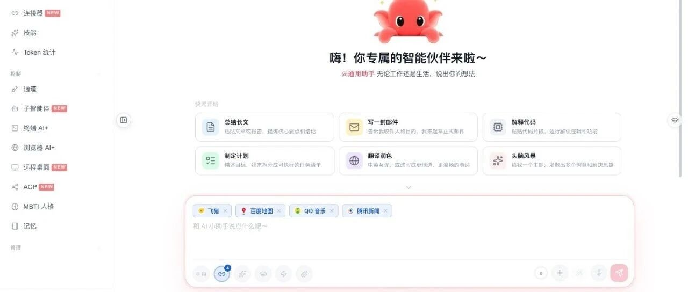
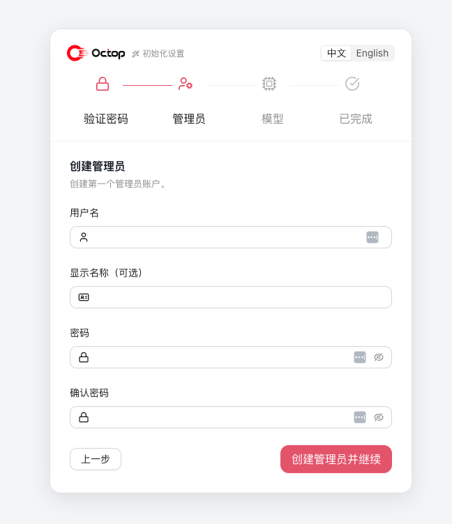
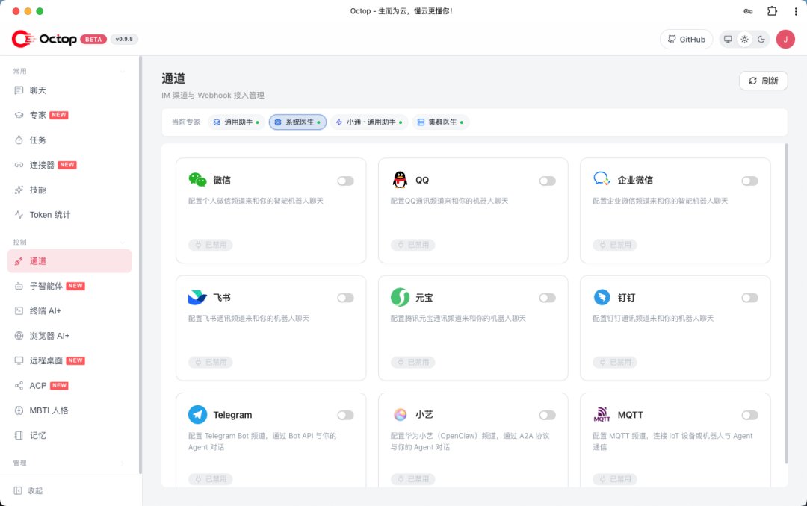
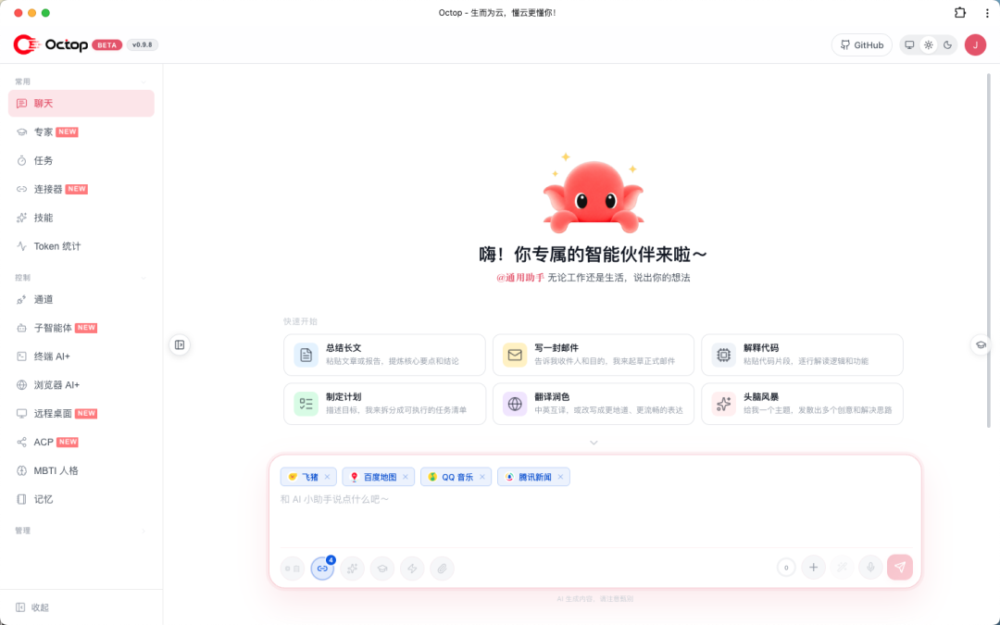
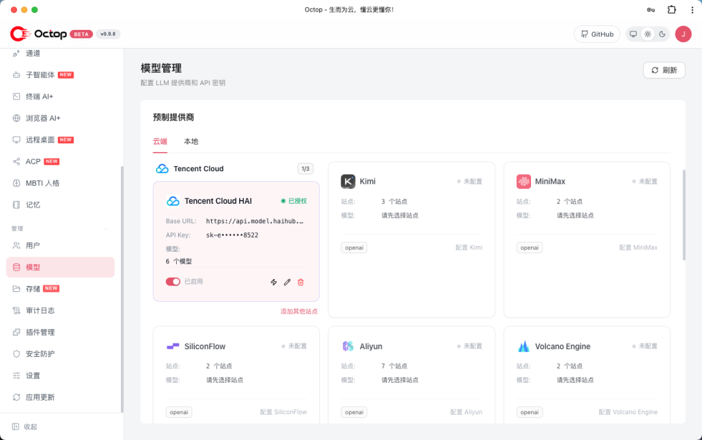
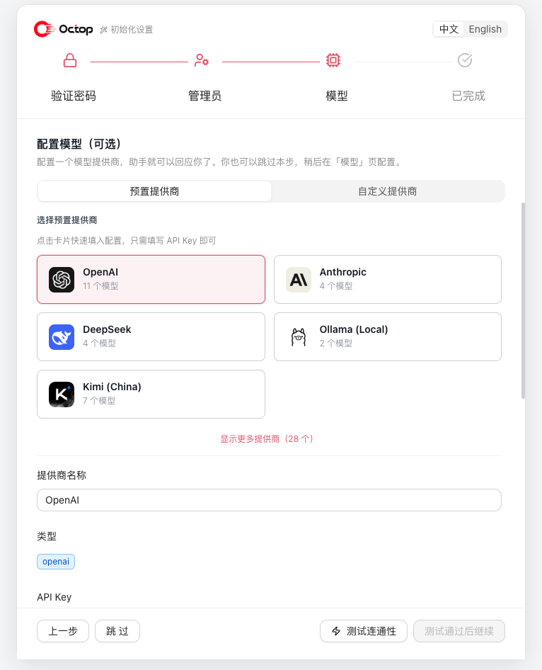

# Octop — 腾讯开源的会自托管多用户多 Agent 平台

> 来源：冰河技术（作者 冰河）｜2026-10-15
> 原文：[给大家推荐一个自托管的 AI Agent开源项目](https://mp.weixin.qq.com/s/y3f0gY60M0eObcVR3OmTug)
> GitHub：[TencentCloud/Octop](https://github.com/TencentCloud/Octop) · 官网 https://octop.cloud
> 归档日实测：**10,294 ⭐ / 1,305 forks / 68 contributors / 855 open issues / MIT / Python / 2026-07-08 建库 / v1.0.2（10-18 发布）/ PyPI `octop` 可直装**



## 一、项目简介

一个开源、可自托管的 AI 助手。它不只是工具，而是"可并行运作的数字生命体"——通过多 Agent 架构，为团队、家庭和个人构建既独立又协作的智能环境。全部运行在自己的机器上：单进程启动，同时提供 Web 控制台、CLI 与 IM 集成。

可以借助飞书、钉钉、QQ、Discord、企业微信或 HTTP/SSE/WebSocket API 与任意 Agent 对话；通过**专家库**一键创建专业角色，通过 **Connector**（OAuth + MCP）接入外部服务，通过 **ACP** 与 IDE / 终端 AI 工具双向协作。

设计目标：让每一次对话、工作区与凭据都留在自己的机器上，同时为每个用户配备一组可按场景切换的专业 Agent。

## 二、项目亮点

| 特性 | 说明 |
| --- | --- |
| **多用户多 Agent 专家团** | 一人管理，全家共用；内置专家库，按场景切换专业角色 |
| **MBTI 人格** | 16 种人格模板与互动测试，为每个 Agent 赋予鲜明性格 |
| **更安全** | JWT 多用户隔离、工具审批、Shell 命令防护与敏感信息脱敏，数据留在本地 |
| **Connector 拓展体系** | 一键接入腾讯全家桶（文档 / 微博 / 新闻等），OAuth 与 MCP 网关轻松扩展 |
| **可插拔后端存储** | 本地目录、Docker 容器、PostgreSQL 或 COS/S3，AI 在隔离边界内操作 |
| **可迁移记忆系统** | 基于 harness-memory，记忆随工作区迁移 |
| **知识库** | 基于文档的 RAG 检索，让 Agent 的回答锚定私有知识库 |
| **插件** | 支持第三方插件扩展；内置插件随安装注入，按需一键启用 |
| **ACP 双向集成** | `octop acp` 增强 IDE 与终端 AI；对话中委派 OpenCode / Claude Code 等 |
| **终端 AI+** | 浏览器内交互式 Shell，AI 辅助命令执行与排障 |
| **浏览器 AI+** | 基于 Chromium 的无头浏览器会话，支持网页自动化、截图与远程操控 |
| **远程桌面** | 控制台内实时看屏与键鼠操控，跨 Linux / Windows / macOS；适合远程办公、GUI 软件操作，无图形 Linux 可一键搭建隔离桌面 |
| **可自托管** | 一条 `octop run` 即可运行控制台、CLI、IM 通道与定时任务，数据存于 `~/.octop/` |

### 你能用它做什么

- **个人助理** — 写周报、整理资料、定日程，记忆随工作区长期保留
- **家庭共享** — 一个管理员账号全家共用，按成员分配不同 Agent 与专家角色
- **团队助手** — 多 Agent 并行协作，对接飞书 / 钉钉 / 企业微信，任务自动分发到群里
- **开发者增效** — 通过 ACP 把编码任务委派给 OpenCode / Claude Code，或终端里 AI 辅助排障
- **网页自动化** — 浏览器 AI+ 自动填表、截图、采集公开信息
- **定时任务** — 自然语言配置 Cron，让 Agent 每天按时推送或执行任务

## 三、项目技术栈

| 层级 | 技术 |
| --- | --- |
| **语言** | Python 3.12+ |
| **Web 框架** | FastAPI + uvicorn |
| **Agent 运行时** | harness-agent |
| **IM 桥接** | harness-gateway |
| **控制平面数据库** | SQLite (WAL，默认) 或 PostgreSQL（可选） |
| **前端** | React 18 + TypeScript + Vite + Ant Design |
| **调度** | APScheduler |
| **ACP** | agent-client-protocol |
| **构建 / 质量** | hatchling · ruff · mypy · pytest |

Octop 由一组 Harness 工程实践拼装而成，把四个专注的运行时组合进同一进程：

- **harness-agent** — Agent 运行时：模型路由、工具、技能与对话检查点
- **harness-gateway** — 多平台 IM 通道桥接，各类入站消息归一为统一处理管线
- **harness-memory** — 分层记忆与全文检索，记忆随工作区迁移
- **harness-browser** — 基于 CDP 的浏览器自动化，支持持久化配置

它不依赖外部消息队列或中间件，而是通过进程内的 `HarnessProcessor` 统一路由所有入口——Web UI、IM 与定时任务。最终呈现为一个可重启恢复的单进程：启动时整个状态从控制面数据库重建（默认 `~/.octop/octop.db`，亦可配置 PostgreSQL）。

## 四、功能特性

### 服务器与认证

- 多用户 JWT 认证，支持管理员角色
- 首次运行向导（`octop init`）
- 交互式 API 文档 `/api/docs`（默认关闭，需在 `config.json` 设 `"enable_api_docs": true` 开启）



### Agent

- 每位租户可创建多个 Agent，各自拥有独立工作区、供应商、通道和定时任务
- 16 种 MBTI 人格模板 + 自定义系统提示词
- 启动时扫描专家库（`infra/agents/experts/library/`）
- 工作区后端：本地磁盘、COS、S3 及其他远程存储

### 通道与自动化

- IM 通道：飞书、钉钉、QQ、Discord、企业微信等（控制台实测还含微信、元宝、Telegram、小艺 OpenClaw、MQTT）
- 主动定时任务，支持自然语言和斜杠命令触发
- Web UI、IM、定时任务共用同一套消息处理链路



### 使用入口

- **Web 控制台** — 对话、Agent 管理、连接器、通道、定时任务、设置
- **CLI** — `octop run`、`octop chat`、`octop acp` 及管理命令
- **HTTP/SSE/WebSocket API** — 完整的程序化访问能力



### 知识库与插件

- **知识库** — 基于文档的 RAG 检索；上传文件后，语义检索让回答锚定私有语料
- **插件** — 安装并管理第三方插件（`octop plugin`）；内置插件随安装注入，控制台一键启用

### ACP（Agent Client Protocol）

两个方向的集成：

1. **入站** — 外部工具使用你的 Octop Agent

```
octop acp --agent main   # 为 Zed、OpenCode 等提供 stdio ACP 服务
```

2. **出站** — Octop 委派给外部编程 Agent：控制台 → **ACP**（`/acp`）配置 Runner（按用户全局），为 Agent 启用 **acp_runner** 后即可在对话中委派。内置出站 Runner 包括 OpenCode、CodeBuddy、Claude Code 和 Codex。

## 五、支持多种 AI 大模型供应商

OpenAI 兼容 API、DashScope（千问）、Ollama 等预设——在控制台或通过 `octop provider` 按 Agent 配置。





## 六、支持的通道

| 通道 | 所需凭证 |
| --- | --- |
| **飞书** | App ID、App Secret |
| **钉钉** | App Key、App Secret |
| **QQ** | Bot AppID、Token |
| **Discord** | Bot Token |
| **企业微信** | Corp ID、Agent Secret |
| **Web 控制台** | 默认启用 |

## 七、项目架构

```
OctopServer
 ├─ DatabasePool        SQLite (WAL) 或 PostgreSQL
 ├─ SharedServices      依赖注入根 — 所有 repo 与配置
 ├─ ExpertCatalog       启动时扫描 agents/experts/library/
 ├─ UserManager
 │   └─ HarnessAgentManager（按用户）
 │       └─ AgentRuntime（按 Agent）
 │           ├─ HarnessAgent        Agent 运行时（harness-agent）
 │           ├─ HarnessProcessor    IM / UI / 定时任务入口
 │           ├─ ChannelManager      IM 连接（harness-gateway）
 │           └─ CronManager         APScheduler
 └─ FastAPI app (uvicorn)
```

单进程架构，重启后从控制面数据库重建状态（默认本地 SQLite，可选 PostgreSQL）。

## 八、项目目录结构

```
src/octop/
  config.py     环境变量配置
  launch.py     OctopServer 启动 + uvicorn
  infra/        业务核心（agents、gateway、cron、db、users …）
  api/          HTTP 层 — FastAPI 路由、JWT、SSE
  cli/          CLI 层 — Click 命令
  dashboard/    构建后的 React SPA（wheel 产物）

dashboard/      前端源码（Vite）— 在此编辑，运行 make build-frontend

docker/         Docker Compose、入口脚本、构建与部署脚本
tests/          unit/ + integration/
```

## 九、快速开始

### 环境要求

- macOS / Linux / Windows
- 无需预先安装 Python——安装脚本通过 uv 在 `~/.octop/` 下创建隔离的 Python 3.12 虚拟环境
- 现代多核 CPU，预留数 GB 内存供进程与模型/Embedding 缓存使用；磁盘需容纳数据库、Agent 工作区与文档语料

### 支持的安装方式

| 方式 | 平台 | 说明 |
| --- | --- | --- |
| 远程一键安装 | macOS / Linux | `curl …/octop/install.sh \| bash` |
| 远程一键安装 | Windows | `irm …/octop/install.ps1 \| iex` |
| 本地脚本 | macOS / Linux | `bash scripts/install.sh` |
| 本地脚本 | Windows | `scripts\install.bat` 或 `install.ps1` |
| PyPI | 全平台 | `pip install octop` 或 `pip install "octop[browser]"` |
| Docker | 全平台 | `docker/docker-compose.yml` |

所有安装脚本均在 `~/.octop/venv` 创建隔离环境，并通过 `~/.octop/bin/octop` 包装 CLI，不影响系统 Python。

### 本地开发

前置条件：Python 3.12+、Node 18+、uv

```
# 后端
make install          # pip install -e ".[dev]"
make all              # format-all + lint + typecheck + test（发布门槛）

# 前端（另开终端）
make dev-frontend     # Vite 开发服务器 :5173
make build-frontend   # 生产构建 → src/octop/dashboard/
cd dashboard && npx tsc --noEmit
```

单独执行：`make test`、`make lint`、`make typecheck`、`make format`。

**1. 本地启动**

```
# 前台运行（API + Web 控制台）
octop run

# 自定义主机与端口
octop run --host 0.0.0.0 --port 8088

# 注册为系统服务（systemd / launchd / Windows 服务）
octop service start
```

打开 **http://127.0.0.1:8088**。交互式 `octop init` / 设置向导会让你自行设置密码（至少 8 位，且同时含字母和数字）。

**2. Docker（推荐用于生产部署）**

```
# 构建并启动
docker compose -f docker/docker-compose.yml up -d

# 或手动构建
bash docker/docker_build.sh
docker run -d \
  -p 8088:8088 \
  -v octop-data:/data/.octop \
  -e HOME=/data \
  -e OCTOP_DEFAULT_PASSWORD="<自定义强密码，留空则自动生成随机密码>" \
  octop:latest
```

打开 `http://localhost:8088`。首次初始化会创建管理员账号并把凭据写入容器内 `/data/.octop/credential.txt`；未设置 `OCTOP_DEFAULT_PASSWORD` 时自动生成随机强密码，被密码策略拒绝的弱密码也会自动回退为随机密码。可用 `OCTOP_ADMIN_USERNAME` 覆盖用户名。

| 变量 | 默认值 | 说明 |
| --- | --- | --- |
| `OCTOP_PORT` | `8088` | HTTP 监听端口 |
| `OCTOP_DEFAULT_PASSWORD` | _(未设置)_ | 首次运行管理员密码（Docker 引导），未设置则自动生成随机密码 |
| `OCTOP_ADMIN_USERNAME` | `admin` | 首次运行管理员用户名 |
| `OCTOP_DATA` | `~/.octop` | 宿主机数据目录（compose 挂载） |

### 数据目录

```
~/.octop/                          ← 安装与数据根目录
├── config.json                    # 进程配置（含可选 database 段）
├── octop.db                       # 默认 SQLite 控制面（用户、Agent、通道、定时任务 …）
├── secrets/                       # JWT 密钥、通道 Token
├── agents/<agent_id>/             # 各 Agent 工作区（SOUL.md、skills …）
├── security/tool_guard/           # Shell 命令允许/拒绝规则
├── logs/                          # 运行日志
├── venv/                          # uv 管理的 Python（安装脚本布局）
└── bin/octop                      # PATH 包装脚本 → venv/bin/octop
```

控制面也可改用 PostgreSQL（`config.json` → `database`，或 `OCTOP_DATABASE_*` / 首次设置向导）。控制面为 PostgreSQL 时，Agent 记忆**默认复用同一 DSN**（per-agent schema）；若需继续用文件记忆，在 agent 配置里设 `"memory": { "backend": { "type": "sqlite" } }`。

### Web 控制台

`octop run` 启动后访问 **http://127.0.0.1:8088**：

- **对话** — 与 Agent 实时聊天
- **Agent** — 创建 Agent，选择专家库 / MBTI 人格，配置供应商
- **Connector** — OAuth 应用与 MCP 网关
- **通道** — IM 平台配置
- **定时任务** — 可视化 Cron 管理
- **知识库** — 管理文档语料与语义检索
- **插件** — 安装、启用与配置插件
- **ACP** — 配置出站编程 Agent Runner
- **设置** — 用户、安全、TLS、系统

交互式 API 文档：**http://127.0.0.1:8088/api/docs**（默认关闭，`config.json` 里 `"enable_api_docs": true` 开启）

## 十、项目代码仓库地址

https://github.com/TencentCloud/Octop

---

## 战略分析

**先分清两件事：软文口径 vs 仓库事实。** 这篇文章来自"冰河技术"公众号——正文结束后紧跟知识星球导流（十一、十二节已剥离），属于典型的大号软文。但项目本身经得起核：仓库 2026-07-08 建库，三个月后 10,294 ⭐ / 1,305 forks / 68 contributors / 855 open issues，MIT 许可（真 OSI 开源，非 source-available），v1.0.2 于 10-18 发布，PyPI 上 `octop` 可直装，主页 octop.cloud，topics 里 `local-first` / `long-term-memory` 与文章描述一致。**建库三个月才发软文**，说明这是真产品在开放，而非 hype launch。反面信号只有一个但很硬：**3.5 个月攒下 855 个 open issues**——要么社区极度活跃，要么 issue 当论坛在用，意味着接口/行为漂移快，跟进成本高（截图还停留在 BETA v0.9.8，实际已 v1.0.2）。

**这是一篇和我现有栈正面对撞的归档。** Octop 的定位与 Hermes Agent 高度重叠：单进程、本地优先、`~/.xxx/` 数据根、多 IM 通道、技能/专家库、插件、Cron、CDP 浏览器自动化、ACP 委派 Codex/Claude Code/OpenCode、RAG 知识库。真正在 Hermes 里找不到对手的是三块：**多用户 JWT 多租户隔离**（每个租户多 Agent、各自工作区/供应商/通道/定时任务，Hermes 是单用户单身份）、**内建远程桌面**（控制台内实时看屏 + 键鼠操控，跨 Linux/Windows/macOS，无图形 Linux 一键起隔离桌面——这解决的是"Agent 要操作 GUI 软件"这一类我目前只能靠 macOS 本机 computer-use 硬扛的场景）、**成体系的安全边界**（`security/tool_guard/` 目录化的 Shell 允许/拒绝规则 + 工具审批 + 敏感信息脱敏，对应 Hermes 的审批散落在各工具层）。

| 维度 | Octop (腾讯, 10.3K⭐) | Hermes Agent（现用） | 差距判断 |
| --- | --- | --- | --- |
| 定位 | 自托管多用户多 Agent 平台 | 单用户个人 Agent OS | Octop 面向"家庭/团队共享一台" |
| 多用户 | JWT 多租户 + 管理员角色 | 无 | **真差距**，Hermes 侧多身份靠 profile 目录拼 |
| 记忆 | harness-memory 分层记忆 + 全文检索，随工作区迁移 | TencentDB Memory 四层(L0→L3) + 场景块 | 我方更深，Octop 赢在"随工作区可搬迁" |
| 技能/专家 | 专家库目录扫描 + 16 种 MBTI 人格 | skills/ + plugins/ 双体系 | 我方生态更大，Octop 人格化是差异化包装 |
| 通道 | 飞书/钉钉/QQ/Discord/企微/微信/元宝/Telegram/小艺/MQTT | local / weixin / api_server | Octop 通道矩阵碾压，尤其 MQTT（IoT） |
| 定时任务 | APScheduler + 自然语言 Cron | cronjob 工具 | 持平，我方与技能/记忆耦合更紧 |
| 浏览器 | harness-browser (CDP) + 浏览器 AI+ | browser_exec (CDP) + computer-use skill | 持平 |
| 编码 Agent 委派 | ACP 双向（入站供 Zed/OpenCode，出站委派 Codex/Claude Code/OpenCode/CodeBuddy） | delegate_task 子代理 + CLI skill 调用 | **ACP 双向更标准**，我方是私有协议 |
| GUI 操控 | 内建远程桌面（跨三平台） | macOS computer-use（本机） | **真差距** |
| 安全 | tool_guard 规则目录 + 工具审批 + 脱敏 | 审批门 + 扫描器 | Octop 规则可审计可版本化，更工程化 |
| 存储后端 | 本地/COS/S3/PostgreSQL 可插拔 | 本地文件 + SQLite | Octop 云端工作区更强 |
| 成熟度 | 3.5 个月 / 855 open issues / v1.0.2 | 长期自用迭代 | Octop 生态更热，稳定性风险更高 |

**顺手把 wiki 里另外两个同赛道归档拉齐看**：`2026-09-03-CubePlex-企业级Agent平台正式开源`（同样押 Harness + MCP + Skills + Memory）、`2026-09-16-MOVO-基于DeepSeek-Harness的企业Agent平台`（把 DeepSeek Harness 当引擎，补组织/角色/Skill 治理/Tools·MCP 治理/Token 统计/审计，Docker Compose 12 服务）。三家路径清晰可分：**CubePlex = 企业治理层**、**MOVO = 多服务重装配**、**Octop = 单进程轻量化 + 腾讯自家 Harness 四件套 + 家庭/小团队多租户**。选型判据不是功能表，而是"你要几个用户"：一人/一个团队小规模 → Octop 单进程最省心；要审计/组织树/合规 → MOVO·CubePlex；要全家+多角色人格 → Octop 独此一家。

**值得偷的三件事**（不必换栈就能落地）：① **`security/tool_guard/` 规则目录化**——把允许/拒绝的 Shell 规则做成可版本化文件，比散在审批提示里可审计得多，可直接映射到我方 hook/审批层；② **记忆随工作区迁移**——TencentDB Memory 目前绑定本机实例，工作区可搬迁是它的天然短板，`harness-memory` 的"记忆跟着工作区走"是个明确的演进方向；③ **ACP 双向**——入站把自己的 Agent 当第三方 IDE 的后端卖出去，出站用标准协议委派编码 Agent，比为每个 CLI 写一个 skill 更省维护。

**要不要试：** 值得在一台闲置机器上 `pip install octop` 起一个实例，重点验证两件 Hermes 做不到的事——远程桌面做 GUI 任务、以及多租户下同一台机器给不同人分配不同 Agent 的实际隔离强度。不建议把现有 Hermes + Obsidian + TencentDB 工作流迁过去：三维（记忆深度、技能生态、知识库沉淀 348 篇）全在现栈上，迁移收益不抵账面。855 个 open issues 也说明它现在适合"观察 + 借设计"，不适合当生产底座。

## 关联阅读

- [[技能文档/2026-09-03-CubePlex-企业级Agent平台正式开源]] — 同赛道：Harness + MCP + Skills + Memory 的企业级 Agent 平台
- [[技能文档/2026-09-16-MOVO-基于DeepSeek-Harness的企业Agent平台]] — 同赛道：把 DeepSeek Harness 当引擎补治理层，Docker Compose 12 服务
- [[技能文档/2026-06-16-Agent-Harness-Engineering生产级拆解]] — Octop 的 harness-agent / harness-gateway / harness-memory / harness-browser 正是这套工程实践的产物
- [[技能文档/LangGraph-vs-DeepAgents-vs-Hermes-三大Agent框架源码拆解]] — 与 Hermes 的框架级对照

## 归档日志

- 2026-10-20 归档（Firecrawl MCP 提取正文 + 6 张内容图落盘；GitHub/API 实测仓库指标：10,294⭐ / 1,305 forks / 68 contributors / 855 issues / MIT / v1.0.2 / PyPI 可装；剥离第十一、十二节知识星球导流与赞赏 UI，imgIndex 5 与 imgIndex 0 为同一张控制台截图已去重）
