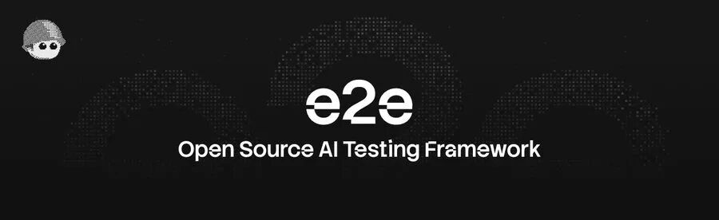
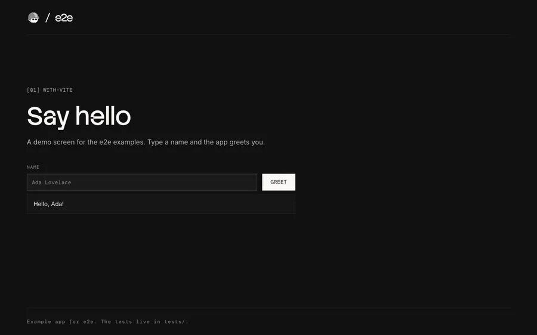
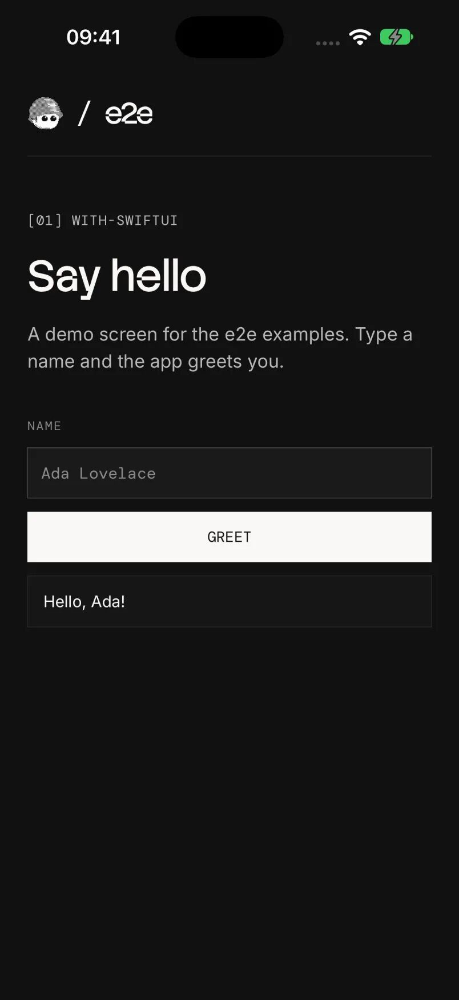
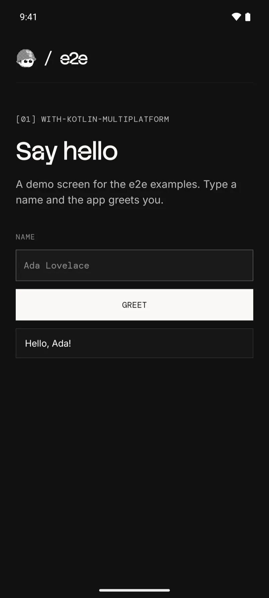

# e2e — 把端到端测试从「写一堆操作步骤」变成「写一句目标」

> 来源：公众号 开源食谱（豆芽菜小萌）｜2026-10-18
> 原文：[8.4K 星封神！这个测试框架让 Agent 自己点 App 跑端到端](https://mp.weixin.qq.com/s/OAQRUOJhjyKtRM4N2Tg_Gg)
> 仓库：[tester-army/e2e](https://github.com/tester-army/e2e) ｜ 文档：e2e.tester.army/docs

## 概述

端到端测试的老痛点很实在：界面一动，选择器全废；操作链一长，测试代码比业务代码还难维护。手写一串点击和等待、或者把希望寄托在脆得要命的定位表达式上，是绝大多数 e2e 代码的现状。

`e2e` 换了一种写法：**你描述一个目标，剩下的交给一个 Agent 去把 App 跑通，再用普通的定位器和断言去校验结果。** 一整套框架同时覆盖 Web、iOS、Android。第一次跑贵一点，之后的回归因为「回放」几乎零模型成本。



## 核心机制：一句话目标 + 动作回放

上手先跑 `npx e2e init`，它问你要 Web 还是手机端、用哪家模型供应商，然后写好配置和一个示例测试。测试长这样：

```ts
// tests/checkout.e2e.ts
import { test, expect } from 'e2e';

test('a member upgrades to Pro', async ({ app, agent, screen }) => {
  await app.open('/settings/billing');

  await agent.act('upgrade the workspace to the Pro plan');
  await agent.assert('the invoice preview shows a prorated amount');

  await expect(screen.getByRole('status')).toContainText('Pro');
});
```

四个角色分工明确：

| 角色 | 作用 |
|------|------|
| `app` | 打开应用 / 目标路由 |
| `agent` | 用一个自然语言目标驱动界面（`act` 执行、`assert` 一句话校验） |
| `screen` | 常规定位器，做硬断言 |
| `expect` | 标准断言库 |

一个测试里，自然语言步骤和常规断言可以混着写，要多精确就多精确。

**最值得说的是回放**：一个被后面断言验证过的 Agent 步骤，会把跑过的动作记下来；下一次跑直接重放这些动作，不再调模型，直到 App 行为变了才重新请模型出马。没有 Agent 步骤的测试压根不需要模型。换句话说——**写测试那次贵一点，之后天天跑的回归几乎不花模型钱**，对 CI 相当友好。

## Web 端：站在 Playwright 肩上

Web 引擎直接复用 Playwright 那一套，Chromium / Firefox / WebKit 三内核全支持。不用重新学一套浏览器控制，它只负责把「目标」翻译成对这些内核的操作。官方示例里 Vite、Next.js、Astro 都能直接跑通。




## 移动端：才是它更亮的地方

iOS / Android 走模拟器、仿真器，背后靠 `agent-device` 去驱动真机级别的交互。原生自动化一直又贵又脆，能用一句自然语言目标去驱动，门槛低不少。官方示例覆盖 SwiftUI、Jetpack Compose、Kotlin Multiplatform、Flutter、Expo，每个都是能跑通的独立工程。





## 真要用，这五件事得先留意

1. **还到不了 1.0** — 官方明说 API 和配置在小版本之间还可能变。当稳定依赖用要掂量：锁版本、盯 changelog 是必须的。
2. **模型自带（BYOK）** — 订阅、API Key 还是本地模型，费用和风险都算你头上。它不包办模型，只负责把目标翻译成操作。
3. **遥测默认开着** — CLI 会发匿名使用数据（不含测试内容和凭据），介意就 `npx e2e telemetry disable`。
4. **自然语言步骤 ≠ 免断言** — 回放能省模型费，但校验还得靠你自己写 locator 和 assertion，否则 Agent 跑偏了你也不知道。
5. **和 Playwright / Cypress 不是替代关系** — 需要精确控制每一步、追求极致稳定的，老牌框架更稳；e2e 适合目标模糊、步骤难写、尤其移动端和探索性场景。

## 关键洞察（作者判断）

- 它不太可能一夜之间把 Playwright 换掉。真正的价值，是给「我要测的东西我知道、但步骤不好写」这类场景一个新写法。
- 移动端是最大受益面：原生自动化一直又贵又脆，自然语言目标驱动把门槛明显拉低了。
- **回放省模型费这个点很实**，对高频回归是真省钱；多端一套框架也省心。
- 结论是**先别急着挪核心业务的测试地基**：1.0 之前放在 side project 或非关键链路上试，等 API 稳下来再考虑主力化。

## 战略分析

### 仓库实测（归档日 2026-10-19 核对）

| 项 | 实测值 | 与文章口径对比 |
|----|--------|----------------|
| Star | **11,302** | 文章标题写 8.4K，一周多涨了近 3K，热度仍在爬 |
| Forks | 577 | — |
| License | **Apache-2.0**（真 OSI 开源，无附加条款） | — |
| 语言 | TypeScript | — |
| 建库 | 2026-07-22 | 建库约 3 个月，属新项目 |
| 最近推送 | 2026-10-19（当天） | 高频活跃 |
| Homepage | tester.army/e2e | 有独立官网 + 文档站 |
| Topics | e2e, e2e-testing, playwright, mobile, mobile-testing, web | 定位与文章一致 |

判断：**热度真实、迭代活跃、许可干净，但库龄只有 3 个月且未到 1.0**。适合现在就用起来摸手感，不适合现在就把主回归套件迁过去。

### 与现有栈的对照

| 维度 | e2e | Playwright/Cypress 手写 | Hermes `dogfood` 探索式 QA |
|------|-----|--------------------------|------------------------------|
| 编写方式 | 写目标（自然语言）+ 断言 | 写步骤（选择器+等待） | 写探针/描述目标，Agent 自己找路 |
| 稳定性 | 回放锁定动作后稳定；首次跑有随机性 | 高（写好就稳） | 低（探索式，不可复现） |
| 模型成本 | 首次跑贵，回归≈0（回放） | 0 | 每次都要模型 |
| 移动端 | ✅ iOS/Android 模拟器（agent-device） | 需另配 Appium 等 | ❌ 仅浏览器 |
| 断言强度 | 靠人手写 locator（不写就没校验） | 原生强 | 靠视觉/文本自判 |
| 当前适合 | side project、探索性、移动端 | 核心链路、极致稳定 | 一次性找 bug |

这张表里最值得注意的是 **e2e 的「首次探索 + 回放固化」正好是 dogfood 缺的那一环**：dogfood 擅长发现「该怎么走」，但结果不可复现、每次都要烧模型；e2e 把这套探索动作录成可重放的管线，之后零成本回归。若将来要做 Web 应用的持续回归，思路是 **dogfood 探路 → 录成 e2e 用例固化**，而不是二选一。

### 借鉴点与风险

- **可借鉴**：动作录制 + 回放固化 = 「探索一次，之后零模型成本」，这个模式可以平移到任何「LLM 驱动 UI 但又要求可重复」的场景（含 Agent 自身的浏览器任务回归）。
- **可借鉴**：自然语言步骤与硬断言混写——把不确定性关在 `agent.act` 里，把确定性留给 `expect`，是 LLM 接管测试的合理边界设计。
- **风险**：① API 未稳定，锁版本是硬要求；② 遥测默认开，需手动关；③ BYOK 意味着 CI 里要有可控的模型成本策略，回放失效时会突然产生费用；④ 不写断言等于没有测试，容易给人「自然语言即测试」的错觉。
- **整合结论**：现阶段不引入到核心链路，作为**移动端 E2E 的候选方案**与 **dogfood 之后固化的手段**记录下来观察；等 1.0 + API 稳定后再评估。

## 归档日志

- 2026-10-19 归档（Firecrawl 正文提取 + 5 张正文配图本地化 + GitHub API 仓库实测核对）
- 文章 Star 口径 8.4K，归档日实测 11,302⭐（差异记录在战略分析表中）
