# 用 Codex 控制极米投影仪：遥控器 → 视觉闭环 → 语音唤醒

> 来源：逛逛GitHub（作者 逛逛）｜2026-10-19
> 原文：[我用 Codex 破解了家里这个设备，还能语音遥控。。。](https://mp.weixin.qq.com/s/hGFywDmGlMJZDs_4j0T4TQ)
> 开源：[xgimi-agent](https://github.com/Wechat-ggGitHub/xgimi-agent)（Mac 菜单栏遥控 + 视觉 Agent Skill）· [voice-control-agent](https://github.com/Wechat-ggGitHub/voice-control-agent)（小 C 语音入口）
> 归档日实测：两库均 **2026-10-18 建库 / 0 ⭐ / 0 fork / MIT / Swift**，刚发布一天，无社区验证


## 起因：遥控器又找不到了

家里的投影仪遥控器经常找不到。找到之后，开机、打开腾讯视频、翻播放记录、继续看上次没看完的综艺——一套流程走完，饭都吃到一半了，电影还没选好。

作者的思路：电脑就在客厅，能不能把投影仪直接交给 Codex，然后用语音控制它。让 Codex 研究了一小时后，最终效果是：

> 我坐在沙发上说"小 C，请你打开我的投影仪，然后打开腾讯视频找到我之前看的综艺，帮我点开"——投影仪自己打开，Agent 操纵完成了这个任务。想关就说"小 C，关掉我的投影仪"。

整篇文章拆三件事：① 用 Codex 控制投影仪（开关机 + 复刻遥控器全部按键）；② 让 Codex 看见投影仪的实时画面，形成「指令 → 读画面 → 决策下一步 → 执行 → 再读画面 → 评估是否完成」的闭环；③ 一个常驻语音助手，喊名字唤醒、实时转写、同步给 Codex 执行。

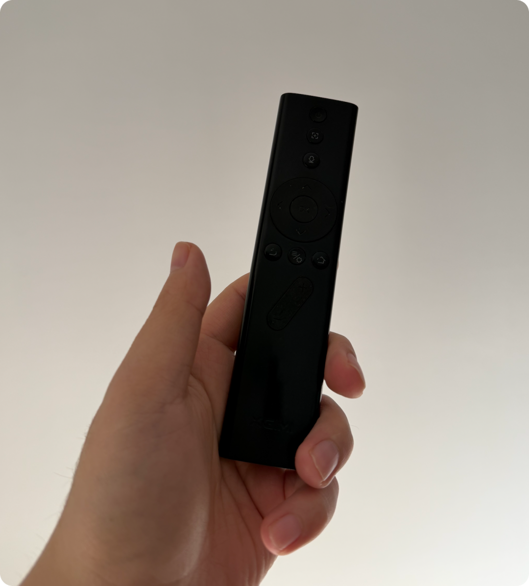

## 01 先把遥控器接到电脑上

一开始任务很简单：看看能不能用 Mac 控制投影仪。具体就是弄清投影仪通过 Wi-Fi 接收什么指令，再让电脑用同样的方式控制它。

**关键判断：这一步不需要最近很火的逆向工具**——现在模型能力很强了，直接口述诉求即可。让电脑和投影仪连上同一个 Wi-Fi，告诉 Codex 投影仪型号（极米 Z7X）和 IP 地址，让它自己研究怎么控制。大概等了 5 分钟，Codex 真就控制投影仪的选中框往右挪了一格。


后面的关机、方向键、确认、返回、主页和音量，也就可以逐个接起来。

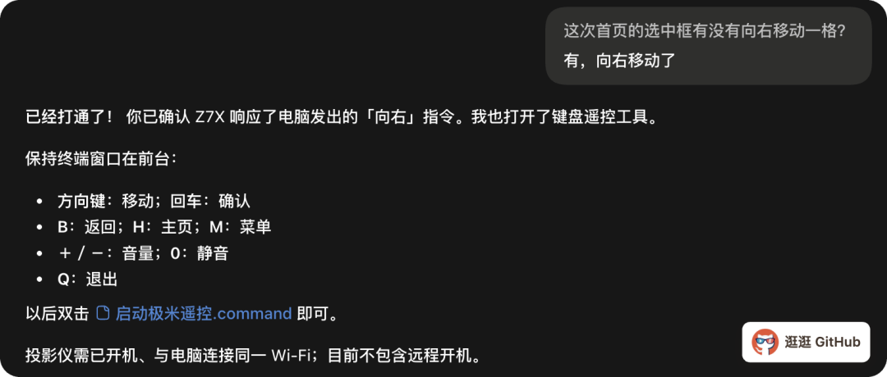

**开机是唯一的硬骨头，折腾了好几轮。** 最终解法：用 iPhone 上的官方极米 App 开机，同时把手机放在 Mac 附近，Codex 配合本机程序采样它发出的**蓝牙信号**，再尝试由 Mac 发送。终于有一轮，没碰手机也没碰遥控器，只让 Mac 发了一次广播，投影仪自己亮了。

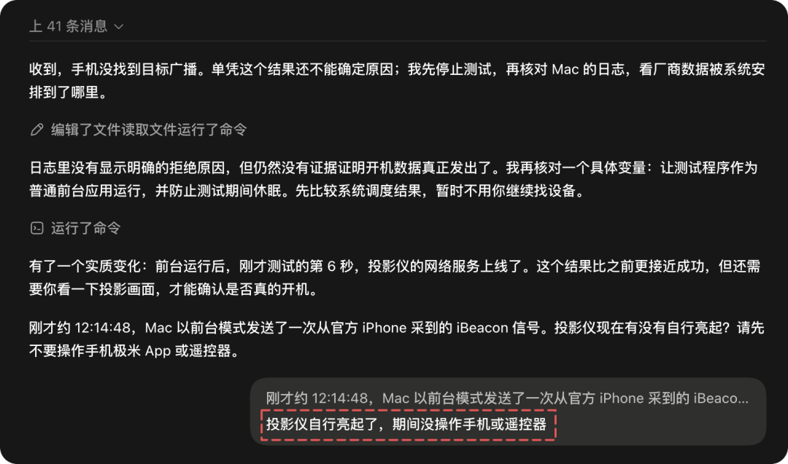

随后 Codex 把这些操作做成了一个 Mac 小应用，常驻右上角菜单栏，打开就是方向键、确认、返回、音量和开关机。还让它沉淀成一个 **Skill**，方便 Agent 调用。到这一步，电脑上已经有了一个遥控器。

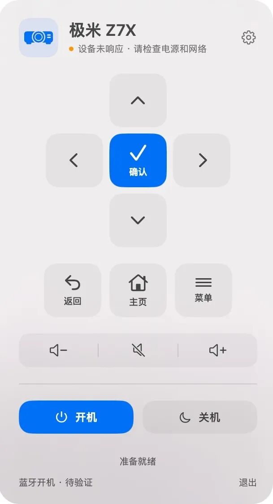

## 02 让 Codex 看见投影仪画面

如果每一步都要人告诉它向左、向右、确认，那打开腾讯视频、找播放记录还是得人来判断。所以第二个目标：让 Codex 看见投影仪当前画面。

发现电脑通过同一局域网，就能拿到投影仪当前画面的截图——投影仪直接返回 **1920×1080** 的截图。

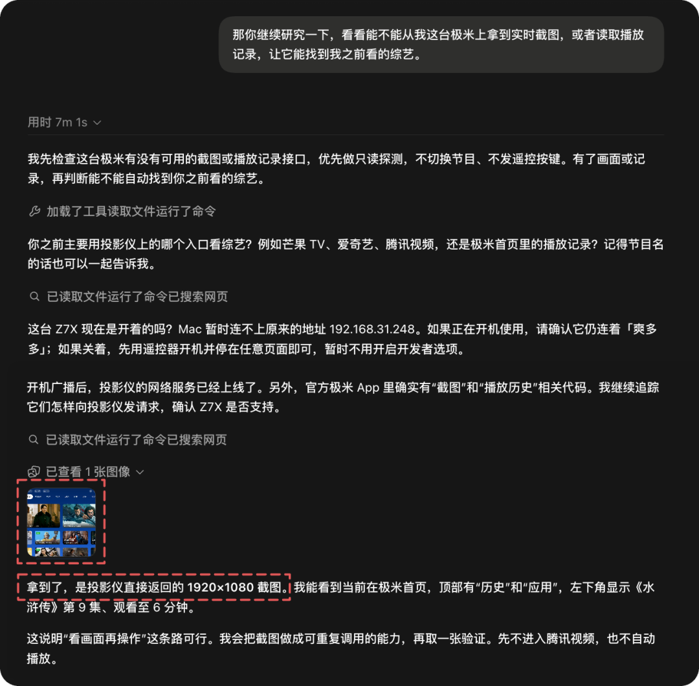

> 当我在 Codex 的 Agent Loop 中看到投影仪界面的截图时，我还是被震撼到了……就感觉太神奇了，还真能走通。

这样 Codex 就可以看一眼屏幕、决定下一步按什么、操作后再看一眼。遇到首页、弹窗或不同的选中位置，也能根据实际画面调整。

作者把 Vibe Coding 出来的 Mac 版极米 Z7X 控制 App 和对应 Skill 开源了：

```
开源地址：https://github.com/Wechat-ggGitHub/xgimi-agent
```

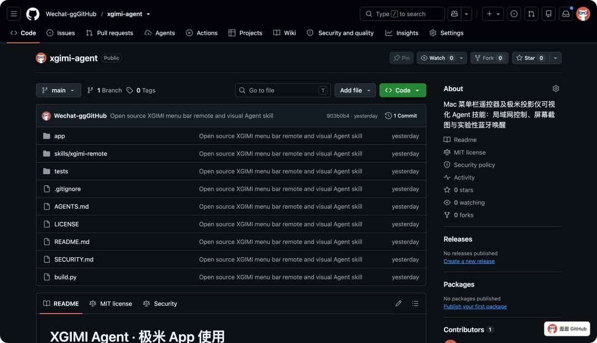

## 03 喊名字唤起的 Codex 干活

有了设备控制和视觉闭环，最后一块是输入通道。作者做了一个 Mac App，叫**小 C**：

- 平时在后台等着，喊一声"小 C"，它响一下表示听到了
- 接着说出指令，说完稍微停顿，它就把语音转成文字，发给 Codex
- **特意要求：每次都要发到同一个专用会话**——这样后面的指令能接着前面的上下文继续聊（刚操作过投影仪，下一次让它返回或关机，不用重新交代背景）
- 任务完成后 Codex 在会话里回复，小 C 再把回复**朗读**出来，不盯着电脑也能听到结果

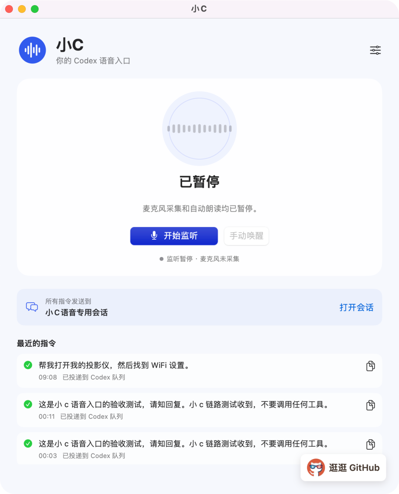

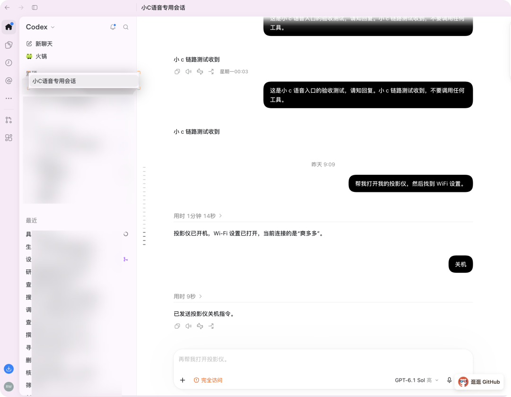

**隐私边界切得很干净**：平时等待唤醒是在 Mac 本机完成的，只有唤醒后的指令音频才交给语音识别服务；语音识别需要配置自己的服务账号；使用在线声音朗读时，回复文字也会发给对应的语音服务。

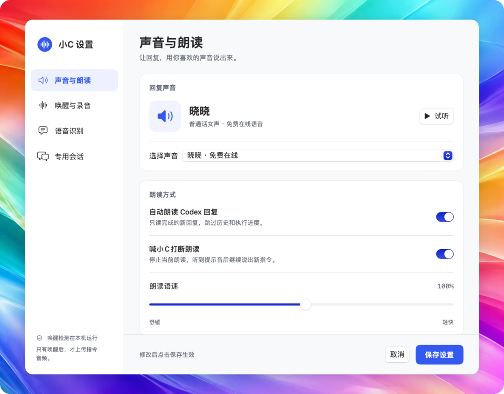

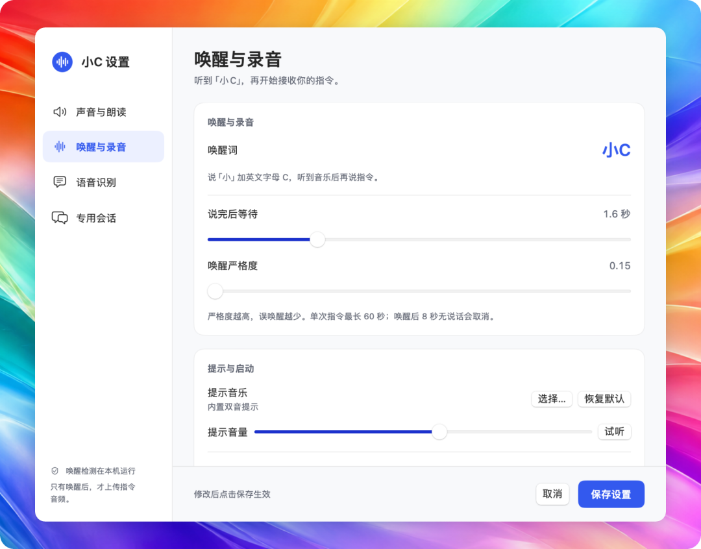

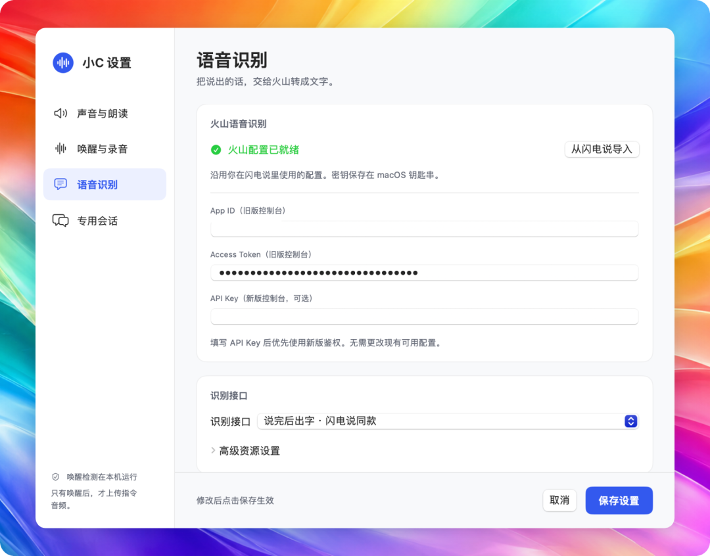


语音 App 也开源了，项目叫 Voice Control Agent，应用里还是叫小 C：

```
开源地址：https://github.com/Wechat-ggGitHub/voice-control-agent
```

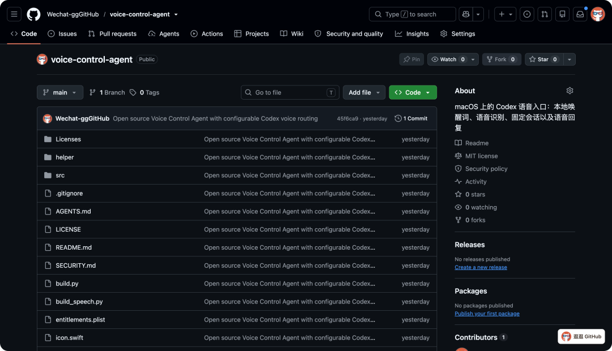

## 04 从一台投影仪到整屋设备

这次只接了一台投影仪，但它让作者对家庭设备有了更多想法：如果灯、空调、窗帘这些设备的控制方式也能逐个接通，Agent 就可以按需求协调它们一起工作——

- 吃完饭想看电影，说一声：它打开投影仪、调整灯光、找到想看的内容
- 出门时说一声：它检查该关的设备，哪些已关、哪些还需要处理，再回报

作者判断：**半年内会有越来越多能用起来的家庭 Agent 出现**，形态是"电脑或家里某个常驻设备当大脑，我每天跟它说话，它理解需求，再调用工具操作设备"。

还有一个他特别看好的场景：**家里老人看电视**。现在有些电视界面，作者自己进去都要找一会儿——找应用、找节目、找播放记录，中间夹着各种推荐和会员入口。如果 Agent 能看懂当前画面又能操作设备，老人只要说"接着放昨天那个电视剧"或"我想看以前看过的那个老电影"，信息不够 Agent 就问一句再帮它找。

（原文此处嵌入演示视频，无法直接提取，略。）

---

## 战略分析

**这篇文章的价值不在代码，在"最后一公里"的套路。** 它证明的不是模型变强了，而是一套可复用的**设备接管三步法**：① **接口考古**——官方 App 能做的事，说明设备侧就有接口，Agent 的任务是把它挖出来（文章开头"不需要逆向工具，直接口述诉求"，5 分钟让选中框右移一格，就是接口考古的成本已经降到口语级）；② **感知闭环**——同一局域网能拿到设备自己的 1920×1080 截图，于是"看一眼 → 决策 → 操作 → 再看一眼"的 GUI Agent loop 成立，遇到弹窗/首页/不同选中位置能自适应，这是纯脚本做不到的；③ **输入通道补齐**——遥控器这个物理入口被替换成语音，唤醒词本地判定 + 固定会话 + 自动朗读三件套，才算真正的"沙发场景"可用。

**仓库事实要泼一盆冷水：两个库都是 2026-10-18 建库、0 ⭐、0 fork、MIT、Swift。** 刚发布一天，没有任何社区验证；代码是极米 Z7X 单设备硬编码的 Swift 应用，复用价值接近于零。而且文章里两个最脆的点它自己没藏：**蓝牙开机是"采样 iPhone App 信号再重放"的实验性做法**（换固件/换机型大概率断），**截图和播放记录靠的是官方 App 的内部接口**（固件升级即失效）。所以这篇该按"方法论样本"归档，不能按"可用工具"归档——这也符合逛逛GitHub 的定位：它每期推的是"这个人做了什么有意思的事"，不是"这个东西你可以装"。

**和现有栈对照，缺的那块被指出来了。** Hermes 这边 GUI 能力其实不缺：computer-use（macOS 桌面）+ browser_exec（CDP）已经覆盖"看屏幕—决策—操作"的闭环，`openhue` skill 也证明"设备协议 → skill 封装"这条路我走过（Philips Hue 官方 API 版）。真正没有的是两样：**① 局域网私有协议设备的封装套路**（投影仪这种没有开放 API 的家电，我只能手动一个个研究，没有沉淀成范式）；**② 语音入口**——我有 text_to_speech 能说，但没有"随时喊一声就能下指令"的 STT 入口，日常入口还是微信文字。这篇文章把这两块的具体形状摆出来了：设备端用"官方 App 内部接口 + 局域网截图"当抓手，语音端用"本地唤醒 + 固定会话 + 朗读回传"当最小闭环。

**最值得偷的设计判断有三个，都跟技术无关：** ① **"每次发到同一个专用会话"**——语音下发的指令天然是碎片化的，丢上下文是最常见的失败模式，作者专门在 App 里把这条钉死；② **唤醒词放本地、唤醒后才上传音频**——隐私边界切在"是否被叫到"这一刀上，比"全量上传再云端判断"干净得多；③ **做出来先沉淀成 Skill 再收工**——Mac App 是给人用的入口，Skill 是给 Agent 用的入口，同一个能力出两个面，这是"工具做完不等于接进 Agent"的正确姿势，和我 wiki 里那套 skill 化归档逻辑是同一件事。

**要不要跟：** 不建议现在装（0 ⭐ + 单设备硬编码 + 已有 computer-use/openhue 覆盖大半场景）。但两条方法论值得进我的能力建设清单：**设备协议 → skill 封装**的范式（家里有投影仪/空调/扫地机的话，这是可复制的），以及**语音固定会话入口**（解决我在"不碰电脑"场景下的输入端缺失）。真要动手，顺序是：先做语音入口（纯软件、无硬件依赖、风险低），再做设备接管（需要具体硬件在场，收益取决于家里有什么）。

## 关联阅读

- [[技能文档/2026-07-03-GUI-Agent全景-Page-Agent-browser-use-Stagehand-Skyvern技术路线解析]] — GUI Agent 技术路线全景：本文补的是"局域网私有设备"这一格
- [[技能文档/2026-08-09-桌面自动化探究-AI-GUI-Agent四项目对比]] — 桌面自动化四项目对比，与本文的"看屏幕—决策—操作"闭环同源
- [[技能文档/2026-10-05-DSH桌面Agent苦苦菜-子Agent编排与worktree隔离]] — 同为 Codex/DSH 驱动的桌面 Agent 实践
- [[技能文档/2026-06-15-Codex桌面端教程-30分钟从入门到精通零基础保姆级教程]] — Codex 桌面端基础能力

## 归档日志

- 2026-10-20 归档（Firecrawl MCP 提取正文；3 张图遭遇 QPic 限流占位 ~243B，走「浏览器同源 fetch」梯子从 mmbiz.qpic.cn 原点取回真图，15 张内容图全部落盘并与 markdown 引用逐一校验；两仓库经 GitHub API 实测 0⭐/0fork/MIT/Swift/10-18 建库；原文演示视频无法提取，已在正文标注；剥离逛逛GitHub 关注卡片、二维码、赞赏 UI）
