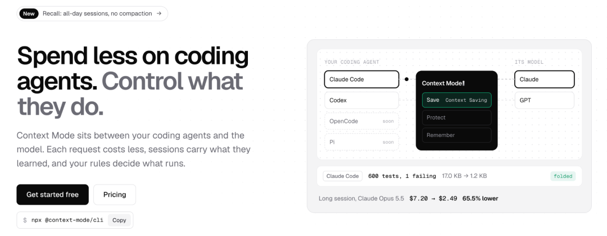
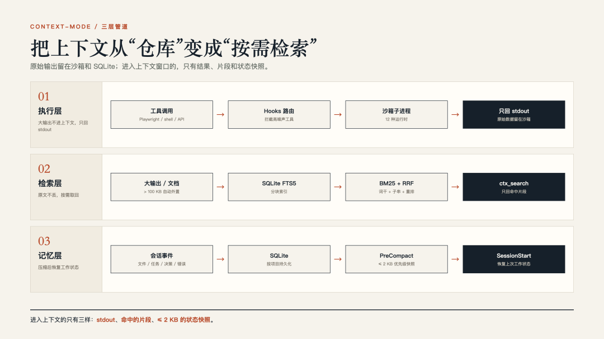
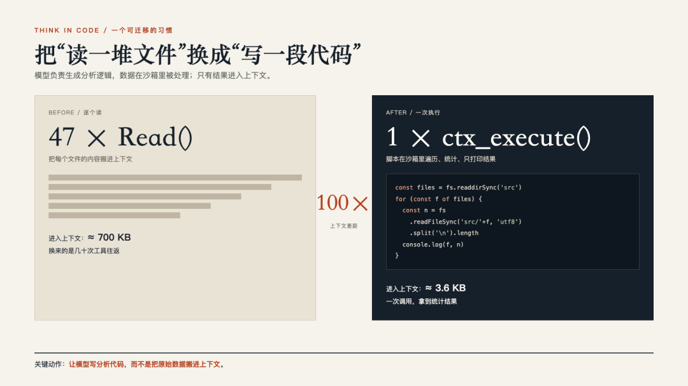
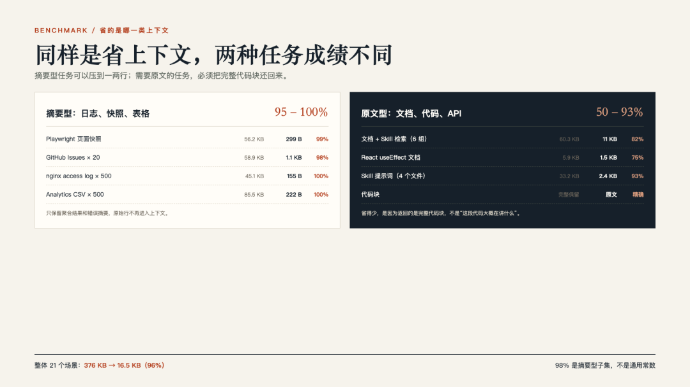

# context-mode：把工具输出挡在上下文之外

> **作者**：小张 · 公众号「老码小张」
> **发布**：2026-10-21 08:09
> **仓库**：https://github.com/mksglu/context-mode
> **一句话**：一个 MCP server + 一组 hooks，把工具输出留在沙箱、把原文留在索引、把会话状态留在 SQLite，只让结果和指针进入对话。



## 开篇的痛点（作者的实测数字）

写一个 Next.js 应用时：

- 一次 Playwright 快照 **56.2KB**
- 20 个 GitHub issue **58.9KB**
- 500 行 nginx 访问日志 **45.1KB**

再加上构建日志和文档查询——**还没开始改代码，半小时后上下文少掉四成**。压缩时模型还会忘掉正在改的文件和任务。

## 项目骨架

- **形态**：MCP server + 一组接在各家 CLI/IDE 上的 hooks
- **作者**：Mert Koseoğlu · TypeScript
- **版本**：1.0.169
- **License**：Elastic 2.0（source-available，非 OSI 开源）
- **工具面**：11 个 MCP 工具
  - 六个沙箱工具：`ctx_batch_execute`、`ctx_execute`、`ctx_execute_file`、`ctx_index`、`ctx_search`、`ctx_fetch_and_index`
  - 五个元工具：`ctx_stats`、`ctx_doctor`、`ctx_upgrade`、`ctx_purge`、`ctx_insight`

作者的评价很中肯：「热度很高，成熟度还在追赶。」

## 上下文被谁吃掉

MCP 工具调用的默认行为是把结果**原样**塞回对话。200K token 的窗口看起来很大，几次大输出就吃掉一半。更麻烦的是压缩——客户端丢掉早期消息，文件路径、待办、刚才的用户决定也跟着没了，模型只能重新问或重新读。

context-mode 把问题拆成四个面：**工具输出、会话连续性、模型的分析方式、最终回答的文风**。

前两个是数据管道，第三个是行为习惯，**第四个它刻意不碰**——README 明说：项目不规定模型该写多短，因为过度要求简短会拉低编码和推理表现。这个边界划得克制。



## 第一层：把执行搬进沙箱，只让 stdout 回来

`ctx_execute` 每次调用起一个隔离子进程，脚本在里面跑，只有 stdout 进入对话。原始日志、API 响应、页面快照都留在子进程里。

- **12 种运行时**：JS / TS / Python / Shell / Ruby / Go / Rust / PHP / Perl / R / Elixir / C#
- 检测到 Bun 时，JS/TS 执行快 **3–5 倍**
- **45.1KB nginx 日志 → 155 字节**（项目记为 100% 节省）：写段 awk 统计状态码分布，只打印结果
- **凭证不进入对话**：`gh`、`aws`、`gcloud`、`kubectl`、`docker` 继承环境变量和配置路径
- **三级阈值**：
  - 输出 > **5KB** 且带了 `intent` → 切换意图过滤：完整输出先索引，按意图检索，只回匹配片段 + 一组可继续搜索的词
  - 输出 > **100KB** → 直接外置成指针，需要时用 `ctx_search` 取

## 第二层：文档切碎，按需取原文

文档和代码块不能只留摘要——你查 `useEffect` 清理写法，要的是完整代码块，不是"有 3 个代码块"。

- **存储**：Markdown 按标题切块，代码块保持完整，存进 **SQLite FTS5** 虚拟表
- **双路检索**：
  - Porter stemming：`caching` 命中 `cached` / `caches`
  - trigram：`useEff` 命中 `useEffect`，`authenticat` 命中 `authentication`
  - 两路用 **Reciprocal Rank Fusion** 合并
- **BM25 里标题权重 5 倍**，导航型查询更容易命中
- **proximity rerank**：查询词靠得近的段落被抬高
- **Levenshtein 纠错**：`kuberntes` 先改成 `kubernetes` 再搜
- **smart snippets**：围绕命中词取窗口，不按前 N 字符硬截断
- **缓存 24 小时**：TTL 内重抓返回约 0.3KB 缓存提示；14 天没用的库启动时清掉
- **渐进限流**：连续搜索前 3 次正常，4–8 次每查询减到 1 条，第 9 次开始挡住，引导改用批量执行

## 第三层：压缩前存快照，压缩后还状态

- 每次工具调用、文件编辑、git 操作、任务变更、报错、用户纠正 → hooks 捕获 → 写进**按项目隔离的 SQLite**
- 上下文快满 → **PreCompact** 触发 → 按优先级压成 **≤2KB 的 XML 快照** → 存进 `session_resume` 表
- **SessionStart** 取出 → 重建 **15 个类别**的 Session Guide → 注入上下文

预算紧张时的丢弃顺序：意图分类、MCP 工具计数可以先不要；**正在改的文件、未完成任务、项目规则、用户决定必须保留**。恢复后第一屏里有"最后一次请求"，所以模型不会上来就问"我们刚才在做什么"。

## 平台覆盖表（关键）

这套东西**依赖 hooks**，所以平台覆盖差异极大：

| 平台 | 会话恢复 | 实际影响 |
|---|---|---|
| Claude Code / OpenCode / KiloCode | 完整 | 捕获、快照、恢复都能跑 |
| Gemini CLI / VS Code Copilot / JetBrains Copilot | 较高 | 工具事件有，用户决策缺 |
| Cursor / Kiro / Codex CLI | 部分 | 能抓事件，压缩后恢复不完整 |
| Zed / Antigravity IDE | 无 | 靠手动指令文件，约 60% |

项目自述：**有 hooks 时接近 98%，没有 hooks 时约 60%**。一次没被路由的 `curl` 或 Playwright 快照，就能把一整轮的节省抹掉。

> **对平台的选择，实际上是对"能不能自动拦截"的选择。**

Codex CLI 的 hooks 需要在配置里打开 `[features].hooks`，默认不一定生效。



## Think in Code：省得最多，也最难改

读 47 个文件统计行数 = 700KB 进上下文；让模型写脚本在沙箱里遍历、只打印结果 = **3.6KB**。

```js
ctx_execute("javascript", `
  const files = fs.readdirSync('src').filter(f => f.endsWith('.ts'));
  for (const f of files) {
    const n = fs.readFileSync('src/' + f, 'utf8').split('\n').length;
    console.log(f + ': ' + n + ' lines');
  }
`);
```

省掉的动作是"把每个文件的内容搬进对话"；**读文件本身仍然发生，只是发生在沙箱里**。

这一步最难推广：工具可以提供 `ctx_execute`，但模型愿不愿意把"读"改成"写代码分析"，取决于路由规则、客户端 hooks 和模型倾向。**装了工具不等于模型会改行为，这是两件事。**



## 98% 的边界（作者最有价值的提醒）

21 个场景，原始输出 **376KB → 16.5KB**，整体节省 **96%**。拆开看：

| 子集 | 场景数 | 原始 | 进入上下文 | 节省 |
|---|---|---|---|---|
| 结构化数据处理 | 14 | 315KB | 5.5KB | **98%** |
| 文档与 Skill 检索 | 6 | 60.3KB | 11KB | **82%**（跨度 44%–93%） |
| 完整调试会话 | 1 | 177.1KB | 10.2KB | 94%（占用 22.7% → 1.3%） |

**所以 98% 是结构化子集里的数字，套不到所有任务。** 日志、CSV、测试输出、页面快照这类"只需要聚合结果"的压缩率最高；文档、API 参考、代码示例这类"必须保留原文"的会掉到 44%–93%。

README 里"会话时间从 30 分钟拉到 3 小时"这句**没有第三方复现**，只能当项目自述。测试 125 个、覆盖 12 种运行时，fixtures 称来自真实工具调用——说明作者做了功课，但基准是项目自己跑的，场景选择、提示词、模型版本都会影响结果。

## 作者的落地建议

> 先小范围试：挑一个长任务，装完跑一遍，结束后看 `ctx stats`。
> - 只有一两成节省 → 瓶颈不在工具输出，继续调模型或提示词更划算
> - 能到 **70% 以上** → 再考虑接进团队默认工作流

以及那句最该记住的：

> 上下文优化这件事，很容易变成"把提示词写短一点"的自我安慰。context-mode 的做法更具体：**把数据留在沙箱，把原文留在索引，把工作状态留在 SQLite，只让结果和指针进入对话。**

---

## 战略分析

### 1. 先核实作者没说的三件事（我另行验证）

| 项 | 文章 | 实测（2026-10-21） |
|---|---|---|
| Star | 3.1 万 | **31,555** ✅ |
| Fork | 未提 | 2,178 |
| 建库 | 未提 | **2026-02-23**（8 个月做到 31.5k，增速惊人） |
| 最近提交 | 未提 | 2026-10-21（**就是今天**，活跃） |
| Open issues | 未提 | **356** ⚠️（成熟度追赶的直接证据） |
| License | Elastic 2.0 | **ELv2 确认**，且原始 LICENSE 里含"不得绕过 license key 功能"条款 |
| 支持平台 | 17 个 | README 表里 **18 列**，含 **OpenClaw**、Pi、OMP，**OpenClaw 是原生 gateway plugin**（不需 MCP server） |

### 2. 🔥 与本机栈的关系：Hermes 不在支持列表里

我把整份 94KB README 搜了一遍——**`hermes` 出现 0 次**。它支持的 18 个平台里没有 Hermes Agent。

但有两条现实路径：

1. **Hermes 是 MCP 客户端**（`native-mcp` skill，config.yaml 里配 `mcp:` 段）。context-mode 提供的是标准 MCP server，**理论上可挂**——挂上后能拿到 11 个 `ctx_*` 工具。但**没 hooks**，按它自己的表格就是"Zed / Antigravity 那档：靠手动指令文件，约 60%"，等于丢掉最值钱的第一层自动拦截。
2. **OpenClaw 原生插件**。本机之前提过 OpenClaw 相关（`OpenClaw系统/` 目录在库里）。若 OpenClaw 侧在跑，那边是**完整支持**——比挂在 Hermes 上划算得多。

**结论：不要指望用它在 Hermes 里拿 98%。** 这跟 ego lite 那次不一样——那个官方有 Hermes 专章，这个没有。

### 3. 真正值得抄的是设计，不是安装

我们其实已经在做它第一层的**一半**：Hermes 的 terminal 输出会被截断并 spillover 到磁盘文件（本次会话开头就在读 spillover）。差别在于：

- **我们**：超长输出 → 存盘 → 模型还得 read_file 读回来（元数据 + 全量正文仍在上下文里滚）
- **它**：超长输出 → 沙箱里处理 → 只回聚合结果，**模型根本不读原文**

这正是我们该补的那一半，而且不需要装它的软件——**一条"超长输出先写分析脚本、只打印结论"的操作规范就够**。

### 4. 三个可以直接搬的机制

| 机制 | 为什么值得搬 | 成本 |
|---|---|---|
| **PreCompact → ≤2KB XML 快照 → SessionStart 复原** | 我们有 session compaction，但压缩后经常要 `session_search` 反查丢失细节。它的"15 类 + 优先级丢弃"是很干净的模型 | 中（要接 Hermes 的钩子点） |
| **按项目隔离的 SQLite 会话库** | 我们的 memory 是全局的，项目态靠 context 硬撑 | 中 |
| **渐进限流（第 9 次挡住，引导批量）** | 防模型陷入"搜—搜—搜"死循环，这个坑我们踩过 | 低（写进 skill 规则即可） |

### 5. 风险与坑

- **ELv2 不是开源**：可自用、可改、可分叉，**但不能拿它做托管服务卖**，也不能改/绕 license key 功能。商用产品里嵌它要法务过一遍。
- **356 个 open issue**——31.5k star 配这个数，说明大量平台适配是"能跑"而非"跑稳"。它自己那张表里一堆 `--` 和 `Plugin`，就是证据。
- **hooks 拦截是单点**：一次没被路由的 `curl` 就抹掉整轮节省。这也意味着它的收益极不稳定，依赖模型是否守规矩（作者自己承认"装了工具不等于模型会改行为"）。
- **基准全自跑**，98% 是营销数字，真实世界按作者自己的分档预期 **70% 才值得上**。

### 6. 一句话结论

**它是一份优秀的"上下文管道工程"教科书，而不是一个该立刻装进 Hermes 的插件。** 现在是 8 个月 31.5k star 的高速膨胀期，356 个 open issue 说明地基还在打。我们的正确动作是：**抄它的三层模型（沙箱化输出 / 索引式原文 / 快照式状态）+ 借它的阈值数字（5KB / 100KB / ≤2KB）+ 先把手上的超长输出改造成"写脚本只打印结论"。** 等它有 MCP-only 模式实测数据、或者 Hermes 侧出现 hooks 桥接，再考虑真装。

---

## 归档日志

- 2026-10-21 归档。正文经 Firecrawl 抓取（full markdown），GitHub 数据经 API + raw README/LICENSE/package.json 逐项核实。
- 实测：31,555⭐ / 2,178 fork / 356 open issues / v1.0.169（release 2026-06-29，main 分支今日仍在提交）/ ELv2。
- 本机未安装 context-mode；`~/.hermes/config.yaml` 无该 MCP 配置。
- 相关：[[技能文档/2026-10-20-ego-lite-Windows版上线-Agent专用浏览器]]（另一个"给 Agent 加能力层"的对照案例）
