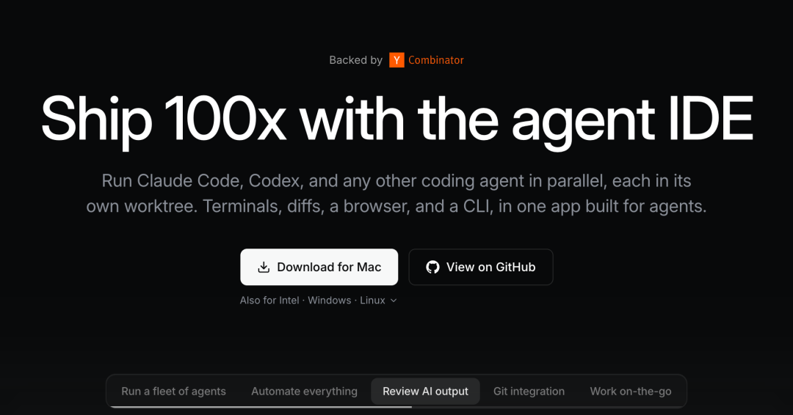
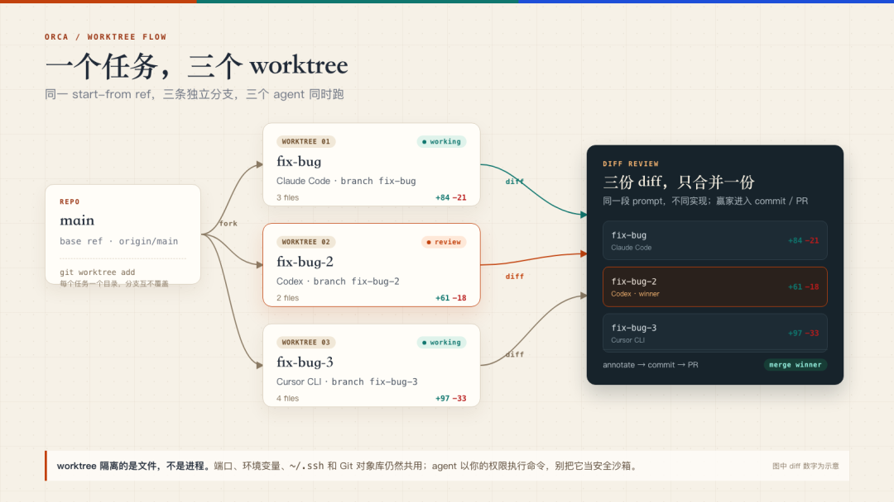
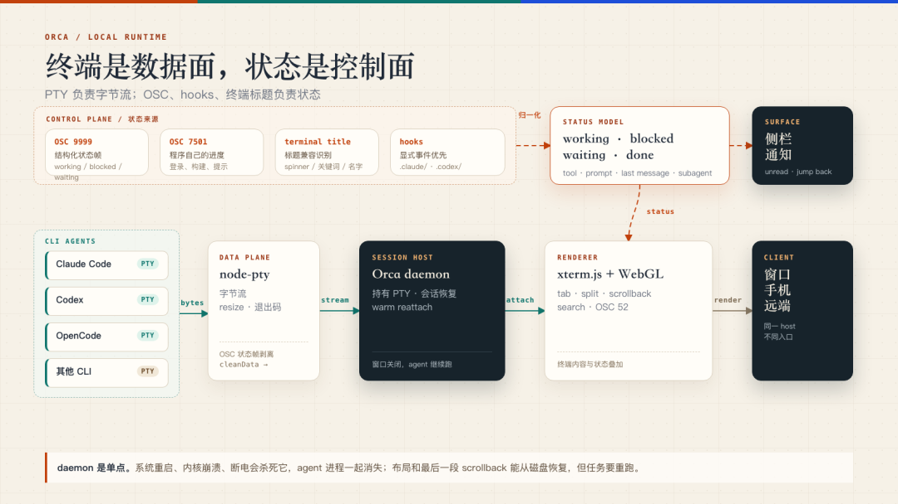
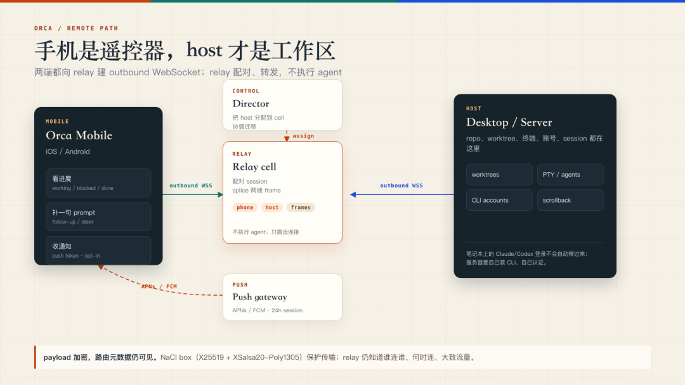

# 一个任务一个 worktree，多个 agent 同时跑 — 10 万 Star 的 Orca

> 公众号：老码小张 ｜ 2026-10-22 17:31
> 原文：https://mp.weixin.qq.com/s/1SqAq7edhJW4YSn1TfmXGw
> 项目：[stablyai/orca](https://github.com/stablyai/orca) — 归档日实测 ⭐**101,994** / Fork 6,444 / TypeScript / MIT / 2026-03-17 建库（7 个月破 10 万星）/ open issues 8,663 / 当日仍在推送
> 官方定位：*"Orca is the place for working with a fleet of agents. Run any coding agent with your own subscription. Available on desktop, mobile and remote runtime."*



## 起因：串行重跑的浪费

> "我之前解决同一个 bug，Claude Code 改了三轮还在原地，Codex 两轮就过了。"

想让两个 agent 同时试，又不想它们在同一份工作区互相覆盖文件、抢同一个 dev server 端口。多数人的做法是**串行重跑**：等一个失败、回滚、再换另一个。

Orca 省掉这段等待。它给**每个任务开一个 git worktree**，把 Claude Code、Codex、OpenCode、Pi 这些 CLI agent 放进各自的工作区和终端，再用一个桌面端统一收状态、恢复会话、连手机。

作者更关心的是它到底在调度什么：**worktree 隔离的边界在哪，终端状态是怎么被读出来的，窗口关掉后 agent 为什么还能跑。**

## 一、一个任务，一个 worktree

三个 agent 共用一份工作区，最先出问题的地方通常是文件系统：A 改了 `src/api.ts`，B 也在改；A 的测试还没跑完，B 已经升级了依赖；两人都要 3000 端口，后启动的直接失败。

### git worktree 是什么

Git 自带能力：**同一个仓库对象库，挂出多个工作目录，每个目录可以检出自己的分支。**

Orca 把它做成**任务单位**：每个 worktree 有自己的分支、文件、终端和 agent 进程；创建时选 `base ref` 和 `start-from ref`；删除时连分支一起删，未合并的分支会先让你 review。

创建过程在后台跑 `git fetch` + `git worktree add`，界面上就是一行进度，失败可重试或取消。这个细节不炫，但它决定了"开一个 worktree"能不能像开一个标签页一样顺手。

手工等价操作：

```bash
git worktree add ../fix-bug   -b fix-bug
git worktree add ../fix-bug-2 -b fix-bug-2
git worktree add ../fix-bug-3 -b fix-bug-3
```

> **branch vs worktree 的关键差别**：branch 共用同一个工作目录，切换时整份文件跟着变；worktree 给每个分支一个独立目录。这个差别在单 agent 时无所谓，**在多 agent 并行时决定了它们能不能同时跑测试、同时改文件。**

### 实际 recipe



从同一个 `start-from ref` 开三个 worktree，分别跑 **Claude Code / Codex / Cursor CLI**，贴同一段 prompt，分屏看；结束后比较 diff，把评论标在赢家的 diff 行上，commit、push、开 PR，再删掉另外两个。

README 说可以并行跑五个 agent，文档 recipe 用三个做例子——**数量可以变，隔离单位不变。**

### 这套流程的价值不在"三个模型投票"

不同 agent 的**失败方式不一样**：有的漏边界条件，有的改错文件，有的测试没跑就宣布完成。并行跑一轮，你能看到它们在同一条需求上各自漏了什么；**多个 agent 都改对的地方，通常也是需求里最确定的部分。**

### 代价：隔离边界在文件系统为止

> ⚠️ **worktree 只隔离工作区文件，不隔离进程、端口、环境变量和 `~/.ssh`。**

- agent 仍然以**你的权限**执行命令；
- 三个 worktree 同时跑 `pnpm install`、同时起 dev server，磁盘和内存会先抗议；
- Git 的对象库还是共享的；
- **worktree 离容器和安全边界还有距离。**

### 递归调度：agent 也能开 worktree

Orca 把"开 worktree"开放给了 agent 自己：`orca worktree create`、`snapshot`、`click`、`fill` 等 CLI 命令，让一个 agent 可以创建新工作区、截图、点击和填表。

**人可以调度 agent，agent 也可以调度 Orca** —— 这个递归能力比多开几个终端更能说明它的调度范围。

## 二、终端是数据面，状态是控制面



Orca 支持"任何 CLI agent"，靠的是**把终端当成统一接口**。Claude Code、Codex、OpenCode、Pi 都是进程，都能挂在 PTY 上：

- 用 **node-pty** 起进程
- 用 **xterm.js** 渲染，WebGL 加速
- 滚动、分屏、搜索、OSC 52 剪贴板等终端能力都在

但只有终端，产品就退化成多标签终端。Orca 多做的是**一层状态提取**：

| 状态来源 | 机制 |
|---------|------|
| `OSC 9999` | 结构化状态帧（working / blocked / waiting） |
| `OSC 7501` | 程序自己的进度（登录、构建、提示） |
| **terminal title** | 标题兼容识别（spinner / 关键词 / 名字） |
| **hooks** | 显式事件优先（`.claude/`、`.codex/`） |

四路输入**归一化**为状态模型：`working / blocked / waiting / done`（携带 tool、prompt、last message、subagent 信息）→ 投影到 Surface：侧栏、通知、unread、jump back。

> **这套设计的好处**：新增一个 CLI agent 的成本很低——只要能跑在终端里，至少能用；有 hooks 的再做深。
>
> **坏处**："支持"分层次。**能启动、能显示状态、能恢复会话、能精确 resume，是四件不同的事。** README 写 "any CLI agent"，这句话在"能启动"层面成立；到了状态和恢复，深度取决于 agent 有没有 hooks、有没有可解析的标题/OSC。

同一套输入通道还延伸到浏览器：**Design Mode** 在真实 Chromium 窗口里点一个 UI 元素，把 HTML、CSS 和裁剪截图送进 prompt。终端是主通道，浏览器是另一条上下文入口。

> 这是 Orca 最容易被低估的部分。多标签终端谁都能做；**把不同 agent 的状态归一化、把窗口关掉后的会话留住，才是它和普通终端拉开距离的地方。**

## 三、窗口关掉，agent 还在跑

很多 Electron 终端应用把 PTY 放在主进程里，窗口一关，子进程跟着退出。Orca 把 PTY 放进**后台 daemon**：窗口只是客户端，daemon 持有终端和 agent 进程。

- 关闭窗口**不会杀死 agent**
- 下次启动 **warm reattach** 到原来的进程，连 scrollback 都还在
- 恢复的不只是进程列表：打开的 worktree、tab/split 布局、每个终端的 scrollback、当前聚焦的 tab 都会回来

**恢复不了的是 daemon 自己被重启**：系统重启、内核崩溃、断电 → daemon 死了，agent 进程也就没了；布局和尾部 scrollback 还能从磁盘恢复，但 **agent 要重跑**。

### 技术底座

| 目录 | 职责 |
|------|------|
| `src/main/daemon` | 后台 daemon，持有 PTY 与 agent 进程 |
| `src/packages/process-host` | 不依赖 Electron/原生模块的子进程层 |

`process-host` 管 spawn、fork、输出上限、取消、Windows 参数和进程树终止。**一个进程层被五个运行环境复用**（桌面、headless server、CLI、SSH relay、daemon），代码路径才不会分叉。

### 代价：daemon 变成单点

它崩了，所有终端一起没；它的 socket 端点、重启接管、版本兼容都要处理。`src/main/daemon/AGENTS.md` 专门写了 socket 路径的所有权协议：只有发布到 canonical endpoint 的 daemon 才能替换自己刚刚证明死掉的 entry，**任何 actor 不能删除自己没创建的 name**。

> 这段注释说明这个单点并不好养。

## 四、手机和远端：桌面是 host，手机远程看状态



远程能力分两条线：

| 路线 | 形态 |
|------|------|
| **SSH worktree** | 连到更强的机器，在远端目录里开 worktree、跑 agent、编辑文件、开终端，带自动重连和端口转发。像把远端目录接进当前客户端 |
| **Remote Orca Server** | 服务器上跑一个 Orca 实例，repo / worktree / 终端 / tab / provider 账号 / agent session 都在服务器上；笔记本只是客户端，负责显示和输入。**把整个 host 搬到远端**，连手机也接同一个 host |

**Remote Server 目前是 beta**，官方推荐两台机器都装桌面版用 **Tailscale** 连；也可以 `headless orca serve`，用 `orca account add --agent claude` / `--agent codex` 单独登录。

> ⚠️ **这个细节很重要**：你在笔记本上登录的 Claude/Codex **不会自动带到服务器**；服务器要自己装 CLI、自己认证。

### 手机端：同一个 host 的远程控制

relay 不要求手机和桌面互相暴露端口：两边都向 **relay cell** 建 outbound WebSocket，relay 配对后 splice 帧；**director** 负责把 host 分配到 cell、协调迁移。手机看到的是桌面 host 的会话，**agent 还在桌面/服务器上跑**。

**传输层**：
- `tweetnacl` 的 `nacl.box`，**X25519 共享密钥 + XSalsa20-Poly1305**
- 桌面、CLI、手机配对共用一种格式，单条明文上限 **4MB**
- 推送走 APNs/FCM，桌面 host 用 X25519 密钥应答挑战，换 **24 小时会话**，再把手机 push token 注册上去

> ⚠️ **payload 是加密的，但 relay 仍然知道谁连谁、什么时候连、大致流量——这些元数据不在加密范围里。**

这套设计解决了一个真实问题：**手机不适合承担 agent 的执行，但适合收通知、看进度、补一句 prompt。** 但它也有明显的云依赖：relay、push gateway、director 都是 Orca 的基础设施；自建/离线场景要另算。Remote Server 还是 beta，官方不建议把服务直接暴露公网。

## 五、作者的判断与边界

### 工程完成度不低，但要注意

- Electron 本身不轻，三个 worktree、三个 agent、三套依赖和三套 dev server 更不轻；
- **worktree 不是容器**，agent 能读你的环境变量、SSH key、端口和本机文件。**你要的是并行，别把不可信代码扔进去跑。**
- "支持任何 CLI agent"要拆开看：能启动是最低层；状态、通知、会话恢复、精确 resume 是另一层。**没有 hooks 的 agent 只能靠标题/OSC 兼容，agent 一改输出就可能失灵。Orca 把兼容层做得很宽，但宽不等于深。**

### 适合谁

| 情况 | 建议 |
|------|------|
| 每天已在 Claude Code / Codex / OpenCode 之间切换 | ✅ 顺手 |
| 经常"让两个 agent 各写一版再比较" | ✅ worktree + daemon + diff review 是一条顺手的路径 |
| 只是偶尔问几个问题 | ❌ 不适合 |
| 需要强隔离的多租户沙箱 | ❌ 至少现在不适合 |

---

## 战略分析

### 一句话判断：Orca 卖的不是"多开终端"，是"状态归一化 + 进程持有"

文章里有两句被放在不显眼位置、但决定了这个产品价值的话：

1. **"多标签终端谁都能做；把不同 agent 的状态归一化、把窗口关掉后的会话留住，才是它和普通终端拉开距离的地方。"**
2. **"能启动、能显示状态、能恢复会话、能精确 resume，是四件不同的事。"**

这两句话合起来，其实是在给整个品类划界。市面上大量"Agent 编排器"实际只做到"能启动"——把几个 CLI 塞进 tmux 分屏，然后美其名曰并行。Orca 的护城河在于**四路径状态归一化（OSC 9999 / OSC 7501 / terminal title / hooks）→ 统一状态模型 working/blocked/waiting/done**。这是一个脏活：需要兼容四套不同的 agent 输出约定，且任何 agent 改输出都可能让兼容层失灵。**正因为它脏，才不容易被抄。**

### 三个真正的架构取舍

| 决策 | 换来什么 | 付出什么 |
|------|---------|---------|
| **用终端（PTY）当统一接口**，而不是给每个 agent 写适配器 | 新增 agent 成本极低，能跑终端就支持 | "支持"分层级，深度取决于有没有 hooks；状态靠标题/OSC 猜，脆 |
| **PTY 放后台 daemon**，窗口只是客户端 | 关窗口 agent 不死，warm reattach 连 scrollback 都在 | daemon 变单点，崩了全没；socket 所有权协议难养 |
| **worktree 当隔离单位**，而不是容器 | 零成本、Git 原生、分支天然对齐 review 流 | 只隔离文件，不隔离进程/端口/env/`~/.ssh`；不是安全边界 |

第三行是全篇最需要记住的一条：**worktree 是"文件系统级的并行"，不是"安全级的隔离"**。文章自己反复强调"别把不可信代码扔进去跑"——这句话把 Orca 的适用场景钉死在了**你自己信任的、自己订阅的 agent** 上。

### 值得注意的三个结构性事实

1. **10 万星但 8,663 个 open issue**。7 个月破 10 万星（比多数明星项目快得多），但 issue 积压 8,663 —— Star 数和工程承载力严重不匹配。这不必然是负面（很多是 feature request），但**它说明这个项目的热度远超维护带宽**。真要上生产，先看你依赖的那条链路（比如你用的 agent 有没有 hooks）近三个月的 issue 关闭率。
2. **daemon 单点 + 云依赖（relay/director/push gateway）** 让 Orca 不是纯本地工具。加密只保护 payload，**元数据（谁连谁、何时、多少流量）暴露给 relay**——对隐私敏感的场景要额外评估，文章指出了这点但没展开。
3. **Y Combinator 背书 + `--agent` 账号体系**暗示商业化路径：Remote Server 的"服务器要自己认证"目前是坑，但这个坑本身就是未来托管服务的入口。

### 与库内既有归档的关系

知识库里 worktree 隔离这条线已经相当密集，Orca 是其中**工程完成度最高、但隔离强度最弱**的一个：

| 库内既有归档 | 与本篇的关系 |
|---|---|
| `2026-10-05-DSH桌面Agent苦苦菜-子Agent编排与worktree隔离` | 最近邻：同样桌面端 + worktree 隔离。Orca 多了 daemon 与状态归一化 |
| `2026-06-14-Polynoia开源-微信群聊指挥多AIAgent并行干活` | 不同入口（IM vs 桌面），同样"人调度多 agent"命题 |
| `万字图文-Loop-Engineering-附代码详解` / `2026-07-13-Loop工程不值钱-inspector才值钱` | 提供"为什么并行需要收敛"的理论层；Orca 的 diff review 是收敛的具体实现 |
| `2026-07-06-实测17种Agentic-Loop-Engineering技术` | 技术盘点层，Orca 可作为一个实例补进去 |
| `Emdash-TaskMaster-mcpm-AI编码工作流三件套` | 同为编码工作流工具链，可对照"隔离单位"的选择 |

**关键洞察**：这一批文章反复出现同一个模式——**并行只是手段，收敛才是价值**。昨天的《从LOOP到图探索》（美团）说的是"只并行不收拢就退化成多开实验"；今天 Orca 说的"saw diff review 才是终点"。两个完全不同的团队、完全不同的场景（ML 训练 vs 编码），在同一个原则上撞车了。**这条可以当成一个跨领域的判断标准：任何号称"并行 Agent"的方案，先问它的收敛机制是什么。**

### 对小谭现有栈的直接启示

**可直接用的一条**：`git worktree add ../fix-bug -b fix-bug` 本身零成本、不需要装 Orca。当需要让 Claude Code 和 Codex 各写一版对比时，**手工开 worktree + 分别起 agent + 比 diff** 就能拿到 80% 的收益，规避 Electron 重和 daemon 单点。真正值得装 Orca 的触发点是：**你开始频繁做这件事，且需要跨设备（手机看进度）或关窗口不中断。**

**可迁移的架构思想（比工具本身更有价值）**：
1. **"数据面 / 控制面"分离** —— PTY 负责字节流（数据面），OSC/hooks/标题负责状态（控制面）。这个切分与 Hermes 的现状是同一逻辑：Hermes 的工具输出是数据面，session 状态与 cron 调度是控制面。想加新能力时先问"这是数据还是状态"，通道选错了上层必然脆。
2. **"宽度不等于深度"** —— "支持任何 CLI agent" 的诚实版本是"支持分四层"。这个思维方式可直接用于评估 Hermes 的 MCP 兼容性：能连上、能用工具、能流式、能中断恢复，是四件事。
3. **进程层被五个运行环境复用** —— `process-host` 不依赖 Electron，被桌面/headless/CLI/SSH/daemon 共用，代码路径不分叉。这是"多形态一内核"的标准做法。

**不必迁移的**：Electron + xterm.js + WebGL 这套渲染栈。Hermes 是终端/IM 形态，不需要图形终端。

## 归档日志

- 2026-10-22 归档。web_extract（Exa 后端）本次失败（`Keyless Exa extract failed`），改用浏览器 `#js_content` innerText 抓取，全文 4,682 字符完整无截断。
- 配图 4 张全部下载至 `assets/2026-10-22-Orca/`，均为 1080 宽 PNG。逐张视觉核读后撰写图注：img_00=官网首页（Y Combinator 背书，"Ship 100x with the agent IDE"）、img_01=一任务三 worktree fan-out 到 diff review 流程图（含底部隔离边界红字）、img_02=终端数据面/状态控制面分层图、img_03=手机 relay 远程路径图。三张架构图底部都带红字警示，已在正文中还原为相应的 ⚠️ 提示，未丢失。
- **仓库数据为归档日 GitHub API 实测**：⭐101,994、Fork 6,444、MIT、TypeScript、2026-03-17 建库、当日仍在推送、open issues 8,663。文章"10 万 Star"表述属实。
- 库内查重：`Orca`、`stablyai`、`node-pty` 均 0 命中，本篇为首篇；`worktree` / `git worktree` 已有 10+ 篇相关积累，已在战略分析中建立交叉引用（尤其是 10-05 DSH 与 Loop Engineering 系列）。
- 文章作者对 Orca 的定位判断（适合谁 / 不适合谁）为**作者口径**，未独立验证；Remote Server 为 beta 状态截至归档日。
