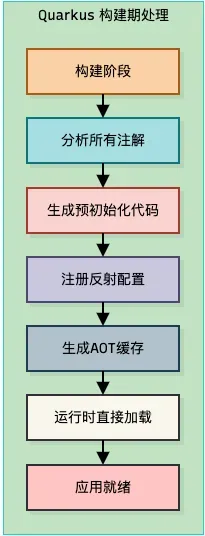
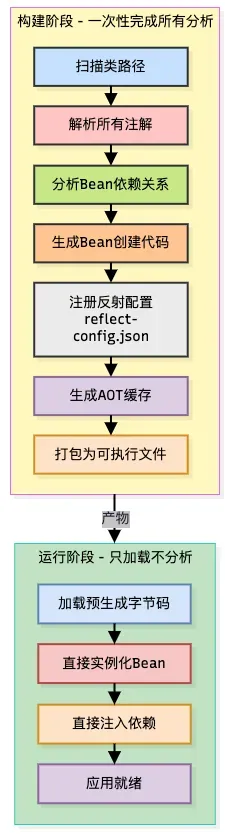
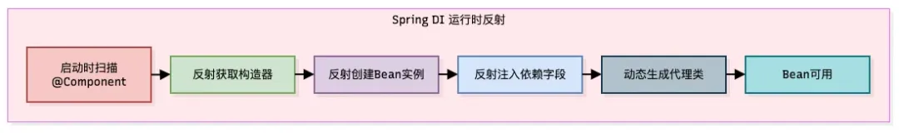
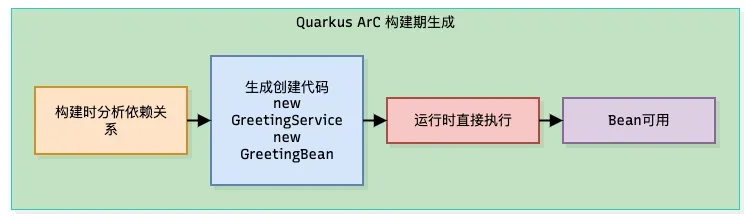
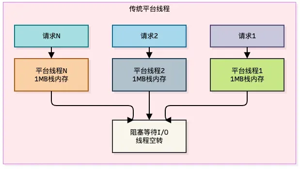
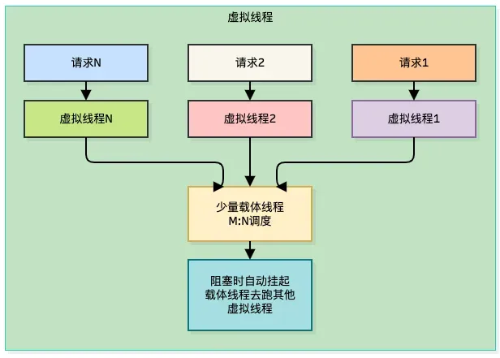

# 为什么越来越多人用Quarkus？

> 公众号：macrozheng ｜ 2026-10-22 14:10 ｜ 原作者：苏三说技术
> 原文：[为什么越来越多人用Quarkus？](https://mp.weixin.qq.com/s/rU7brV___8RzVvyvl5YQ8w)
> 仓库：[quarkusio/quarkus](https://github.com/quarkusio/quarkus) — 归档日实测 ⭐15,953 / Fork 3,343 / Apache-2.0 / 2018-07 创建，仍在高频提交


## 前言

一位读者所在公司正在做 Java 技术栈"瘦身"评估，让他帮忙推荐开源框架。理由算得很实在：跑着两百多个 Spring Boot 服务，每服务平均占 512MB 内存，按 K8s 节点规格折算，光 JVM 堆闲置一年就多花几十万；再加上滚动发布时几百个 Pod 同时重启，"等服务启动完成"这一环节就要给发布窗口预留半小时。

他的结论是：**"不是 Spring Boot 不好用，是我们现在跑的这套东西，跟云原生这个环境有点水土不服。"**

作者认为 Spring Boot 并没有"过时"，问题在于**设计初衷与云原生环境之间存在结构性错配**。

## 一、Java 框架在云原生环境下的三重困境

Spring Boot 继承的**运行时反射模型**，与 Kubernetes 的**弹性伸缩模型**根本错配：

| 困境 | 具体表现 | 代价 |
|------|---------|------|
| **启动时间** | 上下文初始化需 5–15 秒；类加载、Bean 实例化、依赖注入、自动配置扫描在主线程串行执行，JIT 尚未介入，解释执行进一步放大延迟 | 发布窗口预留半小时；扩容要"等" |
| **内存占用** | 最简单的 Web 应用常驻内存常超 200MB，同等功能 Go 应用约 20MB | 内存按副本数线性计费，百副本规模每月数千美元 |
| **预热** | JIT 需数千次方法调用才识别热点触发编译，启动后前几分钟吞吐仅为稳定期的 30%–50% | 按需扩容时新副本一上线就承接流量，直接超时 |

根源不在 Java 语言，而在生态长期沿用的运行时反射模型——Spring、Hibernate、Jackson 都靠反射在运行时扫类路径、解析注解、动态生成代理。开发期极灵活，运行期付重价。

## 二、Quarkus 的构建期处理架构



Quarkus 的核心贡献是**重新设计了一套完全构建期化的框架内核**，使应用天然满足 Native Image 的闭世界假设（closed-world assumption），从而让 Native Image 真正可用于生产级 Java 应用。

一句话概括：**Spring Boot 把活儿留到运行时干，Quarkus 在构建时就把活儿干完了。**

## 三、底层原理

### 3.1 构建期处理全流程



对比 Spring Boot 的运行时流程：Spring Boot 在启动时执行"扫描 → 解析 → 构建 Bean 定义 → 反射创建 → 注入"全链路，Quarkus 把**前四步全部挪到构建阶段**，运行时只做"加载预生成代码"这一步——这就是启动时间从 5.6 秒降到 1.3 秒的根本原因。

### 3.2 ArC 依赖注入：构建时代码生成 vs 运行时反射





ArC 在构建时就"知道" `GreetingService` 依赖 `GreetingBean`，于是**直接生成 `new GreetingService(new GreetingBean())` 的字节码**。运行时不需要反射查构造器、不需要反射注入字段、不需要动态生成代理。

**依赖注入从"运行时操作"变成了"编译期生成的代码"。**

### 3.3 虚拟线程调度模型

Quarkus 4 以 Java 21 为基线，虚拟线程成为一等公民。





```java
@RunOnVirtualThread
@GET
@Path("/blocking-operation")
public String blockingOperation() {
    // 这段代码运行在虚拟线程上
    // 可以使用简单的阻塞API
    // 同时获得极高的并发能力
    return repository.findSomething();
}
```

传统平台线程每请求占 1MB 栈内存，阻塞时线程空转；虚拟线程是 **M:N 调度**——大量虚拟线程复用少量载体线程，阻塞时自动挂起，载体线程转去跑其他虚拟线程。

**核心价值：继续写简单的阻塞代码，同时拿到接近响应式编程的并发能力。**

## 四、性能数据

### 4.1 官方基准测试（2026 年 3 月，文章口径）

| 指标 | Quarkus | Spring Boot | 差距 |
|------|---------|-------------|------|
| 吞吐量 | 19,255 tps | 7,238 tps | 2.7 倍 |
| JVM 启动 | 2.9 秒 | 6.6 秒 | 2.3 倍 |
| 内存占用 | 269MB | 583MB | 2.2 倍 |

### 4.2 BMW Romania 独立实测（2026 年 8 月，文章口径）

BMW Romania CTO Alex Diniș 用同一个服务分别以 Spring Boot 和 Quarkus 实现，包含相同的 REST 端点、业务逻辑和嵌入式 ML 情感分类模型：

| 指标 | Quarkus | Spring Boot | 差距 |
|------|---------|-------------|------|
| JVM 启动 | 1.3 秒 | 5.6 秒 | 4.3 倍 |
| Native 启动 | ~200ms | ~2s | 10 倍 |
| 空闲内存 | 88MB | 204MB | 2.5 倍 |
| Docker 镜像 | 更小 | 更大 | — |

**换算到业务影响**：假设每天 200 次扩容、每次 2 个 Pod，4.3 秒的启动差 × 400 次 Pod 启动 ≈ **每天多出 30 分钟不可服务时间**；按每秒 50 请求算，约等于每天 10 万个延迟或失败请求。

> ⚠️ 上表数据均为**文章口径**，转载时未附原始测试代码与配置，归档时未独立复现。

## 五、代码实战

### 5.1 项目创建

```bash
mvn io.quarkus.platform:quarkus-maven-plugin:3.38.0:create \
    -DprojectGroupId=com.example \
    -DprojectArtifactId=quarkus-demo \
    -Dextensions='resteasy-reactive,resteasy-reactive-jackson,hibernate-orm-panache,jdbc-postgresql'
```

### 5.2 写一个 REST 接口

```java
package com.example.resource;

import jakarta.ws.rs.GET;
import jakarta.ws.rs.Path;
import jakarta.ws.rs.Produces;
import jakarta.ws.rs.core.MediaType;

@Path("/hello")
public class GreetingResource {

    @GET
    @Produces(MediaType.TEXT_PLAIN)
    public String hello() {
        return "Hello from Quarkus!";
    }
}
```

### 5.3 实体和 Repository（Panache 风格）

```java
// 实体
@Entity
@Table(name = "products")
public class Product extends PanacheEntity {
    public String name;
    public BigDecimal price;
    public Integer stock;
}

// Repository（Panache 风格，无需写实现）
@ApplicationScoped
public class ProductRepository implements PanacheRepository<Product> {

    public List<Product> findInStock() {
        return find("stock > 0").list();
    }

    public List<Product> findByName(String name) {
        return find("name", name).list();
    }
}
```

### 5.4 Service 层

```java
@ApplicationScoped
public class ProductService {

    @Inject
    ProductRepository productRepository;

    public List<Product> getInStockProducts() {
        return productRepository.findInStock();
    }

    @Transactional
    public Product createProduct(Product product) {
        product.persist();
        return product;
    }
}
```

### 5.5 配置（application.properties）

```properties
quarkus.datasource.db-kind=postgresql
quarkus.datasource.username=postgres
quarkus.datasource.password=postgres
quarkus.datasource.jdbc.url=jdbc:postgresql://localhost:5432/mydb

quarkus.hibernate-orm.database.generation=update
```

### 5.6 运行

```bash
# 开发模式（支持热重载）
./mvnw quarkus:dev

# 打包为 JVM 模式
./mvnw package

# 打包为 Native 镜像
./mvnw package -Pnative
```

## 六、优缺点

### 优点

1. **启动速度颠覆性提升** — JVM 模式 1.3 秒、Native 模式 200 毫秒；对 K8s 弹性伸缩是从"分钟级"到"秒级"的质变。
2. **内存占用大幅降低** — 空闲内存 88MB，与 Spring Boot 差 2.5 倍；每副本省 100MB，百副本规模每月省数千美元。
3. **构建期处理带来运行时确定性** — Spring Boot 的条件注解可在运行时动态决定 Bean 是否注册，代价是启动行为不可预测；Quarkus 把决策前移到构建期，运行时行为完全确定。
4. **统一的命令式与响应式模型** — 通过 Eclipse Vert.x 集成两种模型，同时仍遵循 MicroProfile 与 Jakarta EE 标准。
5. **Dev Mode 热重载** — 代码、配置、资源实时修改，无需重建或重启。
6. **Java 21 虚拟线程一等公民** — 不再是"二等公民"。
7. **Native Image 生产就绪** — 从设计之初就围绕构建期处理与 GraalVM 原生编译构建，是 Native Image 最成熟的 Java 框架。

### 缺点

1. **生态成熟度不如 Spring Boot** — 社区规模与第三方集成数量有差距；企业内部自研中间件往往只有 Spring Boot Starter。
2. **Native Image 的工程成本** — 原生镜像构建显著更慢，调试原生可执行文件仍需 GDB 与调试符号，并非所有 Java 特性开箱即用。
3. **动态性限制** — 构建期处理意味着运行时动态能力受限，依赖运行时反射的第三方库可能需要额外配置或适配。
4. **学习曲线** — 虽标准 API 兼容，但 DI 机制与编程模型是新的一套，习惯需时间调整。
5. **Kotlin 支持偏弱** — 不如 Spring Boot 原生成熟。

## 七、适用场景

| 场景 | 推荐程度 | 理由 |
|------|---------|------|
| K8s 弹性伸缩服务 | ✅✅✅ 强烈推荐 | 200ms 启动让扩容真正"弹"得起来 |
| Serverless / FaaS | ✅✅✅ 强烈推荐 | 启动时间从"秒级"到"毫秒级" |
| 高密度部署 | ✅✅✅ 强烈推荐 | 内存占用约为 Spring Boot 的一半 |
| AI 推理服务 | ✅✅✅ 强烈推荐 | 快速启动 + 低延迟，适合模型服务 |
| 金融交易系统 | ✅✅✅ 强烈推荐 | 高吞吐 + 低延迟，响应时间稳定 |
| 长期运行的核心服务 | ⚠️ 需评估 | 启动差距不显著，Spring Boot 生态更成熟 |
| 依赖大量 Spring 生态组件 | ⚠️ 需评估 | 迁移成本可能较高 |
| Kotlin 为主的项目 | ⚠️ 需评估 | Kotlin 支持不如 Spring Boot |

## 八、写在最后

作者的回答是：Quarkus 重新思考了 Java 在云原生时代的运行时模型。

Spring Boot 的设计哲学是"**运行时灵活性优先**"，用反射和运行时扫描换开发期便利——这在单体应用时代是正确的选择。但在 Kubernetes 时代，**启动时间、内存占用、弹性伸缩速度**成了硬约束，运行时反射模型的代价开始不可接受。

Quarkus 的设计哲学是"**构建期确定性优先**"，把所有分析前移到构建阶段，运行时只执行预生成字节码。JVM 模式 1.3 秒、Native 模式 200 毫秒意味着：Java 应用可以上 Serverless，K8s 扩容可以在几秒内完成，内存密度可以翻倍。

但 Quarkus 不是银弹——生态成熟度、Native Image 工程成本、动态性限制都是真实短板。对 K8s 弹性伸缩、Serverless、高密度部署这些云原生场景，它已经是经过生产验证、性能领先、持续演进的选择。

参考资源：Quarkus 官网 https://quarkus.io ｜ GitHub https://github.com/quarkusio/quarkus

---

## 战略分析

### 这不是"框架好坏"，是"运行时模型与部署形态是否匹配"

文章最有价值的一句判断是"结构性错配"，而决定错配是否成立的不是框架，是**部署形态**。如果服务部署在固定副本、长年不重启的虚机上，Quarkus 省下的 4.3 秒启动和 100MB 内存换不来任何业务收益，而 Spring Boot 的生态成熟度和团队熟悉度是净收益；一旦服务每天发生上百次扩缩容、按需伸缩或跑在按量计费的 Serverless 上，Spring Boot 的启动/预热成本就会以"不可服务时间"的形式直接出现在账单和错误率里。所以选型的正确问法不是"Quarkus 好不好"，而是"**我的服务一年重启/扩容多少次，每次启动的可见性成本是多少**"——这个数字乘以副本数就是迁移能收回的上限，再和迁移成本、内部中间件 Starter 缺失、Native 构建链维护三项成本对撞。

### 可信度分层：哪些数字能用，哪些只能当宣传

- **可信（机制层）**：构建期处理消除运行时反射、ArC 生成 `new GreetingService(new GreetingBean())` 字节码、虚拟线程 M:N 调度——这些是原理，不随基准波动。
- **需打折（数字层）**：官方 tps 2.7 倍、内存 2.2 倍这类吞吐倍数，在真实业务（大量 I/O、外部依赖、GC 压力）下通常收敛到远低于此；BMW Romania 的 4.3 秒/200ms 是单服务单作者实测，转载未附代码配置，属"文章口径"。
- **反直觉的一点**：Native 模式 200ms 启动听起来是终局答案，但文章自己在缺点里承认原生镜像构建慢、调试难、反射库需适配——**启动最快的形态恰恰是工程成本最高的形态**。多数团队的合理落点是"JVM 模式 + 虚拟线程 + 构建期优化"（1.3 秒已足够应付 K8s 就绪探针），Native 只在 Serverless/边缘/CLI 场景才真正划算。
- **文章没提但影响更大的一条**：GraalVM Native 的内存模型没有 JIT，稳态吞吐通常低于 JVM 模式——文章所有吞吐对比都是 JVM 模式下的，与 Native 启动数据并列呈现容易让读者误以为"又快又省又有吞吐"。

### 与库内既有归档的对照

知识库里已有 17 篇涉及 Spring Boot 的文章（`Spring AI 生产级架构四平面设计`、`2026-06-11-Spring-Boot-LangChain4j-流式调用大模型生产实践`、`2026-06-04-AgentScope-Java-2.0` 等），全部把 Spring Boot 当作默认底座，从没有人质疑过它的运行时模型——这也是本篇的独特价值：**库内第一次出现"Java 底座选型"这一层的问题**。值得注意的是，库内 AI 应用类 Java 文章正在把 Spring Boot 当作"承重墙"使用（Spring AI、LangChain4j 都是 Spring 生态原生集成的），一旦要迁 Quarkus，AI 侧依赖（Spring AI 的 Quarkus 对应物 LangChain4j + Quarkus LangChain4j 扩展）反而成了比业务代码更硬的迁移阻力。换句话说：**Quarkus 在 AI 服务场景被文章列为"强烈推荐"，但在 Spring AI 生态已深度绑定的项目里，这条推荐需要重新算账。**

### 对小谭现有栈的启示

当前栈（Hermes Agent / Obsidian / TencentDB Memory / NexSandglass）没有 Java 服务，本篇不构成直接整合对象，价值在于**可迁移的方法论**：构建期确定性的思路与 Hermes 的"技能预加载 + 工具 schema 前置声明"是同构的——把不确定的探查从"每次运行"挪到"装载时"。若将来要做 Java 侧工具（如企业内 Agent 后端的 JVM 服务），选型判断按上面的公式算：扩容频次 × 启动可见成本 vs 迁移成本 + Native 构建链维护成本，而不是按 tps 倍数选。

## 归档日志

- 2026-10-22 归档。正文经浏览器 `#js_content` innerText 提取（Firecrawl/web_extract 均可用，浏览器用于补图片与发布信息）；9 张配图下载至 `assets/2026-10-22-Quarkus/`，实际格式 webp×5 / png / gif（按 magic bytes 定扩展名，非 URL 猜测）。
- 图片位置按原文 `data-src` 顺序核对：img_001 封面、img_002/003 架构对比、img_004 构建期流程图、img_005 Spring DI 反射流程、img_006 ArC 构建期生成、img_007 平台线程、img_008 虚拟线程 M:N、img_009 尾部 GIF（公众号装饰，已不引用）。
- 仓库数据为归档日 GitHub API 实测（⭐15,953，Apache-2.0，2018-07 创建，2026-10-22 仍高频提交）。
- 性能数据标注为**文章口径**，未独立复现。
- 库内查重：此前无 Quarkus / GraalVM / Native Image 归档，本篇为首篇。
