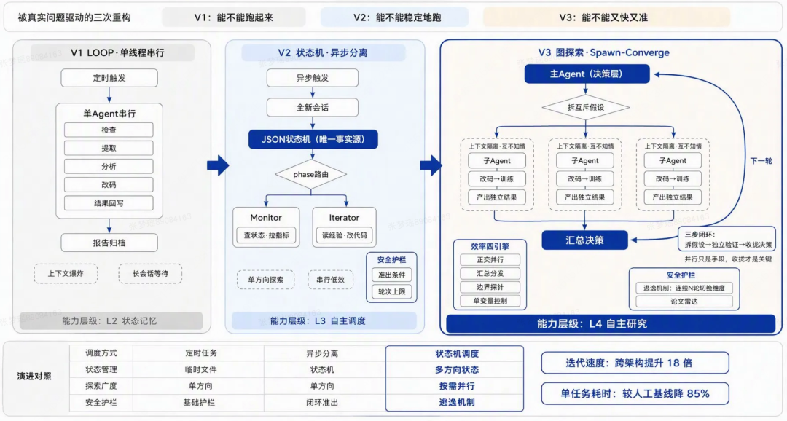
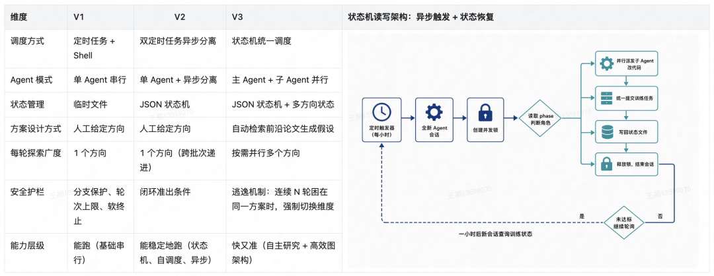
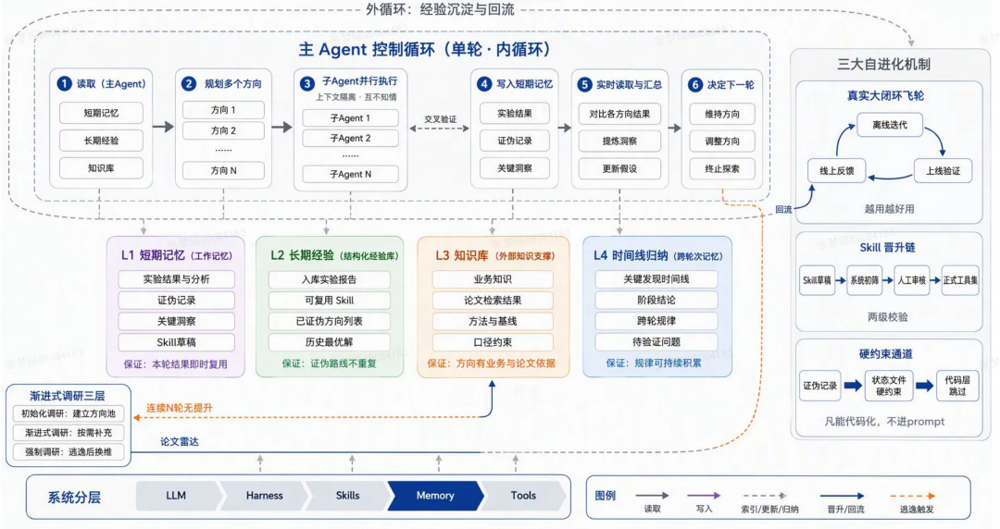
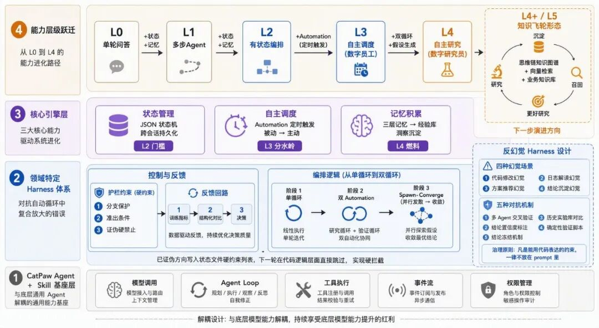
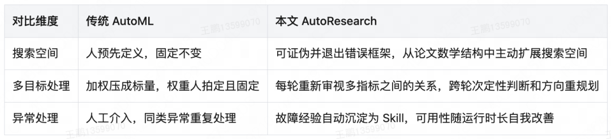

# 从LOOP到图探索 — 算法模型的 AutoResearch 自进化系统架构演进之路

> 公众号：美团技术团队 ｜ 2026-10-22 10:24 ｜ 原创
> 原文：https://mp.weixin.qq.com/s/PtvsHCfKTxyW4-amn19frQ

**全文速读**

算法工程师的一天是"改代码—提交训练—等待—看日志—决定下一步"，过程中还经常被打断。美团团队从 Karpathy 的 AutoResearch 出发，经过三次架构重构，搭建出一套可在企业云端训练平台使用的算法研究自进化系统：从单线程 LOOP 探索升级为 **CyclicGraph Engine 图探索架构**，用状态机保证长周期运行稳定性，并通过"业务知识库 + 真实大闭环 + 经验自动沉淀"实现系统自进化。

在两个结构、目标与场景均不相同的业务建模项目中，单任务完成耗时较人工基线分别减少约 **85%** 与 **83%**；其中一个算法模型已将系统自主推导的方案推全上线并取得线上收益；另一个多目标项目中，系统产出的方案在全部 **12 个**预估目标上同时超过人工基线。两个项目唯一的共同点是同一套系统架构——说明增益来自架构本身。

---

## 1 背景：算法工程师的时间都去哪了？

典型工作流：改代码 → 推送 → 提交训练 → 等待 → 看日志提指标 → 与上一轮对比 → 决定下一步。等待间隙工程师切到别的任务，但切换有成本；训练若在凌晨完成还要等第二天。**一天下来只完成约 2~3 次实质性迭代**，真正需要判断力的环节被切换和等待挤压得所剩无几。

### Karpathy 的 AutoResearch 原型（2025 年底）

单张 H100 上训练 5000 万参数教学级 GPT 的实验原型，仓库只有三个文件：

| 文件 | 职责 |
|------|------|
| `program.md` | 用自然语言描述研究规则 |
| `train.py` | **Agent 唯一可自主修改**的训练代码 |
| `prepare.py` | 负责评估，**被冻结为不可修改** |

约两天内运行约 700 次实验，产出约 20 个针对 `val_bpb` 的正向提交。

两个刻意的信任设计：
1. **评估函数冻结** —— Agent 只能改训练代码不能改评估函数，从机制上杜绝"篡改裁判"；
2. **Git 棘轮机制** —— keep/reset 让每一步改进都可审计、可回滚。

### 搬进企业后暴露的三个问题

- **可信度问题**：规则全部以自然语言 Prompt 声明，模型幻觉导致执行不完全可信；
- **运行环境差异**：本地单机 vs 企业云端训练平台差异巨大，Agent 需异步执行，评价指标要体现业务差异性；
- **LOOP 架构的根本局限**：keep/reset 本质是可回滚的**单线程串行 LOOP**，同一时刻只能维护一条时间线。

> 多数 AutoResearch 实践者（包括最初的作者团队）都沿用了这套单线程思路。

## 2 五条设计理念

后续所有取舍都由此推导：

1. **高效、高性价比** —— Agent 的夜间与周末算力是"闲置产能"，把人的注意力从执行中解放出来，只保留在高价值判断上。
2. **与底层 Agent 基座解耦** —— 基座能力每几个月就有性价比更优的选择，通过好的 Harness 设计"搭便车"，基座升级系统免费受益。
3. **系统自进化，越用越好用** —— 经验、工具、Skill 不每次从零开始，使用中自动总结、经人工校验后沉淀回系统。
4. **用真实的大闭环获取优质数据** —— 离线指标提升只是中间站，方案上线后的真实反馈回流知识库才是垂直场景最稀缺的数据。
5. **可信优先** —— 无人值守的长周期循环里，一次错误会成为下一轮决策的输入并逐轮放大。**凡是能用代码表达的约束，一律不放在 prompt 里。**

## 3 三次架构演进：从 LOOP 到 CyclicGraph Engine

三个版本不是提前规划的路线图，而是被真实问题驱动的演进。

### 3.1 V1 把 LOOP 搬上企业云端

定时任务 + Shell 脚本周期性触发，单个 Agent 串行完成检查、提取、分析、改代码全链路，报告归档到云端协作文档。实现了企业云端 AutoResearch，但**上下文爆炸、状态同步不及时**造成低效。

### 3.2 V2 异步循环与显式状态机

- 每次触发创建**全新会话**，状态持久化在 JSON 状态文件 → 解决长会话上下文爆炸；
- 拆分为 **Monitor + Iterator** 两个角色，靠状态文件 `phase` 字段互斥路由，同一时刻只有一个角色工作；
- 状态文件**只保留决策所需的最小信息**，目标是"把探索结果压缩为可复用的决策依据"——这是针对 ML 迭代场景的定制设计，与通用图编排框架的"全量状态"思路不同；
- 关键决策「**无状态触发 + 有状态文件**」：Agent 不同步等待训练（训练动辄数小时，长会话等待既浪费上下文也不可靠），靠定时触发的新会话在下一次唤起时从状态文件恢复现场。

这一步为 V3 的异步并行打下了地基。

### 3.3 V3 CyclicGraph Engine 图探索架构

核心机制 **Spawn-Converge** 三步闭环：

| 阶段 | 动作 |
|------|------|
| **Spawn** | 决策层主 Agent 把大问题拆成 3~4 个**互斥的差异化假设**（如"特征不足" vs "结构不足"），派发给执行层 |
| **执行** | 子 Agent 通过**上下文隔离**并行各自改代码、提交训练，互不知情，因而不会被彼此的中间结论带偏 |
| **Converge** | 训练完成后主 Agent 汇总对比几份独立结果、提炼洞察，决策下一轮方向组合 |

> ⚠️ 与"多开几个实验同时跑"有本质区别：并行只是手段，配套的是三步闭环。**如果只并行、不收拢，就退化成了多开实验。**

调度层面自 V2 起演进为**状态机驱动**：异步触发 + 状态恢复，Agent 不同步等待训练，靠状态机在下次触发时查询结果。这是对"训练需数小时"这一物理约束的合理架构回应。

### 3.4 三代架构六维对照表

| 维度 | V1 | V2 | V3 |
|------|----|----|-----|
| 调度方式 | 定时任务 + Shell | 双定时任务异步分离 | 状态机统一调度 |
| Agent 模式 | 单 Agent 串行 | 单 Agent + 异步分离 | 主 Agent + 子 Agent 并行 |
| 状态管理 | 临时文件 | JSON 状态机 | JSON 状态机 + 多方向状态 |
| 方案设计方式 | **人工给定方向** | **人工给定方向** | **自动检索前沿论文生成假设** |
| 每轮探索广度 | 1 个方向 | 1 个方向（跨批次递进） | 按需并行多个方向 |
| 安全护栏 | 分支保护、轮次上限、软终止 | 闭环准出条件 | 逃逸机制：连续 N 轮困在同一方案时，强制切换维度 |
| 能力层级 | 能跑（基础串行） | 能稳定地跑（状态机、自调度、异步） | **快又准（自主研究 + 高效图架构）** |

配套的**状态机读写架构**：定时触发器（每小时）→ 全新 Agent 会话 → 创建并锁 → 读取 `phase` 判断角色 → 并行派发子 Agent 改代码 / 统一提交训练任务 / 写回状态文件 / 释放锁结束会话 → 未达标则一小时后重查训练状态。

### 3.5 图架构的效率跃升（可量化）

同一建模项目上：

| 架构 | 迭代次数 | 耗时 | 速率 | 结果 |
|------|---------|------|------|------|
| LOOP | 10 次 | 3 天 | 0.14 次/小时 | 未取得突破 |
| 图架构 | 12 次 | 4.7 小时 | 2.55 次/小时 | 达成目标 |

**迭代速度相差 18 倍。** 差异不来自单次训练变快，而来自四点：
1. **正交并行** —— 每轮信息获取量提升约 3 倍；
2. **"汇总—分发"组织形式** —— 提高单位时间内的有效决策数；
3. **边界探针** —— 快速确定参数上下界；
4. **单变量控制** —— 避免因变量混淆产生的无效迭代。

## 4 垂直耦合：把 AutoResearch 长在业务场景里

通用 Agent 不懂你的业务。真正可用的关键是**业务知识库 + 真实大闭环**。

### 4.1 业务知识库 = 系统的"入职培训"

初始化新项目时要求提供基础业务知识库（建模目标、样本口径、历史结论、约束边界），并结合自动化初始调研构建方向池，保证知识库起点干净。

### 4.2 渐进式调研机制（三层）

| 层级 | 说明 |
|------|------|
| **初始化调研** | 项目启动时建立方向池，对调研来源做筛选 |
| **渐进式调研** | 研究过程中按需补充，而不是一次性塞满上下文 |
| **强制调研** | 指标边际提升缓慢、连续多轮在同一方案内打转时，触发**逃逸机制**，强制切换维度并重新调研——避免在局部最优里空转烧资源 |

### 4.3 真实大闭环 = 自进化飞轮的燃料

离线指标提升只是中间站。方案上线后的真实反馈（线上实验结论、业务口径指标变化）回流知识库，成为垂直场景最稀缺的优质数据。离线指标升降明确、可机器判读；**线上闭环数据则校准"离线好"与"线上好"之间的偏差**。

## 5 系统总架构：四层记忆 + 三大自进化机制

**主 Agent 控制循环（单轮·内循环）六步**：
① 读取（主 Agent：短期记忆 / 长期经验 / 知识库）→ ② 规划多个方向 → ③ 子 Agent 并行执行（上下文隔离、互不知情）→ ④ 写入短期记忆（实验结果、证伪记录、关键洞察）→ ⑤ 实时读取与汇总（对比各方向结果、提炼洞察、更新假设）→ ⑥ 决定下一轮（维持方向 / 调整方向 / 终止探索）。子 Agent 之间有**交叉验证**。

**四层记忆**：

| 层 | 内容 | 保证 |
|----|------|------|
| **L1 短期记忆**（工作记忆） | 实验结果与分析、证伪记录、关键洞察、Skill 草稿 | 本轮结果即时复用 |
| **L2 长期经验**（结构化经验库） | 入库实验报告、可复用 Skill、已证伪方向列表、历史最优解 | 证伪路线不重复 |
| **L3 知识库**（外部知识支撑） | 业务知识、论文检索结果、方法与基线、口径约束 | 方向有业务与论文依据 |
| **L4 时间线归纳**（跨轮次记忆） | 关键发现时间线、阶段结论、跨轮规律、待验证问题 | 规律可持续积累 |

**三大自进化机制**：真实大闭环飞轮（离线迭代 ⇄ 上线验证 ⇄ 线上反馈）、Skill 晋升链（Skill 草稿 → 系统初筛 → 人工审核 → 正式工具集，两级校验）、硬约束通道（证伪记录 → 状态文件硬约束 → 代码层跳过）。

**系统分层**：LLM / Harness / Skills / Memory / Tools —— Memory 是这一层里被文中最强调的差异化部件。

## 6 可信度设计：无人值守时，凭什么相信系统？

长周期自动循环中，Agent 不可靠行为分两类，成因和治理手段完全不同：

| 类型 | 表现 | 特点 |
|------|------|------|
| **认知层幻觉** | 输出语言自洽、事实错误（如把训练波动归因为不存在的因素、参数填成不存在的取值） | 不报错，只会悄悄把后续决策引向错误方向 |
| **执行层偏差** | 工具调用失败、返回与预期不符（平台接口超时、任务 ID 过期、日志字段缺失导致指标解析为空） | 会暴露，但可被"空值继续执行"掩盖 |

> 治理原则一句话：**凡是能用代码表达的约束，一律不放在 Prompt 里。**
> Prompt 里写"不要重复已证伪方向"并不足够，Agent 仍可能认为"这次情况不同"；但已证伪方向一旦写入状态文件的硬约束列表，下一轮就会在代码逻辑层面被直接跳过。

针对执行层偏差的三处设防：
1. **关键状态以状态文件为唯一事实源** —— 易过期字段（如任务 ID）每轮强制重新读取，禁止复用上下文旧值；
2. **平台调用封装为幂等化工具** —— 返回值做结构化校验，字段缺失或格式异常即判定失败，而非带空值继续；
3. **区分代码故障与基础设施故障** —— 前者计入证伪记录并触发方案调整，后者自动重试且**不占用轮次预算**。

### 6.1 原始证据优先：指标与 diff 都要"原件"

系统保留每一轮探索的**原始指标提升**和**原始代码 diff**。Agent 的分析可能有幻觉，但指标数据和代码修改本身是确定真实的。任何一轮结论都可回溯到证据链，而不是回溯到某段叙述。

> 这来自对**幻觉复合效应**的观察：错误结论一旦被喂入下一轮上下文，就会在错误前提上叠加错误推理，步步错但步步"看起来合理"。唯一反制是让训练结果这样的物理事实成为不可绕过的校验锚点——**模型可以幻觉"学习率太小"，但训练跑完后的指标曲线不会配合它幻觉。**

### 6.2 上下文隔离与交叉验证

子 Agent 上下文相互隔离，或改用**不同模型**，从两条路径验证同一假设，检测分歧。汇总时主 Agent 对照几份独立结果再决策，天然带一层交叉验证。

触发条件（并非每轮都做，成本太高）：主 Agent 置信度偏低 / 连续多轮指标同向恶化 / 归因涉及方向性决策。**分歧结论同时保留并转入人工审查，而非简单投票取多数。**

### 6.3 二级人机校验 Skill 草稿机制

系统自动总结工具使用经验与踩坑处理方法，沉淀为 Skill 草稿，经"**系统初筛 + 人工审核**"两级校验后写入工具集。

**真实案例**：早期批次中训练平台参数服务器连接异常的处理经验被自动整理为 Skill 草稿，人工审核后反哺工具集，此后系统自主应对**数百次同类基础设施故障，全程无需人工介入**。已入库 Skill 也会在后续使用中通过审核机制持续自完善。

反幻觉的晋升链：经验先作为**带证据的低层级记录**存在 → 满足复用规则并通过人工审核 → 才晋升为正式 Skill。**未经外部验证的结论永远不进入知识库，只暂存在临时区。**

### 6.4 归因：自进化系统的"慢变量"

Agent 的归因（"为什么这个方向有效"）仍是开放难题。答案不是某个单点技术，而是三方面积累：知识库让归因有业务依据、调研让归因有论文依据、真实实验数据让归因有证据依据。**归因能力是慢变量——Harness 建设得好，它会随使用时长持续变好**，这本身就是自进化系统设计的一部分。

### 6.5 Harness 决定系统上限

Harness 定义：套在通用 Agent 外、让它在生产流程中稳定行动的一组运行规则（状态文件、工具返回校验、失败恢复、经验库、硬约束、提示词）。

**外部实证**：LangChain 的编码 Agent 全程使用同一个模型，仅调整 System Prompt、Tools、Middleware 三个 Harness 维度，在 Terminal Bench 2.0 的 89 个跨领域任务上得分从 **52.8% → 66.5%**。同一个模型，换一套工作机制，差 **14 个百分点**。

> 三次重构本质上就是在与底层通用 Agent 解耦的前提下，打磨这套领域特定的 Harness。**它决定系统是加速发现真理，还是加速传播错误。基座模型的能力红利人人可得，而 Harness 是差异化竞争力的所在。**

## 7 与 Agent 基座解耦，享受 Agent 红利

核心设计「**无状态触发 + 有状态文件**」：状态全部落在 JSON 文件里，每次触发都是全新会话。三重收益：

| 收益 | 说明 |
|------|------|
| **随时可触发** | 不受会话生命周期限制，定时、手动、事件驱动任意唤起 |
| **零空转** | Agent 不同步等待动辄数小时的训练，触发即工作、完成即退出 |
| **基座自由** | 不依赖任何基座的会话记忆或专有能力，基座升级后系统无缝切换 |

前端交互层尝试过 IM 机器人、内部 Agent 平台、自建沙箱等多种形态，**框架设计与交互形态完全解耦**——换个入口，系统照常运转。

## 8 真实使用体验：从一句需求到自主迭代

**用户**：我要开始一个新项目，需要给你提供什么？

**系统**：需要提供基础业务知识库（缺失会询问补充）、需要优化的业务指标、报告归档的云端文档目录、迭代上限和阈值指标（防止无限制消耗资源），并给出可直接填写的需求模板。

**用户**：填写模板文档，把链接发给系统。

**系统**：启动自动迭代。中途用户可随时询问进度、打断；不打断则达成目标或达到上限时自行停止。

> 典型体验：**周五启动，周一回来发现系统已自主完成十余轮迭代，核心指标显著改善，期间零人工介入。**

这直接修正了团队对人机分工的初始设定（"AI 执行、人监督每一轮方向"）。实践后收敛出的分工边界是：**人的价值集中在少数几个高杠杆节点上，而非分散在每一轮的执行监督中。**

## 9 效果、验证与边界

### 9.1 效果：增益来自架构本身

| 项目 | 结果 |
|------|------|
| 建模项目 A | 单任务完成耗时较人工基线减少约 **85%**；自主推导的优化方案（**不在任何参考论文中**）已通过全部验证并推全上线，取得线上收益 |
| 建模项目 B（多目标） | 减少约 **83%**；系统产出方案在**全部 12 个预估目标**上同时超过人工基线 |

两个项目模型结构、优化目标、场景均不相同，唯一共同点是同一套系统架构。

### 9.2 与传统 AutoML 的差异

| 对比维度 | 传统 AutoML | 本文 AutoResearch |
|---------|------------|------------------|
| 搜索空间 | 人预先定义，固定不变 | **可证伪并退出错误框架，从论文数学结构中主动扩展搜索空间** |
| 多目标处理 | 加权压成标量，权重人拍定且固定 | 每轮重新审视多指标之间关系，跨轮次定性判断和方向重规划 |
| 异常处理 | 人工介入，同类异常重复处理 | 故障经验自动沉淀为 Skill，可用性随运行时长自我改善 |

> 最关键一点：工程界主流 AutoML 默认"正确答案在预定义搜索空间内"。而实际案例中，**正确答案恰恰不在初始空间内**——系统需要先证伪并退出一个错误的问题框架，再从论文的数学结构中推导出新的候选方案。这是**能力层级的差异**（从"执行给定方向"到"自主生成假设"），而非搜索效率的差异。

### 9.3 三层验证

| 层级 | 决定什么 |
|------|---------|
| 离线指标 | 是否达标 |
| 线上实验 | 用 A/B 结果置信区间判断是否推全 |
| 可解释性检验 | **能否进硬约束库** —— Agent 给不出合理推导，即使指标好也不入库，避免错误经验污染知识库；无法判断时转人工审核 |

### 9.4 适用边界与诚实的局限

**适用三条件（需同时满足）**：有明确的可量化指标；单次实验成本可接受；实验结果可逆。

**不适用**：评价高度主观、搜索空间完全开放、单次实验成本极高且不可逆。

自述局限：
- **基础设施依赖** —— 训练资源是最大外部瓶颈，系统只能降低资源消耗，无法从根源消除资源紧张；
- **经验迁移的幻觉风险** —— 垂直业务经验库跨项目复用可能把局部经验错误泛化，当前靠人工审核卡点拦截；
- **归因可解释性有限** —— 能推导出有效方案，但"为什么有效"的解释不够严谨，需人工交叉验证后才能进硬约束库。

**下一步方向**：① 提升自进化稳定性（打磨状态机与流程稳定性）；② 知识迁移中的幻觉问题（如何稳定复用跨业务经验，保证经验库干净）；③ 更友好的交互与使用体验。

## 10 结语

> Agent 自主研究的真正价值不在于"比人更快地搜索已有空间"，而在于"**能够证伪错误的前提，并主动扩展搜索空间**"。当系统能从论文的数学结构中推导出人类未给定的方案，并在真实业务中验证有效时，它已经从"执行工具"走向了"研究伙伴"。

> 三个月三次重构最大的启发：自主研究系统的核心工程量**不在模型侧，而在 Harness 侧**——状态机、硬约束、证据链、晋升门槛这些"不性感"的基础设施，才是决定系统可信度的分水岭。评估这套系统的正确方式也不是看它跑得多快，而是看它**犯错之后能否被证据纠正、被约束拦住、被经验库记住**。可复现、可审计、可回滚，是自主研究系统比效率更重要的底座。

## 11 参考文献

1. Andrej Karpathy. AutoResearch. GitHub, 2025 — https://github.com/karpathy/autoresearch
2. Ryan Lopopolo. Harness engineering: leveraging Codex in an agent-first world. OpenAI, 2026
3. LangChain. The Anatomy of an Agent Harness. LangChain Blog
4. **统计口径说明**：统一以"一个训练任务"作为一次迭代的计数单位（并行方向分别计入），含因指标崩溃被证伪的探索性失败；人工基线按实际投入迭代的工作日折算；系统侧仅统计正常执行批次，基础设施故障批次不计入分母。**18 倍为图架构相对本系统自身 LOOP 架构的提升；85% 与 83% 为相对人工基线的单任务耗时减少，两者分母不同。**

---

## 战略分析

### 一句话判断：这是目前国内公开材料里，"Harness 工程"讲得最实的一篇

文章真正的主张不是"我们用 Agent 做算法研究"，而是**把竞争壁垒从模型侧搬到 Harness 侧**。最硬的证据不是 85%/83% 的效率数字（那是结果），而是 LangChain 那个对照实验：同一个模型，只改 System Prompt、Tools、Middleware 三个维度，Terminal Bench 2.0 从 52.8% 到 66.5%。这条引用把"Harness 决定上限"从作者观点变成了可复现的外部事实——**模型红利是公共品，Harness 是私有财产**，这是全文最有价值的一句。

### 三个真正有原创性的机制

1. **Code-not-Prompt 的硬约束通道**："已证伪方向"写进状态文件的硬约束列表，下一轮在代码层被直接跳过，而不是靠 Prompt 恳求模型"别重复"。这是对"Prompt 只是建议、代码才是约束"最干净的工程化表达。
2. **单线程 LOOP → Spawn-Converge 图探索**：把"多开实验"和"并行验证互斥假设"区分开来。判据很锐利——只并行不收拢就退化成多开实验。这条判据可以直接拿来审计市面上所有号称"并行 Agent"的框架。
3. **Skill 晋升链的门槛设计**：Agent 给不出推导，即使指标好也不入库。这是"用可解释性做知识准入门槛"，而不是用可解释性做汇报材料——反幻觉从"事后解释"变成"入库前置条件"。

### 需要打折的地方

- **85%/83% 与 18 倍的分母不同**，文章自己在脚注里承认了。18 倍是"图架构 vs 自家 LOOP"，85% 是"vs 人工基线"，两个数字并排出现容易被读成同一个提升幅度。这种诚实值得肯定，但读者必须自己拆开看。
- **样本量极小**：两个建模项目、同一团队、作者自评。文中"两个项目唯一共同点是同一套架构，因此增益来自架构"的推理，在 n=2 时其实是弱证据——架构相同也可能只是团队水平相同。
- **不可迁移的部分没讲**：文章几乎所有收益都建立在"有数小时级训练任务 + 可量化指标 + 可逆实验"这三点上。这三个条件在大多数业务场景（推荐、广告之外）并不成立，所以"可复制到你的团队"的门槛比文章语气暗示的高得多。
- **人工成本被系统侧统计排除了**：口径说明里"系统侧仅统计正常执行批次"，但全流程里人工审核 Skill 草稿、人工交叉验证归因都是真实人力投入。85% 是"任务耗时减少"，不是"总成本减少"。
- **训练资源瓶颈无法消除**——文章自己承认，这是最诚实的局限：Agent 提高的是"单位算力的探索效率"，不是"算力供给"。降本来自减少无效迭代，不来自增加产能。

### 与库内既有归档的关系（这是本篇最大的长期价值）

知识库里已经有相当密集的 Harness 相关积累，本篇把散落的多条线索第一次串成了一条有实证的因果链：

| 库内既有归档 | 与本篇的关系 |
|---|---|
| `2026-05-25-Harness-Engineering-从零搭建-Rule-Skill-Sub-Agent完整路径` | 提供"是什么"的框架，本篇提供"为什么在无人值守时可信"的证据链 |
| `2026-06-10-从Skill Insight到Agent Insight：一次以Harness为中心的演进` | 同方向判断，本篇给出可量化的收益数字 |
| `2026-08-27-Prime-Agent-自进化Harness框架` | 自进化框架的开源实现，本篇是企业在真实业务里的落地版本 |
| `2026-08-02-LoopX-超长程Agent管理工具-状态内核` | 状态内核思路高度同构：无状态触发 + 有状态文件 + 状态机恢复 |
| `2026-09-02-DeepSeek-Harness缓存优化-源码拆解` | 成本侧，本篇是能力/可信度侧，互补 |
| `2026-06-07-MLEvolve自进化AI-Agent-ML算法发现框架` | 同为 ML 算法自主发现，可对照搜索空间处理方式 |
| `MyHarness构建思路-从说明书到引擎` | 概念层，本篇提供三个月三次重构的实战代价曲线 |

**特别注意**：本篇的「无状态触发 + 有状态文件 + phase 字段互斥路由」与库内 LoopX 的状态内核、以及 Hermes 自身的 session/cron 机制几乎同构。这不是巧合——**这是长周期 Agent 任务的收敛解**：会话是有生命周期的，状态必须落在会话之外的持久层，只有这样才能做到"触发即工作、完成即退出"。

### 对小谭现有栈的直接启示

**可直接迁移的三条**（不需要美团那套训练平台）：
1. **Code-not-Prompt**：Hermes 里凡是"上次已经试过/否掉"的结论，写进文件（如 `.hermes/decisions.md`）并在流程里代码化跳过，而不是塞进 prompt 指望模型记得。本知识库归档本身就是这个思路的低配版。
2. **原始证据优先**：Agent 的总结会有幻觉，但 `git diff`、命令退出码、测试输出不会。归档/复盘中保留原始产物而非只保留叙述——这也是为什么本知识库坚持存原文而非摘要。
3. **Skill 晋升链**：SkillOpt / skill_manage 的写入应该有"初筛 + 人工确认"两级，草稿先进临时区，验证过才进正式技能库。这与已有的 `skill-optimizer`、`skillify` 技能是同一逻辑，可直接对照补强。

**不必迁移的**：三层记忆（L1 短期 / L2 长期经验 / L3 知识库 / L4 时间线归纳）看起来漂亮，但它服务的是"每轮训练数小时、需跨轮积累证伪记录"的场景。日常 Agent 任务没有这个时间尺度，硬套四层记忆会变成过度工程。**它的价值在于证明"记忆分层要按时间尺度和复用频次切"，而不是照抄四层。**

## 归档日志

- 2026-10-22 归档。正文经 web_extract 全文抓取（8,836 字符，完整无截断，含目录、10 个章节、参考文献与统计口径说明）。
- 配图 14 张中成功下载 13 张至 `assets/2026-10-22-AutoResearch/`（img_00~img_11、img_13；img_12 的 src 为空，为微信懒加载未触发或空占位，已跳过）。其中 img_11.gif 体积 7.5MB 为文末动图装饰，未在正文引用。
- 全部下载图已逐一视觉核读后撰写图注，非猜测：img_02=V1/V2/V3 演进全景、img_04=六维对照表+状态机读写架构、img_05=控制循环+L1~L4 四层记忆+三大自进化机制、img_06=硬约束通道/Skill 晋升链/证据优先三支柱、img_08=AutoML vs AutoResearch 对比表。
- 库内查重：`AutoResearch`、`CyclicGraph` 均为 0 命中，本篇为首篇；但 `Harness` 已有多篇积累（见战略分析表格），已在分析中建立交叉引用关系。
- 文中所有性能数字与百分比均标注为**文章口径**，未独立复现；已单独指出 85%/83% 与 18 倍分母不同这一口径问题。
- 公众号：美团技术团队；发布 2026-10-22 10:24。
