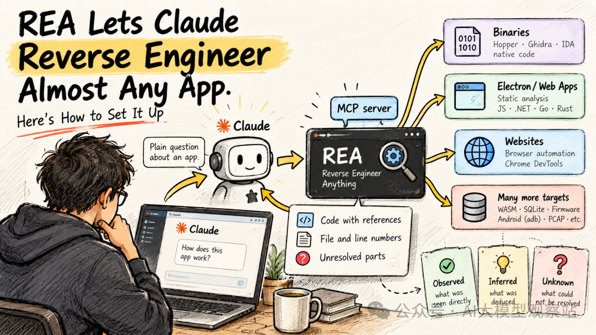
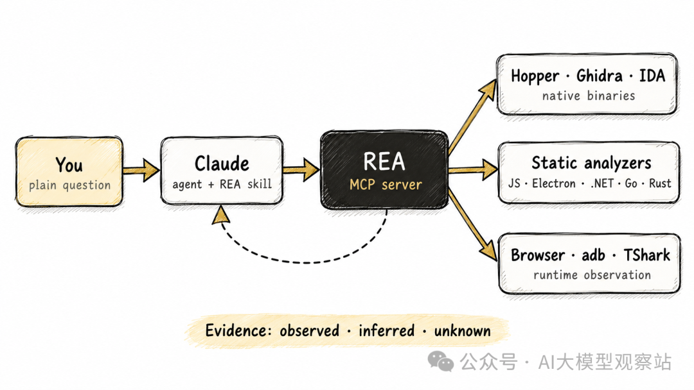
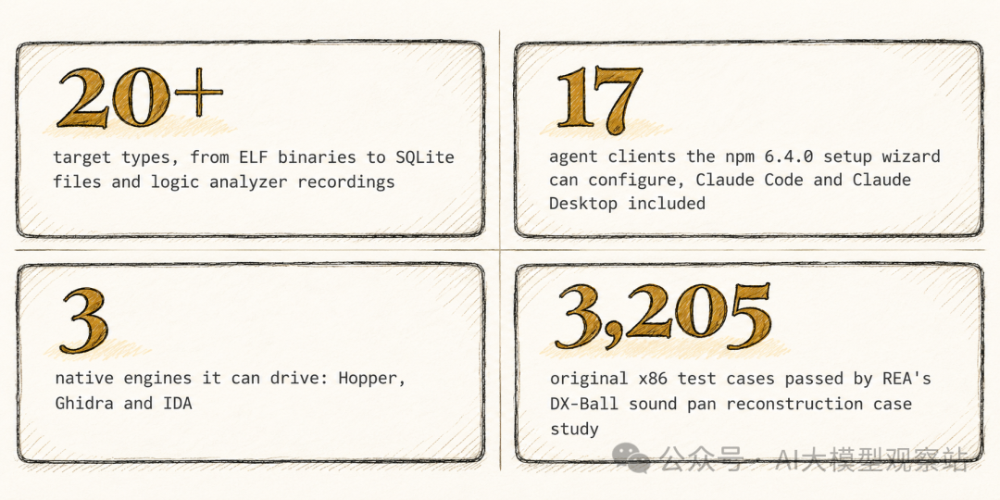
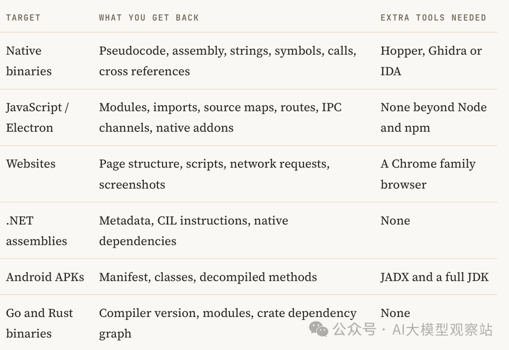
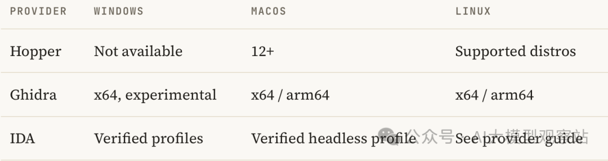

# 用 REA 让 Claude 逆向分析应用

> REA（Reverse Engineer Anything）是一个开源 MCP server，可让 Claude 深入分析二进制文件、Electron bundle 和网站，并**明确指出它无法确定的内容**。



## 概述

你看到别人应用里一个功能，想知道它是怎么实现的——Notion 的富文本粘贴、某款老 DOS 游戏让一圈子弹瞄准玩家的算法。答案通常藏在编译后的二进制或 minify 过的 Electron bundle 里，以前要花一个下午泡在 Ghidra 里眯眼看伪代码。

REA 把这件事交给 coding agent：用普通语言问 Claude，Claude 调 REA 的工具，REA 返回**代码、文件、行号引用**，以及一份**尚未解决问题的清单**。

- 采用 MIT license，npm 包名 `rea-agents`，本地分析不上传目标。
- 但作者强调：REA 最有用的地方，是演示 GIF 里看不到的那部分（见文末「无法替你完成的事」）。

---

## 一、REA 到底是什么

底层是一个 MCP server。MCP（Model Context Protocol）让 Claude Code、Claude Desktop、Cursor、Codex 等 agent 调用外部工具。注册后 Claude 就能像用文件/shell 工具一样调用 `open_binary`、`close_binary`。

安装时还会装一个 **skill**，内含调查步骤，帮 agent 决定先做什么、后做什么。agent 能做的事，你也可以在终端用 `rea` 命令自己做——工作流相同、输出格式相同，**没有"只有 agent 能用的能力"**。

### 关键设计决策：REA 不是 decompiler

| 目标类型 | REA 的做法 |
|---|---|
| Native code | 调逆向工程师已经信任的工具：Hopper / Ghidra / IDA |
| JavaScript & Electron | 自己做静态分析 |
| 网站 | 通过 DevTools protocol 驱动 Chrome 系浏览器 |

REA 本身只负责**编排和记录**。



### Evidence — 这个项目的灵魂

项目把结果记录称为 **Evidence**。每项结果记录：

1. 发现的来源
2. 直接观察到的内容
3. 推断出的内容
4. **仍未解决的问题**

Claude 读取的是完整记录，包括其中的缺口。这会直接影响你该信任它结论到什么程度。



---

## 二、它可以检查哪些内容

README 列出二十多种目标类型。最常用的几类：

| 目标类型 | REA 提取内容 | 前置条件 |
|---|---|---|
| **Native binaries** | 伪代码、汇编、字符串、符号、调用、交叉引用 | Hopper / Ghidra / IDA |
| **JavaScript & Electron** | 模块、imports、source maps、路由、IPC channels、native addons | 只需 Node + npm |
| **Websites** | 页面结构、脚本、网络请求、截图 | Chrome 系浏览器 |
| **.NET assemblies** | 元数据、CIL 指令、native 依赖 | 无 |
| **Android APKs** | Manifest、类、反编译方法 | JADX + JDK |
| **Go & Rust binaries** | 编译器版本、模块、crate 依赖图 | 无 |



还有较少见的类型：WASM modules、EVM bytecode、SQLite databases、firmware images（Binwalk / Unblob）、packet captures（TShark）、HAR files、录制的 Linux crashes、Flutter apps、通过 adb 连接的 Android 设备。

**两个必须注意的区别：**

- 部分类型**仅支持 Linux**，规划前先看仓库 docs 对应指南。
- **静态检查** JavaScript / .NET 只读文件；**runtime capture** 会以你的用户权限**真的运行目标程序**——应当像对待任何未知可执行文件一样谨慎。

---

## 三、开始之前

Node.js 要求：**22.19+ / 24.11+ / 26+**（官网建议直接上 24 LTS）。

```bash
node -v
npm -v
```

```bash
# Windows
winget install --exact --id OpenJS.NodeJS.LTS

# macOS
brew install node     # 或官方 .pkg

# Linux（发行版包往往落后于 22.19，用 fnm）
curl -fsSL https://fnm.vercel.app/install | bash
# 重开终端后：
fnm install 24 && fnm use 24 && fnm default 24
```

> **Linux 注意**：Ghidra、JADX、firmware tools 和静态 JS 分析都要求 PATH 中存在 **procps 兼容的 `ps`**（REA 用它检查进程所有权）。桌面发行版通常自带，精简版 Docker 镜像通常没有。

**始终在一个专用工作目录里操作：**

```bash
mkdir rea-work && cd rea-work
```

---

## 四、在 Claude Code 中设置 REA

Claude Code 是最佳环境——它还能读你的项目、跑构建、在理解功能后**写出重新实现**。

```bash
# macOS / Linux
curl -fsSL https://claude.ai/install.sh | bash
# Windows PowerShell
irm https://claude.ai/install.ps1 | iex
```

重开终端 → 进入 `rea-work` → 运行 `claude` 登录（订阅或 API 账户）。然后二选一：

### 方式 A：让 Claude 为你安装

```
Install REA and connect it to this coding agent using npx rea-agents@latest setup.
Show me the setup plan for approval, then verify the installation.
```

### 方式 B：自己跑安装向导

```bash
npx rea-agents@latest setup --client claude_code
```

省略 `--client` 则自动探测机器上所有受支持 agent 并默认选中。方向键移动、Space 切换、Enter 继续。

**这个向导刻意设计得很谨慎**——修改任何东西之前先显示计划（改哪个配置文件、skill 装到哪、是否需要装 Hopper），确认后才动手：备份现有配置、不碰无关 MCP 条目、原子写入、并把注册信息**钉到当前这个确切的 REA 版本**（避免更新时行为悄悄改变）。

- 先跳过 Hopper，第一次练习不需要
- 只看计划不应用：加 `--dry-run`
- 脚本化：`--json` 输出计划，配合显式 `--client` 时 `--yes` 应用计划

### 重启并验证

退出 Claude Code 再启动，然后：

```bash
npx -y rea-agents@latest doctor --client claude_code --json
```

必须看到 `"healthy": true`。在 Claude Code 里 `/mcp` 会列出已连接的 servers，也可以直接问：

```
Check that REA is connected and show me which REA tools you can use.
```

### 手动注册（跳过向导）

```bash
claude mcp add rea -- npx -y rea-agents@latest mcp
```

两个代价：**不会安装随附 skill**（Claude 有工具却没有操作指南）；且为保证可复现，应把 `@latest` 换成确切版本，如 `rea-agents@6.4.0`。

---

## 五、在 Claude Desktop 中设置 REA

**注意**：必须先彻底退出应用。只关窗口不够——macOS 按 Cmd+Q，Windows 还要从系统托盘退出。然后在 Claude 之外开终端：

```bash
npx rea-agents@latest setup --client claude_desktop
```

手动配置时，`claude_desktop_config.json`：

```json
{
  "mcpServers": {
    "rea": {
      "command": "npx",
      "args": ["-y", "rea-agents@latest", "mcp"]
    }
  }
}
```

Desktop 适合"问关于某个应用的问题"；要完成「理解功能 → 实际构建」全流程，Claude Code 更合适（它能直接操作你的代码库）。

---

## 六、添加 native 分析引擎

JavaScript、Electron、.NET、Go、Rust 目标**无需额外配置**。编译后的 native code 才需要 provider。



| Provider | Windows | macOS | Linux |
|---|---|---|---|
| **Hopper** | 不可用 | 12+ | 支持列表内发行版 |
| **Ghidra** | 实验性，只读 | x64 / arm64 | x64 / arm64 |
| **IDA** | 已验证 profile | 已验证 headless profile | 见 provider guide |

### Hopper：简单的选择

重跑 setup 并勾选 Hopper。REA 会找你已有的安装，或建议下载官方包；它会校验包大小和 digest，批准后安装。Linux 上支持 Ubuntu 24.04+、Fedora 41+、Nobara 44+、Arch、CachyOS、Omarchy，并在**私有虚拟显示器**里跑演示，不占你桌面。

Hopper 是商业软件，演示版有供应商限制。macOS 首次打开必须选演示模式或激活 license，**且必须在 REA 将要使用的同一用户会话里完成**。若系统询问 Automation 权限，去 System Settings → Privacy & Security → Automation 允许。

```bash
npx -y rea-agents@latest doctor --provider hopper --json
```

### Ghidra：免费，但有严格要求

**必须精确使用 Ghidra 12.1.4**，加一个含 `javac` 的 64 位 JDK 21+。REA 不替你下载 Ghidra 和 Java——从 Ghidra releases 下载发行版压缩包（不是 "Source code"），解压后把两个路径交给它：

```bash
export GHIDRA_INSTALL_DIR="/absolute/path/to/ghidra_12.1.4_PUBLIC"
export JAVA_HOME="/absolute/path/to/jdk-21"
npx -y rea-agents@latest doctor --provider ghidra --json
npx -y rea-agents@latest setup
```

**设好变量后必须在同一个终端再跑一次 setup**，路径才会写进 Claude 配置——GUI 客户端不继承 shell 环境变量。

- 不知道 Java 在哪：`java -XshowSettings:properties -version` 看 `java.home`
- **Apple Silicon / Linux arm64 还需先自行构建 Ghidra 的 native decompiler**
- Windows 支持仍属实验性，且仅只读

> **不错的安全细节**：每个 REA session 都在临时 Ghidra project 里打开二进制，使用隔离的 cache 和 config 路径，传 `-readOnly`，结束后删除该 project。**你自己的 Ghidra projects 不会被打开。**

### IDA：自备 license

通过上游 IDA MCP server 接入。用一个小 JSON 描述它，再告诉 REA 文件位置：

```bash
export REA_IDA_MCP_CONFIG="/absolute/path/to/ida-mcp.json"
export REA_ANALYSIS_PROVIDER="ida"
npx -y rea-agents@latest doctor --provider ida --json
npx -y rea-agents@latest setup
```

多个 provider 都能处理目标时，必须显式指定：CLI 用 `--provider ghidra`，MCP 用 `provider_id`，或把 `REA_ANALYSIS_PROVIDER` 设为默认。超大二进制可调高 `REA_GHIDRA_STARTUP_TIMEOUT_MS` / `REA_HOPPER_STARTUP_TIMEOUT_MS`。

---

## 七、第一次调查（可自证的练习）

官网提供一个小 Electron app 示例，**只有六个文件**，带一个 Export notes 按钮——适合当第一个目标，因为每项结论你都能自己核实。

```
Download https://rea.tools/examples/notes-example.zip into a new example folder and unpack it.
Use REA to find what happens when I click Export notes. Show where notes.csv is written,
which fields it contains, and the relevant files and lines.
```

不需要安装 Electron。REA 读文件、映射 entrypoints / modules / 进程边界，然后 Claude 追踪点击链路：

1. `renderer.js` 调 `window.notes.exportCsv()`
2. `preload.js` 把它转成 `notes:export` channel 上的 IPC 调用
3. `main.js` 的 handler 通过 `csv.js` 格式化，把 `notes.csv` 写进 Downloads，列为 `id` 和 `title`

REA 结果里的 IPC 部分：

```json
{
  "literal_channels": 1,
  "renderer_transmissions": 1,
  "main_handlers": 1,
  "paired_renderer_transmissions": 1,
  "ambiguous_renderer_transmissions": 0
}
```

**看最后一行**：如果 channel 名是运行时用变量拼接的，REA 会标记为 `ambiguous`，而不是猜一个对应关系。

> **"无法将此项配对"的计数，比"找到了"的计数更有价值。**

文件路径是从代码推断的；想确认实际执行了什么，做 runtime capture。

想自己解压也可以：

```
Use REA to inspect the app at /absolute/path/to/notes-example.
Find how it exports data and show the relevant files and lines.
```

---

## 八、怎么写 prompt 才有效

README 的核心工作流是**先理解，再构建**：

```
Understand how search works in the Notes app, show me the evidence,
and build a similar feature for my project.
```

编译后的程序要指定 provider 和路径：

```
Use REA with Ghidra to inspect /absolute/path/to/program.
List its functions and strings, then explain the part that handles
user input with references to the code.
```

打包后的 Electron app 直接把 `app.asar` 给它：

- Windows：`AppData\Local\Programs\<App>\resources`
- macOS：右键应用 →「显示包内容」→ `Contents/Resources`
- Linux：`/opt/<App>/resources`

追问示例：`Follow notes:export to its handler. Which inputs reach the CSV writer, and what happens if writing the file fails?`

**五个显著改善结果的习惯：**

1. 始终给**绝对路径**，含空格要加引号
2. **明确要求 Claude 给出证据和未解决问题**——否则它总结时可能省略
3. 装了多个 provider 就点名，避免选择不明确报错
4. 长调查让 Claude 关闭二进制时传 `snapshot_path`，供后续 session 复用
5. 静态分析留下未解决项，就转 runtime observation（browser / Electron / process capture）

---

## 九、不通过 agent 使用 REA

有时你只要原始输出。

```bash
npm install --global rea-agents
rea --help
```

不带 `--global` 的 `npm install rea-agents` 只会把 binary 装进项目的 `node_modules/.bin`。一次性运行可以完全不装：

```bash
npx -y rea-agents@latest analyze-javascript-application /absolute/path/to/app --json
```

配好 provider 后的 native 命令：

```bash
rea analyze   /path/to/program --provider ghidra --json
rea search    /path/to/program "search"  --provider ghidra --json
rea function  /path/to/program main      --provider ghidra --json
rea decompile /path/to/program 0x1000    --provider ghidra --json
rea xrefs     /path/to/program 0x1000    --provider ghidra --json
rea trace     /path/to/program "search"  --provider ghidra --json
```

`rea providers --json` / `rea capabilities --json` 告诉你这台机器上有什么可用。

**每次 CLI 调用都是独立进程**，需要复用的结果要存下来——用 Snapshots：

```bash
rea analyze /path/to/program --provider ghidra --snapshot /path/to/analysis/program.json
```

再跑相同查询时，只要目标字节、操作、参数、provider、设置都匹配，REA 直接读缓存，**连 Ghidra 都不会启动**。

`rea evidence-import` / `evidence-export` / `compare` 可验证、导出、比较 Evidence bundles——**比较同一应用两个版本的变化**。

---

## 十、更新与排查

REA 发布很快，很多版本都带修复，排查前先更新：

```bash
rea update                                # 全局安装
npx rea-agents@latest setup               # npx 用户：刷新注册后重启 Claude
```

常见问题：

| 症状 | 处理 |
|---|---|
| Claude 看不到 REA | 正确重启 Claude，再跑 `doctor --client claude_code` |
| provider 失败 | `npx -y rea-agents@latest doctor --provider ghidra --json` 看失败项 |
| PowerShell 禁止运行脚本 | 用 `npx.cmd` 代替 `npx` |
| Claude 在 WSL 中运行 | 在 WSL 内装 Node 和 REA，并用 Linux 路径 |

卸载：`npx rea-agents@latest uninstall`（只删 REA 自己的注册和 skill 文件），加 `--purge-data` 连缓存和状态一起清。`rea doctor` 本身严格只读。

---

## 十一、REA 无法替你完成的事

作者承诺的"重点"部分——README 对限制写得格外直白，而这些限制恰恰界定了产品的真实边界。

**法律**：用途限定为合法研究、教育、互操作性、软件保存，以及检查你拥有或获准检查的软件。它不授予 Hopper、IDA、JEB 的 license；破解副本和共享密钥明确不在允许范围。**雇主法律团队对逆向分析竞品的规定，不会因为"是 Claude 发起分析"而失效。**

**隐私分两截**：REA 本地分析，不上传你的应用；但 **Claude 会收到工具结果**，按模型 provider 自己的数据政策处理。二进制里有不能共享的内容时，让 agent 检查前先想清楚。

**供应链**：只从官方仓库、rea.tools 或 `rea-agents` npm package 安装。**名字相似、README 照抄的仓库不能证明可信——一个请求控制你 disassembler 的工具，正是攻击者最可能仿造的目标。**

**技术上最重要的限制**：REA 不会生成完美的重建结果。Ghidra 伪代码不是原始源码，无法解析的计算调用仍标记为未知。REA 给 Claude 的是**足够可靠的证据，让它能写重新实现并测试**。

rea.tools 上的 DX-Ball 案例是规范做法：重建出的声音 pan 函数经过原始 x86 代码中 **3,205 个用例**验证，并且能复现全部 **63 个编译后的函数字节**。这不是一个 prompt 能做到的——他们把 REA 的每个回答都当成**需要验证的主张**，才得到这个结果。

**这才是该带走的习惯：让 Claude 负责挖掘，每次都仔细阅读未知项清单，并手边备好测试 harness。**

---

## 战略分析

**REA 的定位不是"AI 版 Ghidra"，而是"逆向工程的证据台账 + 工具编排层"。** 这个区别决定了它的价值：市面上的 AI 反编译尝试失败的原因几乎都是同一个——模型看着伪代码输出一段自信的胡说。REA 的做法是把不确定性变成一等公民（`ambiguous_*` 计数、未解决问题清单、Evidence bundle 的 import/export/compare），让 agent 的产出从"答案"降级为"待验证的主张"。对 Hermes 这类 agent 体系，**这种"证据对象化"比能力本身更值得抄**——我们现在的 skill 输出是自然语言结论，没有结构化 confidence/unknown 字段，多步调查复用到下一个 session 就得重来。

**与现有工具链的实际关系：**

| 维度 | REA | Hermes 现状 | 结论 |
|---|---|---|---|
| 形态 | MCP server + CLI 双通道，同一工作流 | MCP 原生支持（native-mcp） | 可直接接入，`npx rea-agents@latest mcp` 即可 |
| 逆向能力 | 编排 Hopper/Ghidra/IDA + 自有 JS/Electron/Web 静态分析 | 无（仅 pyinstaller-exe-extraction 一次性脚本） | **真实能力缺口**——尤其 Electron `app.asar` 这条线，Mac 上大量工具可拆 |
| 证据结构 | Evidence bundle，可 compare 两版本 | 无 | 值得做成 skill 输出规范 |
| 缓存/复用 | snapshot_path，命中则不启 Ghidra | 无 | 值得借鉴到重任务（转录音频、chunked 分析） |
| 安全隔离 | 临时 Ghidra project + readOnly + 隔离 cache，完事即删 | 无统一约定 | 值得写成 skill 的硬规则 |

**与本机现实的对齐**：这台机器是 macOS（26.4.1），Node 已是 v22+ 可用，所以 JS/Electron/Web/.NET/Go/Rust 五类目标**开箱可跑、零额外依赖**——而 native binary 需要 provider，最便宜的路径是 Ghidra（免费），但 Apple Silicon 上要**自己构建 native decompiler**，这是唯一有真实摩擦的环节。Hopper 演示版在 macOS 首次打开必须人工确认一次，属于打断自动化的一次性成本。

**我的判断：值得装，但用法要收窄。** 不是为了"AI 逆向"这个噱头，而是两个具体场景：(1) 拿到一个 macOS 工具的 Electron bundle，想搞清它把数据写到哪、用了什么 IPC 通道、有没有外联；(2) 拆解竞品或买来的闭源工具的实现思路，用于自己重新实现。这两个场景我现在完全没有工具支撑。反过来说，如果目的是"学习某个功能怎么实现"，很多时候开源替代品 + README 的性价比仍高于逆向——REA 应该当**最后手段**而非首选。

**安装建议优先级**：先按 `方式 B` 只跑 `npx rea-agents@latest setup --client claude_code`，跳过所有 provider，用官网 6 文件的 notes-example 做验证——这一步零成本、能确认 MCP 链路通不通。确认有价值后再决定 Ghidra（免费但要在 Apple Silicon 自建 decompiler）或 Hopper（付费/演示版限制）。别一上来就装 Ghidra，那是最容易卡住的地方。

## 归档日志

- 2026-10-23 归档（Firecrawl 主提取 + 浏览器补 metadata 与图片；正文 10,939 字、5 张图逐张读图转写两张表格为 Markdown 表）
- 发布日期取自页面 `#publish_time`：2026年10月23日 09:28
- 已剥离：公众号「看看这些！」付费课程推销块（AI 工程师的 Python / 真正可用的 RAG / 10 天掌握 Claude / 原来 Claude 还能这么用）、文末二维码与「微信扫一扫」模板文字
