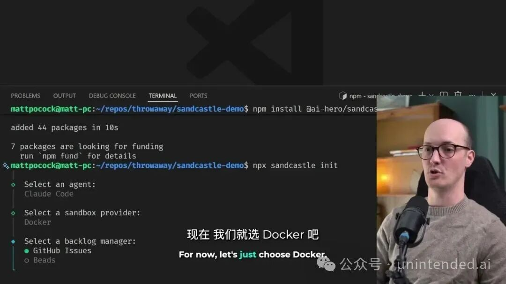
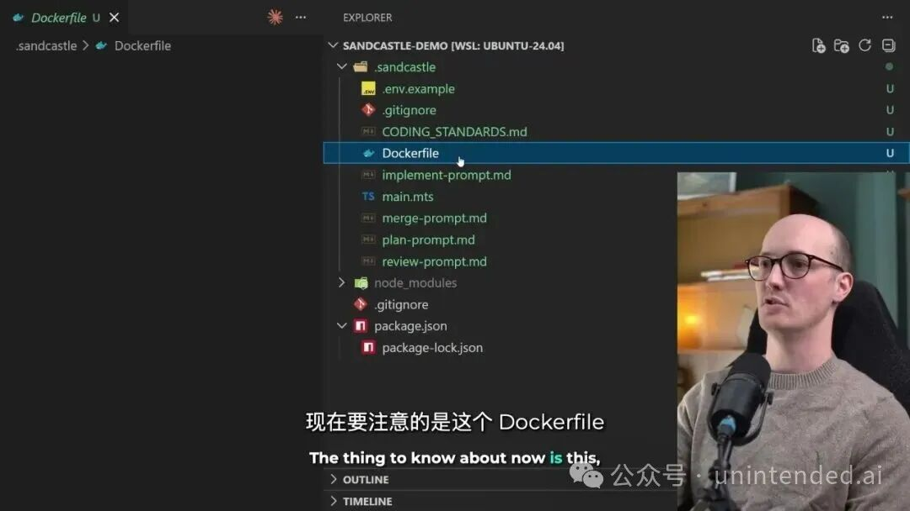
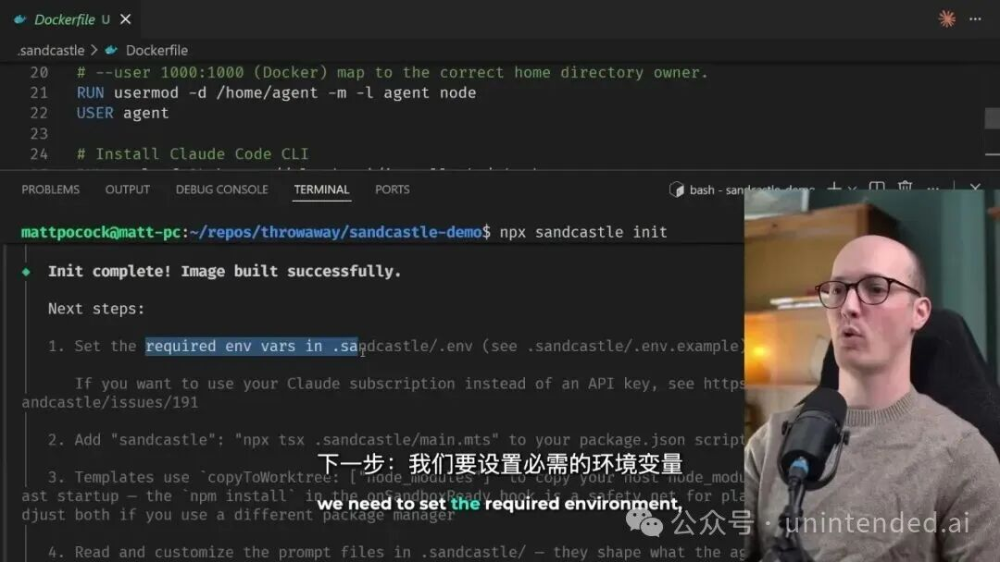
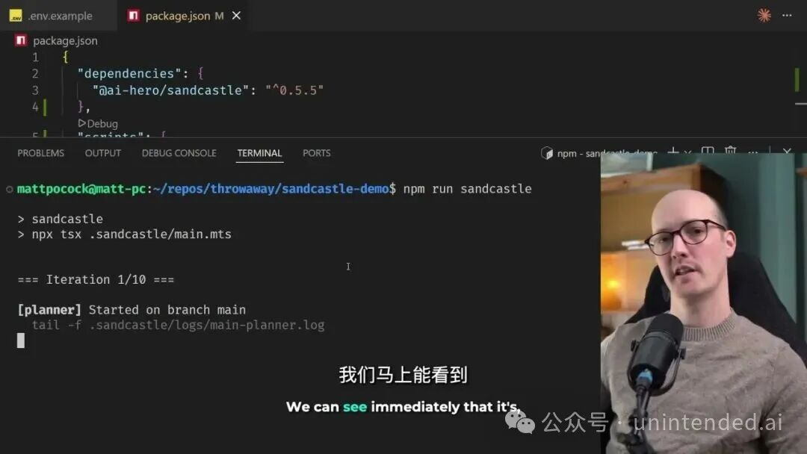
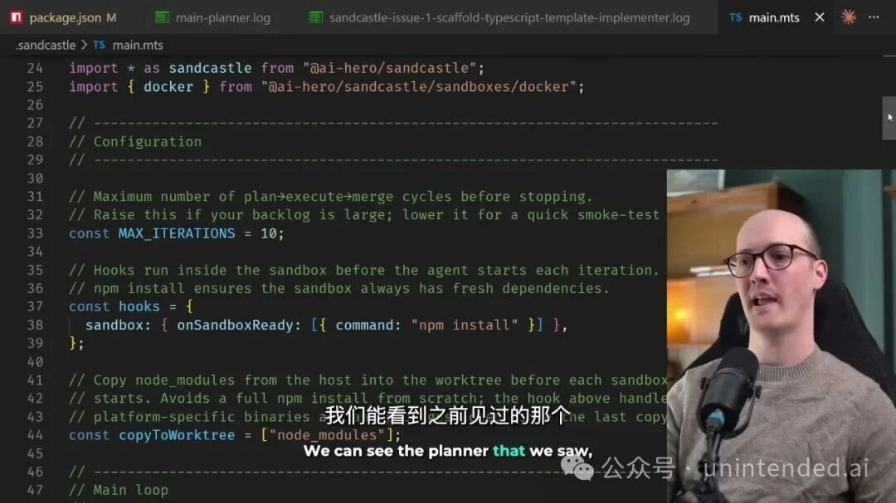
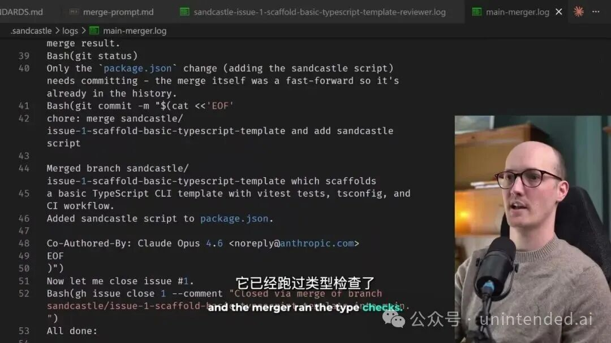
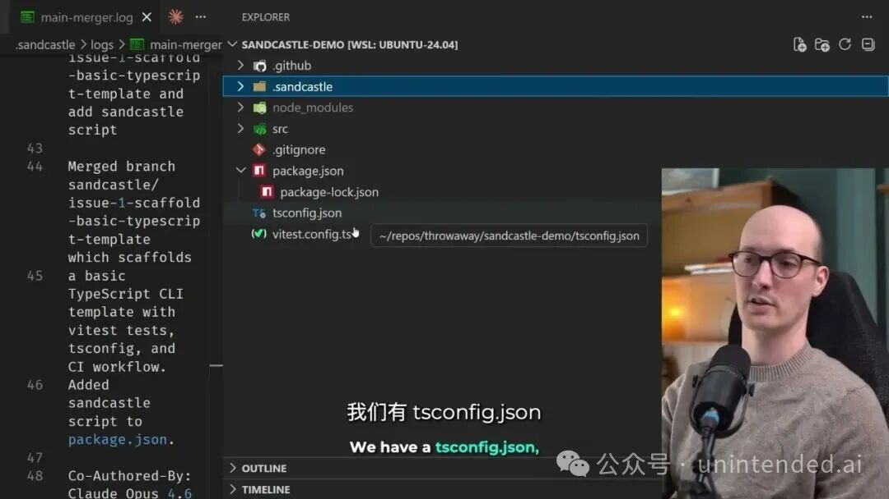

# Sandcastle — 让 Agent 自己领 Issue、写代码、审查、合并的 AFK 工作流

> 来源：unintended.ai｜2026-10-27
> 原文：[微信文章](https://mp.weixin.qq.com/s/-HgxtOvRY4Jm69TQb7yJZg)
> 项目：[mattpocock/sandcastle](https://github.com/mattpocock/sandcastle)（归档日实测 9,006⭐ / 975 fork / MIT）

## 概述

跑一条命令，Agent 自己去领任务、写代码、跑测试、审查、合并——原来要花几天的活全部干完，你睡觉或喝咖啡，回来看结果。听着很美，但编排起来费脑子。**Sandcastle** 就是现成方案：Matt Pocock（Total TypeScript 作者）开源的自动化开发工作流，也叫 **AFK 工作流**（Away From Keyboard）。

文章把手把手路径讲全了：安装 → 初始化 → 配密钥 → 构建沙箱 → 建 issue → 启动循环 → 改造。全部跑通约 10 分钟。文末还给了一段「懒人版提示词」，直接扔给 Agent 让它自己部署。

> ⚠️ **标题口径纠正**：标题的「30w Star」是 Matt Pocock **个人 GitHub 账号累计 star**，不是本项目。`mattpocock/sandcastle` 归档日实测 **9,006⭐**（约为标题数字的 1/33）。文章对比的「294k Star 开源项目」同样是他个人累计口径。判断项目热度请看仓库数字。

## 安装与初始化

进入项目目录，两条命令：

```shell
npm install @ai-hero/sandcastle
npx sandcastle init
```

`init` 依次问三件事：**用什么代理、用什么沙箱、用什么待办管理器**。文章演示选的是 Claude Code + Docker + GitHub Issues。



选完待办管理器还要选模板，目前内置五个。演示选的是 **Parallel Planner with review**（带并行执行 + 代码审查），作者建议新手也从它起步，流程最完整。

选完在项目里生成 `.sandcastle/` 目录：



| 文件 | 作用 |
|------|------|
| `main.mts` | 入口脚本，定义整个循环：planner 筛任务 → implementer 干活 → reviewer 审查 → merger 合并。所有角色串联逻辑都在这一个文件里 |
| `plan-prompt.md` | Planner 角色的提示词 |
| `implement-prompt.md` | Implementer 角色的提示词 |
| `review-prompt.md` | Reviewer 角色的提示词（含编码规范占位区） |
| `merge-prompt.md` | Merger 角色的提示词 |
| `Dockerfile` | 沙箱环境定义：容器内预装系统依赖、gh CLI、Claude Code |
| `.env.example` | 环境变量模板 |

## 配环境变量与构建沙箱

把 `.sandcastle/.env.example` 复制成 `.sandcastle/.env`，填两个值：

- `ANTHROPIC_API_KEY` — Anthropic API 密钥
- `GITHUB_TOKEN` — GitHub 个人访问令牌，需要 `repo` 和 `issues` 权限

> **⚠️ 作者亲踩的坑**：用第三方兼容 API（如 OpenRouter）时，模板的 `.env` 里**默认没有 `ANTHROPIC_BASE_URL` 这一行**。不手动加上，请求会直接打到 Anthropic 官方——要么报错要么扣错账户的钱。作者在这里卡了一阵。

新版本 init 会自动构建镜像；没有则手动：

```shell
cd .sandcastle && docker build -t sandcastle . && cd ..
```

再在 `package.json` 的 scripts 里加一行，之后启动只需 `npm run sandcastle`：

```json
"sandcastle": "npx tsx .sandcastle/main.mts"
```



## 领任务与启动

Sandcastle 通过 **GitHub Issues** 领取任务。init 选了 GitHub Issues 后，会在仓库里创建一个 **`sandcastle` 标签**——只有打了这个标签的 issue 才会被 Agent 领取，其他 issue 不受影响。

到仓库新建 issue、打上该标签、写清需求，然后：

```shell
npm run sandcastle
```



## 四个角色怎么接力



| 角色 | 职责 | 关键机制 |
|------|------|---------|
| **Planner** | 在 Docker 沙箱内调 gh CLI 拉取所有带 `sandcastle` 标签的开放 issue，读标题/标签/评论，判断哪些未被阻塞 | 输出 **JSON 格式的计划** |
| **Implementer** | 接计划里的每个 issue 写代码、跑测试 | Parallel Planner 模板下，**无依赖关系的 issue 会同时启动多个 implementer 并行**，各自在独立分支工作 |
| **Reviewer** | implementer 完成后审查 | 见下方 `!` 语法 |
| **Merger** | 收尾：接收所有完成分支，合并回主分支、处理冲突、跑类型检查，再用 gh CLI 关闭对应 issue 并留评论 | 冲突处理 + 收尾自动化 |

### review-prompt.md 的 `!` 语法（全文最有价值的设计）

在代码块前面加 `!`，Sandcastle 解析 prompt 时会**执行这段命令，并把结果注入 prompt**：

```
!`git diff {{SOURCE_BRANCH}}...{{BRANCH}}`
```

这样 reviewer 能拿到当前分支与源分支的完整 diff 再做审查——不用 agent 自己去翻 git log。`review-prompt.md` 底部还有一段编码规范占位区，可以填自己项目的规范。

### 循环控制

`main.mts` 里有 `MAX_ITERATIONS` 参数，默认 **10**——planner → implementer → reviewer → merger 最多跑 10 轮。issue 全部关完则提前停。





## 跑通之后能改什么

模板生成的配置是**能用的起点，不是最终形态**。Matt 反复强调的一句：**Sandcastle 不预设你该怎么用它，它就是代码。**

| 改动方向 | 做法 |
|---------|------|
| 换代理 | `main.mts` 的 agent 参数可换 Codex 或其他；甚至可以让 planner 用一个代理、implementer 用另一个 |
| 改 prompt | 四个角色 prompt 随便改：implement 加项目上下文与编码规范，review 加审查标准，plan 加 issue 筛选条件 |
| 调分支策略 | 默认临时分支实现后合并回来；也可改成开 PR 分支，人工审查后再合并 |
| 组合代理做对抗性审查 | Claude Code 写实现、Codex 做审查；或多个代理各写一份实现，由审查代理挑最优 |

### 关键限制：角色之间没有记忆

**每轮代理之间没有记忆，纯靠 git commit 和 issue 关闭状态衔接。** 循环能不能稳定跑，取决于 prompt 的质量。如果代理反复卡在同一处，先看对应角色的 prompt 是不是缺关键上下文。

日志在 `.sandcastle/logs/`，每个角色每轮都有独立 log 文件，排查直接看对应的那份。

## 战略分析

**这篇文章的真实价值不在于「又发现一个能自己写代码的工具」，而在于它给出了 AFK 工作流的确定性循环形态。** 对比我们已有的两个 Matt Pocock 归档：`loop-me`（6-25）解决的是「你的工作 loop 长什么样」——苏格拉底式盘问 27 轮把模糊流程逼成 spec；`Teach Skill 学 Loop Engineering`（6-28）解决的是「怎么学会它」——三层学习路径。**这一篇是第三块拼图：可执行的运行框架**，把 spec 变成了真能跑的四角色接力。三篇合起来构成完整链条：想清楚 → 学会 → 跑起来。

**与 Hermes 现有编排能力的真实差距：**

| 维度 | Sandcastle | Hermes 当前能力 |
|------|-----------|----------------|
| 编排定义 | TypeScript 库，`main.mts` 里写代码 | `delegate_task` 声明式派发，配置驱动 |
| 沙箱隔离 | Docker / Podman / OS 原生（Seatbelt/Bubblewrap）/ 云（E2B、Modal、Daytona） | 本地进程，无隔离层 |
| 任务来源 | GitHub Issues（标签过滤） | 会话内指令 / cronjob |
| 并行执行 | 无依赖 issue 自动并行多 implementer | 支持并行子代理（上限 10） |
| 审查环节 | 独立 reviewer 角色 + `!` 命令注入 diff + prompt 内嵌编码规范 | 无独立审查角色，靠 requesting-code-review skill |
| 合并收尾 | merger 自动合并、解冲突、跑类型检查、关 issue | 手动 / skill 流程 |
| 跨轮记忆 | **无**（靠 git + issue 状态） | 有（memory + session） |
| 断点续跑 | 靠 issue 未关闭状态 | 无原生能力 |

**值得直接借鉴的三点：**

1. **`!` 命令注入 prompt 的机制**。这是成本极低、收益极高的一招——让 reviewer 不用自己摸索上下文，`git diff` 结果直接喂进去。我们的 skill 体系里完全可以复刻：在 prompt 模板里允许 `!` 前缀执行本地命令（`git status`、`ls`、测试输出），把结果注入。比让 agent 自己多次调工具省 token 得多。
2. **「标签即队列」的任务路由**。`sandcastle` 标签是准入过滤器——只有明确标记的 issue 才被 Agent 碰。这个设计解决了「Agent 乱接活」的问题，比自然语言描述「不要动别的 issue」可靠得多。同样的思路可以用于我们的 cronjob 触发条件。
3. **`MAX_ITERATIONS` 显式上限 + 日志分角色分轮次**。确定性循环的稳定性来自两个东西：明确的轮次上限，和能定位到「第几轮哪个角色」的日志。这两点比任何 prompt 优化都更能防失控。

**反过来看它缺什么：没有跨轮记忆，靠 git commit 和 issue 状态衔接。** 这是它「确定性」的代价——好处是可复现、不会因上下文漂移而失控；坏处是 agent 会反复掉进同一个坑（文章自己承认了这一点：卡住时只能回头补 prompt）。**Hermes 的 memory + 跨会话上下文正好补这个短板**，这也是两条路线真正互补的地方：确定性循环负责执行稳定性，持久记忆负责避免重复犯错。

**关于成熟度的诚实判断**：9,006⭐、975 fork、MIT（真 OSI）、2026-03 建库、2026-11-11 仍在推送、142 个开放 issue。**注意 README 与文章定义不一致**——README 把它定位成「编排 AI 编码 agent 的 TypeScript **库**」（`sandcastle.run()` / `createSandbox()`），沙箱 provider 涵盖 OS 原生、容器、云多家；而文章通篇只讲 `npx sandcastle init` 出来的 Docker + GitHub Issues + Claude Code 那条**模板路径**，把库当成了成品工具。文章讲的「AFK 工作流」是库之上的一层模板——想真正定制得读 `docs/guide`，不能只看文章。142 个开放 issue 也说明还在快速迭代期，别指望零维护。

## 关联阅读

- [[技能文档/2026-06-25-Matt-Pocock-loop-me-Skill-拷问27轮转自动化工作流]] — **≠ 本篇**：loop-me 是把工作流程逼成 spec 的盘问方法，本篇是把 spec 跑起来的执行框架
- [[技能文档/Matt Pocock Teach Skill学Loop Engineering-学习方法论]] — **≠ 本篇**：同作者的 Loop Engineering 学习方法论，本篇是可运行代码
- [[技能文档/2026-11-12-Modern-Web-Guidance-给AI装现代Web知识大脑]] — 同期另一条路线：Sandcastle 给 agent 加执行力，Modern Web Guidance 给 agent 加判断力
- [[技能文档/2026-07-15-Loop-Engineering-AI编程智能体生产级代码生成闭环-银河技术]] — 生产级 Loop 的四平面架构与五层失效模式，可用来评估 Sandcastle 的工程完整度

## 归档日志

- 2026-11-12 归档（Firecrawl 抽取成功；仓库数据经 GitHub API 实测：9,006⭐/975 fork/142 issues/TypeScript/MIT/2026-03-17 建库/2026-11-11 最后推送。**文章标题「30w Star」为作者个人账号累计口径，非项目 star，已在正文顶部打标纠正**。正文 8 张图全部下载并逐张视觉核对：1 张为 243B 占位图（img_006）已删除，保留 7 张实录截图——其中 img_005 实际是 `main.mts` 源码截图而非流程图，img_008 为 VS Code/Copilot 面板截图，均无广告或二维码。README 与文章对项目定位的差异已记录在战略分析中。）
