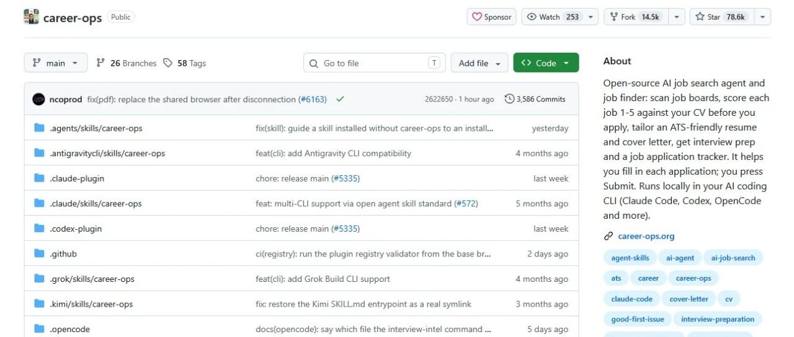

# career-ops：78.6K Star 的开源 AI 求职 Agent

> 来源：冰河技术 · 冰河 · 2026-10-30
> 原文：[这个GitHub 78.6K+ Star的神级Skill，可以帮你评估JD、定制简历、跟进投递](https://mp.weixin.qq.com/s/ZlM5ga2fH8HhWDNlfAw3aQ)
> 仓库：[career-ops-hq/career-ops](https://github.com/career-ops-hq/career-ops) · MIT · JavaScript



---

## 概述

求职最耗人的环节不是面试，而是**投递本身**：JD 写得像样、实际要求一堆对不上；简历改两小时，发出去没回音。career-ops 把这一步交给开源 Skill 来做，至少在"要不要投"这件事上把判断速度提上来了。

它不绑定特定客户端——Codex、WorkBuddy、豆包工作，以及 Claude Code / OpenCode / Qwen / Grok / Pi / Antigravity CLI 这类支持 Skills 的 Agent 都能装。手上有什么就用什么，不必为它换环境。MIT 协议，**默认本地运行**，简历不出本机（只发给你自己选的模型供应商）。

作者的上岸数据（README 自述）：**740 条岗位评估 → 68 次投递 → 12 场面试 → 1 个 offer**，"我是它的第一个用户，我拿到了工作，然后开源了它"。仓库 2026-04-04 建库，截至归档日实测 **78,721 ⭐ / 14,532 fork / 253 watcher / 535 open issues**，仍在每日提交。

---

## 核心流程：投之前先做判断

作者用得最多的功能是**岗位评估**：把 JD 全文贴进去，它做三件事——

1. **确认岗位是否还在招**（posting 仍然存活吗，是不是转贴的 ghost job）
2. **逐条对照简历**：匹配度打分、缺哪几条、哪些是硬性必须满足、哪些只是 JD 里顺手带一句的修饰
3. **给报告**：分数低于 **4.0/5** 直接建议"不要投"。坚持要投也继续准备材料，但会保留一句提醒，说明它原本不建议这个岗位

作者的评价是这套设计"不是替我做决定，而是把'大概率陪跑'提前摆到桌面上"。他贴进去的**第一个岗位就被拦下了**——它没有急着改简历，而是先让他确认职级、薪资范围和实际工作内容。这一步比预想的更有价值，因为**很多 JD 写的和实际干的并不是一回事**。

## 评估通过之后，才动简历

作者的习惯是**把评估和改简历分开确认**，不想让它一口气全跑完，所以每次指令都加一句"先给评估结果，我看完再决定要不要改"。

确认之后它按岗位要求重新组织经历、导出 PDF、求职信先给一版草稿。硬规矩两条：

- **只用原简历里写过的东西，不凭空补新经历**
- **核对数字和关键经历**，明显对不上的会拦下来

作者也点出了边界："它没打包票说自己全能看出来，有些改写它未必能识别，所以发出去之前我还是会自己逐句读一遍。简历这东西，同一家公司大概率只有一次投递机会，句子读着顺不代表内容没问题。"

## 投出去之后，它接着管

每处理完一个岗位就记进追踪表。攒了几个之后问一句"现在进展怎么样"，它把每个岗位状态列出来，哪个该发跟进邮件也会标出来。面试前能帮整理材料，谈薪时能给表达思路。作者的原话："至少投递记录不用再靠我自己开表格维护了。"

## 安装：作者踩的坑

安装本身比预想的简单——在支持 Skills 的 Agent 里发一句"帮我把这个 Skill 装好"附上仓库地址，它会自己读安装说明、装依赖，需要授权的地方弹出来问。

**但作者踩了一个坑：装完没重开会话，接着发指令，它一直说没有这个技能，还以为装失败了。重开一个会话才认出来。** 结论：装完最好重启 Agent，或者至少新开一个对话，别紧接着就用。

官方给的标准路径（README）：

```bash
npx @santifer/career-ops init
cd career-ops
claude   # 或 codex / qwen / opencode / agy / grok / pi
```

`npx` 随 Node.js 自带，一次性运行、不全局安装。也可以在 Claude 桌面端按插件方式装（Customize → Plugins → Add marketplace → `career-ops-hq/career-ops`），数据默认落 `~/career-ops-data`，插件升级不碰你的文件。

## 第一次用：先把条件说清楚

首次打开它会先要简历和求职意向。作者的做法是把简历文件拖进对话框，然后把想找的方向、不能接受的情况一条条说清：想做哪类工作、哪些地方不去、薪资低到什么程度不考虑。

**"这部分信息越具体越好"** ——除简历外还有期望薪资、技术栈、工作地点、擅长方向。写得含糊，后面评估就容易飘。

## 作者实测觉得有用的两点

| 价值 | 具体表现 |
|------|---------|
| **逐条对照** | 把"招聘要求"和"我的经历"逐条对上，哪里匹配、哪里缺写进报告。这些信息本身就能用来准备面试，或反过来提醒自己该补什么 |
| **按岗位调侧重点** | A 公司看重某个技术栈，它会把简历里相关经历往前放、写得更醒目。相比一份简历海投，"至少让材料看起来是为这个岗位准备的" |

作者的态度也很克制：**"它只是辅助。判断岗位是否靠谱、简历里的内容是否真实、面试怎么聊，最终还是得自己来。"** 但至少在投递之前，能帮你少花几小时改一份大概率没下文的简历。

---

## 仓库实证：README 里文章没写的部分

文章是体验视角，仓库是产品全貌。归档日核对 README 与 GitHub API，几个文章没覆盖的关键设计：

### 硬边界（README 明列"不会做的事"）

- **不自动投递**：每个字段都起草，你审阅并点 Submit。脚本从不 POST（`prepare-application.mjs`）
- **不发邮件**：只起草。代码库里没有任何邮件传输组件
- **不回传数据**：无遥测、无官方后端。简历只从你机器发到你选的 AI 供应商
- **不劝你硬投**：低于 4.0/5 会明说不要投，你可以覆盖，它会把异议写进结果

### A–H 评估体系

Role summary → CV match（每条要求带**权重来源标注**：JD 原文措辞 / JD 结构推断 / 估算，估算项不能进最高档）→ level strategy → 薪酬调研 → 个性化 → 面试准备（STAR+R），外加 **Block G 岗位真实性检查**（是否还在招、是否转贴：只给观察不给判决）和 **Work-Auth 信号**（JD 明写不提供签证担保 = 硬阻断）。

### 能力矩阵（README Features）

| 能力 | 说明 |
|------|------|
| ATS PDF 生成 | 从你的真实经历出发按 JD 定制，Space Grotesk + DM Sans 设计 |
| 求职信 | 关键词镜像 + 四个交互角度（why/problems/approach/tone）+ 草稿确认门 |
| 公司深研 `deep` | AI 战略、近期动作、工程文化、你该采取的切入角度 |
| 联系人发现 `contacto` | 定位招聘经理/HR/团队同侪，起草 ≤300 字符 LinkedIn 私信 |
| 模式分析 | 拒信模式、各渠道推进率（`analyze-patterns.mjs`）、转贴检测（疑似 ghost job） |
| 面试故事库 | 跨评估累积 STAR+R 故事，沉淀 5–10 个可复用的主故事 |
| 谈薪脚本 | 薪资谈判框架、地域折扣反驳、竞争 offer 杠杆 |
| Portal 扫描器 | **100+ 公司预置**（Anthropic、OpenAI、ElevenLabs、Retool、n8n…）+ 35+ 搜索查询，覆盖 Ashby / Greenhouse / Lever / Wellfound，55+ 供应商模块 |
| 批量处理 | 无头 CLI worker 并行评估（`claude -p` / `opencode run`） |
| Dashboard TUI | Go + Bubble Tea 的终端看板：10 个过滤页签、8 种排序 |
| 插件系统 | Gmail / Notion / Apify 等可选集成，**默认关闭** |

### 技术栈

Agent 层 = `AGENTS.md` + 各 CLI 包装文件 + `.agents/skills/career-ops/SKILL.md`（一份 SKILL.md 被 Claude / Codex / Qwen / Grok / Antigravity 各自软链，Cursor 自动发现）；PDF = HTML 模板 + Playwright；扫描器 = Playwright + Greenhouse API + WebSearch；看板 = Go + Bubble Tea + Lipgloss；数据 = Markdown 表 + YAML + TSV，全部本地文件、可 Git 版本化。

数据可外置：`CAREER_OPS_ROOT` / `CAREER_OPS_DATA_DIR` 环境变量或 `.career-ops-data` 标记文件，把个人数据（`cv.md`、`portals.yml`、`data/`、`reports/`、`output/`）从代码里剥出来，方便切分支、拉更新、跑多份 profile。

---

## 战略分析

### 一、它真正的创新不是"AI 改简历"，而是给 AI 立了三条宪法

同类工具（AI 简历改写、JD 匹配打分）遍地都是，career-ops 的差异点全在**约束**上，而且是**写在代码里而非提示词里**的约束：

1. **不许凭空补经历** —— 代码层有校验：PDF 里出现的数字或事实若既不在原简历、也不在 `article-digest.md` 里，直接拦下。作者自己也承认"它不能判断每一种改写"，所以保留人工逐句复核
2. **不许自动提交** —— `prepare-application.mjs` 从不发 POST。这个"人按 Submit"的设计是**架构级**的，不是配置项
3. **不许低于 4 分还假装热情** —— 你覆盖它可以，但它保留异议记录

这套"AI 起草 + 人执行 + 机器留异议"的三段式，恰好是我在 Hermes 里一直在用的模式（Approvals + 副作用留给人）。**把一个高风险流程（求职）做成 HITL 架构而不是自动化流程**，是这个项目能冲到 78K Star 的结构性原因，不是营销。

### 二、值得借鉴的三个工程模式

| 模式 | career-ops 的做法 | 对现有体系的启发 |
|------|------------------|-----------------|
| **一份 SKILL.md 多运行时软链** | `.agents/skills/career-ops/SKILL.md` 为标准，`.claude/`、`.qwen/`、`.grok/`、`.antigravitycli/` 各自引用，避免 N 份副本漂移 | Hermes 技能若要跨 CLI 复用，可走同一份源 + 软链而非复制 |
| **数据层与代码层彻底分离** | `CAREER_OPS_ROOT` 外置用户数据，升级/切分支不碰个人文件；插件模式默认 `~/career-ops-data` 并在插件目录内拒写 | 与 Obsidian vault + Hermes 的"代码/知识分离"同构，值得固化为规范 |
| **评估与产出分阶段确认** | 评估报告 → 人确认 → 才生成 PDF/求职信；进度按 slug 落盘，中断可续 | 长任务分阶段落盘 + 确认点，正对应 cognition-ledger 的做法 |

另外一个细节值得记：**权重来源标注**（这条要求的重要性是 JD 原文说的、结构推出来的、还是模型估算的，估算项不能进最高档）。这是一种很干净的"**把不确定性显式化**"设计——任何打分型 Agent 都该抄。

### 三、与知识库既有求职类归档的关系

| 归档 | 定位 | 与 career-ops 的差异 |
|------|------|---------------------|
| [[技能文档/ai-job-search-17.7KStar-Claude-Code-AI求职框架]]（07-09，17.7K⭐） | 同为 Claude Code 系 AI 求职框架，`/setup → /scrape → /apply` | 同为"评估→定制→申请"三段式，但 career-ops 在**边界约束**、Portal 覆盖（100+ 公司 / 55+ 供应商）、追踪闭环（follower/reply-watch/outcome/calibrate）上明显更成熟；ai-job-search 三个月前 17.7K，career-ops 四月底建库、半年 78.7K，社区热度差一个量级 |
| [[技能文档/2026-06-22-resume-template-LaTeX简历PDF]] | LaTeX 简历模板 + AI 编辑 | 模板是**原材料**，career-ops 的 `latex` / `latex-tex` 模式可以直接吃这套模板做按 JD 定制输出，两者互补而非替代 |
| [[技能文档/2026-06-07-自研AI简历修改工具汇总]] | 自研改简历工具盘点 | 那些是"改句子"级别的工具；career-ops 是"投不投 + 投给谁 + 投完怎么跟"的全流程 |

顺带值得记一条生态信号：围绕它已经长出社区分支——`DavePenn/career-ops-cn`（53⭐，接 Boss直聘/猎聘/拉勾做国内平台）、`shuheng-mo/career-ops-china`（114⭐）、`career-ops-ui`（92⭐）。**说明其 provider 模块化设计确实可扩展**，但也提醒：中文主流招聘平台（Boss 直聘等）不在官方预置名单里，国内用户要么装社区分支，要么自己写 provider。

### 四、对小谭当前场景的判断

小谭目前在做的是 AI 业务落地方法论（业务画布、真实业务目标梳理），不在求职周期里。所以这个项目的价值不在"用它找工作"，而在三个可迁移点：

1. **HITL 三段式的模板**——"AI 起草 → 人审 → 机器留异议"可以直接搬到业务落地里的高风险动作（比如对外报价、客户承诺、合同条款），代码级拦截比提示词级约束可靠得多
2. **权重来源标注**——任何给方案/供应商/项目打分的场景，都该标清"这个分是原文说的、结构推的、还是估的"
3. **评估→确认→产出 的分阶段落盘**——与 cognition-ledger 的账本思路一致，中断可续

**安装建议：暂不装。** 它需要 Node + Playwright + 一个 AI coding CLI 作为运行时，本体 12 万 KB 的仓库 + 100+ portal 配置，是完整产品而非轻量 skill；在非求职周期装它只会占地。真要复用，抄三个设计模式即可，工作量远小于装全套。

---

## 归档日志

- 2026-10-30 归档（微信文章经浏览器提取正文 + og 元数据；README 与 GitHub API 实证补充仓库能力与硬边界；封面图 1 张已下载，文章本身无内嵌正文配图）
- 仓库数据归档日实测：78,721 ⭐ / 14,532 fork / MIT / 建库 2026-04-04 / 最后推送 2026-10-30
- 关联归档：[[技能文档/ai-job-search-17.7KStar-Claude-Code-AI求职框架]]、[[技能文档/2026-06-22-resume-template-LaTeX简历PDF]]、[[技能文档/2026-06-07-自研AI简历修改工具汇总]]
