# Super-agent 设计探索：迈向更自主的 Agent 系统

> DeepSeek Harness 团队｜2026-10-31 20:29｜作者 Yujia Qiao（系统实现 + 本文写作），Huanqi Cao 等 19 人审阅
> 原型：`deepseek-ai/dsh-superagent-prototype`

**这是原文，不是解读。** 文中所有架构判断、实验数据均出自 DeepSeek Harness 团队本人。

---

## 一句话结论

**真正的瓶颈已经不是模型能力，是人的注意力。** 单任务上限定于模型，**多任务上限定于「一个人只能同时跟进 3～5 个活跃 Session」**。Super-agent 要做的事，就是把 Session 从用户的认知负担变成系统的实现细节。

---

## 问题的提出：为什么现在的 Agent 撑不住

过去一年 Coding Agent 已证明模型能用工具解决复杂问题，人的角色正上移到**决策与验收**。随之涌现的个人助手（Personal Agent）接入消息、日程、邮件，持续观察信息流——这种**持续在线、事件驱动**的模式不限于个人场景，商业场景同样成立。

但现有主流 Agent 设计撑不住：

| 问题 | 后果 |
|------|------|
| 以单一 Session 为基本单位，Session 之间彼此独立 | 用户并行推进多项工作时必须手动切换并记住各 Session 上下文 |
| 一个人通常只能同时跟进 **3～5 个活跃 Session** | **多任务的上限取决于人的注意力，不是模型** |
| 用 CLI/MCP/连接器在单会话 Agent 上做外挂扩展 | 单会话同步阻塞、多任务上下文混乱、**本地设备离线即停止运行** |

> 文中一句话是全文的题眼：**"Session 应当是系统的实现细节，而不应是用户的认知负担。"** 让用户手动管理 Session，很大程度上是从底层 LLM API 延续下来的**设计惯性**。

---

## 四个基础特征

| 特征 | 含义 |
|------|------|
| **连续** | 在 IM 聊天、GitHub 评论等熟悉界面交互，始终感觉只存在一个 Agent。例如先在 IM 提出方案 A、随后在 PR 评论里改成方案 B，它能理解并调整方向 |
| **高效** | 交互响应迅速，同时并行高质量完成多个复杂任务。**无需等上一个任务完成就能接受下一条指令** |
| **主动** | 无需逐条下达指令，持续观察环境事件并主动推进值得处理的事项，不需要介入时**保持安静** |
| **持久** | 始终在线，直接接入真实工作环境，长期运行中遇到异常**自动恢复** |

**单个 ReAct Loop 无法同时支持这四个特征。** 文中强调：相似的设计约束会导出相似的架构选择；而这些问题与传统计算机系统长期探讨的问题高度相似，**因此计算机系统的经典设计思想在这里同样适用**。

![Super-agent 整体系统架构，标号 [2] 至 [6] 对应下文各节](../assets/2026-10-31-superagent/img_001.jpg)

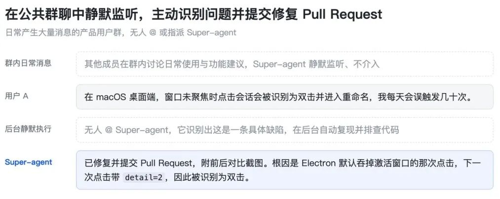

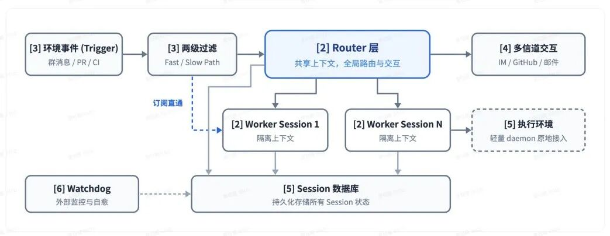

---

## 一、双层架构：用 Router + Worker 拆开连续性与吞吐

核心权衡：

- **所有事件交给同一 Session**：上下文最连续，但受单 ReAct Loop 串行上限所限，耗时长、吞吐低，多任务中间细节混杂**影响完成效果**
- **每条事件新开 Session**：并发吞吐最高，但任务不独立时**缺全局上下文导致结果割裂**，多 Session 各自回复用户造成**交互混乱**

解法：**把「维护全局连续性」与「高并发执行」拆到两层**。

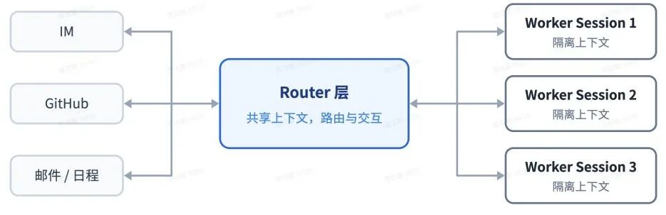

### Router 层（常驻全局路由）

- 承接**所有入口的人类交互**，是全局的**序点（Sequence Point）、协调点和记忆**
- **不直接执行具体任务**，只负责人类交互与任务分派——**甚至可以不配备 Bash 工具**（防止它变成性能瓶颈）
- 与常见 Agent Team 的区别：Agent Team 的子步骤耦合紧，Team Lead 要深入理解任务细节、高频协调，负载重；**Router 只处理任务之间的高层关联与分派，任务常常没想象中复杂，轻量模型就够**

**关键发现——单 Router Session 并没有想象中容易成为瓶颈**：上一轮推理期间到达的事件（Trigger）会积压，在下一轮**一并处理形成批处理**。当拥堵时，多条 Trigger 自动合并进一次 LLM 调用，在 **Prefill 阶段并行计算**，单次请求耗时增长**远慢于批处理大小**。因此在一定范围内，**积压越多，单个决定分摊的推理时间越低**。上限取决于上下文长度和一轮内能准确处理的 Trigger 数。

规模再大时，Router 层内部可做多层过滤或水平切分（Sharding）——**本质仍是连续性与吞吐量的权衡，切分越细吞吐越高但分片间记忆连续性越低**。

### Worker 层（隔离并发执行）

- 各 Worker **上下文隔离**，挂载完整执行工具，专注单一任务
- **配最强模型**（直接决定任务结果与代码质量）
- **不直接与人类交互**，只向 Router 汇报状态，由 Router 统一回复——避免多会话各自回复的混乱
- 同层 Worker 通常不直接通信：**冲突往往发生在同一个 PR 等共享工作环境**，只要都订阅了对应 Thread 就会收到相同事件通知，从而**自行发现和解决冲突**
- 每个 Worker 内部还可再开 Subagent 或本身就是 Agent Team，**对上层 Router 保持透明**

> 个人助手场景的映射很实用：界面上只有一个聊天框，但当用户在同一对话里讨论多个话题时，**前端单一聊天页维持交互连续性，底层为每个话题分派 Worker 并行推进**。

---

## 二、事件驱动：让 Agent 从「等指令」变成「看环境」

驱动 Agent 的主要输入不再是用户逐条键入的提示词，而是环境中的**半结构化事件（Trigger）**：群聊消息、邮件日程提醒、代码审查评论、CI 结果。

### 2.1 事件过滤：Fast Path / Slow Path

真实环境事件流呈现**高噪音、低触发率**特征。对每个事件都调大模型判断，延迟和算力都受不了。

- **程序层策略（Fast Path）**：按事件来源、群组范围、白名单等**确定性条件**用代码快速准入，不同来源分别设「仅响应明确请求 / 作为候选事件 / 直接忽略」
- **语义层策略（Slow Path）**：通过准入的候选事件交 LLM，按提示词策略和上下文判断是否需要行动。**语义层同时是人类友好的自然语言扩展点**

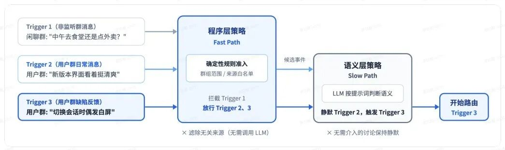

### 2.2 事件路由：订阅与直通

如果每个后续事件都经 Router 转发，全局节点依然扛不住。**Fast/Slow Path 同样适用于路由**：

**Thread 概念**：同一个 GitHub PR、同一个 IM 话题、同一封往来邮件串下的连续事件构成一条事件流。

- **已订阅（Fast Path）**：Router 为某 Thread 建 Worker 后，该 Worker **直接订阅**该 Thread，后续事件**由程序直通**，不经 Router。若新事件超出任务范围，Worker 可取消订阅或交回 Router 重派
- **未订阅（Slow Path）**：Router 仍**可观测所有事件**以掌握全局，但只判断和分派尚未被订阅的新事件

**订阅是多对多关系**：一个 Worker 可订阅多个 Thread，一个 Thread 可被多个 Worker 订阅。当多个 Worker 在同一工作环境交集时，新事件**同时直通给所有订阅者**——无需点对点通信也能获知彼此操作并自行解决冲突。

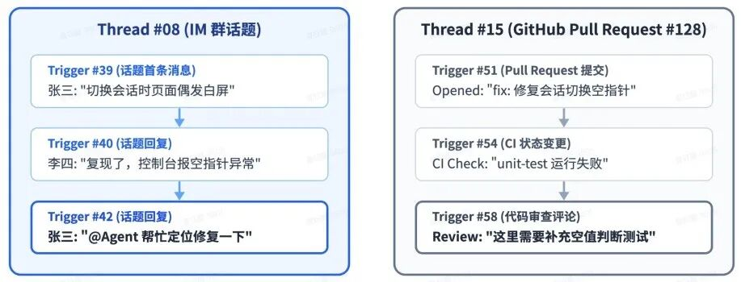

### 2.3 上下文组织：把上下文窗口当 Cache 管理

> **"浪费上下文窗口，就是浪费模型的智能。"** 注入过多挤占窗口、稀释注意力；注入过少迫使模型反复调工具读取、增加步数。

两个基本操作，借鉴编译优化和局部性（Locality）思想：

- **Inline**：近期很可能用到的信息直接内联进窗口，省去工具调用往返
- **Spill**：超出预算或低频的完整信息留在窗口外，**窗口内只留引用或摘要**，按需读取

逐步优化路径：

1. **从最少信息开始**：只给当前对象的 ID 和内容摘要
2. **利用局部性逐步 Inline**：先附紧密关联对象的 ID，再附**时空相邻内容**——内容前 50 字、IM 消息的**前后相邻消息与所回复的那条**、代码评论所在评审讨论中的相邻评论
3. **超出上限则 Spill**：对长内容设较小上限，超出部分截断并**保留续读入口**，需要完整内容时再调工具

**链式召回（Chain of Recall）**：给 Trigger、Thread、Worker Session 赋唯一 ID，注入时内联**下一跳**关联对象的 ID，使这些对象在底层构成一张**引用图**。由于每次工具召回的结果本身也遵循 Inline & Spill，其返回结果又会内联再下一跳的摘要和 ID——**模型可从当前事件出发，顺引用关系逐跳按需展开上下文**。

文中例子：从一条当前消息 → 所在 Thread → Thread 内联 ID → 相关 Worker Session → 该 Worker 关联的另一个代码评审 Thread。

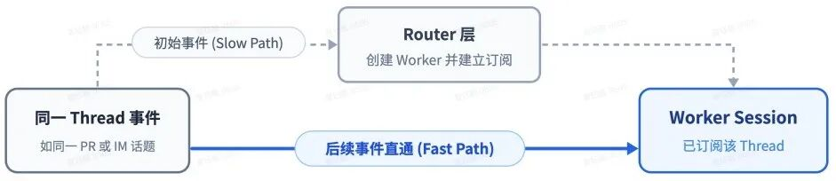

### 2.4 提前行动：投机执行（Speculative Execution）

**在还不确定结果是否会被采用时，根据环境信号在后台提前尝试，用额外后台算力换人类的等待与介入成本。有价值就交付，没价值就丢弃。**

- 个人助手：收到会议邀约邮件，先**后台核对日程冲突、搜集背景、备好回复草稿**，用户过目即可直接发
- 研发协作：内部群里配了一条**「静默复现并修复」**策略——有人反馈问题或讨论方案时，Agent 先在后台尝试复现并找修复方案，**只有在确认问题并找到简单修复方案后才交付，否则全程保持安静**

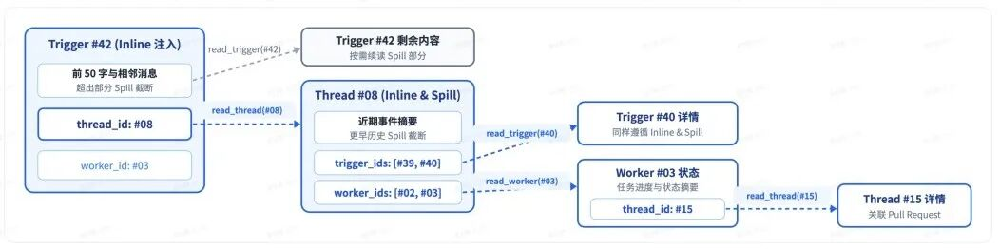

---

## 三、面向人的交互

### 3.1 全双工交互：异步 ReAct Loop

经典 ReAct Loop 中，模型发起同步的 `run()` 后循环**阻塞**，工具执行完毕前无法响应任何新输入——**半双工**。

改为 `start()` / `stop()` 的异步 ReAct Loop：

- 调 `start()` **立即返回「已启动（Started）」**，循环不再等待该工具
- 后台工具完成后，最终结果**作为一条新事件消息投递进会话**
- 模型可调 `stop()` 主动终止执行过长的后台命令

由此**前台对话响应与后台任务执行解耦**，新输入在当前推理步结束后即被处理，不必等后台工具完成。

> ⚠️ 文中明说：**这一异步任务机制已在 DeepSeek Harness 中实现，但尚未默认开启。**

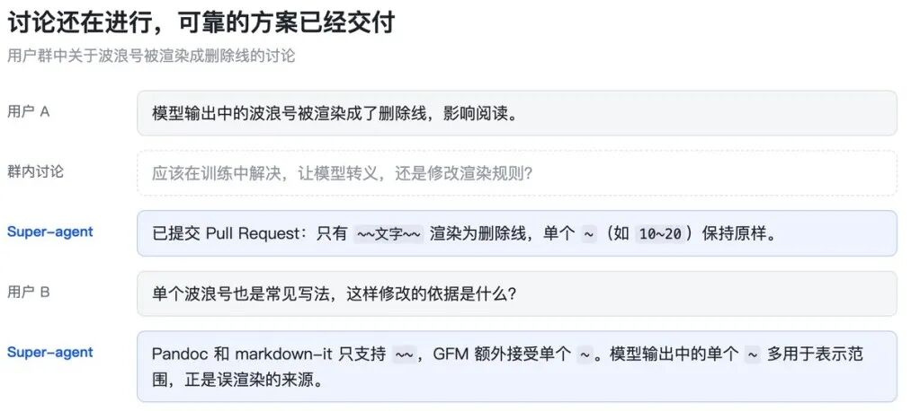

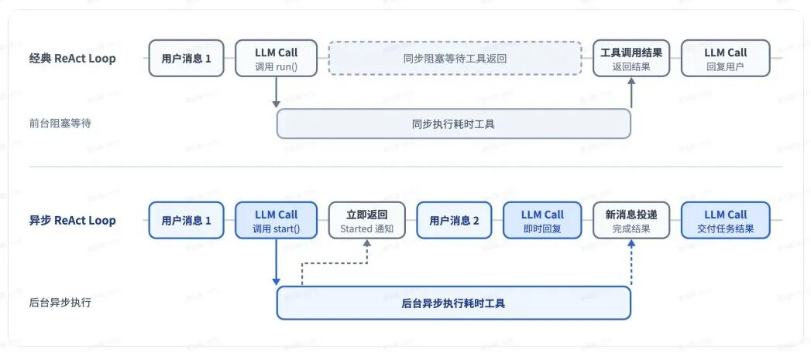

### 3.2 多信道交互：输出匹配信道带宽

把终端式交互原样搬进群聊——冗长推理 + 密集工具调用全量输出，在多人协作中**极易造成信息过载**。双层架构已隔离了其中一部分（Worker 的冗长过程不外泄）。

- **IM 等即时通讯信道**：低打扰轻量沟通，**像人类同事一样只在需要决策或验收时通知，只问直接问题、给简短结论**。文中验证过一条简单有效的硬性规定——**单次回复不超过 100 词**
- **GitHub、邮件、文档等异步信道**：结构化、高信息密度交付。建/更 PR 时按项目规范写完整的问题背景、改动说明与验证结果；个人助手场景直接起草结构化邮件与文档摘要

---

## 四、计算、状态与环境的分离

现有本地 Agent 把**推进 Loop 的计算**、**需持久保存的会话状态**、**代码仓库与本地工具链等执行环境**绑在同一台设备——设备休眠即停，且访问不到其他设备的环境。

借鉴**存算分离（Compute-Storage Separation）**，分两步解耦：

### 4.1 计算与状态分离

推进 Agent Loop 的计算做成**无状态**，放进云端**无状态弹性计算容器**；Session 等持久状态**存入数据库**。容器可水平扩展、重启、替换，连续性由持久化存储保障——**Agent 摆脱单台本地设备的生命周期限制，实现云端持久在线**。

### 4.2 计算与执行环境分离

常见思路都有问题：
- **云端启沙箱拉代码重建环境**：真实环境往往含**未提交的本地修改、私有凭据、内网服务依赖、特定硬件工具链**，同步成本高且易遗漏
- **要求用户迁往云端工作**：对多数用户迁移成本过高

**既然难以复制和同步的是环境本身，就不必让执行环境跟着 Loop 上云。** 让 Loop 在云端，**重状态的执行环境留在原地**，仅在端侧部署一个**不保存会话状态的轻量 daemon**，只负责执行命令与返回结果。

这与 Anthropic 的**「脑手分离」（Decoupling the brain from the hands）**一致——同样让 harness 保持无状态、会话日志存在 harness 之外、通过统一接口按需接入执行环境。**区别在场景**：Anthropic 那篇描述的是托管服务，主要讨论按需创建的沙箱与客户 VPC 内资源；这里首先要接入的是**用户日常使用、可能间歇在线的个人机器，上面有未提交的修改和本地凭据**。

因此既支持 **BYOM（Bring Your Own Machine）**——把日常开发机或个人电脑接入云端 Agent，也支持云端托管机器或按需创建的环境。

> 结果：一个 Agent 不再受限于单台机器，可在不同执行设备间切换；**甚至支持间歇在线设备**——某台个人设备重新上线后，由云端 Agent 自动触发并完成需要在该设备执行的任务。

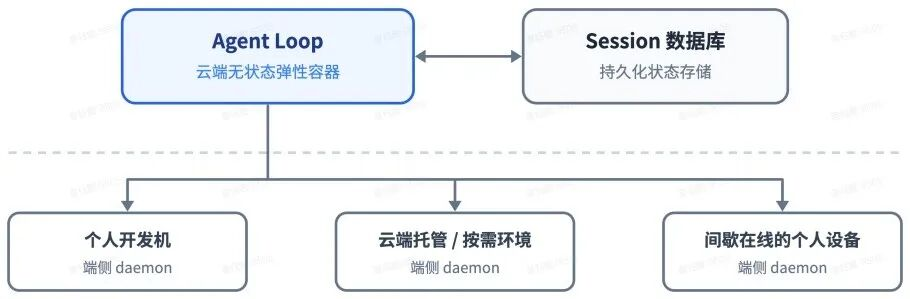

---

## 五、Watchdog：外部控制回路

持久在线的分布式系统**很难仅靠主系统内部逻辑保证长期可靠**，需要主系统之外的**独立外部控制回路（Control Loop）**。

**关键洞察**：在 Agent 系统里，**仅靠进程存活探测或监控脚本是不够的**——许多异常不是进程崩溃，而是**模型在执行中陷入无效循环或偏离目标**。所以不只要监控基础设施存活，还要**监控任务本身的进展**。

实现：主系统外配一个**独立的 Watchdog Session**，用定时消息驱动，构成外部 Control Loop。

- 处理接口报错、状态恢复失败等基础设施故障
- **由模型判断各个 Worker 是否有实质进展、方向是否偏离整体目标**
- 发现异常及时介入修复，外部偶发故障则**持续复查直至恢复**
- Watchdog 本身也是**具备完整工具能力的 Agent Session**，维护者可用自然语言询问故障原因，也可**让它在线修正主系统行为**——增删提示词、调整触发规则

---

## 六、实验数据（核心，可直接引用）

实验基于**合成负载与简化环境**，作者自己声明"部分设置还可以更严谨，结果仅作初步参考"。

### 6.1 消融实验

约 300 条消息/次（约 20 条是工作请求，其余闲聊、跟进、叫停、CI 消息），编码工作用**只消耗时间的工具**代替——**衡量的是系统调度与协作能力，而非单任务执行能力**。每方案重复 5 次，消息间隔与工作时长按 1/4 缩放，模型调用耗时为真实值。

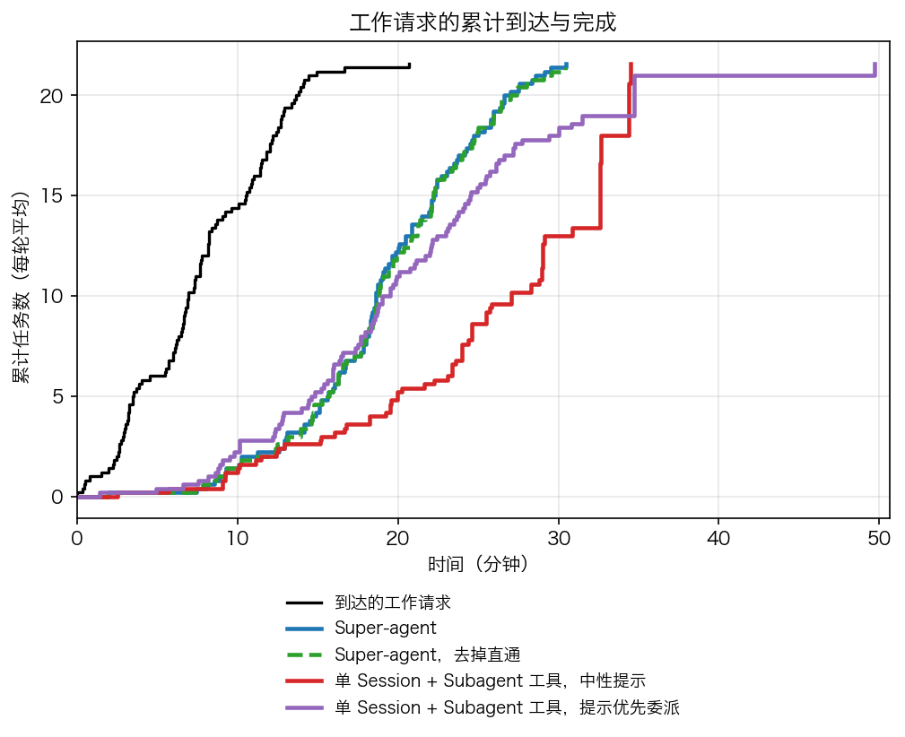

| 方案 | 任务完成时间 P50 / P95（分钟） | 单次实验读缓存 Token（全部 Session） |
|------|------|------|
| **Super-Agent** | **12.4 / 15.7** | 2323 万 |
| Super-Agent，去掉直通 | 12.6 / 15.5 | 3177 万 |
| 单 Session + Subagent 工具，中性提示 | 20.4 / 29.5 | 605 万 |
| 单 Session + Subagent 工具，提示优先委派 | 13.8 / 29.0 | 1082 万 |

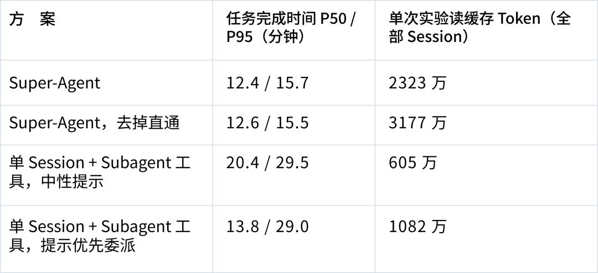

**三个可直接引用的结论：**

1. **双层架构赢了提示词工程**。单 Session + Subagent 在实验场景下**受提示词影响极大**。中性提示 `"Use a subagent for a piece of work when appropriate..."` 下，模型**5 次运行一次都没调用 Subagent**，全在主 Session 做并被新消息不断打断，**p95 达 29.5 分钟**。改为提示优先委派 `"Every message of the chat reaches you, so work you run yourself keeps stopping for new messages. Prefer handing each piece of work to a subagent of its own..."` 后，5 次中 4 次委派，时间缩短但整体仍慢于 Super-agent，**剩下 1 次它判断工作「很小」而自己执行，形成紫色长尾**。
   > **相比于在单 Session 中依赖提示词工程和模型临场判断分不分工，双层架构通过让 Router 不直接执行具体工作、Worker 仅接收所订阅 Thread 的消息，在系统层面上缓解了这一问题。** —— 这是全文最有说服力的一句。

2. **代价是 token**。Super-agent 因维护多个独立会话，读缓存 token 高于单 Session——**用更多 token 换更短且更稳定的完成时间**。

3. **直通机制不提升质量，但省 Router 的钱**。去掉直通后完成时间基本一致（12.6/15.5 vs 12.4/15.7），但 **Router 需做的决定增加约 30%，总读缓存 token 从 2323 万涨到 3177 万（+37%）**。

### 6.2 Router 层批处理压测

Router 调真实模型、Worker 用 Mock 模型，Trigger 到达速率从约 1 条/分钟升到约 40 条/分钟。

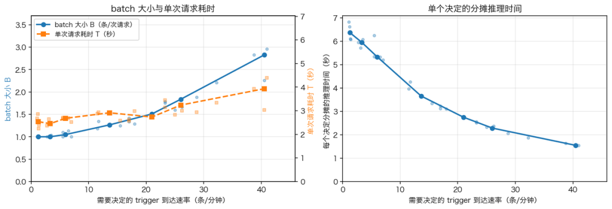

| 指标 | 1 条/分钟 | 40 条/分钟 | 变化 |
|------|------|------|------|
| 平均 batch 大小 | 1.0 | 2.8 | ×2.8 |
| 单次请求耗时 | 2.5 秒 | 3.9 秒 | **×1.56（慢于 batch 增长）** |
| 单个决定分摊推理时间 | 6.4 秒 | **1.6 秒** | **降至 25%** |

**结论：外部事件突发拥堵时，Router 反而通过自动合并积压事件提高了有效吞吐。** 这也解释了 7.1 中去掉直通使 Router 峰值负载增加仍未触及瓶颈——**在目前团队规模下，无需过早水平切分 Router 而牺牲全局上下文连续性**。

---

## 七、开放问题（作者自己列的未解项）

### 7.1 双层架构如何扩展
"单常驻 Router Session + 订阅直通 + Worker 间不直接通信"是以**较小工程代价**覆盖当前多数任务的简化组合。规模扩大、耦合度提高后：Router 何时水平切分、粒度如何划分、同层 Worker 何时需直接通信、采用何种协作拓扑，**均无定论**。

系统与模型的 **Co-design** 也值得探索——针对 Router 的事件判别、批量分派、上下文召回做**专项训练**。

> **长程记忆是主要瓶颈**：常驻 Router + 基于引用图的链式召回，主要解决**近期任务与会话历史**的按需检索。**运行周期拉长到跨月甚至更长时，长程记忆便成为制约可扩展性的主要瓶颈。**

### 7.2 脱离 Session 之后如何协作
底层执行会话不再对应用户界面上的会话后，如何呈现任务并提供自然的交互与项目管理成了新问题。文中判断：**以聊天窗口为中心的交互在一定程度上是路径依赖的结果**。交互可以更多发生在**领域特化的界面**中——像文中实例那样直接让 Super-agent 在 GitHub 的 Issue 和 PR 里工作。**界面上保留的一个会话，底层未必只对应一个 Session。**

### 7.3 上下文边界与 A2A
组织配备 Super-agent 时，**实际上是在划分上下文共享与隔离的边界**：需要共享的共用同一实例，需要隔离的各配独立实例。一旦存在多个彼此隔离的实例（如每个成员的个人助手与团队共用实例），跨边界协同就是 **Agent 间通信（A2A，不特指某个协议）**——在**不共享上下文、各自代表不同权限边界**的前提下如何安全可靠协作，仍需探索。

### 7.4 安全与隐私（最重的一条）
事件驱动让 Agent 被更广泛的环境驱动，**也增加了接触不可信输入的风险**。文中直言：**"如果没有办法很好地解决安全与隐私问题，那么 Super-agent 只有在一个很小且可信的范围才能工作。"**

- 云端 Loop + 端侧 daemon 的设计**默认建立在云端与端侧互信的前提**上。一旦云端 Loop 遭遇**服务端入侵或提示词注入**被攻破，**其连接的全部端侧设备都面临被控制的潜在风险**
- 即使云端未被攻破，**只要端侧环境中的凭据能进入模型上下文，正常执行过程中就存在凭据泄露风险**——需要设计机制**让 Agent 在完全不接触凭据本身的情况下使用凭据**

---

## 战略分析

### ① 这篇文章的真正价值：把 Agent 架构问题翻译成操作系统问题

全文没有提出新理论，**它的贡献是把 Agent 系统的问题映射到已解决的计算机系统问题上**：Fast/Slow Path、局部性、Cache 管理、投机执行、存算分离、Control Loop。这个映射本身极有价值，因为**它让"Agent 该怎么架构"从玄学变成可查文献的工程问题**。

### ② 最有说服力的一句，是对提示词工程的判决

> "相比于在单 Session 中依赖提示词工程和模型临场判断分不分工，双层架构……在系统层面上缓解了这一问题。"

**中性提示下模型 5 次一次都没委派**——这是硬数据，不是观点。它说明：**靠 prompt 让 Agent"自己决定要不要分工"是不可靠的**。你写"适当的时候用 subagent"，模型倾向于自己干；你写"优先委派"，模型还是有一次判断"这活很小"然后自己干，形成 p95 长尾。

**这条对我们直接适用**：Hermes 里 `delegate_task` 目前完全依赖我临场判断该不该分。这篇文章给出的替代方案是**用架构强制**——把"决策层不干活"变成结构约束（Router 不配 Bash），而不是提示词约束。

### ③ 4 个 feature 里，"主动"和"静默"是同一个机制

「静默复现并修复」这条策略值得单独记：**Agent 在后台干活，但只有确认问题且找到简单修复方案后才出声，否则全程保持安静。**

这和多数 Agent 产品的默认行为相反——现在大多数 Agent 是"做了什么都告诉你"，把噪音当透明。**主动性的正确形态是"做事积极、说话克制"**，这两个不是矛盾而是同一套过滤机制的两种输出。

### ④ 与我们现有栈的差距，可以逐条对上

| Super-agent 模块 | 我们的现状 | 差距性质 |
|---|---|---|
| 双层 Router/Worker | 单 session + `delegate_task` 临场判断 | **架构级**，非配置级 |
| 事件驱动 Trigger | cron 定时触发 + 用户消息 | 缺 IM/PR/CI 事件源接入 |
| 订阅与直通 | 无 | 缺 Thread 概念 |
| Inline & Spill / 链式召回 | 记忆系统有检索，无**引用图逐跳展开** | 可借鉴，不必重写 |
| 异步 ReAct Loop | 已有（后台进程 + notify） | **已具备雏形** |
| 存算分离 | 本地 macOS 单机运行 | 硬约束，改不了 |
| Watchdog | 无独立控制回路 | 可低成本补：外部定时巡检 + 独立判断"任务是否走偏" |

**能立刻做的一件事**：把 Watchdog 的**思路**补上——不是监控进程活着，而是**定期判断正在跑的任务有没有实质进展、方向有没有偏**。文中点得很准："许多异常并非进程崩溃，而是模型在执行中陷入无效循环或偏离目标。" 这个盲点在我自己的长任务里确实存在。

### ⑤ 关于那 23,723 个 star

原型仓库 `deepseek-ai/dsh-superagent-prototype`：**23,723⭐ / 2,927 forks / MIT / TypeScript / 2026-10-31 建仓 / 2026-11-03 最后推送**。仓库 `size` 只有 **37 KB**。

**这个数字组合要正确解读**：一款架构原型一天拿到 2.3 万 star，说明**社区对"Agent 该怎么架构"的饥渴程度**，不是说明这个原型能直接拿来用。37KB 的仓库 + 作者自述"只是一种为了验证技术路线而提供的原型，并非 DeepSeek 的正式产品"——**它是论文的代码附录，不是产品**。

真正值得抄的是那 6 个设计模式，不是那 37KB。

### ⑥ 一个诚实的提醒：实验条件很理想

作者自己声明了三次限制：合成负载、简化环境、"部分设置还可以更严谨"。而且 **Worker 用 Mock 模型**、编码工作用**只消耗时间的工具**代替——所以这些数字衡量的是**调度与协作能力**，不含真实模型的执行波动。

**12.4 分钟 vs 20.4 分钟这个差距，在真实场景里可能被模型自身的不稳定性淹没。** 引用数据时要把这个前提一起带上。

---

## 关联

- [[2026-11-16-用Super-agent理念拆解Octop团队模式]] —— **二手解读**，用本文的 Super-agent 框架去分析腾讯 Octop。**先读本篇原文，再读那篇应用。**
- [[2026-10-15-自托管AI-Agent开源项目-腾讯Octop]] —— Octop 本体，可与本文双层架构对照
- [[2026-11-02-卡兹克Agent自动化系统全景-事件中台与CI中台]] —— 事件中台视角，与本文事件驱动互补
- [[2026-11-17-LoopForge-腾讯云端自进化研发平台]] —— 同样是云端 + Watchdog 路线，可横向对比
- [[2026-11-08-Astron-Agent-科大讯飞企业级Agentic-Workflow平台开源拆解]] —— 企业级 Workflow 平台的另一种解法
- [[2026-07-15-LangGraph-OpenAI-SDK-Skills-MCP都不是企业Agent最终答案]] —— 同样在讨论 Router/编排层定位
- [[DeerFlow 2.0 - 字节Super Agent Harness-2026-03-27]] —— 字节同名概念，**注意区分**：那篇的 Super Agent 指单 Agent 能力上限，本文的 Super-agent 指架构形态

## 归档日志

- 2026-11-18 归档。微信正文 16,208 字全文抓取（浏览器直取 `#js_content`），无删减。
- 配图 15 张，剔除 img_015（招聘广告），保留 **14 张**正文图（含 3 张数据表/曲线图）。
- 原型仓库经 GitHub API 核实：`deepseek-ai/dsh-superagent-prototype` **23,723⭐ / 2,927 forks / MIT / TypeScript / 建仓 2026-10-31 / 最后推送 2026-11-03 / size 37KB**。
- **未合并**：`2026-11-16-用Super-agent理念拆解Octop团队模式` 是本文框架的应用解读，本篇是原文，二者是「理论 → 应用」关系，必须并存，已双向建立关联。
- 全文实验数据（消融 4 方案表、Router 批处理 3 指标）均按原文数字抄录，未做任何推算或改写。
