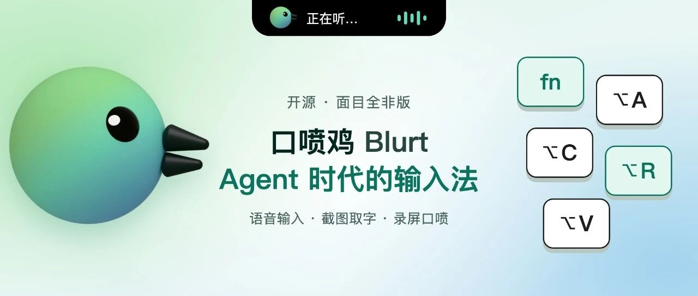
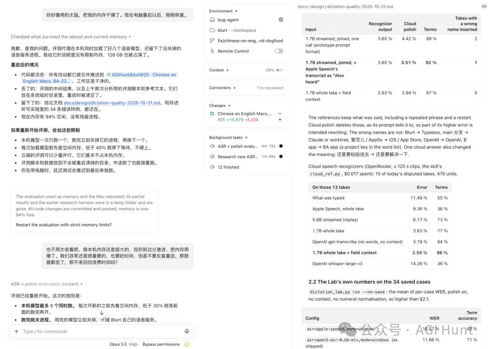

# 猛蹬 200 亿 Opus 5.5 token，我开源了一个 vibe coding 必备神器



> 一句话定位：**Agent 时代的输入法**——把「说、指、划、录」直接变成 Agent 能吃的输入。

## 项目基本盘（实测于 2026-11-04）

| 项 | 实测值 |
|---|---|
| 仓库 | `AGIHunt/blurt` |
| Star | **257**（官网同日显示 257，一致） |
| Fork | 23 |
| License | **MIT** |
| 语言 | Swift（原生 macOS App，非 Electron） |
| 建库 | 2026-09-25（约 40 天） |
| 最近提交 | 2026-11-02（活跃） |
| 开 Issue | 13 |
| 仓库体积 | 约 137 MB |
| 官网 | https://blurt.work |
| 成本 | 作者称约 200 亿 Opus 5.5 token，约 5000 美金 |

**注**：257⭐ 对比同期 AI 工具类项目（如 Autoloop 次日 1.9K）不算爆款，但它是**原生 Swift 应用**、9 月才建库，且作者是有 1924 篇原创的技术博主，属于"自用工具开源"而非流量项目。

## 为什么做这个（旧版痛点）

如果你的 AI 一夜奋战后给你写了 40 个页面、几万行代码，那接下来呢？


**旧版的核心痛点**：AI 猛干完之后，还要给它擦屁股——反馈修改意见极其低效。

> 我得打字、截图，画圈、画箭头、写描述，讲什么什么地方、怎么怎么个复现、前后什么逻辑、当下的背景、复现的步骤……等很多细节。

> 虽然 AI 很聪明，说不清楚也还好。但也正是因为它的聪明，一旦哪个地方没讲清楚，它一猛干就干偏了。

**旧版解法**：一键录屏 + 边录边说 + 动动鼠标画画圈，把视频扔给 Claude Code / Codex，让 Agent 把视频里的鼠标轨迹、画的圈、说的话、操作流程整理成问题列表。

实测效果：**5 分钟讲清楚 52 个问题**，每条带截图、原话和时间点。

## 新版（"面目全非版"）六个功能

### 1. 语音输入（`Fn`）

- 按一下 `Fn` 说话，字打在光标处
- **双击 `Fn`** = 说完直接发送（回车）
- 默认只做「轻整理」：去掉嗯啊、加标点，**不改你的用词**
- 按 `⇧` = 结构化整理（说成清单）
- 按 `⌘` = 中→英 / 英→中翻译
- `⌥L` = 把上一条重新排成清单（可撤销）

**作者的一个观察**：

> 貌似用英文给 Codex 发指令，它会显得更聪明……所以说中文、出英文，对我来说还挺重要的。

（这是作者的主观感受，README 里没有对应的 benchmark 支撑。）

### 2. 截图取字（`⌥C`）

框选屏幕上**无法选中的文字**（截图、视频、锁定的页面、终端），松手即进剪贴板。

关键细节——它做的是**排版还原**，不是裸 OCR：
- 边缘被切断的半行**丢弃**
- 折行的列表项**合并回一行**
- 表格保留 tab，代码保留缩进
- 耗时约 **0.2 秒**

按 `⌥T` 则是框选 + OCR + 翻译。

文章给的对比数据：**错字率 0.70%，普通 OCR 15.8%**（注意：这是文章口径，README 未收录此数据）。

### 3. 截图 + 语音（`⌥A`）

截图后可**直接在图上划线、画圈、画框**，同时开口说话描述。截完的卡片挂在**刘海处**，可直接拖给微信、Claude、飞书或任意 App——**图和文字一起发过去**。

（这个设计很聪明：不是"截完保存再上传"，而是把卡片当成一个可拖拽的对象。）

### 4. 录音（`⌥V`）

同事过来找你讨论问题，按一下就开始录。最长 10 分钟。

> 说话人识别：开发中

### 5. 录屏（`⌥R`）

老功能，边翻边看、指指点点、随意喷。新版做了细节改进。

**录屏 → 事项的完整链路**：
```
录屏 → 本地转录（边说边转）→ Agent 读文本 + 看几帧截图
     → 输出事项列表（问题/想法/待办），每条带截图、标注位置、步骤、可能涉及的代码
```

关键设计：**视频从不发给模型**。语音本地转录，Agent 只读文本 + 看几张帧图。

### 6. 快捷键总览

| 键 | 功能 |
|---|---|
| `fn` | 说话 |
| `⇧`（说话时） | 结构化，排成清单 |
| `⌘`（说话时） | 中→英 / 英→中 |
| `⌥A` | 截图 |
| `⌥V` | 语音备注 |
| `⌥R` | 录屏 |
| `⌥C` | 框选取字 |
| `⌥T` | 截图翻译 |

全部可在设置里改。

## 模型选型（作者花重金做的部分）

> 这软件看着简单，但在各种模型的选型和效果上，我真是花了重金和大量 token 来对各种开源模型和闭源 API 进行 PK、筛选、适配……把我 128G 内存都干死机了好几次。



**README 里的真实模型表**（比文章更详细）：

| 用途 | 模型 | 下载体积 |
|---|---|---|
| 语音（听写/语音备注/录屏），16GB+ | Qwen3-ASR 0.6B, 8-bit, MLX | 1.0 GB |
| 语音，可选：英文稍好，2.5 倍大小 | Qwen3-ASR 1.7B, 8-bit, MLX | 2.5 GB |
| 润色，16GB+ | Gemma 4 E2B, 4-bit | 3.4 GB |
| 润色，8GB | Gemma 3 1B, 4-bit | 0.7 GB |
| 语音备注（纯 CPU）；日/韩/粤 | SenseVoice Small | 228 MB |
| 其他语言录屏 | Whisper large-v3-turbo, MLX | 1.5 GB |

**实测内存占用**：约 2.8 GB（用 1.7B 时 4.2 GB，M1 Max 上测）。空闲模型 10 分钟卸载。

**作者诚实的地方**：

> 但我确实就只在我自己的两台 Mac 上测试过。其他电脑的配置只是 mock 来测出来的，不一定很精准。

## 安装

- 系统要求：**macOS 13+**，听写和推荐语音模型需要 **Apple 芯片**
- 协议：MIT
- 官网下载：blurt.work
- 命令行安装：
```bash
curl -fsSL https://blurt.work/install.sh | sh
```
- **接入 Agent**：设置 → Agent → 连接… → 自动把 skill 和 MCP server 装进 Claude Code、Codex、Cursor 等
- 然后在 Agent 里说一句 **「开始口喷」**（`/blurt` in Claude Code，`$blurt` in Codex）

支持的 Agent：Claude Code、Codex、Gemini CLI、Kimi Code、OpenCode、Grok、CodeBuddy Code、WorkBuddy、Cursor。

## 战略分析

### 它到底解决了什么问题

**不是"语音输入"**——语音输入是红海，Typeless / Wispr Flow / Superwhisper / Aqua Voice 全在做。

**它解决的是「意图到 Agent 输入框」这一段**。README 第一句就说清楚了：

> It works next to the agents you already use... and handles the part before they start: getting what you mean into the agent's input box. **It has no agent of its own and doesn't replace yours.**

这个定位非常克制，也解释了为什么它能做出差异：**不做 Agent，只做 Agent 的入口**。

三个竞品都没有的能力：

| 能力 | Blurt | Typeless | Wispr Flow | Superwhisper | Aqua Voice |
|---|---|---|---|---|---|
| 截图/语音卡片给 Agent | ✅ | ❌ | ❌ | ❌ | ❌ |
| 录屏 → 带截图和代码指针的事项 | ✅ | ❌ | ❌ | ❌ | ❌ |
| 交给编码 Agent，状态经 MCP 回传 | ✅ | ❌ | ❌ | ❌ | ❌（号称有，未核） |

### 与现有工具链的对照（对小谭这边）

| 维度 | 现状 | Blurt 能否补 |
|---|---|---|
| 微信端跟 Hermes 交互 | 只能打字 | **理论上能**——但 Blurt 是 Mac 本地 App，解决的是"打给 Agent"，不解决"手机上跟 Agent 说" |
| 归档时描述问题 | 我得打字写需求 | **能显著缓解**——「说一句 + 框选截图」比打字快 |
| 录屏讲 bug | 无 | **能补**——但小谭不在写代码场景，价值有限 |
| 视频转录 | 缺 yt-dlp + API Key | **不能替代**——Blurt 录屏是"我讲屏幕"，不是"别人的视频" |

**结论：对纯写作/归档场景，价值中等；如果经常要给 Claude Code / Codex 提反馈，价值很高。**

### 它最值得学的地方（不是功能，是工程）

**1. README 的数据诚实度，超出绝大多数开源项目**

它主动标注了每一处数据的局限：
- 「Synthetic speech is cleaner than a real microphone, so error rates are optimistic」
- 「smaller Macs, real microphones and accents were not measured」
- 「Competitor numbers come from other people and methods, **some from a competing vendor**, and are not directly comparable」
- 「Offline ... **not yet tested with the network off**」
- 「其他电脑的配置只是 mock 来测出来的」

**这是我在归档文章时反复遇到的问题**——文章口径和实测经常不一致。Blurt 的做法是：**把不可比的地方明确写出来，而不是拼一张好看的表**。

**2. 隐私默认值的设计**

- 语音在你 Mac 上处理，麦克风只在听写时开
- 听写时读光标周围约 500 字符（让专有名词更准），**永不读密码框**，可关闭
- 「Never use cloud speech recognition」开关，即使配了 Key 也强制本地
- Send Feedback 的数据在 Cloudflare 私有存储，14 天内删除

**3. "No connectors, by design"**

> Your agent already has tools for Slack, Linear, GitHub, Notion, Jira and Feishu/Lark. Blurt writes files (Markdown, CSV and the hand-off bundle) and leaves delivery to the agent.

**这是很成熟的架构判断**：不重复造集成，只产出文件，让 Agent 去投递。避免了 N×M 的集成爆炸。

**4. "Fixed" 永远是 "to verify"**

> Agents report back through the MCP server: an item moves to *In progress*, then *To verify*. **"Fixed" from an agent always means to verify until you mark it done.**

这条规则极有价值——**Agent 的自评不可信，必须有人工确认环节**。这正是我在研究仓颉时提到的「不能靠 agent 自评『我做得很仔细』」的同一个洞察，Blurt 在状态机层面直接强制了。

### 文章口径 vs README 实测（三处差异）

| 项 | 文章说 | README 实测 |
|---|---|---|
| 中文准确率 | 「错字 0.70%」 | **CER 1.3%**（Qwen3-ASR 1.7B，7 句 × 2 音色） |
| OCR 准确率 | 「错字 0.70%，普通 OCR 15.8%」 | **README 未收录此项**，无从核实 |
| 延迟 | 「0.39 秒」 | **0.29–0.54 秒**（中位数 3 次，warm models） |
| 润色模型 | 「Gemma 4 E2B」 | 一致，但补了 8GB 机器用 **Gemma 3 1B** |

> 差异原因：文章是宣传稿，取了最好看的单点数值；README 给的是区间和测试条件。**引用时应以 README 为准。**

### 作者盲点 / 风险

1. **137MB 仓库 + 6GB 模型下载**——不轻。文章说"下完就能用"，但推荐体验需要下模型
2. **只在两台 Mac 测过**，M1 16GB 的实际体验是 mock 的
3. **Windows / Linux 还没有**（"coming soon"），README 说 skill 的脚本部分已能跑
4. **257⭐、13 个 open issue、40 天新库**——非常年轻，不适合当基础设施依赖
5. **录屏转事项要消耗 Agent token**——作者给的三个真实案例：7 分钟录屏约 $2、14.3 分钟约 $2.6、20 分钟约 $2.1（Opus 5.5 API 价格）。**"免费"指 App 免费，用起来不免费**
6. **`⌥C` 取字用 macOS 自带识别器**，代码和路径里的符号容易错，要额外配本地 OCR 模型（720MB）或云模型才能修正

## 关联阅读

- [[技能文档/2026-11-04-仓颉Skill研究-能否优化归档能力]] — 同样涉及"Agent 输入质量"与"质量门"的思考
- [[技能文档/2026-11-04-Agent-Autoloop-卡兹克开源Agent自动化系统]] — 同期 Agent 工具，同样强调"人确认环节"
- [[技能文档/索引目录/Agent工具与工作流]] — 相关工具合集

## 归档日志

- 2026-11-04 归档
- 格式: A（标准，含战略分析）
- 抓取路径: 微信返回「环境异常」验证页 → `web_extract` 只拿到标题 → **Firecrawl MCP 成功抓全文**（已验证此路可绕过微信风控）
- 核实: `AGIHunt/blurt` **257⭐** / 23 fork / MIT / Swift / 2026-09-25 建库 / 2026-11-02 最近提交 / 13 open issues
- 核实: README 完整数据表（模型体积、延迟区间、费用实测、竞品对比）
- 核实: 官网 blurt.work 数据与 README 一致（257⭐、0.39s vs 0.29-0.54s 区间）
- 偏误: 文章「错字 0.70%」vs README「CER 1.3%」——已按 README 修正并标注
- 缺口: 文章「普通 OCR 15.8%」README 无对应数据 → 无法核实
- 缺口: 文章「200 亿 token / 5000 美金」为作者自述，无第三方验证 → needs_review
- 图片: 5 张（含 2 个 GIF 演示 + 封面），全部落盘
