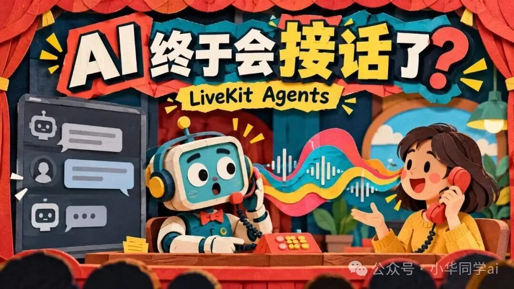
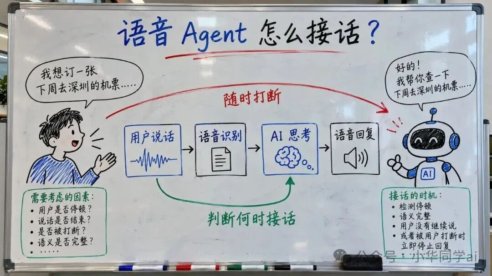

# 疯掉啦，15K Star 的 LiveKit Agents！！！！！

> 给 AI 接上语音合成，不代表它就能自然对话。用户什么时候说完？中途插话怎么办？网络不稳定时怎么继续交流？**LiveKit Agents 关注的，就是让实时语音 Agent 进入产品时，这些容易被忽略的工程问题。**

想象一个电话客服：用户说到一半停顿，AI 抢着回答；用户想纠正，AI 还在念上一段话。它明明能识别语音，也能生成回答，却让人忍不住想挂电话。

因为自然对话不是"录音、转文字、等待、播放"四个按钮串起来那么简单。**什么时候接话，能不能被打断，延迟够不够低**，都会影响体验。

LiveKit Agents 是一个构建实时语音、多模态 Agent 的开源框架，适合把这些能力嵌入自己的应用。查阅时 GitHub 显示约 **1.5 万 Star**；这只是关注度，不是效果保证。

## 把一条语音链路拆开看

常见方案可以理解成：**用户说话 → 语音识别 STT → 大模型理解与决策 → 语音合成 TTS → 用户听到回复。**

框架让开发者组合不同服务商的识别、模型和语音合成能力，也支持实时语音模型；并非所有方案都必须经过同一条文字流水线。

用户与 Agent 通过 LiveKit 房间交流。LiveKit 使用 WebRTC 处理实时媒体传输；Agent 在服务端作为房间参与者，处理声音等输入，再返回结果。

| 环节 | 可以先这样理解 |
| :-- | :-- |
| WebRTC 与房间 | 让客户端和 Agent 实时交换音视频 |
| STT / LLM / TTS | 听懂、处理、开口的不同组件 |
| 轮次判断 | 判断用户是否说完，减少不合时宜的抢话 |
| 工具调用 | 按需连接业务系统，执行查询等操作 |

这些组件是可组合的，不等于换了框架就自动解决所有延迟、准确率或口音问题。

## 真正值得看的三个能力

**第一，处理对话节奏。** 项目提供语义轮次检测和打断处理能力，目标是改善接话时机。具体表现仍依赖模型、环境和配置，需要用真实场景测试。

**第二，把对话接到业务。** Agent 可以调用自定义工具，也支持 MCP。例如用户问订单状态，后端工具可以查询业务系统，再由 Agent 组织回答。

**第三，复杂任务可以交接。** 官方示例展示多个 Agent 之间的 handoff：一个负责收集信息，另一个负责后续任务。关键不只是角色多，而是让工作流程更清晰。

项目还提供任务分发、客户端 SDK、电话集成和测试框架，适合继续探索面向实际用户的语音应用。

## 能拿来做什么？

一个很直观的方向是语音客服：先回答常见问题，涉及订单时调用查询工具；复杂问题交给人工。另一个方向是语言陪练：用户开口练习，Agent 根据上下文继续对话。

也可以结合视频、文本、屏幕共享等能力探索多模态助手。具体能处理什么输入，取决于所选模型、插件和实际配置。

**别把演示效果当成生产能力。** 电话接入、人工转接、录音告知、权限隔离和业务容错，仍要结合实际系统设计。

## 开源不等于所有部分都免费

仓库采用 Apache-2.0；项目文档介绍了自托管 LiveKit 服务和部署 Agent 的方式。同时，官方示例也可使用 LiveKit Cloud 或外部模型服务。

自托管需要考虑服务器、网络、运维和扩容；接入第三方语音或模型服务时，也要核算对应费用和数据处理方式。模型、插件及外部服务各自的条款需要单独检查。

如果你的需求只是离线生成一段旁白，完整实时 Agent 框架可能偏重；但如果你想让用户**边说边交流，还能调用业务系统**，它值得收藏。

> 本文基于公开仓库和文档整理，未进行本地部署或延迟实测。

## 项目地址

https://github.com/livekit/agents

---

## 战略分析

### 仓库事实核查（2026-11-02 实测，GitHub API）

| 指标 | 实测值 |
| :-- | :-- |
| 仓库 | `livekit/agents` |
| Star | **15,051**（与文章"约 1.5 万"一致） |
| Fork | 4,048 |
| Open Issues | 883 |
| 创建时间 | 2023-10-19 |
| 最近推送 | 2026-11-02（当日有提交，活跃度极高） |
| 主语言 | Python |
| License | **Apache-2.0**（OSI 真开源，非 source-available） |

**热度判断**：3 年 15K star、4000+ fork、issue 883 且当日仍在提交 —— 这是长期活跃的工程型项目，不是营销项目。Fork/Star 比 0.27 偏高，说明有大量下游集成方（自建部署场景多）。

### 竞争格局（同赛道 star 排序）

| 排名 | 项目 | Star | 定位差异 |
| :-- | :-- | --: | :-- |
| 1 | `pydantic/pydantic-ai` | 20,997 | 通用 Agent 框架，realtime voice 只是其中一个能力 |
| 2 | `pipecat-ai/pipecat` | 16,993 | 最直接竞品：voice agents + 多模态实时流水线，编排 DSL 更轻 |
| 3 | `livekit/agents` | 15,051 | WebRTC 传输层自带（LiveKit SFU），基础设施更厚 |
| 4 | `QwenAudio/qwen-audio-agent` | 3,104 | 阿里系实时语音 runtime，中文场景针对性强 |

**关键判断**：这个赛道真正的二选一是 **LiveKit Agents vs Pipecat**。
- 选 LiveKit：需要 WebRTC 房间、多端接入、电话接入（SIP）、视频/屏幕共享 —— 传输层是它的护城河，别家要自己拼。
- 选 Pipecat：只需要语音流水线编排、想少带基础设施、要多供应商快速切换。
- 注意：**两者都不解决"你接的是哪家 STT/LLM/TTS"** —— 成本与效果取决于你选的外部服务。

### 与现有栈的整合方案

| 环节 | 接入方式 | 说明 |
| :-- | :-- | :-- |
| 语音入口 → Hermes | LiveKit Agent 作为服务端参与者，说话后调 MCP | 项目原生支持 MCP，可把 Hermes 现有工具（Obsidian/搜索/终端）当工具层直接挂上 |
| 多 Agent 分工 | 用 handoff 把"收集信息"与"执行任务"拆成两个 Agent | 对应现行的「幕僚长 vs 执行层」分工 |
| 客户端 | 官方提供 Web / iOS / Android / Flutter SDK | 微信端不适用（无 WebRTC 房间直连），需中转层 |

**摩擦点**：WeChat 端不能直接跑 WebRTC 房间，语音入口要走电话（SIP）或小程序 → 自建网关。这是接入成本最高的部分，不是框架问题。

### 值不值得投入

- **不值得**：只想给现有 Agent 加"说话"能力（TTS 一条命令就能解决，用不上实时框架）。
- **值得**：目标场景是**打断+追问+边查边答**（电话客服、语音陪练、车载/家庭语音助手）。这类场景的核心难点正是轮次检测与打断，恰好是这个框架唯一真正的技术差异点。
- **建议动作**：先不部署，只读 `examples/` 下的 handoff 与 turn-detection 示例；如果未来真要做语音入口，再评估 Pipecat 对比跑一遍延迟。

---

## 归档日志

- 归档日期：2026-11-02（会话时钟 `date` 实测）
- 发布时间：2026-11-02 05:18（Firecrawl 返回的页面时间戳）
- 提取方式：Firecrawl MCP `firecrawl_scrape`（formats=markdown, onlyMainContent=true），返回完整正文 + og 元数据，未走 parser/Camoufox 回退
- 图片：2 张内文图，直连 `mmbiz.qpic.cn`（带 Referer + Chrome UA）下载成功，均 >100KB 真实 JPEG；已逐张读图核验并配中文 alt（封面图/白板链路图），无 CDN 限位占位图，无跳过项
- 图片命名：`assets/2026-11-02-LiveKit-Agents-实时语音Agent框架/img_001.jpg` `img_002.jpg`
- 已清理：公众号关注 banner、重复页尾名片、"推荐阅读"5 条跨号链接、微信阅读器/赞赏/投诉等 UI 残留、二维码图引用
- 事实核查：GitHub API 实测 star/fork/创建时间/license，竞品按 star 排序（纠正文章"1.5 万 star"的模糊表述为精确 15,051，并补齐同赛道对比）
- 文章口径 vs 实测：文章称"约 1.5 万 Star" —— 实测一致；文章未提竞品 Pipecat（17.0K star 更高），已在战略分析补充
