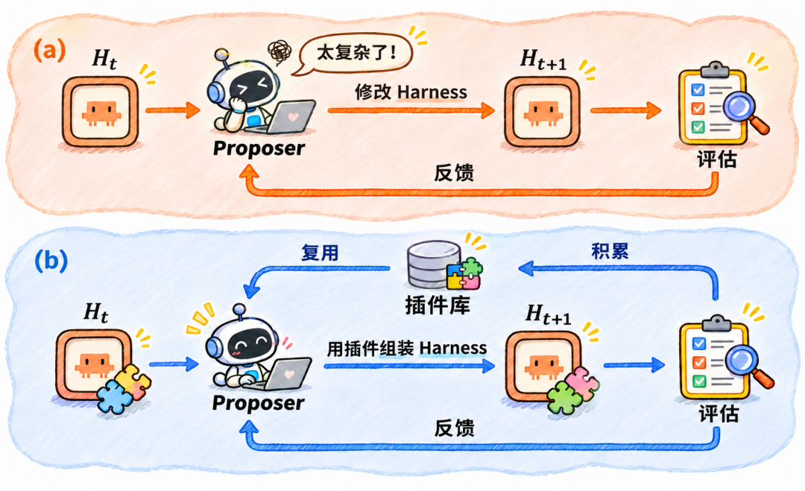
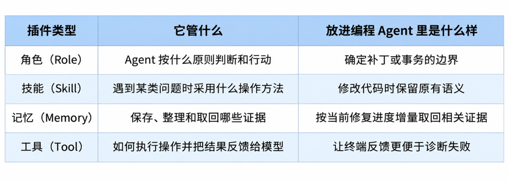
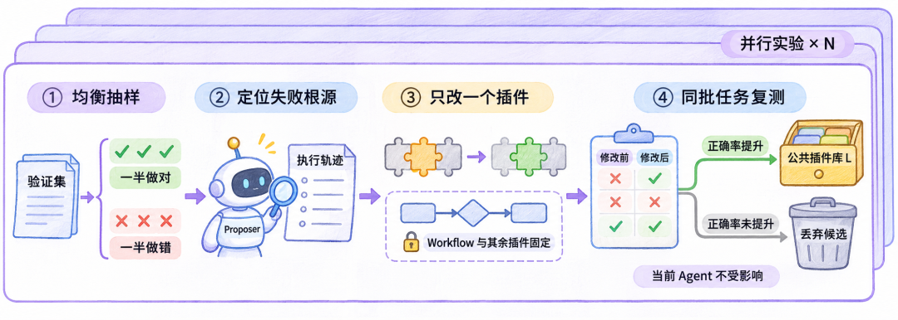
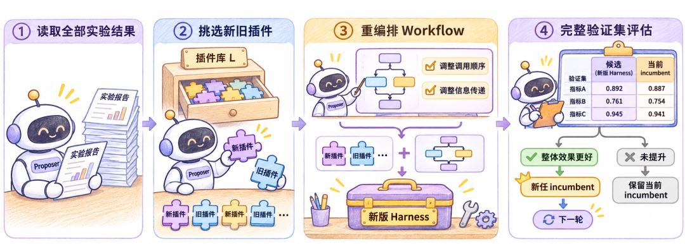
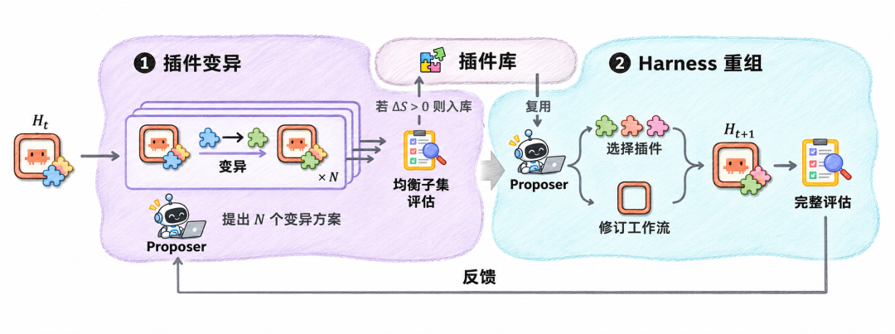
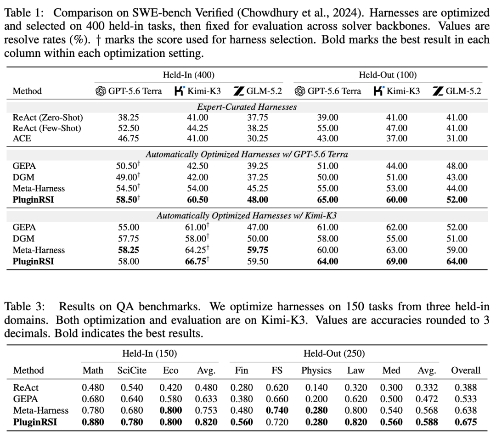

# 把 Harness 拆成插件，美团×中科大 PluginRSI 实现 Agent 分块式自进化

> Everything is a plugin（万物皆插件）。
> --DeepSeek Harness

## 概述

同一个大模型换一套 Harness，任务完成率会出现巨大差别。于是学术界兴起 **Harness 递归自优化（RSI）**：让另一个 AI 智能体读任务执行记录、找出失败原因、自动改写整套 Harness 代码，全程不动底层模型权重，成本远低于重训。

但旧范式有个绕不开的痛点：**一改写就是全盘重写，好点子容易丢，经验无法沉淀复用**。中国科学技术大学、美团、武汉大学和新加坡国立大学提出的 **PluginRSI** 解决的正是这件事——把每次修改背后的判断规则做成**可替换、可验证的插件**，下一个智能体遇到类似任务时可以直接用上它。

论文：`arxiv.org/pdf/2609.32423`（**文章口径，未独立核实**）

## 旧方案的困境

主流的 Meta-Harness、DGM 流程很直白：拿完整 Agent 外壳 → 另一个 AI 通读全部代码与失败记录 → 直接改整个 Harness → 生成新版跑评估 → 继续下一轮。

"整体大改"有两个致命短板：

| 短板 | 表现 |
|------|------|
| **很难单独测试某一个想法** | Harness 里混杂记忆逻辑、工具逻辑、角色提示、执行流程。想验证"优化记忆检索"，改完记忆模块后流程和工具也一起变了，性能变化无法归因 |
| **来之不易的好机制容易被覆盖丢失** | 这轮摸索出好用的终端报错反馈逻辑，下一轮全盘改写时被 AI 顺手删掉。每轮都在推倒重来，经验无法代代积累，反复收敛到差不多的方案，浪费算力 |

## 核心框架：把 Agent 拆成可插拔插件

核心思想：**不反复改写完整外壳，把 Harness 拆成独立 Plugin，进化零件；验证有效的零件存入共享工具箱，后续拼装新 Agent 直接复用。**

两个分工不同的 Agent，搜索过程中**两个底座模型都保持固定**：
- **Solver**：用当前 Harness 做任务，留下工具调用、执行轨迹和评测结果；
- **Proposer**：读这些材料，提出插件与工作流的修改方案。

上一轮产出的 Harness、插件和运行反馈进入下一轮，递归发生在优化闭环里。

### 什么是插件

每个插件是独立、有标准接口的小模块，含两部分：**一份 YAML 配置（输入输出格式、参数）+ 一份 Python 实现代码**。

而完整的 Harness = **一批挑选出来的插件 + 一套 Workflow 工作流脚本**。

Workflow 不写复杂业务逻辑，只负责调度：何时调用哪个插件、插件输出如何流转、控制整个任务循环。业务能力全部下沉到插件。

**这套设计把两个容易混的问题分开了**：一个机制本身能否改好，靠替换插件试；几个机制怎样配合，交给工作流试。

### 四类插件

## 阶段一：插件变异（单独打磨零件，好的就存进工具箱）

每轮迭代并行生成多组实验（四步）：

1. 从验证集挑**均衡小批量任务**——混合一半做对、一半做错的案例；
2. Proposer 看这套任务的执行轨迹，**定位失败根源**；
3. **只选中某一个插件修改**，Workflow、其余所有插件原封不动；
4. 在小批量任务上测试：正确率提升 → 新版本入**公共插件库 L**；未提升 → 直接丢弃，不影响当前 Agent。

**变量只有一个**，性能变化可明确归因到这个插件改动，不混杂其他干扰。优秀改进永久入库，不会被后续改写删掉。

### 论文中真实发现的插件改进（三个实例）

| 插件 | 原始行为 | 变异后 |
|------|---------|--------|
| 记忆插件 | 关键词匹配召回历史，常返回大量重复信息 | 增加**去重逻辑**，优先返回从未展示给大模型的新证据，大幅减少冗余干扰 |
| 终端工具插件 | 只返回命令输出 | 进化出**失败感知反馈**：自动识别隐藏在成功返回码下的测试报错，主动补充失败提示 |
| 角色插件 | — | 进化出**修复范围控制**，约束 AI 不要胡乱大范围改代码 |

三者全部作为独立零件入库，可供之后所有 Agent 调用。

## 阶段二：Harness 重组（挑选成熟零件，重新编排工作流）

1. Proposer 读取本轮插件变异的**全部实验结果**；
2. 从插件库**挑选**一批有价值的新旧插件；
3. **修改 Workflow 调度逻辑**：调整调用顺序、信息传递方式，重排协作流程；
4. 拼装成完整 Harness，在**完整验证集**评估整体性能；更好则作为新一代 **incumbent（当前最优 Agent）** 进入下一轮。

一句话：**阶段一专注打磨零件，阶段二负责挑选零件、设计零件之间如何配合、组装新整机。两者缺一不可**——消融实验证明，去掉任一阶段性能都明显下滑；**只有插件库但没有变异+重组流程，不会带来明显收益**。

## 实验结果

三大类任务：软件工程（SWE-bench Verified，真实 GitHub bug 修复）、命令行（Terminal-Bench-2.1）、多领域问答（数学/法律/医学/金融/科学）。基线：ReAct、ACE、GEPA、DGM、Meta-Harness。

### SWE-bench Verified 解决率（%）— 论文原表，Held-Out(100)

| 方法 | GPT-5.6 Terra | Kimi-K3 | GLM-5.2 |
|------|--------------|---------|---------|
| ReAct Zero-Shot | 39.00 | 41.00 | 41.00 |
| ACE | 37.00 | 43.00 | 31.00 |
| Meta-Harness（Terra 优化） | 55.00 | 53.00 | 44.00 |
| **PluginRSI（Terra 优化）** | **65.00** | **60.00** | **52.00** |
| Meta-Harness（Kimi 优化） | 60.00 | 63.00 | 59.00 |
| **PluginRSI（Kimi 优化）** | **64.00** | **69.00** | **64.00** |

文章口径：Kimi-K3 优化 → held-out **69% vs Meta-Harness 63%（+6）**；GPT-5.6 Terra 优化 → **65% vs 55%（+10）**。

**关键：进化出的 Harness 具备跨模型迁移能力。** 用 Kimi-K3 迭代出的外壳直接套给 GPT、GLM，不需要任何再优化，依然维持明显优势（如 Kimi 优化的 PluginRSI 在 GLM-5.2 上 64.00 vs Meta-Harness 59.00）。现实场景常需迁移到不同底座模型，这一特性实用价值很高。

### 跨领域问答 Overall（Held-Out 250）

| 方法 | Overall |
|------|---------|
| ReAct | 0.388 |
| GEPA | 0.533 |
| Meta-Harness | 0.638 |
| **PluginRSI** | **0.675** |

在见过的训练域提升巨大；跨完全陌生领域收益明显变小——作者指出不同学科需要完全不同的策略，**插件的跨领域复用存在天然天花板**。

### 进化效率

相比 Meta-Harness，PluginRSI 用**更少的累计模型调用次数**得到更高性能的 Agent，且验证集提升能同步反映在未见测试集上，**过拟合风险更低**。Meta-Harness 常表现为训练任务越来越好、陌生任务波动且提升有限。

### 插件库的复用价值

多轮迭代后插件库从 **75 个增长到 132 个**，但 **Workflow 调度代码依旧不到 300 行**——复杂度沉淀到各插件中，Workflow 保持简洁可控。

从头启动全新 Agent 时直接加载已进化完的插件库：**仅 2 轮迭代**未见任务解决率就到 **69%**；而从零开始同样步数只有 **65%**。沉淀的插件工具箱可**加速未来其他 Agent 的进化**，实现经验传递。

## 关键洞察

1. **它真正的贡献不是"分块"，是"归因"**。单插件修改 + 均衡小批量（一半对一半错）的组合，让每一次性能变化只有一个变量。这是实验方法论搬进自动搜索循环——很多 Agent 自进化系统恰恰败在无法判断"到底是哪一步起了作用"。
2. **入库门禁 = 知识的复利**。提升才入库、不提升就丢弃，且入库版本不会被后续改写删除。这让进化第一次有了**单调性**（好机制只增不减），而 DGM/Meta-Harness 是每轮推倒重来。
3. **Workflow 短、插件多是健康信号**。132 个插件配 <300 行调度代码，说明复杂度被正确地下沉了。反过来，如果调度脚本膨胀，说明业务逻辑泄漏回了编排层。
4. **作者自己列出的四个短板很诚实**：固定任务集 vs 现实分布漂移、插件库膨胀后的管理裁剪问题、单插件变异发现不了"需要多插件+Workflow 协同改"的能力、token 成本上升（输入 +7.5%、输出 +19.8%）。
5. **跨领域天花板是结构性的**。插件承载的是"某类任务的判断规则"，规则天然带领域假设；数学的策略迁不到法律。这提示插件的正确粒度可能是"领域内可复用"，而不是通用。

## 战略分析

对小谭现有栈的价值不在论文分数，而在**"零件化沉淀"这个结构本身**。

Hermes 的 skill 体系已经是插件化架构（每个 skill 独立、有标准 frontmatter、按需加载），但缺的正是 PluginRSI 的两件事：

| 能力 | PluginRSI | Hermes 现状 | 差距 |
|------|-----------|------------|------|
| 单变量改进 | 只改一个插件，其余冻结 | 改 skill 靠人凭经验，改动常连带触发链 | ⚠️ 缺单变量纪律 |
| 小批量均衡回测 | 一半过关样本 + 一半失败样本 | 无固化的回归集 | ❌ 完全缺失 |
| 入库门禁 | 提升才入库，无效即丢 | 改进直接覆盖原文件，旧版靠 git | ⚠️ 有 git 但无"提升判定" |
| 公共零件库 | 132 插件，跨 Agent 复用 | ~200 skill，领域交叉复用靠人找 | ⚠️ 有库无检索式组装 |
| 编排层瘦身 | Workflow <300 行 | skill 内部逻辑冗长 | ⚠️ 需持续克制 |

**可落地的三件事（按性价比）：**

1. **给 skill 加"变异回测集"**。选一个高频 skill（如 `kb-archive-article`），准备 6-8 个回归用例（一半是历史成功的归档、一半是曾被纠正过的失败案例），任何改动前后跑一遍，只接受净提升的改动。这是把 PluginRSI 阶段一搬到单机的最小可行形态，成本几乎为零——回归集就是历史会话记录。
2. **把"失败案例"变成一等公民**。PluginRSI 的均衡抽样（一半做错）是关键设计。知识库里现在只沉淀"做对了什么"，没有"曾经怎么错的"。可以在归档日志里固化一个"踩坑"字段，作为 future 变异集的素材。
3. **借用"插件 + 薄 Workflow"的分层**。skill 里应该区分**判断规则**（可复用零件，如"何时算成功"、"什么情况该放弃"）和**流程编排**（本次任务特有）。现在多数 skill 把两者混写，导致规则无法跨任务复用。

**不建议照搬的：** 完整的"Proposer 自动改写 + Solver 评估"闭环。在小谭的使用强度下，自动改写 skill 的风险（改坏一个用得很顺的 skill）远大于收益；`SkillOpt`/`SkillAdam` 那条线已经有验证门，且成本更低。真正该借的是**方法论骨架**（单变量、均衡样本、提升才入库），而不是自动化程度。

**与已有归档的关系：** 本库已有多篇同赛道记录——[[技能文档/2026-08-27-Prime-Agent-自进化Harness框架]]（运行时 CRUD 自进化 + 版本回滚）、[[技能文档/2026-09-27-AI兵器谱84-SkillAdam-洗髓经-Skill自进化优化]]（验证门 + 自主性梯度）、[[技能文档/2026-09-05-从OpenSpec到AIDLC团队AI代码质量实践]]。PluginRSI 在这条脉络里的独特位置是：**它把"回滚"换成了"入库"**——不算推倒重来，而是把好的零件永久保留，让进化有累积性。

## 归档日志

- 2026-11-03 归档（内容抽取于 11-04 完成，同日与 Auto-Ontology 一并归档）
- 抽取方式：浏览器 `#js_content` innerText（3,777 字）+ 8 张正文图按 data-src 懒加载逐张取回 + 封面（9 张全部 HTTP 200，无占位图）
- 图片核对：8 张内容图经读图确认为架构图/流程图，论文原表（img_008）已转录为 Markdown 表格
- **论文地址 `arxiv.org/pdf/2609.32423` 为文章口径，未独立核实**；GitHub 仓库文中未给出，未做 star 实测
- 数字口径说明：正文表格取自文章中所附论文原表（img_008），与文章叙述的 69%/63%、65%/55% 一致，故按原表呈现
