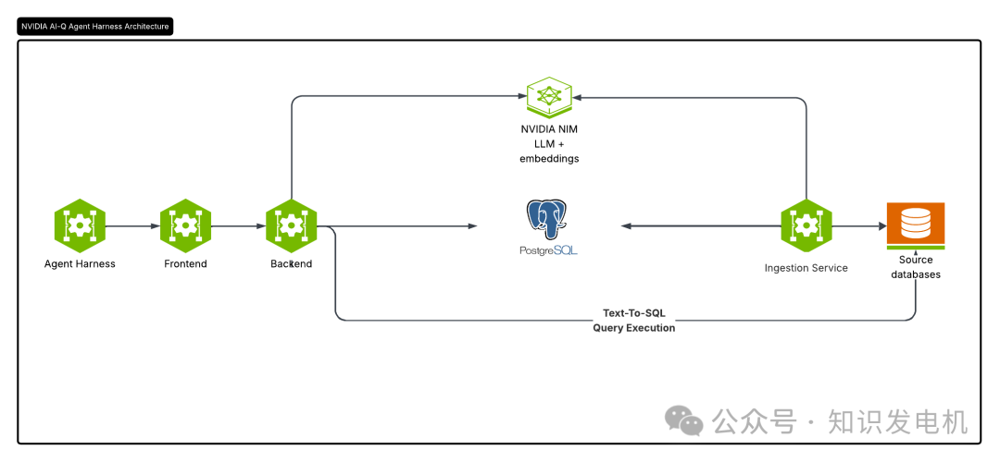

# 拒绝"一本正经地胡说八道"！英伟达开源 Auto Ontology，打通企业级 AI 智能体落地最后一公里

## 概述

企业级 Data Agent 的老问题是"算得快但算错"——大模型不知道"净利润"在 A/B 两套系统里口径不同，也不知道废弃测试表不能参与计算。传统 Text-to-SQL 把数据库 Schema 直接塞进上下文，指望模型自己悟出表关联，结果既烧 token 又在算错时给出极自信的答案。

英伟达（NVIDIA）开源的 **Auto-Ontology** 针对的正是这一层：在杂乱的数据库与智能体之间架一个**语义层/本体层**——从企业元数据自动生成本体（业务术语 → 列、评审过的 SQL 度量表达式、表关系），智能体通过本体查询，人通过 Web UI 评审认证。

> **归档日实测（2026-11-04）**：`NVIDIA/auto-ontology` **3,559 ⭐** / 306 fork / Python / **Apache-2.0 真开源** / 2026-04-27 建库 · 今日仍在提交（pushed 2026-11-04T10:08Z）。文章称"近 2000 Stars"为**文章口径，已过期**。
> 配套评测仓 `NVIDIA/auto-ontology-eval`（50 ⭐，Apache-2.0，2026-07-02 建库）。

## 核心定位：不是 Text-to-SQL 工具，是 Agent 的上下文层

官方的自我描述很克制：**"An open context layer that helps agents give fewer wrong answers on enterprise data."**——一个跑在你数据库旁边、给智能体提供上下文的服务。

它在动手查询之前必须先让 Agent 知道六件事：数据在哪里、是什么意思、该不该用、怎么用、从哪来、什么和它相似。

### 与"把 Schema 塞进上下文"的正面比较（官方对照表）

| 维度 | Schema 在上下文窗口里 | Auto-Ontology 工具 |
|------|----------------------|-------------------|
| Token | 每加一张表/一列都在涨 | 只给问题真正触及的术语与表 |
| 语义 | 只有列名，其余靠 Agent 猜 | 业务术语映射到列与 SQL |
| Join 与度量 | 每个问题临时现编 | 预解析好的关系 + 评审过的 SQL 表达式 |
| 无法回答的问题 | 自信作答，通常答错 | 先做可回答性检查，答不了就反问澄清 |

## 三阶段工作流：生成 → 认证 → 回答

### 阶段一 生成（Generate）
摄取服务（Ingestion Service）从源库构建本体草稿：
1. **读源**：抽取 schema、分析列画像、采样值，写入 catalog；
2. **命名实体**：逐表抽取术语（Term）并映射到列；
3. **解析关系**：推断表间 join 与桥接表，从查询历史里建议 SQL 属性；
4. **写本体**：术语、关系、SQL 属性存 Postgres，向量存 pgvector 供检索。

本体里只有三种定义：**Terms**（业务概念 + 描述 + 同义词 + 对应列）、**SQL 属性**（挂在术语下、经过评审的 SQL 表达式，如毛利、滚动汇总）、**Relationships**（表怎么 join，含桥接表）。

> 官方示例：Wide World Importers 一次编译产出 **31 个术语**。

### 阶段二 认证（Certify）
人把草稿变可信：在 Chat 里用真实问题测 → 在 UI/API 里改术语、描述、SQL 属性 → 逐项**认证（certify）**。

这一步是全篇最被低估的设计：**它是把"AI 自动生成"和"人签字负责"分开的两道门**。企业落地最怕的不是生成不出来，而是生成出来没人认账。

### 阶段三 回答（Answer）
Agent 每问一次的固定五步：
1. 意图分类 + 抽取问题里的实体；
2. 用**向量检索**召回候选术语、列、SQL 属性；
3. 基于候选写 SQL；
4. **校验过滤值与查询**（对数据库实测），校验失败自动修复 SQL；
5. 执行并返回**答案 + SQL + 执行步骤**。

候选支撑不了查询时，直接报告"这个数据答不了"；预测类问题路由到 KumoRFM（需配置）。

### 可回答性检查的实际表现（官方 Quickstart 案例）

数据里没有广告投放，所以问投放 ROI 时：

```text
You:    What was return on ad spend for the sushi roll flash drive in June 2015?
Agent:  check_answerable -> coverage 0.5; no term covers "ad spend"
Agent:  I can find revenue for that product, but this data has no advertising
        spend, so I can't compute return on ad spend. Do you want June 2015
        revenue instead, or is ad spend tracked in another source I should connect?
```

这就是"拒绝一本正经胡说八道"的技术实现方式：不是让模型更谨慎，而是**让它在写 SQL 之前先被卡一道覆盖率检查**。



## 技术栈与工程规格

| 组件 | 技术 | 职责 | 端口 |
|------|------|------|------|
| Frontend | Next.js 16 / React 19 / Better Auth / Prisma | Web UI、认证、公开 API 网关 | 3000 |
| Backend | FastAPI（Python 3.12+）、LangChain | Text-to-SQL Agent、catalog、本体 API | 3001 |
| Ingestion Service | FastAPI | 摄取与语义编译 | 3002 |
| MCP Server | FastMCP | 本体只读工具 | 3003 |
| Postgres + pgvector | PostgreSQL 17 | catalog、本体、应用数据、向量库 | 5432 |
| HashiCorp Vault | 可选 | 连接凭据管理 | — |

**⚠️ 安全边界（官方明确警告）**：后端 FastAPI 信任前端在 `x-auto-ontology-user-id` 头里传来的用户身份，且**摄取服务的 ingest/delete/reset/compile 端点自身没有认证**。官方要求 3001/3002 必须留在私有网络，客户端一律走 3000 的 Web App。这一条比文章重要得多——本文只提了"内置 SSO+RBAC"。

### 十个连接器
PostgreSQL、MySQL、Databricks、Snowflake、ClickHouse、Trino、Apache Kyuubi、HeavyDB、DuckDB、SQLite（DuckDB/SQLite 仅连接串方式）。

### 四个模型角色（默认走 NVIDIA NIM）

| 角色 | 默认模型 | 干什么 |
|------|---------|--------|
| REASONING | `nemotron-3.5-lightning-30b-a3b` | 建本体、写答案 SQL 与解释、给可回答性打分 |
| NON_REASONING | 同上 | 快步骤：意图、实体抽取、候选选择、SQL 校验与修复 |
| EMBED | `nemotron-3.5-embed-1b` | 把表/列/术语/SQL 属性索引进 pgvector 并匹配问题 |
| RERANK | `nemotron-3.5-rerank-8b` | 编译期给候选表排序 |

> **纠偏**：文章写的三剑客 `nemotron-3-nano-30b-a3b` / `nemotron-3-embed-1b` / `llama-nemotron-rerank-vl-1b-v2` 已被官方 README 更新为 nemotron-3.5 系列。可换自托管 NIM 或任何 OpenAI 兼容端点（`<ROLE>_ENDPOINT/_API_KEY/_MODEL`）。

### MCP 原生支持（10 个只读工具）

| 用途 | 工具 |
|------|------|
| 就绪检查 | `check_readiness` |
| 术语 | `search_terms`, `get_term`, `get_term_columns`, `get_term_sql_attributes`, `get_sql_attribute`, `describe_table` |
| 可回答性 | `check_answerable` |
| 提问 | `ask_question`（返回答案 + SQL + 行数据） |

Cursor 配置（`~/.cursor/mcp.json`）：
```json
{ "mcpServers": { "auto-ontology": { "url": "http://localhost:3003/mcp" } } }
```

**每个 MCP 调用都以该登录用户的权限执行**——多用户权限隔离不是装饰。

### 三个 Agent Skills
`nvidia-ontology-setup`（装、连源、编译、证明就绪）、`nvidia-ontology-management`（检查、建模、认证、导入导出、发布）、`nvidia-ontology-query`（提问并验证 SQL/行/答案）。入口是仓库根的 `AGENTS.md`。

### 部署
- **本地**：Docker Compose（`docker compose up -d --build`），需 Docker Compose v2、`uv`、`nvapi-` Key；
- **生产**：仓库带完整 **Helm chart**，直接进 K8s；
- **标准互通**：兼容 **Apache Ossie**（语义模型交换开放标准），自带 NVIDIA 转换器，可用 `POST /api/model/import|export` 导入导出 Ossie YAML。

### 评测方式（官方自证）
`auto-ontology-eval` 在 **BIRD、BEAVER、FDABench-Lite、Wide World Importers** 上做双臂对照：**Control**（prompt 里给 schema）vs **Treatment**（走编译好的本体），同一模型同题跑两次，用各基准官方规则做执行匹配打分，报告准确率差值并**列出"本体修对了的题"和"本体弄坏了的题"**。BIRD-Interact（多轮、需要反问）单开 harness。

## 关键洞察

1. **它卖的不是准确率，是"可归因"**。答案永远附带 SQL 和执行步骤，度量表达式是人在术语下评审过的——同一个"净利润"在所有答案里用同一条 SQL 算。企业真正付钱的是"这个数字凭什么"的追问能被回答。
2. **可回答性检查是幻灭器**。`check_answerable` 返回 coverage，覆盖率不足就反问。这比"让模型别编"工程化得多：在生成阶段前置一道确定性闸门。
3. **认证（Certify）是产品化分水岭**。自动生成本体谁都能做，但把"人签字"做进数据模型的状态里，才让 AI 生成的东西能在企业内网被审计。
4. **本体不是知识图谱的浪漫版**。它是 Term→列、SQL 属性、join 关系三种定义，全部落 Postgres + pgvector。没有 RDF/OWL 那套重型栈，"工程化"是它的第一条原则。
5. **不接受外部 PR**——官方明确只收 integration request 与 issue。这是"大厂内部项目开源"的典型姿态：可用、可读、但社区不能改。选型时要算进这个风险。

## 战略分析

这篇文章的价值不在"英伟达又开源了"，而在于它给出了**Agent 落地企业数据的三层分工范本**：语义层（本体/术语/SQL 属性）→ 工具层（MCP 只读工具 + 可回答性）→ 表达层（Web UI 认证 + 答案带 SQL 溯源）。这三层恰好是小谭现有栈里最薄的一段。

**与现有栈对照：**

| 维度 | NVIDIA Auto-Ontology | Hermes Agent | Obsidian 知识库 | TencentDB Memory |
|------|---------------------|--------------|----------------|------------------|
| 定位 | 企业数据语义层（只读问答） | 通用 Agent harness | 个人知识资产 | 四层记忆（L0→L3） |
| 结构来源 | 从 DB 元数据**自动编译** | 人工写 skill/plugin | 人工归档 | 对话自动抽取 |
| 术语/口径唯一性 | ✅ Term + SQL 属性 + Certify | ❌ 无度量口径层 | 部分（wiki 词条） | ❌ |
| 「答不了」显式化 | ✅ coverage + 反问 | 靠 prompt | — | — |
| 溯源 | ✅ 答案附 SQL + steps + 行 | ⚠️ 有 trace 但非面向用户的度量溯源 | ✅ 归档日志/source_url | ⚠️ 部分 |
| 协议暴露 | MCP（10 工具）+ REST + Skills | MCP 客户端为主 | — | MCP |
| 人审门禁 | ✅ Certify 状态位 | ⚠️ skill 审阅靠人 | ✅ 归档即审 | ❌ |

**可借鉴的三件事（按性价比排序）：**

1. **把"可回答性检查"搬到知识库检索上**。现在 `kb-archive-article` 的流程是"搜到就信"，可以加一条前置的 coverage 判定：检索结果里没有直接覆盖问题的段落时，明确回"知识库里没有这块"并列出最接近的 3 篇，而不是拿相邻内容凑答案。这是零成本的可靠性提升。
2. **度量口径术语表（Term + SQL 属性）的模型**。知识库里现在有 [[技能文档/2026-10-08-OntoQuery本体论智能问数系统]] 那套 7 张元表做法，Auto-Ontology 给的是更轻的版本：三张定义（术语/SQL 属性/关系）+ 认证状态位。若以后要做"某个指标到底怎么算"的查询，这个骨架比图数据库划算。
3. **答案带 SQL 的交付形态**。归档文档里凡是引用论文数字，都该像答案附 SQL 一样附口径来源（论文原表 vs 文章转述）。这一条我在本库已经把"文章口径/实测"分开标注，Auto-Ontology 只是把这件事产品化了。

**不建议现在动手的：** 完整部署 Auto-Ontology 对小谭当前场景过重——它是**面向企业关系型数据库的只读问答服务**，不是个人知识库的分析引擎；需要 Postgres 17 + 4 个 NIM 端点 + 4 个容器，收益（多源 join、RBAC）在单机个人场景用不上。真正值得看的是它的 `skills/` 目录——三个 skill 的写法可直接当"如何教 Agent 操作一个多服务系统"的范本。

**风险提示：** ①不接受外部 PR，长期维护依赖英伟达内部节奏；②后端信任 header 身份、摄取端点无认证，暴露到公网即高危；③默认依赖 NVIDIA NIM（可换但需自建）；④KumoRFM 预测功能会把表数据**上传到外部托管服务**，官方要求先做数据审查——想接就先把这两行读清楚。

## 参考

- 仓库：`NVIDIA/auto-ontology`（Apache-2.0，3,559 ⭐ @2026-11-04）
- 评测仓：`NVIDIA/auto-ontology-eval`（Apache-2.0，50 ⭐）
- 文档：`docs/mcp.md`、`docs/connections.md`、`docs/authentication.md`、`docs/conversation-api.md`、`DEPLOYMENT.md`

## 关联阅读

- [[技能文档/2026-10-08-OntoQuery本体论智能问数系统]] — 同样解决 NL2SQL 四痛点（同义词漏配/时间歧义/关联扇出/黑盒），但走的是 7 张 MySQL 元表 + 确定性 Java 管线的路线；Auto-Ontology 是自动编译 + 人认证 + MCP 暴露的路线。二者是同一问题的"重本体轻 LLM"与"轻本体重 Agent"两极。
- [[技能文档/2026-09-27-dsh-ontology实测-给Agent记忆装上本体约束]] — 记忆侧的本体约束（TBox/ABox），与本文的数据侧本体正好互补。

## 归档日志

- 2026-11-04 归档
- 抽取方式：浏览器 `#js_content` innerText（3,169 字）+ 图片按 data-src 懒加载逐张取回（1 张正文架构图 + 1 张封面，均 HTTP 200）
- **事实核对（归档日实测）**：文章称"近 2000 Stars"→ 实测 3,559 ⭐；文章称三剑客为 nemotron-3-nano/embed-1b/rerank-vl-1b-v2 → README 已更新为 **nemotron-3.5** 系列；文章称"四大核心能力 Discover/Ground/Validate/Expose" → README 实为五项（Discover/Ground/**Certify**/Validate/Expose），本文按 README 五项呈现
- 文章未提、已从 README 补入的关键信息：摄取端点无认证的安全边界、Helm/K8s 部署、Apache Ossie 标准互通、KumoRFM 外部上传风险、四个模型角色、十个连接器、不接受外部 PR
