# NorthCUA — 北坡（奇迹之风）开源的完整 Computer Use 方案：模型 + 数据 + 训练 + Harness

> **来源**：微信公众号「刘聪NLP」
> **原文**：[挖到一个Computer Use的宝藏开源模型，本地操作电脑不用愁了～](https://mp.weixin.qq.com/s/q0Xb1fuQHsFdr1lSuBDZjw)
> **发布日期**：2026-11-06
> **GitHub**：[beipo-ai/NorthCUA](https://github.com/beipo-ai/NorthCUA)
> **论文**：[NorthCUA Technical Report (arXiv 2611.02102)](https://arxiv.org/pdf/2611.02102v1)，123 页快照（2026-10-31）
> **模型**：[NorthCUA-Nano](https://huggingface.co/china-beipo/NorthCUA-Nano) / [Mini](https://huggingface.co/china-beipo/NorthCUA-Mini) / [Pro](https://huggingface.co/china-beipo/NorthCUA-Pro)
> **标签**：AI, Computer Use, GUI Agent, NorthCUA, 开源, Harness, 后训练, Qwen3.5

---

## 概述

Work Agent 里当前最热的两个能力是「操作浏览器」和「操作电脑」，两者绕不开同一个核心能力——**GUI**。作者在 Hugging Face 上发现北坡（上海奇迹之风，Qiji Zhifeng）开源了新 Computer Use 模型 **NorthCUA**，一次放出完整链路：模型权重、数据构造、分阶段训练方法，以及配套的 **NorthCUA Harness** 运行系统。

文章的落点不是"又来了一个模型"，而是：**同一个 Qwen3.5 底座，经过一套面向 Computer Use 的数据 + 训练 + 运行系统，电脑操作能力就能显著提升**——这正是后训练见效快的样例。

> 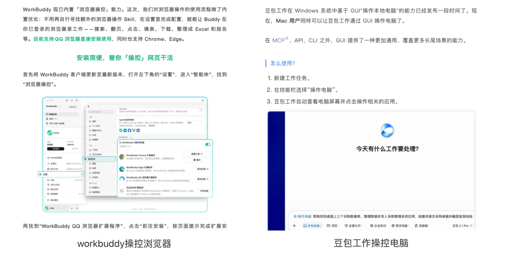
> Computer Use 的双主线：操作浏览器 + 操作桌面，交汇于 GUI 能力

## 模型家族与开源范围

| 模型 | 总参数 / 激活参数 | 架构 | 定位 |
|------|------------------|------|------|
| **NorthCUA-Nano** | 9B / 9B | Dense | 本地起步首选，带 Ultrafast 加速模块 |
| **NorthCUA-Mini** | 35B / 3B | MoE | 单机可跑的中间档 |
| **NorthCUA-Pro** | 397B / 17B | MoE | 旗舰，评测对标闭源/国内头部 |

三个尺寸**均基于 Qwen3.5 继续训练**得来。作者称其在 Computer Use 评测中超过国内一众模型（文中点名 DeepSeek-V4.1-Flash、Kimi-K3）——属**文章口径**，以 arXiv 论文原始表格为准。

> 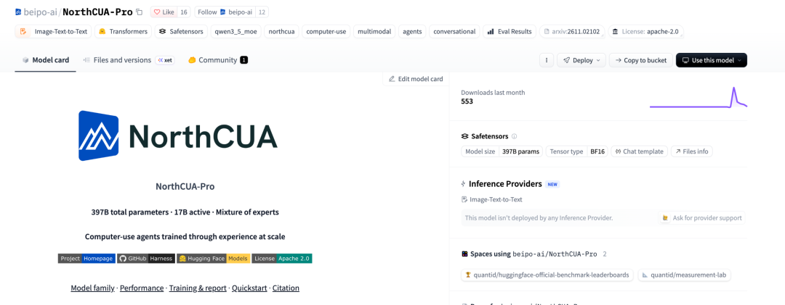
> NorthCUA 三个尺寸规格表（9B Dense / 35B-A3B / 397B-A17B，均基于 Qwen3.5 后训练）

**开源范围的边界（据 README，2026-11-05 实测）**：仓库 `beipo-ai/NorthCUA` 发布的是 **Desktop/Web Harness**；Experience Flywheel（经验飞轮）、数据生成、分阶段训练流程与模型权重是**独立的研究组件**，不在本仓库内。权重以 Apache-2.0 发布在 Hugging Face，但 README 明确声明："该 checkpoint 与本 Harness 分离，其推理与基准能力尚未被本仓库的集成测试接受。"

> 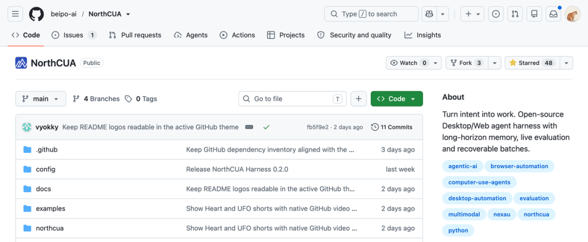
> Computer Use 评测对比（文章口径：NorthCUA 系列领先国内同级模型）

## 训练：三阶段

NorthCUA 真正下功夫的是**训练、数据和 Harness**。训练分三段：

1. **中期训练（Mid-training）**——超过 **10 万条轨迹**、**400 万+ GUI 操作步骤**数据，让模型先广泛接触桌面、网页、办公软件与各类视觉界面。
2. **长轨迹监督微调（Long-horizon SFT）**——从上述轨迹里筛出约 **3,000 条高质量长任务轨迹**及 **31 万个 GUI 交互步骤**，训练模型完成更连贯、更复杂的任务。
3. **强化学习（Joint Desktop-Web RL）**——约 **1,500 个桌面任务 + 500 个网页任务**，模型在**真实运行环境**里完成任务，由**验证器**判定结果，而不是只模仿"某一步鼠标该点哪里"。

> 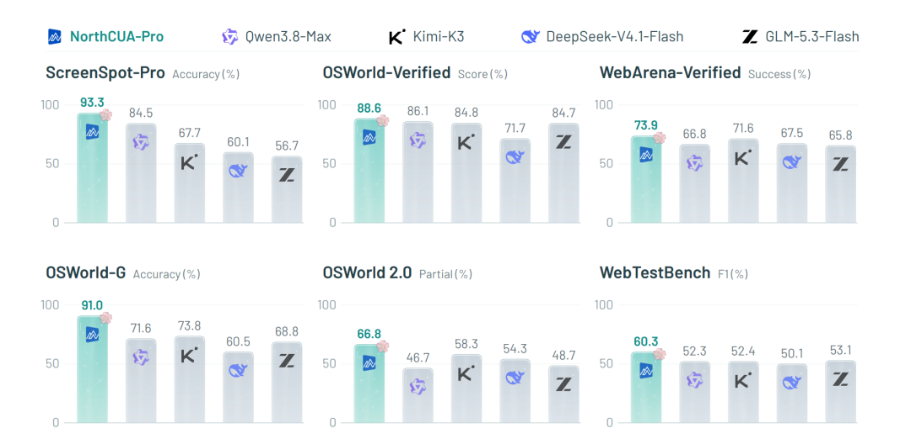
> 评测分档与训练数据规模示意（10 万轨迹 / 400 万 GUI 步 → 3000 长轨迹 / 31 万步 → RL 1500+500 任务）

## Harness：为什么模型训完还不能直接用

模型训练完不等于能稳定操作电脑。长任务里它需要**记住做过什么**、在**页面变化后重新理解状态**，还要处理**超时、弹窗、误点、上下文过长**。NorthCUA Harness 解决的正是这一层：

- 给桌面与网页提供**统一运行接口**；
- 传入视觉状态、**保存工作笔记**、**压缩过长历史**（task-preserving compaction）；
- 任务运行时**持续调用验证器**；
- 某一步失败后可从**批次和检查点恢复**，无需整条任务重来。

整个过程形成一套**数据运转飞轮**（文中称"有点 RSI 那意思"）。

> 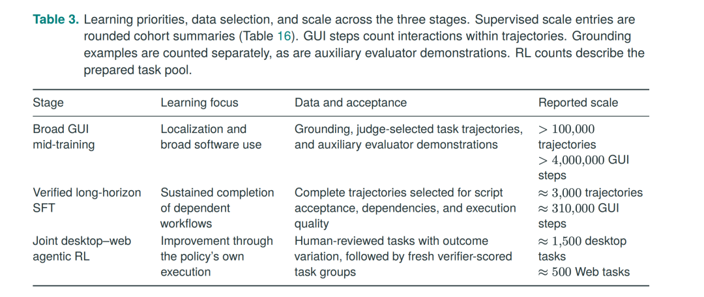
> 三阶段训练流程：中期训练 → 长轨迹 SFT → 真实环境强化学习

README 对 Harness 的四项承诺，与上面的叙述一一对应：

| 需求 | NorthCUA 提供 |
|------|--------------|
| 在桌面和网页上**动手** | 原生截图/鼠标/键盘工具，或浏览器截图 + DOM 引用 + 表单/标签页，共享 session 与 step 契约 |
| 长任务**不跑偏** | 有界的 overlay/clean 图像窗口、保留任务语义的压缩、持久化工作笔记，完整 trace 留在 prompt 历史之外 |
| **验证真实发生了什么** | 独立 evaluator 可在清理前检查产物与原始 live workspace；**actor 完成**与**评估结论**分离 |
| **批量可靠运行** | Controller/Device 执行、隔离 attempt、有界重试、持久批次状态、resume、outcome 记录、确认式清理 |

## Ultrafast：4.21M 参数的选择层

NorthCUA-Nano 里有个很有意思的模块——**Ultrafast**。受 JEV 启发，在 Nano 主体上增加了一个 **4.21M 参数的选择层**专门做快速决策：

- 当下一步动作来自**有限选项**（点击某按钮、选择某候选项）时，选择层**直接给出答案**——一次模型调用出 `CLICK / e42`；
- 遇到**填写文本、开放式推理、输出最终回答**时，交回原 LLM 逐 token 生成。

> 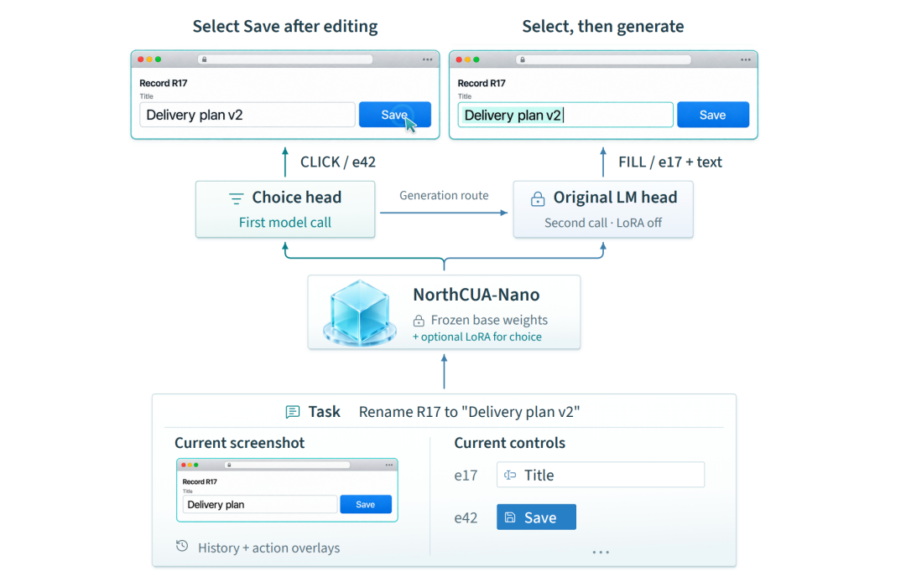
> Ultrafast 机制：选择层（Choice head）直接输出动作，生成路由交回原始 LM head 逐 token 生成

作者由此延伸出一个判断：**决策与生成本应融合在同一个模型里**。未来一个模型训完后，可以依据任务状态在"慢思考 / 快速选择 / 工具调用 / 文本生成"之间切换，而不是每加一种能力就再拼一个完整模块上去。README 对它的定位很克制：`NorthCUA-Ultrafast` 把直接动作选择与开放式生成配对在 pre-RL Nano 上，提供的是一个**可度量的质量-延迟权衡**。

## 实测表现（基于官方 Harness）

**整体评价：**

- 网页操作和**表格录入很丝滑**——抓 Issue、对参数、填飞书多维表格都没问题，可替人解决重复性电脑操作；
- **长流程极度依赖上下文记忆**——历史记录被裁剪后容易陷入"鬼打墙"，出现漏项或重复填表；
- **混合调度能砍掉大量生成步数**——397B + 9B 跑日常长任务很稳，部分任务耗时直接少一半以上；
- 能直接操作电脑玩游戏（推箱子、杀戮尖塔过首关）；
- 代码能力不错，3D 建模能做出有质感的微缩小物件，**大场景仍吃力**。

> 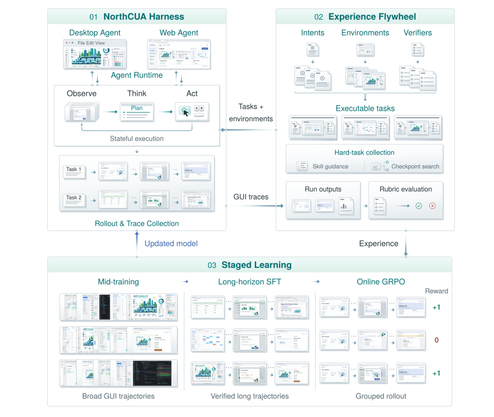
> 办公场景：网页内容整理与多维表格录入的完整动作链

### 场景一：GitHub Issue → 飞书多维表格

对自家开源的 WorkBuddy 蓝皮书仓库，要求"只抓 Open 状态的 Issue，把标题、状态、来源填进飞书多维表格"。NorthCUA **成功把全部 Open 问题登记进飞书**。

> 
> 抓 GitHub Open Issue 并录入飞书多维表格

> 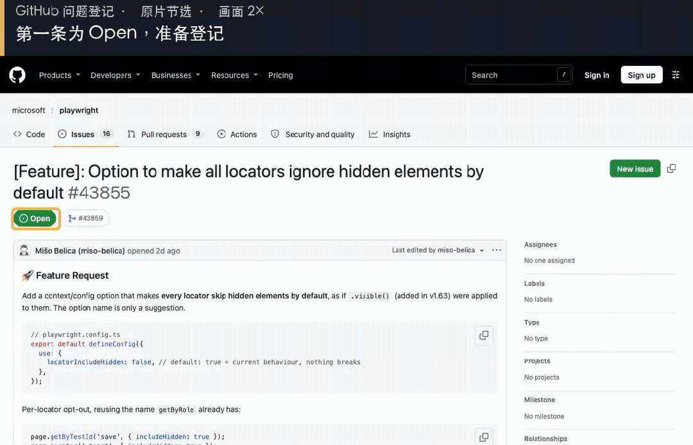
> 表格录入过程（网页操作 + 表单填写连续执行）

> 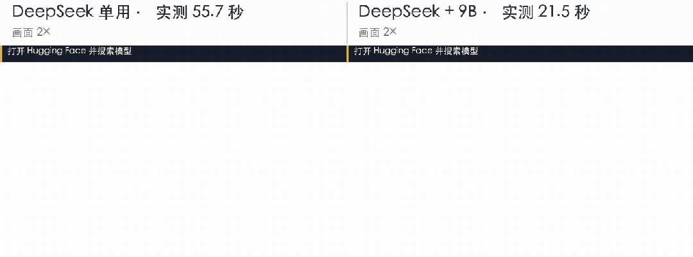
> 定位 Hugging Face 模型 config 并提取架构字段

### 场景二：每月开源模型资料整理

这是平时 Codex 帮作者干的活——让模型自己上网查 MiniCPM-V4.7 和 Clover 的架构细节，填进飞书。模型会翻到模型卡和 `config`，把 **MoE 架构和 35B 参数**准确提取出来。

> 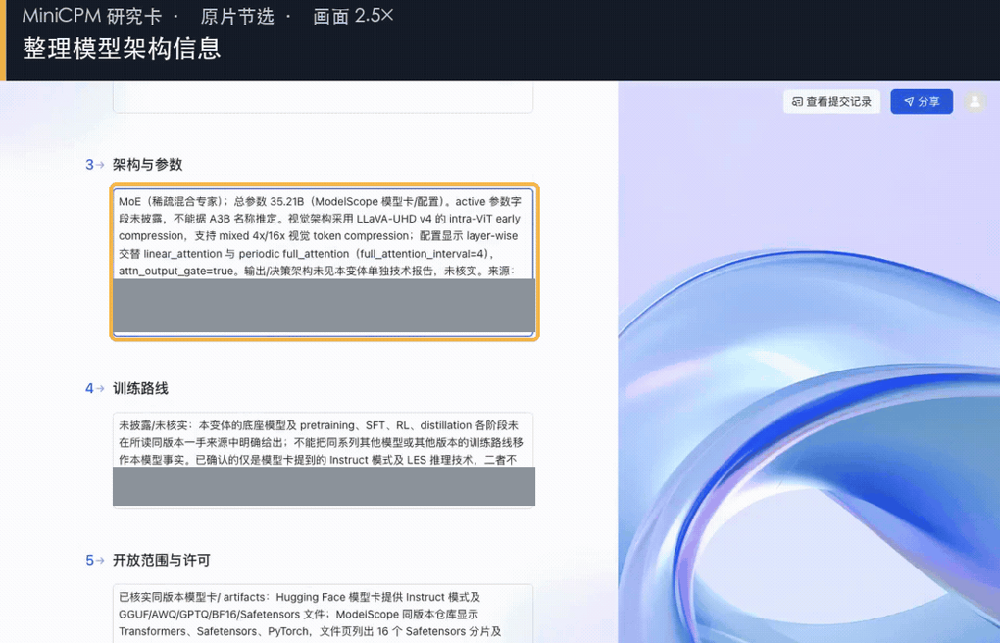
> 查 Hugging Face 模型卡与 config，提取架构参数后回填表格

### 场景三：Ultrafast 同题秒表对比

用同一个 DeepSeek 做生成器，对比"单用 vs 挂 NorthCUA-Nano Ultrafast 选择器"，任务是去 Hugging Face 定位模型原始 config：

| 方案 | 生成调用次数 | 耗时 |
|------|------------|------|
| 单用 DeepSeek | 8 次 | **55.7 秒** |
| + 9B Ultrafast 选择器 | **2 次** | **21.5 秒** |

提速很明显。但作者自己也留了一句：**动作选择确实能砍掉无谓的文字生成，实际整项任务用时有快有慢，不能一概而论**——单项操作的速度不等于端到端任务的吞吐。

> 
> 开源版杀戮尖塔：选卡与战斗接入，过第一关（视频约 01:00）

### 场景四：游戏（能力边界探测）

- 开源版杀戮尖塔：选卡、战斗都接上了，**顺利打过第一关**（视频约 01:00）。
- 斗地主小游戏：顺利过关领到奖励。
- **没跑通的**：小丑牌两轮都没打够 300 分，扫雷两局全踩雷。**稍微复杂一点的策略博弈，现在的 CUA 还是搞不定**。

> 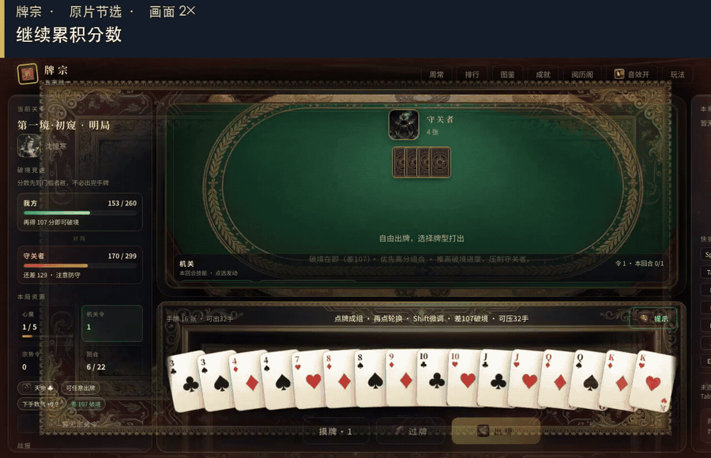
> 斗地主小游戏通关领奖励

> 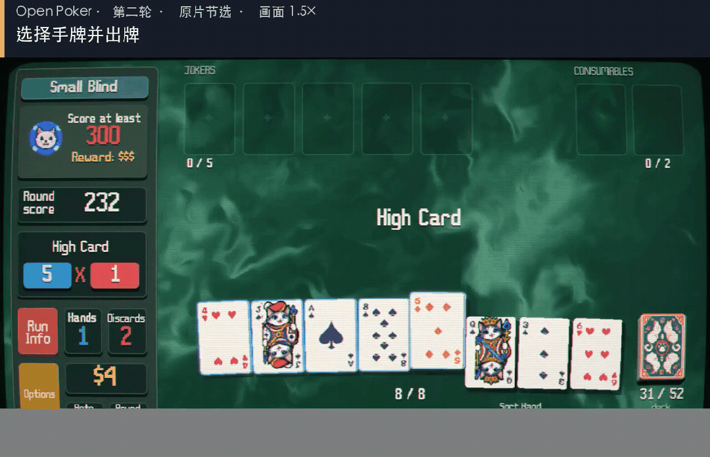
> 失败案例：小丑牌两轮未达 300 分、扫雷两局全踩雷

> 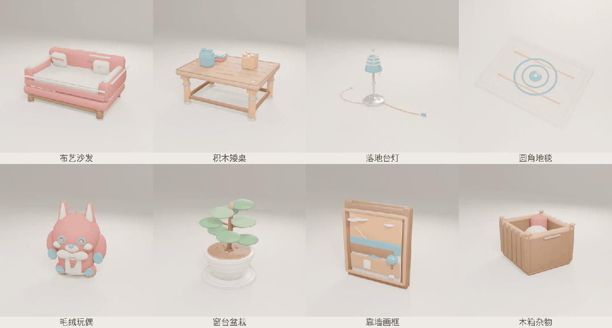
> Blender 场景渲染前的物件代码生成与装配

### 场景五：3D 建模（通用代码能力的旁证）

生成物件代码，自建流程装配后丢进 Blender 渲染：

- **微缩咖啡馆**很精致——咖啡机、杯碟和糕点整齐摆在绿色柜台上，有沙盘质感；
- **八件单体小物件**造型统一，放大看台灯电线和包边有小瑕疵，但整体效果好；
- 线轴裁缝铺、茶杯茶会效果都不错；
- **翻车**：这个书桌的窗框没焊牢，直接离地悬空散架。

> 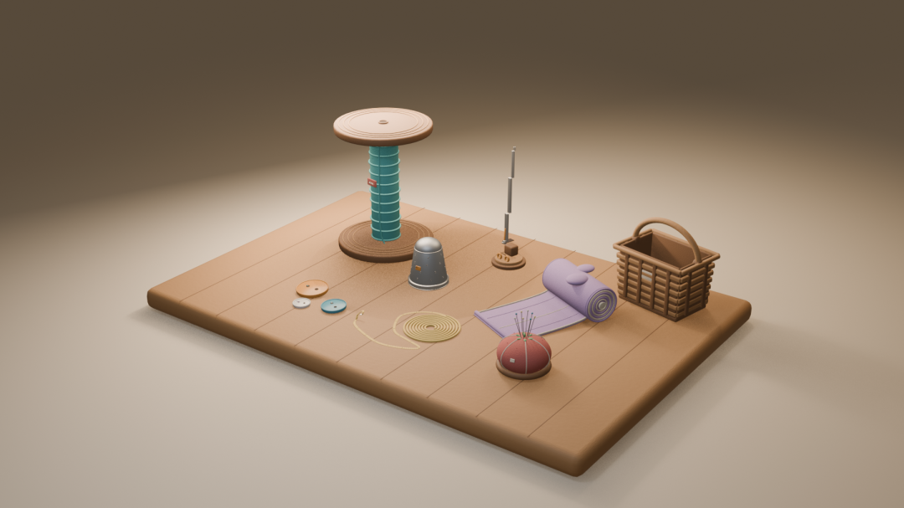
> Blender 渲染的微缩物件场景（造型统一，细节仍有瑕疵）

> 
> 翻车案例：书桌窗框未焊牢，模型离地悬空散架

> 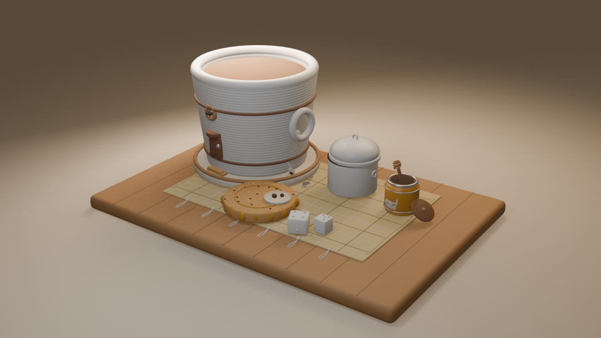
> 多场景 3D 产出对比（微缩咖啡馆 / 线轴裁缝铺 / 茶杯茶会）

> 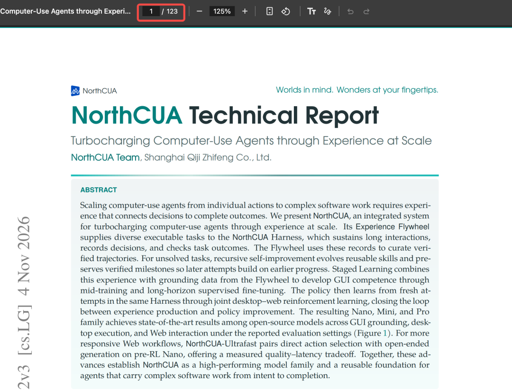> 
> 123 页技术报告（arXiv 2611.02102）：NorthCUA Technical Report — Turbocharging Computer-Use Agents through Experience at Scale

## 结论与上手路径

作者的核心判断：**NorthCUA 最值得关注的不是单个模型，而是"模型 + 数据构造 + 训练方法 + Harness"这一整套飞轮**。很少看到一个 123 页的 paper 里塞这么多东西。代码和模型都已开源，**建议先从 Nano 跑起来**，先把那些不想做的重复操作做完——"也许这才是 Work Agent 真正开始走向生产力工具的信号"。

### 实际安装方式（据 README，非文章内容）

```bash
git clone https://github.com/beipo-ai/NorthCUA.git
cd NorthCUA
uv sync --locked --python 3.12 --extra local --extra device
uv run --no-sync playwright install chromium
uv run --no-sync northcua --help
```

- **无需 API Key 的第一条结果**：`northcua demo serve --directory logs/tutorial` 起本地确定性模型端点，再用 `northcua local web run ... --evaluate` 跑一条真实浏览器任务，看 `evaluation_report.overall_verdict`。这一条**验的是集成链路，不是模型能力**。
- **接自有模型**：需要支持图像输入 + 结构化 tool call（Chat / Responses / Anthropic / Gemini 都有配置路径）。对输出 **0–1000 相对坐标**的模型（含 NorthCUA 家族），要先把 `desktop.coordinate_policy.input_space` 设为 `normalized_1000`，默认是 `image_pixels`。
- **给编码 Agent 用**：仓库自带 `skills/northcua/SKILL.md`（operator skill），把安装、模型设置、任务、证据、批跑、恢复都串起来。

---

## 战略分析

**一、这篇文章的价值不在"又一个 CUA 模型"，而在把 CUA 工程化的四个真实卡点讲清楚了。**

卡点一：**训练数据必须是可验证的轨迹，而不是演示视频**。10 万轨迹 / 400 万步的中期训练是"广度"，3000 条长轨迹 / 31 万步的 SFT 是"连贯性"，1500+500 个真实环境 RL 任务是"能不能验收"。这三段的划分本身就是一个可复用的配方——**广度打底、长轨迹修形、验证器定标准**。这跟知识库已有的 Harness 系列文章（PluginRSI 的单变量改进 + 均衡回测样本、美团/中科大的插件化自进化）是同一套思路在不同层面的实例化：**没有验证器，就没有后训练**。

卡点二：**Harness 不是胶水，是长任务能否成立的前提**。文中列的那串"记住做过什么 / 页面变化后重新理解状态 / 超时弹窗误点 / 上下文过长"，正是所有 GUI Agent demo 到生产之间那道墙。NorthCUA 的四个解法（工作笔记、有界图像窗口、task-preserving 压缩、checkpoint 恢复）里，**最该抄的是"压缩要保任务语义"和"actor 完成 ≠ 评估通过"**。后者的意思是：模型自己说"我做完了"不算数，独立 evaluator 必须能在清理前回看原始 workspace——这直接对应本知识库 `2026-11-04-我们是如何给客服Agent做评测` 里那条结论"综合指标全涨的版本也可能必须禁止发布"。

卡点三：**延迟优化的路径不是"更大的模型更快"，而是"把有限的选项从 token 生成里拿出来"**。4.21M 参数的选择层做点击/选择这类封闭动作，比 397B 逐 token 生成在 HFF 定位类任务上快 2.6 倍（55.7s → 21.5s，8 次生成 → 2 次）。这个思路对本机栈的启发很直接：Hermes 的工具调用里有大量**封闭选项决策**（选哪个 skill、选哪个文件、选哪个渠道），完全同一个模式。作者自己也不夸大——"整项任务用时有快有慢"。

卡点四：**开源的边界要说清楚**。放出来的是 Harness + 权重；飞轮、数据生成、训练流程是"独立研究组件"。所以**能跑起来、不能完整复现**。这不是缺点，是必须提前知道的预期管理。

**二、与本机栈的对照**

| 维度 | NorthCUA | 当前体系（Hermes + TencentDB + Obsidian） |
|------|----------|------------------------------------------|
| 定位 | 端到端的 Desktop/Web Computer Use 系统 | 面向文本/文件/API 的个人助理 + 知识管理 |
| 感知通道 | 截图 + DOM 引用 + 可访问性，双通道统一契约 | 浏览器 CDP/JS 注入、终端、文件读写；**桌面像素通道基本空白** |
| 记忆 | 工作笔记 + 压缩 + 完整 trace 外置 | TencentDB 四层记忆（L0→L3）+ session history |
| 验证 | 独立 evaluator，运行中持续判定 | **无自动验证层**，靠人读产出 |
| 批跑/恢复 | Controller/Device、隔离 attempt、持久批次、resume | 单会话交互为主，cron 任务无断点恢复 |
| 技能生态 | 自带 operator SKILL.md | skill 库（同类形态，可互译） |
| 模型 | 自训 Qwen3.5 三档，可本地部署 | 走 API（DeepSeek 等），无本地 CUA 权重 |
| 开源边界 | Harness + 权重 Apache-2.0；飞轮/训练流程不开 | — |

差距归成三条：**(1) 缺视觉感知层**——Hermes 的浏览器能力很强，但"操作任意桌面软件"是没有的，本机已有 `computer-use` / `macos-computer-use` 两类 skill 走的是截图 + 坐标点击，缺的是长任务的状态管理与验证；**(2) 缺评估闭环**——所有归档、所有自动化跑的产出，目前没有独立 evaluator 回看"真实发生了什么"；**(3) 缺断点恢复**——长任务中断即重来。

**三、可借鉴的落地动作（按性价比排序）**

1. **先借"验证器与 actor 分离"这一条，不动代码。** 归档流程的 quality gates（`references/archive-quality-gates.md`）本质就是一个独立 evaluator——继续把它当作硬门，而不是事后检查。同理，任何"Agent 说完成了"的外部副作用（上传、发帖、写远端）必须以**回读目标**为准，这在 Hermes 的 `external_state_verification` 里已经写明，NorthCUA 提供了同行验证。
2. **借"封闭选项选择层"的思路优化工具调度。** 不必训 4.21M 小层，但可以把高频封闭决策（选 skill、选文件、选渠道）做成确定性映射表而不是每次让 LLM 生成，直接砍 token 与延迟。
3. **借 Harness 的"任务笔记 + 保语义压缩 + checkpoint"补长任务可靠性。** 本机已有 `cognition-ledger`（长任务认知账本）与长归档的 `/tmp/kb_progress.json` 断点续跑模式，说明这块已经在自发演进；NorthCUA 的贡献是给了它一个经过 123 页报告论证的正式形态。
4. **不建议现在装。** 实测仓库热度：`beipo-ai/NorthCUA` **66⭐ / 3 fork**，2026-11-02 建库，11-05 还在提交——**发布 4 天、非常早期**。配套还有依赖风险（固定版本 NexAU 要求 Transformers 4.x，上游有已知 advisory）。想试的话先跑 README 的 no-key tutorial 验链路，别直接接生产任务。

**四、与已有归档的定位关系**

- `2026-08-09-桌面自动化探究-AI-GUI-Agent四项目对比`（Browser Use / UI-TARS Desktop / OmniParser / cua）——那篇讲的是**分层原理**（感知/解析/推理/操作/反馈），NorthCUA 是**这五层全部自己做**的一条纵向整合路线，且额外补了"长任务状态管理 + 评估"这一层，是原理篇的工程化落地。
- `2026-07-03-GUI-Agent全景`（Page Agent / browser-use / Stagehand / Skyvern）——那篇是**浏览器内**的五条技术路线；NorthCUA 的 Web 侧能力与它们重叠，但差异化在**桌面 + 浏览器共用一个 session/step 契约**，以及桌面原生工具。
- 与 Harness 系列（PluginRSI、MOVO、Prime-Agent、Raven）的关系：NorthCUA 把"Harness"这个词从**文本/工具的编排层**扩展到了**GUI 动作的运行层**，可以视作 Harness 概念的一个新分支。

## 归档日志
- 2026-11-06 归档（微信公众号 · 刘聪NLP）。正文经浏览器 `#js_content` 提取，图片 19 张下载至 `assets/2026-11-06-NorthCUA/`（含封面图与被裁掉的视频播放器碎片，未保留索引 4/8 两张小于 300px 的图标）。
- 仓库数据（66⭐ / 3 fork / Apache-2.0 / 2026-11-02 建库）于 2026-11-06 通过 GitHub API 实测，非文章口径。
- 评测分数（超过 DeepSeek-V4.1-Flash、Kimi-K3）与三阶段训练数据量（10 万轨迹 / 400 万步 / 3000 长轨迹 / 31 万步 / 1500+500 RL 任务）为**文章口径**，未逐项核对 arXiv 原文表格。
- README 补充了安装命令、`normalized_1000` 坐标策略、operator SKILL.md 与"权重未被集成测试接受"的声明——这部分文章未提。
