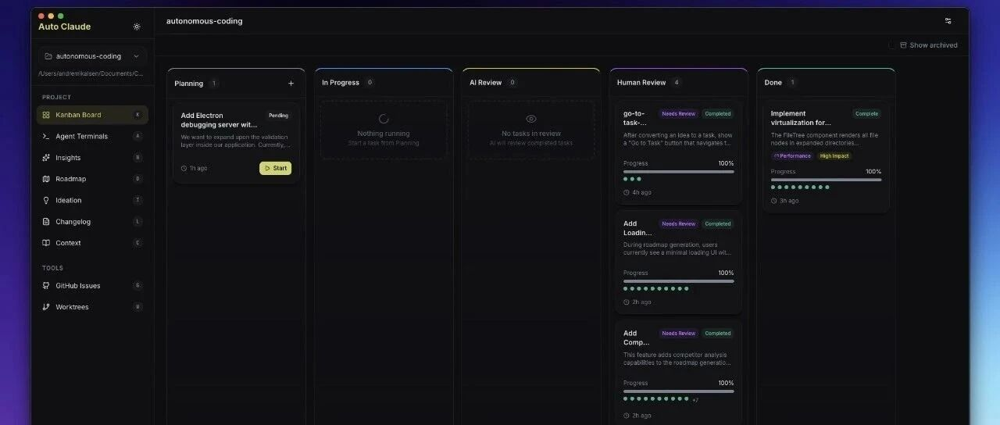

# 一个人顶一个团队：Claude Code + Aperant = 一支自动干活的开发小队

> 原文：Java基基 · 2026-11-10
> 仓库：[AndyMik90/Aperant](https://github.com/AndyMik90/Aperant) · AGPL-3.0

## 概述

Claude Code 好用，但它是**单线程**的：你说 → 它做 → 你看 → 你再说。项目一大，或想同时推进几件事，等待时间就把节奏切碎了。

**Aperant**（原名 Auto-Claude，现稳定版 2.7.6，仓库同时维护一条 beta 分支）就是来解决这个的。改名原因不难猜：Auto-Claude 那套命名容易被误以为是官方项目，换成 Aperant 后定位清楚了——**它不是 Claude 的替代品，是套在 Claude Code 外面的一层指挥系统**。

它的价值主张不是加快 Claude Code 的手速，而是**把「等」这件事从你的日程里删掉**。

> **归档日实测（2026-11-10）**：`AndyMik90/Aperant` **14,601 ⭐** / 1,890 fork / **AGPL-3.0** / TypeScript / **2025-12-04 建库**（近一年） / 最后推送 2026-06-14。
> 文章口径「一万四千多 Star / AGPL-3.0」与实测一致 ✅



## 一、拆的是「一次只能跑一件事」这道墙

Aperant 的做法：在界面上建一个任务，用自然语言说清想要什么，它把任务拆开，派给多个 Agent 执行。**最多同时开 12 个 Agent 终端并行**。

这 12 个不是摆设——每一个都是真的在跑 Claude Code 的终端，处理不同的子任务：一个写业务逻辑，一个跑测试，一个补文档，互不干扰。

作者的理解：**把「串行等待」换成了「并行排队」。** 要做的判断没变少，但等待被摊薄了。

更实际的变化是节奏。以前一个任务跑十分钟，这十分钟只能盯着或走开；现在同时有三件事在跑，可以在等的时候处理另一件事的验收，注意力不再被单点锁住。

## 二、看板让「AI 在干什么」可见

打开 Aperant，第一眼是一个 **Kanban 看板**。任务按四阶段流转：

```
规划 → 执行中 → AI 审查 → 人工审查
```

四个阶段对应四种状态，颜色区分，卡住了在哪一格一目了然。这个设计解决的是**黑盒感**——大部分 AI 编程工具的问题是，输出出来之前你完全不知道它在干什么。

### 「AI 审查」这一步值得单说

代码写完不直接丢给你，**先过一个专门的 QA Agent，它对着原始需求逐条核对，不通过就打回去重做**。

这一层其实在替代人的第一遍粗筛。作者见过的 AI 编程流程里，**返工最大的成本不是改代码，是改完之后发现需求理解错了**。让一个独立 Agent 拿原始需求对一遍，能把这个错误提前拦下来。

> **关键细节：QA Agent 对照的是「原始需求」，不是它自己刚写的代码。** 这个细节决定了它是真审查，不是自我背书。

最后还是留了**人工审查**这道关。自动化不等于零监督，尤其第一次跑不熟的项目。

## 三、并行改同一个仓库，靠什么保证安全

多个 Agent 同时改一个代码库，听着就容易出事。Aperant 的安全模型是**三层叠加**：

| 层 | 机制 | 防什么 |
|----|------|--------|
| 1. 文件隔离 | **git worktree** — 同一仓库维护多个工作目录，每个目录挂独立分支，每个 Agent 在自己的 worktree 里改 | 互相覆盖 |
| 2. 系统沙盒 | 操作系统级别的沙盒，Bash 命令在隔离环境执行 | 乱执行系统命令 |
| 3. 命令白名单 | 动态白名单，按检测到的项目技术栈只放行必要命令 | 越权操作 |

**这三层缺一层都不成立，光 worktree 只能防覆盖，防不了删库。**

作者也留了诚实的提醒：**worktree 不是系统沙箱**，误操作、外部服务和合并问题仍要单独防范。

## 四、上下文注入与集成

### 终端里能把上下文直接灌进去

终端界面支持**一键注入任务上下文**：开一个新 Agent，直接把当前任务的背景灌进去，不用重新描述一遍需求。

这个细节在实际使用里很重要——**Claude Code 本身无状态**，每开一个新 session 都要从头说，说到第五遍的时候人是会烦的。Aperant 用一层**跨 session 记忆**把这事接住了。

> 所以它卖的不只是并行，还有「不用重复交代背景」。后者省的是心气，比省时间更影响你愿不愿意一直用。

### 三方集成

- **GitHub / GitLab** — 从 Issue 导入任务，AI 分析后生成合并请求。价值在入口：以前是把 Issue 看成一段文字自己翻译成任务描述，现在直接导进来，少一次人工转录，也少一次理解偏差。
- **Linear** — 同步任务状态，给已经在用它的团队准备的，进度不用手动同步。

### 四个偏「想」的功能

| 功能 | 作用 |
|------|------|
| **Roadmap** | 产品规划：告诉它方向，帮你梳理路线图，顺带做竞品分析和受众定位 |
| **Ideation** | 给代码库做体检：找性能问题、安全漏洞、可改进处 |
| **Insights** | 聊天界面，专门问关于代码库的问题。**不改进代码，只帮你理解代码**，接手旧项目时好用 |
| **Changelog** | 按看板上已完成的任务自动生成发布记录 |

这四个单看都不算核心，但凑在一起，**把「项目里除写代码之外的那些活」接走了一部分**——一个人顶一个团队的体感，很大程度来自这里。

## 五、安装前提与代价

### 三样必备

1. **Claude Pro 或 Max 订阅**（免费版不够用）
2. 装好 **Claude Code CLI**
3. 项目必须是 **git 仓库**

三样齐了，去 GitHub Releases 下对应平台客户端，走一遍 **OAuth 授权**就能建任务。Windows、macOS（Intel + Apple Silicon）、Linux（AppImage / deb / Flatpak）全覆盖。

> OAuth 和 CLI 配置对新手有点绕，**不是下载完直接用的工具**。对命令行熟的人不难，但别指望十分钟上手。

### 成本要提前算清楚

- **并行跑 12 个 Agent，token 消耗是按倍数走的**，Claude Max 的用量限制在高强度使用下会撞到。这不是隐藏费用，是并行本身的代价。
- **实际舒服的区间是同时开 3–5 个**。12 个是上限，真开到 12 个，你会发现**自己的审查速度成了新瓶颈**。
- **AGPL-3.0**：自己用免费；改了再分发、或拿它提供服务，你的代码也得开源；商业闭源要单独谈授权。

## 六、适合谁

- ✅ **已经在用 Claude Code 做真实项目、觉得单 session 效率不够的人** — 最合适
- ⚠️ 偶尔写个小脚本的 — 配置成本不划算，装它的时间够你把脚本写完两遍
- ✅ 想探索「从执行者变成指挥者」这个方向的 — 它是个很具体的样本。把任务拆解、分派、审查这套流程固化下来，人只负责定方向和最后拍板

## 战略分析

### 这篇补的是你栈里「并行」这一格

| 维度 | Aperant | 你的现状（Hermes） | 差距判断 |
|------|---------|-------------------|----------|
| 并行执行 | 最多 12 个 Claude Code 终端，每个真终端 | `delegate_task` 最多 10 个并行子代理 | **形态不同**：Hermes 是进程内子代理，Aperant 是独立终端 + worktree。子代理共享不了文件隔离 |
| 文件隔离 | **git worktree** 一任务一目录一分支 | 无（子代理共享同一工作区） | **这是真缺口**。多子代理改同一仓库会互相踩 |
| 过程可见性 | Kanban 四阶段实时流转 | 无统一看板，靠日志/transcript | 中等缺口，但你的量级未必需要看板 |
| 审查环节 | **独立 QA Agent 对原始需求逐条核** | 靠 skill 里的代码审查流程（`requesting-code-review`） | 理念已有，**「对原始需求而非对代码」这个细节值得抄** |
| 跨 session 记忆 | 一键注入上下文 | memory + skill，但每轮仍要重建上下文 | 你有 memory 层，这块比它强 |
| 集成入口 | GitHub/GitLab Issue → PR | `gh` CLI 全流程 | 对等 |

### 值得直接拿走的三个点

1. **「QA Agent 对照原始需求，不对照自己刚写的代码」** — 这条能直接搬进 `requesting-code-review` 这个 skill。现在的审查流程是审 diff，容易被「代码看起来对」带过去；对照原始需求逐条核，才能拦住「需求理解错了」这类返工成本最高的错误。**零成本，改 prompt 就行。**

2. **git worktree 一任务一目录** — 你的知识库归档文章已经在用这个模式（`2026-10-22-一个任务一个worktree-Orca多Agent并行`）。如果你哪天要跑多个 coding 子代理改同一个仓库，这是唯一能防覆盖的低成本方案，不需要 Aperant 这个壳。

3. **「12 个是上限，真开 12 个你的审查速度成了新瓶颈」** — 这句话是反向指标。**并行的真实瓶颈不是机器，是你的验收带宽。** 这和卡兹克那篇「人的注意力是最宝贵的资产」是同一个结论从两个方向逼近。

### ⚠️ 泼冷水

- **AGPL-3.0 是硬约束**：任何「拿它提供服务」的场景都会传染你的代码。个人用没问题，一旦产品化就得换方案或谈授权。
- **最后推送 2026-06-14**（距归档近 5 个月）。文章说「稳定版 2.7.6 且同时维护 beta」，但仓库活跃度需要你自己再确认一次——同期 Aperant 相关仓库里冒出好几个 fork（`krzemienski/aperant-tui` 等），主仓静默期通常意味着维护重心在转移。
- **它绑死 Claude Code**。你的栈是 Hermes 为主，引它进来等于多养一套并行系统 + 一份 Claude 订阅。**判断：不值得整机引入，值得抄它的两个设计（QA 对需求、worktree 隔离）。**

## 关联阅读

- [[技能文档/2026-10-22-一个任务一个worktree-Orca多Agent并行10万星]] — 同一套「一任务一 worktree」思路的主流实现，Orca 10 万星。对比看：Orca 强在状态归一化和跨端，Aperant 强在 Kanban 阶段流转和 QA 关卡。
- [[技能文档/2026-06-14-Polynoia开源-微信群聊指挥多AIAgent并行干活]] — 另一条多 Agent 并行路线：IM 风格 + DAG 自动拆任务。
- [[技能文档/2026-11-02-卡兹克Agent自动化系统全景]] — 同一命题的另一面：不拆并行，而是把「事件的起点」从人身上拿掉。

## 归档日志

- 2026-11-10 归档
- 抽取方式：浏览器 `#js_content` innerText（4,502 字）；封面图 1 张下载成功（51KB jpg）。正文无内嵌图片，其余为公众号推广位（芋道 ruoyi-vue-pro / yudao-cloud 广告 + 知识星球二维码），已按 content-cleaning 规则全部剥离，保留正文起于「把任务分开跑，把验收留在人手里」这句题记。
- **事实核对（归档日实测 GitHub API）**：`AndyMik90/Aperant` **14,601 ⭐** / 1,890 fork / **AGPL-3.0** / TypeScript / **建库 2025-12-04** / 最后推送 2026-06-14。与文章口径「一万四千多 Star、AGPL-3.0」一致。
- 顺手核对文章里推的自家项目：`YunaiV/ruoyi-vue-pro` 实测 40,330 ⭐ / MIT / Java（文章称「国产 Star 破 10w」= 声称的是整个微服务矩阵合计，非单仓，勿误读）。
- 文章口径未核实：稳定版号 2.7.6、beta 分支同时维护、12 Agent 上限的具体实现限制。
