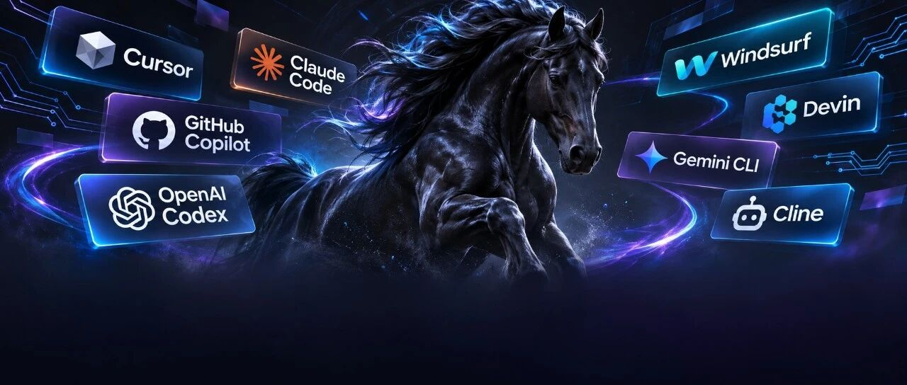
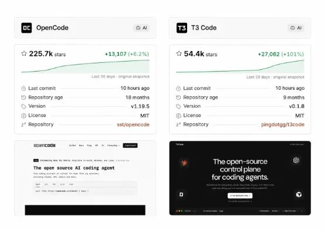
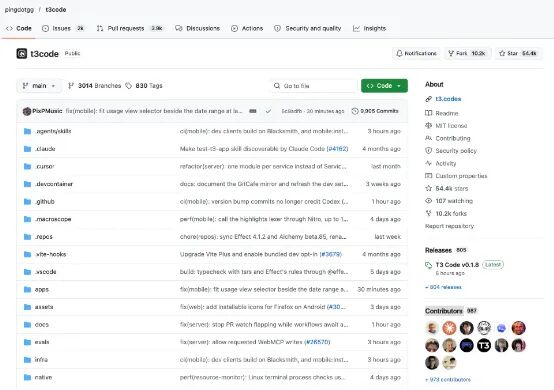
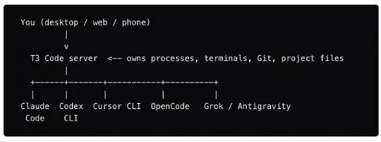

# Codex、Claude Code 都卷完了，居然还能跑出黑马？

> **作者**：InfoQ（编译 宇琪 / 策划 Tina）｜**发布**：2026-11-10 15:45
> **原访谈**：Theo Browne × Joel Hooks 播客（[YouTube](https://www.youtube.com/watch?v=2iu5u3sUukc)）
> **一句话**：过去要专门开发的功能，甚至整个产品，现在可能只是一个 Markdown 文件加一个 cron。

---

## 太长不看版

**T3 Code 是什么？**
一个开源 agent 编程界面，把 Codex、Claude Code、Cursor 等 Harness 统一包起来。终端里跑一个 websocket 服务，桌面端 / 网页 / 手机都能远程连接，甚至能在一台电脑上操作另一台上的线程。

**但它不是给普通开发者用的。** Theo 明说：我想服务的是资深工程师的安全区——大公司里周围没人在意的资深工程师，或者学校里已远超同伴甚至超过老师的年轻开发者。他们想深入、想痴迷，但身边没有同类。**我不会为了扩大受众降低门槛。**

**Plan Mode 死了吗？** 不是被抛弃，是被**吸收进模型本身**了。当年存在的理由是模型太笨、需要靠"限制能力 + 改写系统提示词"约束它别乱改；现在模型聪明到不会在你们还没聊完时就抢先动手。大家用"拷问（grill me）"式追问，本质上就是在做计划。

**skills 还有未来吗？** 有，但**形态会变**。可复用流程有价值，团队把规则写进共享 Markdown 很合理，但它依赖 AGENTS.md 等其他文件，两个人跑同一个 skill 也可能因全局文件或模型不同而行为不同。以后这些流程**可能变成云端服务**：团队任何人点一下，就在不干扰本机 agent 上下文的情况下拿到报告。

**为什么坚决劝人别做独立创始人？** 极少数成功，几乎所有人都变得非常抑郁。Theo 只当了约三个月独立创始人，回想那段窗口期还会觉得有压力。

**大多数人用 AI 的方式错在哪？** 他们不是在用 AI 自动化自己理解的东西，而是在用 AI **逃避建立那份理解**。正确路径是先在某件事上变得足够好，知道它怎么成功、怎么失败，再带着这份标准把 AI 引进来。**自动化掉你所热爱之事里那些你不喜欢的部分。**

---

## 一、项目全景：三个兼职的人 vs 万亿美元公司

T3 Code 的 **Orchestrator V2** 最近上线并进入稳定版——这套做了大约半年的多模型、多 Harness 编排能力终于跑顺了。从一个早期体验欠佳的开源替代品，到如今用户数超过 70 万，它在已经成熟的编程 Agent 赛道里跑成了黑马。

为什么值得关注？因为它**始终在深耕编程这件事**，尤其在别家都往另一个方向走的时候。ChatGPT 恨不得把 Dots、Spaces 和插件全塞到你眼前，Claude Code 在往通用办公方向扩。**T3 Code 的核心就是编程，它是工程师为工程师做的工具。**

> 归档日实测（GitHub API）：**54,652 ⭐ / 10,231 fork / MIT / TypeScript / 2026-02-08 建库 / 最后推送 2026-11-10**（活跃）

**贡献者 987 人，5.44 万 Star，1.02 万 Fork，MIT 协议。** 做出这个开源项目的是**三个兼职的人**，对面则是市值过万亿美元、拥有成千上万名工程师的公司。它本身不靠卖 AI 服务赚钱，模型订阅要用户自己准备，但运营这个开源项目其实挺贵。

### 兼容性：把你在用的模型、Harness 和订阅接到一起

一直支持 Claude Code 和 Codex，最近又把几乎所有其他选项都补上了——**Codex、Claude、Cursor、Grok、OpenCode、Antigravity、Muse Code、Pi** 都是直接内置的。想用其他兼容 ACP 的 Harness，也接入了整个 **ACP Registry**，Amp、Cline、Copilot 等都可以从里面添加，还可以手动配置。

### 远程环境管理：明显领先的地方

可以在一个远程环境里启动任务，再让**子 Agent 到另一个已连接的远程环境里执行子任务**——至少在一些其他头部模型厂商的桌面应用里，还没见到这种支持。

> 如果高度依赖远程环境，T3 Code 是目前用过最好的工具；如果工作流高度依赖多个 Agent（一个模型做调研、另一个实现、再一个审查代码），它同样是最好的方案。

**架构上，所有操作都走自己的 WebSocket 服务器**，而不是直接往终端发命令或靠奇怪的 Electron 调用建立连接。

一个同时订阅 Codex、Claude、Cursor 甚至 Antigravity、写代码量极大的深度用户给的判断是：**T3 Code 尤其适合同时用多个模型的人。** 单从写代码角度，头部模型厂商桌面应用能提供的功能它基本都有，使用体验和实际表现都达到了**原厂桌面编程应用的水平**。

---

## 二、用滑板术语"面试"新模型

Theo 玩了一辈子滑板，这段经历给了他一套衡量模型能力的指标——**Skatebench**：通过物理特征描述一个滑板动作（板往哪走、人往哪走、绕哪个轴转、转多少度），把正在发生的事完整描述出来。真正有意思的是，模型**既要能推理三维动作，也要懂滑板语法**，才能把术语正确组合和化简。

**成绩**：多数前沿模型在 82%–88% 之间，**只有一个到了 95 —— Gemini 3.1 Pro**。Theo 认为 Google 在这里有很大优势：3D 推理高于平均，多语言和本地化能力又强。Fable 这类模型在同一榜单上只有 70 多到 80 出头。

### 他的新模型测试法（值得抄）

1. **看模型定位**。像 ox alpha 在 OpenRouter stealth launch 那次，产品说明写得很清楚只做编程和 agent 任务，就不交给 Skatebench。
2. **直接放进日常工作流**。先在 Harness 里把它配好，**再让它去别的 Harness 里配置自己**。
3. **让它用现有工具分析我的代码库，然后追问**：为什么选这个工具、为什么引入这个 skill、怎么看这个代码库的架构、有没有拿到做改动所需的条件。这一轮既能看出它如何理解自己的能力和边界，**也能反过来得到关于我自己系统设置的反馈**。
4. **承担真实工作，难度逐步提高**：从"修这个区域的 bug"一直到"我有这个六年没迁移、没更新的应用，把它在另一套完全不同的技术栈上重建一遍"。

> "这听起来像招人，或者合同工转正。"
> "更像一场**理想中的面试**。理想情况下，每面完一个候选人，团队都应该交流一次：这个人走到哪一步了，接下来该往哪个方向问。"

**对模型和对人是同一个思路**：我能信任它有多资深，它能走多远，需要给它多长的绳子，给了绳子之后还能信任多少。

---

## 三、拥有自己的技术栈

> **你很难真正控制和高效使用自己不理解的东西。**

Theo 的做事方式：喜欢折腾，不只看一个东西内部怎么运作，也看**做出这个东西的人怎么工作**。会深挖这个人或团队：是什么让他们做出它，什么启发了他们，什么问题把他们逼到非做不可，他们接下来要往哪走。**如果我和做东西的人不对齐，长期也不可能和这个东西本身保持对齐。**

### 为什么必须选开源

> 不只是因为免费或者可以自由使用，而是因为开源本身允许你折腾、贡献和理解。**不开源的软件，从根上就更不可能和我的利益一致。** 哪怕我一行代码都不贡献、一眼源码都不看，只要它不开源，创造者和我在某些需求上分道扬镳的概率就明显更高；如果它开源而分歧还是发生了，**至少我还能把方向纠正回来**。

**T3 stack 就是把这套逻辑落地的结果**：把一组信任的开源小工具按 Unix 风格组装起来，不是把每个工具都改到极致，而是让它们组合成一个能解决真实问题的整体。

现在这套思路又原样交给了 agent。Theo 花了多年让全栈 TypeScript 应用在两端互相感知：**改一个数据库字段名，消费这份数据的客户端组件立刻报错，整条链路类型安全。现在 agent 从终端获得反馈，而终端背后正是这套维护了多年的系统。**

### 关于受众：不降低门槛

评论区有人抱怨"每两周一个新模型，改一个配置字符串就得重学一遍"。Theo 的回应：**我不太在意这类人**。他们人数够多，也在帮忙养活我们做的事，但我在乎的是那种想学、想成长、想聊到伴侣都觉得烦的工程师。

**他的受众两极**：一边是微软的 VP（说得多了、写得少了，需要知道 AI 领域在发生什么），另一边是 17 岁的开发者（同龄人都不在意，他为了热爱继续写）。品牌想同时触达这两种人——年轻开发者先接受一项技术，两年后带着它进公司，而公司里签字的 VP 又恰好听过同一套内容。**两端一夹，品牌愿意付更高的价格。**

> 如果我为了扩大受众去做自己不想做的事，每个观众的价值反而会被稀释。所以我不必把内容做笨，也能养活团队，**这相当于十倍的受众**。

---

## 四、T3 Code 为什么存在

起点很具体：**Julius（主要工程师）和 Theo 都很喜欢 Codex 桌面应用**。Julius 是 Theo 认识的最厉害的开发者，但他**偏偏不是终端派**——写的代码比谁都多，却至少有一半通过 VS Code 里的 git 面板完成，连 git 都不肯用命令行。**他是 GUI 派，Theo 是 TUI 派。**

两人对性能回退和结构变化都极敏感：**一旦进入心流，原本在某个位置的东西突然被挪走，就会非常烦躁**。而 Codex 的 CLI 和 AppServer 都开源，**桌面应用却不开源**——所以它出现不喜欢的变化时，他们什么也做不了。

### 折腾的路径（失败记录同样有价值）

1. 先做原生桌面应用，想把 agent 编程性能做到极致 → **没达到预期，放弃**
2. 把市面上所有 Harness 管理工具逐一试用：**cmux**（至今每天用，侧边栏 + 标签页管理终端）、**Conductor**（闭源桌面应用，管理本机 Claude Code 和 Codex）→ 要么不够优雅，要么不能自由修改
3. 最后勉强再试一次，**用 Electron 重做**

> 我知道一提到 Electron 就会引来大量批评，但它在长文本、滚动、代码、图表和图片的动态渲染上性能合适，而 Google 在 Chromium 生态上投入的数十亿美元，让跨平台体验有了一个很好的起点。

### 架构与它解决的恐惧

**终端里跑 websocket 服务器，绑定本机各种 Harness**；桌面端、app.t3.codes 网页端、iOS 和 Android 都能连进来。React Native 版本已开源上架，SwiftUI 重写版在 TestFlight 也开源。Theo 把自己所有电脑都放进 **Tailscale** 网络，可以从一台机器连另一台上的线程。

> 我手边这台笔记本上运行着一批线程，但没有一个跑在这台机器上，合上盖子再打开，它们还在，因为工作都在另一台算力很强的机器上。

**解决的几个具体恐惧**：
- 不用再担心每开一个线程电脑就变得更热、应用变得更慢
- 不用怕 Codex 在一段重要工作快结束时崩溃
- 不会面对第二天打开时一批项目和线程不知道先看哪个

**所有设计围绕一件事：有想法时快速起一个线程，完成后快速合并。** 侧边栏做成**收件箱样式，优先显示没完成的工作，而不是最近碰过的工作**。

### 解开与单一实验室的绑定

以前想用 Anthropic 模型就得用 Anthropic 的 Harness，因为 200 美元套餐里有 8000 美元的推理量，换成 Cursor 或 Copilot 不划算。**T3 Code 直接控制你电脑上已经登录的 Claude**，界面开源、MIT，可以自由 fork。

相当一部分用户跑的是**自己 fork 的版本**。有大牌产品克隆或 fork 了 T3 Code；也有人因为每天用这个工具，**第一次给开源项目提交代码**——他们会问它关于自己的问题，读它自己的源码，然后动手改。还加了 `npx t3 triage`，T3 Code 启动不了时也能把上下文交给 Claude 或 Codex 排查。

> **如果我和 Julius 哪天走向大家不喜欢的方向，用户也可以 fork 出去。这个时代信任越来越少，你能信任的，只有自己能改的代码。**

**最酷的用法不是下载桌面端**：在 Mac 和 Linux 上运行 `npx t3 connect`，给你登录 URL，确认后装一个**登录即启动的服务**，这台电脑就能被远程使用，不用装别的。

### iOS 6 的类比：AI 工具还在拟物化阶段

iOS 6 之前是拟物化时代——Calendar 像纸质日历，Books 像木书架，Compass 像桌上实物，Calculator 按钮排列照着实体计算器做，**尽管触摸屏上根本没有真正的按钮**。因为用户不信任手机能替代这些东西，苹果也不知道怎么设计得更好。后来用户习惯了，很多人根本没拥有过实体日历和指南针，苹果就转向 **iOS 7 的扁平设计**：为"怎样最好用"设计，而不是为"人们熟悉什么"设计。

> 这次转向当时遭到很多反对，有人至今认为方向错了。但它让软件**先变简单，再变得更有能力**：如果每增加一个功能，都要在界面上放一个对应的物理开关或旋钮，软件就做不大，也做不深。

**AI 工具还在拟物化阶段**：假装 Git 的三十年用法很重要，终端必不可少，不看每一行代码就不算真开发者——这些是对旧方式的依恋。模型变好之后，就有了改变的空间。

---

## 五、当产品变成一个提示词

> 过去是功能、甚至整个产品的东西，现在可以**只是一个提示词或 Markdown 文件**。

过去有人搭建复杂的软件工厂，二十种 sub-agent 分管任务、互相审查、套大循环和测试；现在直接让 Codex 或 Claude Code 拆任务、审查、用 browser use 测试，**无需改动现有工具，也能得到几乎相同的功能**。

**Theo 自己不写自定义 sub-agent。** 唯一例外是 Claude Code 的一个 bug：他的版本只让 sub-agent 调 Opus 4.8，不让调 Opus 5，所以创建了 system prompt 为空的 Opus 5 和 GPT 5.6 sol，让顶层 agent 还能操控。**其他时候只说需求，信任模型，前提是项目里有它需要的工具。**

### skills 的未来形态

可复用流程本身有价值，**因为模型对措辞敏感**。团队想保证行为一致，把规则写进共享 Markdown 很合理。问题是**它依赖你其他的 Markdown，比如 AGENTS.md**。

> 两个人跑同一个 skill，也可能因为全局文件或模型不同而行为明显不同。我写"得到确认前把问题当只读"，对 Claude 系列必要，对 Codex 或开放权重模型就会带来麻烦：问它 PR 评论值不值得处理，它回答值得，却不采取行动；让它修改，它会修改，但不 push。我用 ox alpha 时，尽管模型很棒，我不得不连着说了三次"没问题，去做吧"。

**以后这些流程可能变成云端服务**：团队任何人点一下，就在不干扰本机 agent 上下文的情况下拿到报告。

---

## 六、类型安全、验证、CI 为什么反而更值钱了

> **自动挡也有齿轮，只是你看不见。** 齿轮让发动机更高效，防止熄火。即使驾驶员用不着操心怎么换挡，齿轮依然能让发动机设计得更高效。**类型安全也是这样，它让 Agent 更有把握地改代码。凡是让 Agent 更难工作、更难有把握地做出改动的东西，恐怕都很难长期存在。**

有了全栈类型安全，每改一行代码，**用不着把整个系统重新验证一遍**。可以更有把握地改动、更早发现问题，也省得把不能正常工作的东西交给同事和用户。

Theo 的自述很实在：我经常在多个项目之间切换，**记不住**这个函数接收的是对象、字符串还是数字，还是这几种类型的组合，参数按什么顺序排列，也记不住它返回的是被修改过的对象、只读值、裸字符串，还是一个错误类型。没有类型系统，我就得记住这些细节，或者到处反复核对。

> **上下文总得有个地方存。如果全靠脑子记，忘了就等于丢了，事情很快就会乱套。**

**Agent 也一样。** 每开一个新会话，它都得重新建立这些知识。它只知道会话历史里有的东西，对你的代码库没有先验了解。可以在 AGENTS.md 或 CLAUDE.md 里给它一些提示，但**上下文窗口再大，也装不下大多数代码库**。

> 要让 Agent 有把握地修改系统，更重要的是看它**只掌握部分信息时，能安全地做多少改动**。在大公司或大型代码库里，没有人真正知道整个代码库怎么运作，理想状态下，你也不需要知道。类型系统提供的正是这一点。

### 每个 Agent 都困在上班第一天

> Agent 就像一位天赋惊人的工程师，却困在最糟糕的《土拨鼠之日》里。每次你交给他一个任务，他的大脑就会重置，忘掉此前学到的一切。想象一下，这位工程师是你团队的员工，却连自己已经入职都不知道。**你会给他写一封怎样的信，让他每天醒来扫一眼，就能跟上目前的情况？**

某种程度上 `CLAUDE.md` 就应该起到这个作用。他已经精通工程，也完全能在你的代码库里找到需要的东西。**他缺的是最基本的信息：从哪里开始、你是谁、他的工作是什么。** 用一封简短的信把角色和职责交代清楚，就能帮他更快上手。毕竟，他每天都是第一天上班。

### 最被低估的实践：用 Agent 跑写不成规则的检查

Theo 用的是 **Macroscope**（AI 代码审查平台），在里面建目录、定义通过和失败标准，CI 时启动审查 agent。两个实际例子：
- **Effect 最佳实践**：确保每次代码提交和新开的 PR 都遵循团队看重的 Effect 编码约定
- **防止代码偏离设计系统**：把代码库里已有的设计系统组件做成简明索引，还列出过去 PR 里出现过的问题（比如有人在某组件里自己实现了一个 tooltip，没用已提供的那个）

> **能写成 lint 的早就写了，仍然有遗漏。**

用自然语言写下这些要求，就像交代公司里每一位员工审查每个 PR 时要逐项核对什么。**拿飞行打比方，飞机遇到状况时飞行员会照着清单逐项检查。我们的清单在每个 PR 提交时触发。**

> 这让我想起第一次用 TypeScript 的感受。**有多少错误能在轮到审查者或维护者处理之前就被发现？**

---

## 七、自然语言现在可执行了

Theo 说这是他观念上最大的变化之一。他经历过 Node 刚出现的时代：JavaScript 当时主要用来在浏览器里操作页面，突然之间可以下载安装一个二进制程序、在终端运行、把一个 JS 文件通过管道传给它。**这门原本用来摆弄页面元素的语言，居然能直接在我的电脑上运行，用来控制机器、做实实在在的工作。**

> **有了 Node，JavaScript 从一门修改网页的语言，变成了可以用来构建程序、应用、交互体验和服务的语言。Claude 和 Codex 给自然语言带来了类似的变化。就像把 JS 文件通过管道传给 Node 一样，你可以把 Markdown 文件通过管道传给 Claude，让它执行里面的指令。**

**他自己的真实用例**：有个服务每天早上 10 点运行。**cron 定时把一份 Markdown 指令交给 Agent**，Agent 遍历他维护的各项目里所有尚未关闭的 PR，根据审查结果**生成新的 HTML，直接覆盖原页面**。每天开工时就能看到一份更新后的仪表盘。整个仪表盘就是一个 HTML 文件，**省去了定制后端和专门的托管环境**。

> 有些应用值得用 C 或 C++ 从头写。你不会用 Node 重写 ffmpeg，**也不该用 Markdown 重写 web 服务器**，但我以前很多维护起来很麻烦的零碎工具，现在就是一个 Markdown 文件，基本没什么要维护的。

---

## 八、别做独立创始人；小团队先把系统建好

> **别做独立创始人。极少数成功，几乎所有人最后都很抑郁。** 独自创业，孤独和疲惫是独一无二的折磨。我只做了约三个月独立创始人，回想起来还是有压力。有好的联合创始人，我才能走得更远、熬过艰难的部分。

### 团队该怎么提升能力

**每个人都必须关心使用者。** 不是让后端工程师去认识头部 YouTuber，而是要知道自己在团队里的位置、谁消费你的工作、他们的需求是什么。后端要多和前端、应用团队待在一起，也要和平台团队保持同步。

> **中间那部分，也就是你关闭的工单，越来越不是你的工作。只要 Jira 或 Linear 的工单足够详细，agent 就能完成。如果觉得不是，那是在骗自己。**

**你要为 agent 铺路。** 回想你最愉快的工作经历：谁给你的任务、怎么呈现、代码库里有什么让任务更容易完成、你带着什么上下文、对问题有多熟悉、有什么方法验证改动、第一次提交收到什么反馈……**这些对 agent 同样有效**。你的工作不再是"上下文进去、代码出来"的黑箱，而是**把箱子设置好，让它成功**。

### 关键洞察：置信度提升带来指数级放大

> 回想那个工作几乎自然流出的时刻：成功所需的一切都在，包括对问题和用户的认知、工具、验证系统的权限、好用的 dev server、能轻松拉起的 staging。**把这些复制下来，编码进代码库。**
>
> 当你对"PR 真的能上线"的信心**从 40% 提高到 60%、70%、85%，交付能力会指数级放大**。不是为一两个人或十个人铺路，而是能按工作量动态扩缩团队。
>
> 如果有 85% 的通过率，你就能**拉起几百个 agent 清理 backlog**，前提是系统能让它们验证工作。

**代码库不要要求全局设置、特定端口、只能跑一个桌面实例**；要让 agent 能同时起五个浏览器版本对比，能访问 iOS 模拟器点按钮，有真实后端可跑。你的开发者评审、改代码、测试时最大的痛点是什么？**消除这些摩擦。** 如果你还不能在改自己代码的同时拉下同事的改动试跑而不弄坏本地环境，agent 也做不到。你自己能在一件事和另一件事之间切换而不丢线索，agent 才能从一个变成一百个。

> 昨晚睡前我合并了 28 个 PR，因为系统已经验证过，到我手上状态很好。
>
> 我提过一个 **3000 行的 PR，只为通过 Tailscale 暴露 T3 Code 的 dev server**，方便远程测试。这种事以前只有 500 人团队才值得做：花一周让三个人的远程开发快 30%，不划算。**但几百个 agent 的切换成本，一旦消灭，回报是指数级。**

### 大公司 vs 小团队

> 大公司把"以前怎么做"编码进流程，不照做可能被开除。**小团队的流程可以随技术变化，而技术变化比流程快得多，差距从没这么大。小团队只要把系统建好，就有机会胜出。**

**判断标准**：有 95% 的把握绿色 PR 不会影响用户，再加上能轻松回滚的系统，你就可以**闭眼合并**。

Theo 最看重的三样：
1. **TypeScript 全栈类型安全**
2. **tRPC** 对前后端关系的信心
3. **Vercel preview deployment**：关联仓库后每个 PR 都有和生产一致的无状态预览环境，点开即启动，没人使用时零成本

> 验证方案应该简单到只是看一眼方案。**任何摩擦，比如等代码拉取、构建、关掉另一个 dev server，都会让我更不想验证**，代码更不可能合并，或者合并了也不能跑。

### 最后也是最重要的一句

> **你可以用 agent 自动化不喜欢的部分，但前提是足够了解它。** 你得对不喜欢的事有足够深的在意，才能找出所有边界情况，再交给 AI。
>
> **多数人卡在这里：他们用 AI 逃避建立理解，而不是自动化已经理解的东西，这是给自己留下隐患。**
>
> 先变好，知道它怎么成功、怎么失败，再带着标准把 AI 引进来。不要因为不想学前端、不喜欢 Kubernetes、不喜欢 code review，就整体交给 AI。**先在意、先设置好，再引入 agent，成功率会高得多。**
>
> **自动化掉你热爱之事里那些你不喜欢的部分。**

---

## 战略分析

### 1. 这篇文章真正的价值不在 T3 Code，在"系统为上"的那套判断

T3 Code 本身门槛很高（不服务普通开发者、要自备模型订阅、要 Tailscale、要自己 fork）。**真正可迁移的是 Theo 反复讲的四件判断**：

| 判断 | 可迁移性 |
|---|---|
| **置信度门槛决定团队规模**：85% 通过率 → 可拉起几百个 agent | ⭐⭐⭐⭐⭐ 直接可算 |
| **消除验证摩擦，而不是增加审查环节** | ⭐⭐⭐⭐⭐ 立刻可做 |
| **能写成 lint 的早写了，写不成的用 agent 跑** | ⭐⭐⭐⭐⭐ 立刻可做 |
| **用 AI 自动化已理解的，不要逃避理解** | ⭐⭐⭐⭐⭐ 认知层 |
| websocket 服务器统一多端多 Harness | ⭐⭐ 工程量大 |
| Electron 重做桌面端 | ⭐ 不适用 |

### 2. 与你现有栈的直接对应关系

**已经做对、应该加强的**：
- **`CLAUDE.md` / `AGENTS.md` 当"每天第一天的信"** — 你 Hermes 的 skills 体系本质就是这个，但 Theo 的框架比"写技能"更准：**它不是知识库，是每天早上让新人 30 秒内上岗的简报**。检查一下你的 skill description 有没有回答"你是谁、从哪开始、工作是什么"，而不只是"能干什么"。
- **"卡兹克定的事"式决策文件** — 和 Theo 的 `CLAUDE.md` 是同一件事的两种形态，一个记决策、一个记角色。**两者应该合并成同一份上下文入口**，你现在分在 skills + memory 两处。
- **类型安全 / 测试 / CI 当 agent 的护栏** — 你跑 386 篇归档 + wiki 校验用 awk/sed 断言，本质就是这套。可以再加一层：**把"归档质量标准"写成自然语言清单交给 agent 逐项核对**（对应他的 Macroscope 用法），而不是只靠脚本做事后校验。

**值得抄的**：
- **`preview deployment` 思路 → 归档"预览环境"**：每次归档写完先在临时目录生成一份"可看一眼就确认"的摘要（对应他说的"验证简单到只是看一眼"），确认后再落正式路径。你现在是"写完再校验"，中间摩擦不小。
- **"面试模型"的四步法** — 你换模型（deepseek / Claude / GPT）时可用同一套：先配置 → 让它自己配置别的 Harness → 用现有工具分析代码库并追问为什么 → 承担真实工作逐步升难。比跑 benchmark 有用。
- **inbox 式侧边栏（优先显示未完成）** — 对应你的 `daily-task-prep` 和 cron，**未完成的工作应该顶上来，而不是最近碰过的**。

**不建议抄的**：
- **不写自定义 sub-agent** — 他的理由是模型够聪明了。但你现在的 subagent 是**为了隔离上下文**（长任务不污染主上下文），和他是两个目的。**别被这句话带偏**。
- **T3 Code 本身** — 需要自备 Claude/Codex 订阅 + Tailscale + 自己维护 fork，你已有 Hermes 覆盖这套职责，**引入只会多一层要养的工具**。

### 3. 一个可以本周就做的动作

**把"置信度"这个概念显式化。** Theo 说交付能力随置信度指数放大，但置信度不是感觉，是可算的：**你今天 merges / 归档，一次成功率是多少？返工率是多少？** 你库里 386 篇，如果能统计"归档后需要回头修比例"，这个数字就是你的置信度基线。**从今天开始记，一个月后你就知道能不能放开了让 agent 批处理。**

### 4. 与知识库已有内容的关联

- [[2026-11-02-卡兹克Agent自动化系统全景-事件中台与CI中台]] — 同一命题的另一条路径。卡兹克是"事件中台 + CI 中台 + 票拟批红"，Theo 是"验证摩擦消除 + 类型安全 + 置信度门槛"。**两人都指向同一结论：人退到决策位，但卡兹克靠流程编排，Theo 靠系统质量**。卡兹克那套适合小量高频，Theo 这套适合备战大规模并发。
- [[2026-11-10-Aperant一个人顶一个团队-ClaudeCode多Agent开发小队]] — Aperant 是"外面套一层并行指挥系统"，Theo 直接说**不需要那层**，模型自己会拆任务。两篇是**对立观点**，值得并读：Aperant 的 QA 独立审查 与 Theo 的 agent 跑自然语言检查，是同一个问题的两种成本结构（前者人写 QA Agent，后者写 Markdown 清单）。

---

## 归档日志

- **来源**：微信公众号 InfoQ，`pd7Z1jDfPH3Q5YsUgcLmEg`
- **抽取方式**：浏览器 `#js_content` innerText，正文 14,753 字
- **配图**：原始 9 张内嵌图 + 1 张封面，逐张视觉核验后**保留 3 张正文配图**（Star 对比 / GitHub 仓库 / 架构图），**剔除 5 张**（InfoQ Codex 资料包广告、作者微信二维码推广位、AICon 大会广告、圆形头像占位、362 字节空白占位 webp）
- **剥离内容**：正文尾部「转发，点赞，在看，安排一下？」三连 + 「今日好文推荐」4 条软广 + AICon 大会招徕段，均非正文
- **核实**：GitHub API 实测 `pingdotgg/t3code` = 54,652⭐ / 10,231 fork / MIT / TypeScript / 建库 2026-02-08 / 最后推送 2026-11-10，与文章口径（5.44 万 Star、1.02 万 Fork）一致，且仓库活跃
- **未处理**：访谈原视频（YouTube 2iu5u3sUukc）未转录，正文已给直达链接
- **归档时间**：2026-11-10
