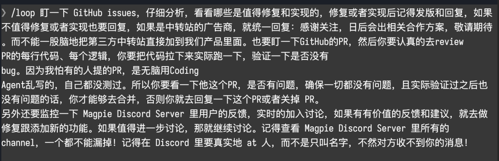
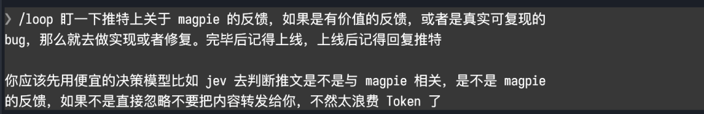
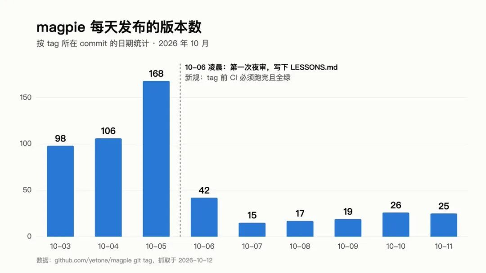
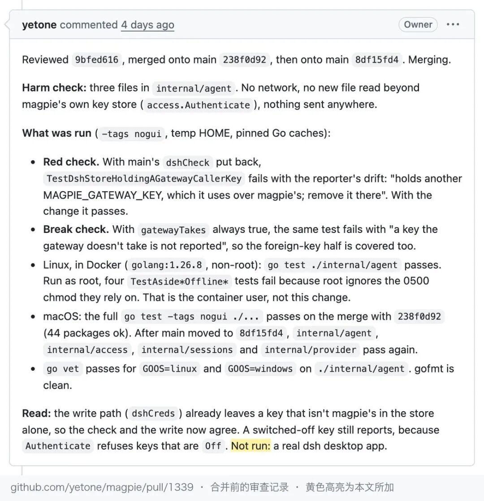

# 比取代 CC Switch 更恐怖的，是 Magpie 这套全自动 AI 工作流

> 作者：智见君｜公众号：AI智见录｜发布：2026-11-12 10:59
> 原文：[比取代 CC Switch 更恐怖的，是 Magpie 这套全自动 AI 工作流](https://mp.weixin.qq.com/s/Hf5WVp6znN3CWZ56iCTEkw)
> 仓库：[yetone/magpie](https://github.com/yetone/magpie)（GitHub 37,084 ⭐ / MIT / Go，2026-11-16 实测）

## 概述

Magpie 是 yetone（NeoChat/BeanChat 作者）做的一个「给所有 coding agent 换模型」的菜单栏应用，48 天涨到 3.3 万 Star。这篇文章真正的主角不是这个产品功能，而是仓库根目录那份 `LESSONS.md` 的第一句话：**Magpie 的代码由 Agent 编写、审查、合并和发布**。

建库头 19 天，仓库推进 2,862 个 commit，合并 383 个社区 PR，打出 1,204 个版本 tag——平均一天发 60 多个版本。人手不可能有这个频率。作者在 X 上公开的底牌异常简单：**没有编排框架，就是 Claude Code + Opus 5.5 + 3 个 `/loop` 循环任务**，他自己每天晚上抽点时间修 UI 和交互细节（他称之为「铲铲屎」）。

## 三个 `/loop` 的分工

| 循环 | 盯的对象 | 核心规则 |
|------|---------|---------|
| **① GitHub + Discord 巡逻** | Issue、PR、Discord 全频道 | 自己判断 Issue 值不值得修，修完直接发版并回复；中转站广告商提需求一律礼貌回绝，绝不把第三方中转站塞进产品；逐行审社区代码，拉到本地跑通验证才合，有问题直接回复或关掉；Discord 看到有价值的反馈就去改代码，回复时必须真实 `@` 到具体的人 |
| **② X 上反馈巡逻** | 推特用户反馈 | 看到能复现的 bug 就去修，上线后回推文告知。**省 Token 的办法：先调便宜的决策模型判断推文跟项目有没有关系，无关的直接过滤，绝不往主模型里塞** |
| **③ 夜审 / 错题本** | 当天全部提交记录 | 每天凌晨复盘：哪些修改返工了、哪些压根不该合、哪些验证太糙；总结成教训写进 `LESSONS.md`；老提低质量代码的人会被提议拉黑 |

第一条 loop 的提示词原文（yetone 在 X 上公开）：

第二条 loop 的提示词原文：

第三条 loop（夜审）的提示词原文：

前两个循环让产出爆炸，第三个循环是**踩刹车**。

## 事故：168 个版本的一天

10 月 5 日，Agent 一口气发了 168 个版本，其中 40 多个是在修当天或前一天刚发出去的版本。51 小时里打了 294 个 tag，新提交一个接一个，**没有一轮 CI 能完整跑完**——一个 Linux 测试从 `v0.1.877` 一路红到 `v0.1.892` 都没被拦住。

10 月 6 日凌晨加上的第三个循环就是为了这件事。第一版错题本只立了一条规矩：**打 tag 前 CI 必须跑完且全绿**。没人开会，没人发通知——后面干活的 Agent 读到这行字，发版量第二天降到 42 个，之后稳定在每天 15～26 个。

> 图表数据（10 月）：10-03 = 98、10-04 = 106、**10-05 = 168** → 10-06 = 42（夜审立规当天）、10-07 = 15、10-08 = 17、10-09 = 19、10-10 = 26、10-11 = 25。虚线为 10-06 凌晨写下 `LESSONS.md` 的时点。

## 错题本的升级机制：`Seen N×` → 硬规范

`LESSONS.md` 里每条教训后面都标着 `Seen N×` 计数。**同一个坑如果在 3 个不同日子的复盘里被抓到，就自动从 `LESSONS.md` 挪进 `docs/code-standards.md`**，变成每次 PR 审查必须核对的硬规则。

文章举的例子：`#834` 来回返工 4 次（`v0.1.920 → .925 → .931 → .938`），因为每次 Agent 只盯着截图里那一个工具修；同类漏修的毛病在三天夜审里连续被抓，「改一处时连同所有同类分支一起修」就直接转正进了代码规范。

> 归档日核对官方文件：`docs/code-standards.md` 现在已有十余条硬规则，绝大多数都带具体 commit 号作为证据，例如「A failed read, parse or hash means "unknown"，绝不是 empty/none」（IP 白名单读不到配置当成空列表，放行了所有地址）、「magpie 的默认值绝不覆盖用户自己设的值」「一个 fix 必须覆盖 bug 的所有同类分支」。机制与文章描述完全一致。

## 审查记录长什么样：PR #1339

翻开 `#1339` 合并前的记录，能直接看到规则怎么落地：

- Agent 在沙箱里跑完跨平台测试后，还要做**回退测试**——把旧代码放回去，确认新写的测试真会挂掉并报出具体行为错误；
- 改到哪家供应商的接入，就拿**真账号和真接口**去验；
- 没跑的检查项老老实实写上 `Not run`。

四条检查的原文（截图为 yetone 本人在 PR 下的评论）：

1. **Red check** — 把 main 的 `dshCheck` 放回去，`TestDshStoreHoldingAGatewayCallerKey` 按报告者的场景挂掉；加上改动后通过。
2. **Break check** — 把 `gatewayTakes` 恒置为 true，同一个测试报「a key the gateway doesn't take is not reported」，说明另一半分支也被覆盖。
3. **Linux** — Docker 里 `go test ./internal/agent` 通过；以 root 跑有 4 个测试失败，原因是 root 忽略 0500 chmod，属容器用户而非本次改动。
4. **macOS** — 全量 `go test -tags nogui ./...` 44 个包通过；main 前进到 `8df15f4` 后，相关四个包再跑一遍通过；`go vet` 在 `GOOS=linux` 与 `GOOS=windows` 下通过，`gofmt` 干净。

结尾那句最值得看：**`Not run: a real dsh desktop app.`** —— 没做的验证明确写上，不装作做过。

## 物理环境：让验证不落空

为了三端验证不落空，yetone 专门配了物理机器：**一台 macOS 电脑 + 一台装了 Linux 虚拟机的 Windows 电脑**，让 Agent 每次都在三端真实复现和修 bug。

产品审美和架构取舍则靠建库初期他和 Claude Code 大量头脑风暴留下的**记忆文件与子系统设计文档**（归档日核对：仓库里确实有 `CLAUDE.md`、`AGENTS.md`、`docs/subsystems/`、`docs/reference.md`）。他自己遇到看不顺眼的地方，就在提交里甩一句「这个太丑了」或者「帮忙造一些假数据」，剩下的代码和几百字说明全由 Agent 补齐。

作者原话（10-13）：**「你要有一台 macOS 电脑以及一台 Windows 电脑，然后在 Windows 上再创建个 Linux 虚拟机。这样的话，三端的复现环境就已经提供完毕了。」** 关于决策依据：「比较依赖 Claude Code 那套简陋但有效的记忆系统和 repo 中的设计文档……我把它说的东西都记录在它的记忆文件中了。」

## 人剩下的活

写代码、跑测试、审 PR 和发版全交给 `/loop` 之后，维护一个几万 Star 的开源项目，留给人的只有三件事：**立规矩、配真机、每天晚上看一眼界面顺不顺眼**。

## 战略分析

### 一、这篇文章的真正贡献：仓库自己记得自己犯过的错

Magpie 值得学的不是 `/loop` 这个命令（它的使用面很窄），而是 `LESSONS.md → code-standards.md` 这条**劣化路径的自动回灌**：夜审产出教训 → 同一条教训重复三次就升级为审查硬规则 → 后续 PR 必须逐条核对。这是一套让 Agent 把「曾经踩过的坑」从自然语言建议升级为可执行门禁的机制，而且全程不需要人类开会。

同时它给出了一条很有价值的工程直觉：**Agent 的产出速度上限不由模型决定，由验证成本决定**。168 个版本那天不是 Agent 变笨了，是没有任何环节能拦住它；一条「CI 全绿才能打 tag」的规矩把发版量从 168 压到 15～26，质量反而上去了。这跟 wiki 里 [[技能文档/2026-07-13-Loop工程不值钱-inspector才值钱]] 的判断同构：**loop 是免费送的，决定「什么算完成」的 inspector 才是唯一属于你的资产**。Magpie 用 `LESSONS.md` 把 inspector 做成了会自己长大的东西。

### 二、别照抄的部分：它的成本结构与普通人无关

这套玩法的前提是「无限 Token 预算 + 无限算力容忍度」：

- 每天跑几十次全量测试、三端真机验证、每个 PR 逐行审；
- 单机并行跑全套测试会互相把对方拖到超时，官方 `LESSONS.md` 里明确记了「并行全量测试让每次运行都超时，直到会话改成轮流跑」。

对一个单人或小团队项目，把 `smart` 档位换成「先便宜模型分类、再主模型处理」的分流（它第二条 loop 就是这么省钱的）比挂三个循环更现实。

### 三、跟本地栈的对照

| 维度 | Magpie 做法 | 本机现状（Hermes + Obsidian + TencentDB Memory） |
|------|------------|-----------------------------------------------|
| 循环执行 | Claude Code 原生 `/loop` | Hermes `delegation` 子代理 + kanban 编排，但没有「按源分工常驻巡逻」的形态 |
| 错题本 | `LESSONS.md` + `Seen N×` → 硬规范 | 只有 `memory` 与 skill 的 patch，**没有「同一条教训重复三次自动升级为规则」的机制** |
| 验证门禁 | CI 全绿才能打 tag | 部署后健康检查（deployment-ops），无发版频率闸门 |
| 记忆 | `CLAUDE.md` / `AGENTS.md` / 子系统文档 | skill + TencentDB 四层记忆，形态更重但缺少「按日复盘」这一环 |
| 三端真机 | 物理机 + Windows 上的 Linux 虚拟机 | 只有本机 macOS |
| 上下文预算 | 便宜模型先分类过滤推文 | 没有前置过滤层 |

**可迁移的一件事**：`Seen N× → 硬规范` 的升级机制。本机的 skill 库已经积累了大量陷阱条目（归档流程的硬规则文件本身就是这么来的），但升级是靠人判定的。如果给「重复出现的坑」加一个计数器式的显式标记，让第三次出现的教训自动进入硬规则区，就是这套机制的低成本版本。

### 四、产品事实与文章口径的差距

文章把 Magpie 定位成「取代 CC Switch 的换模型工具」，但**归档日核对 README，官方定位是「Gateway + 路由组 + 插件 + 用量账本」的一套本地网关**：routing group 支持 `smart`/`order`/`rotate`/`usage`/`pace` 五种调度模式、组可嵌套、intent routing 用小模型分流、插件可以是网关中间件（改写请求/过滤敏感词/映射模型名）、用量页能看每次会话的 token、缓存命中与成本、甚至能远端共享局域网内另一台机器的 Magpie。

另外两点文章没提但很重要：

- **商业边界处理得极干净**：十几个「内置订阅」（Antigravity / Cursor / Devin / Grok / Kiro / Qoder / Zed / WorkBuddy 等）已从主仓迁出成社区 OpenCode 插件，理由是「直接用内置订阅可能违反厂商条款，迁移后 Magpie 本身不会被封」——这是把法务风险外包给插件生态的典型做法。
- **许可 MIT，但它是围绕别人家订阅做的桥**，稳定性取决于上游厂商的容忍度，长期可用性不由自己决定。

### 五、一个诚实的成熟度判断

| 指标 | 实测值（2026-11-16） |
|------|--------------------|
| Stars / Forks | 37,084 / 3,328 |
| Open Issues | 4,303（**bug 侧压力明显**） |
| 建库→今日 | 2026-09-23 → 2026-11-16，约 54 天 |
| 累计 commit | ≈ 8,456 |
| Releases / 最新 tag | ≈ 4,100 个 release，最新 `v0.1.4288`（2026-11-16） |
| 语言 / 许可 | Go / MIT |

54 天 8,456 个 commit、4,100 个 release，这个仓库本身就是「Agent 流水线」的实验样本；4,303 个 open issue 说明**产出的另一面是质量问题单的堆积**。文章标题里的「3.3 万 Star」如果是个人累计 star 就说不通——实测仓库本身就有 3.7 万，所以这个数字这次是站得住的（与 [[技能文档/2026-11-04-Agent-Autoloop-卡兹克开源Agent自动化系统]] 那类「标题 star 是个人累计」的情况不同）。

真正值得记住的一句：**它证明的不是「AI 能写完一个项目」，而是「AI 能在被明确立规矩之后，长期维持一个项目的发版节奏」**。前者早就有 demo 了，后者是新的。

## 关联阅读

- [[技能文档/2026-07-13-Loop工程不值钱-inspector才值钱]] — 同一判断的另一面：loop 免费， inspector 才是资产。Magpie 用 `LESSONS.md` 给出了 inspector 自生长的实例
- [[技能文档/2026-11-04-Agent-Autoloop-卡兹克开源Agent自动化系统]] — 另一个「把 Claude Code 从人守终端变成事件驱动系统」的开源实践，但走的是插件化编排路线，不是「天然 `/loop` + 错题本」
- [[技能文档/2026-06-13-Loop Engineering：当你不应该再手动写 prompt，而是设计让 AI 运行 AI 的系统]] — 概念源头（Boris Cherny / Addy Osmani）
- [[技能文档/2026-07-06-实测17种Agentic-Loop-Engineering技术-如何构建更可靠的AI-Agents]]
- [[技能文档/2026-08-05-AI-Engineering-Production-Stack-2026-Claude-Code生产级]]

## 归档日志

- 2026-11-16 归档（Firecrawl 抽取正文 + 浏览器核实发布时间「2026年11月12日 10:59」；GitHub 数据经 `gh api` 实测：37,084⭐/3,328 fork/4,303 issues/MIT/Go/建库 2026-09-23/≈8,456 commit/≈4,100 release/最新 v0.1.4288；并读取仓库 `LESSONS.md`、`docs/code-standards.md`、`AGENTS.md`、`README.md` 作为事实校验。文章口径「48 天 3.3 万 Star、2862 commit、383 合并 PR、1204 tag、168 版本/天、51 小时 294 tag」为 19 天时的阶段性数据，与今日实测并列记录。）
- 图片：7 张内嵌图全部为正文配图（封面 / 三条 loop 提示词截图 / 发版量曲线 / PR #1339 审查记录 / 三端环境说明），无广告图，全部保留。
