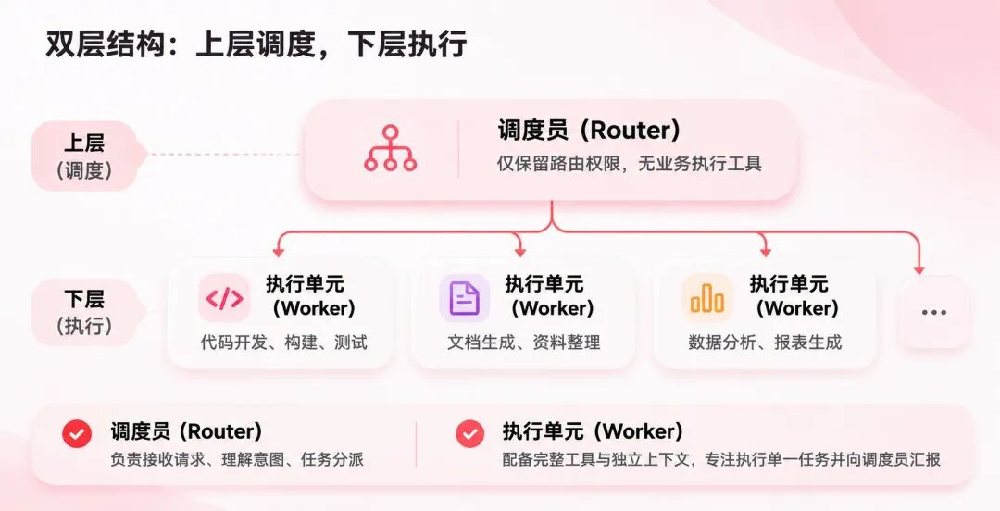
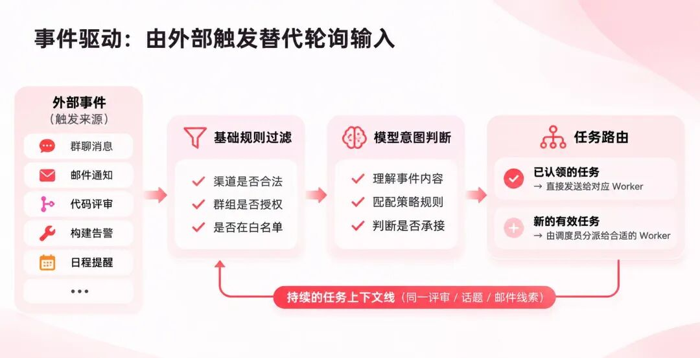
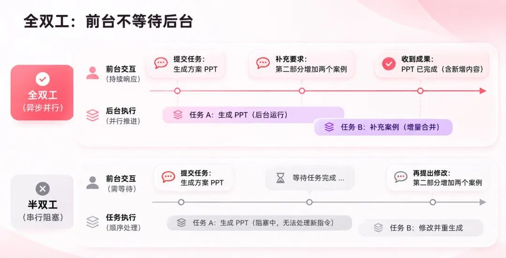
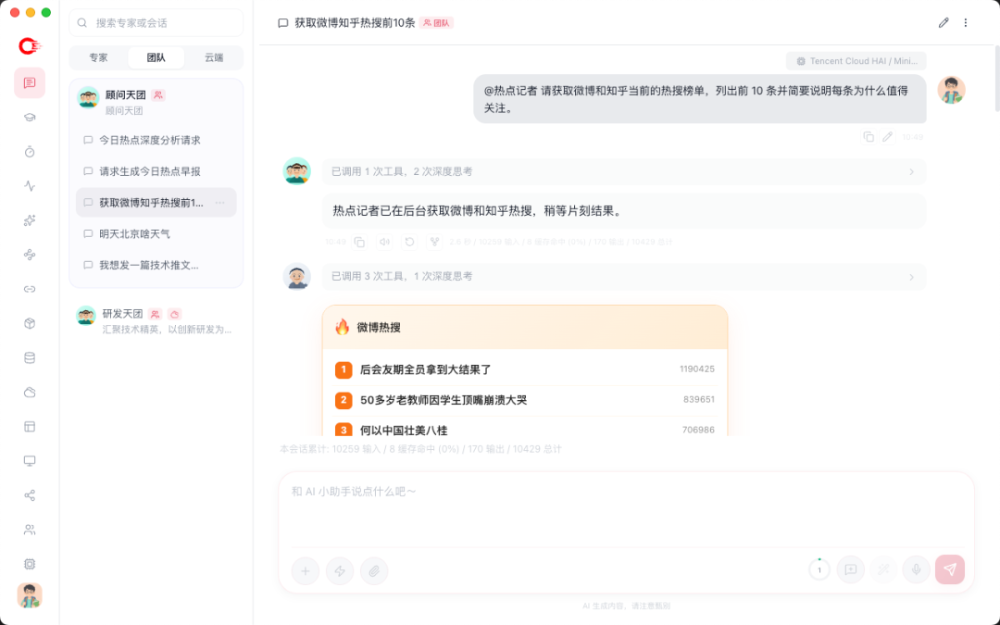
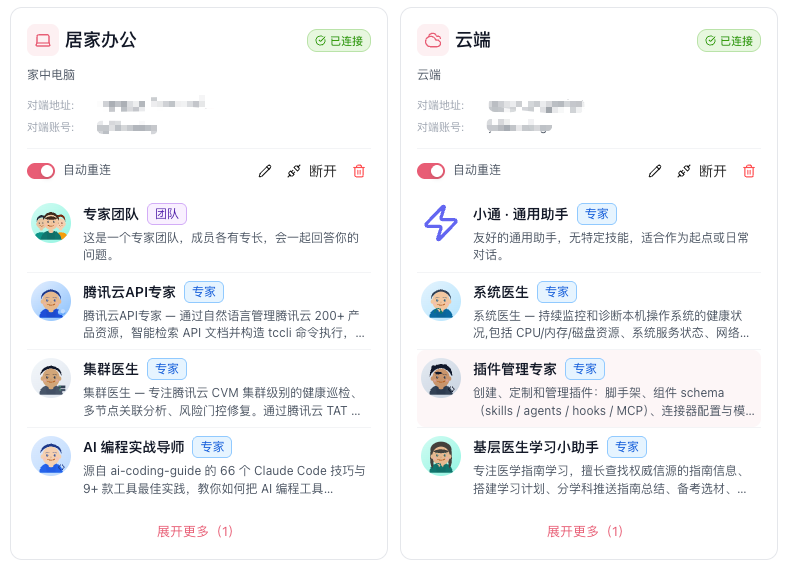
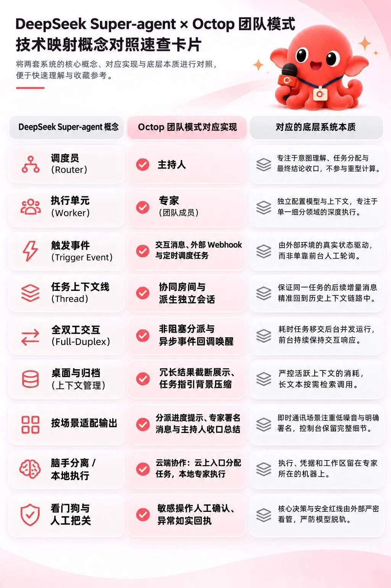
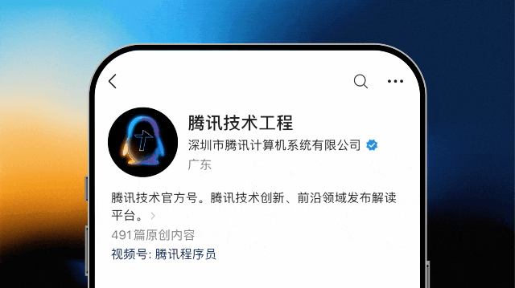

# 用 Super-agent 的理念，拆解 Octop 团队模式

> 作者：Jubaoliang，Octop 负责人 ｜ 来源：腾讯技术工程 ｜ 发布：2026-11-16 15:26
> 本文以 DeepSeek《Super-agent 设计探索》为参照，解析腾讯云开源项目 **Octop** 的「团队模式」如何独立落地了同一套多任务并行架构。

DeepSeek 发布长文系统阐述 Super-Agent 设计理念——打破 AI「单次仅能处理单一任务」的旧范式，以**调度员（Router）+ 执行单元（Worker）**的双层架构实现任务并行与后台运行。

无独有偶，Octop 在 **1.0.2 版本**便已上线「团队模式」：由**主持人 Agent** 统筹分解任务、多名**专家 Agent** 并行执行。两者核心思路殊途同归，形成了一次跨越产品与时间的对照印证。

---

> 相关归档：[[技能文档/2026-10-15-自托管AI-Agent开源项目-腾讯Octop|Octop 项目介绍与实测（10,294⭐）]]（项目概况、安装与本机运行）｜[[技能文档/DeerFlow 2.0 - 字节Super Agent Harness-2026-03-27|DeerFlow 2.0：字节 Super Agent Harness]]

---

## 一、Super-agent 要解决的问题

### 那个所有人都经历过的场景

群里突然发来通知，要求周五提交一份季度汇报 PPT。此时手头还在排查线上故障，又有紧急的新功能要赶进度，无奈之下只能把 PPT 需求复制出来，新建一个会话窗口。

随着手头的事情增多：

- 浏览器里的对话标签越开越多
- 每个窗口分别推进到哪一步，**全凭个人记忆**
- 两天后同事反馈第三页业务数据要更新，**早已记不清当初是在哪个窗口生成的**，只能把前因后果重新给模型描述一遍
- 找不到历史记录，便不得不再次新开窗口
- 修改过程中助手又要耗费数分钟重新生成整份内容，用户只能守在屏幕前干等

DeepSeek 给出的直观数据：**一个人通常只能同时跟进三到五个处于进行状态的复杂会话。**

> 当前的模型虽然越来越聪明，逐渐摆脱了"每一步都需要人盯着看"的局限，但各项事务究竟进展到了哪一阶段，**记忆负担依然落在人身上**。
> 一件事能否做好，取决于底层模型的能力强弱；而**多件事能否并行推进，考验的则是人类用户的精力上限**。

### 四个目标

Super-agent 试图接管的，正是这种**跨上下文的状态追踪与任务分派**工作：

| 目标 | 含义 |
|---|---|
| **连续性** | 无论在聊天群组还是代码评审页面交互，背后的服务实体始终如一，用户无需记忆哪句话落在哪个孤立窗口里 |
| **高效率** | 前置任务尚未结束时，不阻塞后续指令的接收，多项任务真正并发推进 |
| **主动性** | 不再依赖人类一条条机械下达指令，群聊讨论、邮件往来、自动化测试结果中出现需协同的事项可自主介入；非相关事务静默旁观 |
| **持久性** | 常驻真实工作环境，长时间运行遭遇单点故障也能基于持久化上下文恢复，无需推倒重来 |

> 行业普遍采用的"提示一次、执行一步、确认结果、再规划下一步"范式，**本质上是一种串行运转的单线程逻辑**，一旦面对多任务场景便捉襟见肘。

---

## 二、Super-agent 的几个关键设计

### 2.1 双层结构：上层调度，下层执行

DeepSeek 的马车比喻：**大语言模型是马，外部工具和运行环境是马具，封装后的产品形态是车行；一辆配齐车夫与工具的马车就是一个 Agent，用户则是每天需要调度发货的货主。**

- **主流用法**：货主每来一批货物，就必须亲自前往车行单独雇一辆马车，将这单任务全权托付给它。**新开一个对话窗口 = 重新走一遍雇车流程。**
- **Super-agent 的路径**：车行直接常驻到团队工作群中，群内讨论、代码评审留言、自动化测试报错都能统一感知。

车行内部配备一名专属的**调度员（Router）**，职责非常纯粹，只负责任务的辨识与分派：所有外部需求统一汇聚，由其判断该分配给哪辆马车、是否需要多车协同、各方完成后如何汇总反馈。具体拉货的马车则称为 **Worker**。

#### 调度员必须"被剥离得极为轻巧"

> 只负责接收需求与分派任务，**自身绝不承担具体执行，甚至完全不配置业务工具**。

正因为调度员无需分心处理繁重的业务运算，面对持续涌入的新任务时才能始终保持快速响应。他仅需做任务意图理解和路由分配，因此**选用更轻便、更敏捷的模型即可胜任**；底层 Worker 则各自配备全套业务工具与独立上下文对话流，接入能力更强的大模型，专注执行完单一任务后向调度员汇报，最后由调度员对外统一回复。

#### 关键反例：为什么"主 Agent + SubAgent"不是真正的双层架构

业内常见的"一个主 Agent 挂载若干 SubAgent"设计中，主 Agent 既要接收消息，又保留了自己直接下场干活的工具链，**分不分工完全依赖大模型在当下的概率判断**。

DeepSeek 的实验证据：

| 提示词策略 | 结果 |
|---|---|
| 仅注明"在合适时可以寻求帮手协助" | 测试五次任务**没有一次触发分工**，其中耗时最长的一项被拖延了近半小时 |
| 强化为"尽量将任务分配出去" | 五次测试中**依然出现过**主 Agent 因自认为难度较低而亲自执行，导致主窗口当场被长任务卡死 |

> 事实证明，**只有彻底拿走调度员手中的具体业务工具，从架构层面阻断其亲自执行的可能性**，才能稳定保证每一项进入系统的任务都能被可靠调度。

### 2.2 事件驱动：由外部触发替代轮询输入

当执行体系建立后，核心问题转向：**系统何时启动运转？**

驱动 Agent 工作的指令，不再是用户在对话框中逐字敲入的提示词，而是整个协作网络中自然发生的**外部事件**：

- 一条群聊消息
- 一封新邮件
- 一次日程提醒
- 代码评审中的评语
- 流水线构建失败的通知

这些统称为**触发事件**。用户甚至无需特意找到它并主动发起对话。

#### 双重过滤机制

工作群内绝大多数闲聊与日常沟通与业务任务无关，若将每条群消息都送入大模型做语义分析，在响应速度和调用成本上都吃不消：

1. **前置层（基础规则过滤）**：来源渠道不符、群组未授权或不在白名单范围内的信息直接丢弃
2. **模型层（语义研判）**：只有通过前置过滤的有效事件才递交模型，由模型依据**自然语言编写的策略规则**综合研判是否应当承接

#### 任务上下文线

针对同一个代码评审、同一话题讨论或连续往来的邮件线索，系统将其抽象为一条持续的"**任务上下文线**"。

一旦某个任务被分配给某位 Worker，该任务线上后续追加的上下文将**直接路由至对应的 Worker**，无需反复绕回调度员重新流转。

> 试验表明：在代码评审提交二十多分钟后，即使评审人员追加了一条修改意见，负责该任务的 Worker 也能立刻无缝衔接历史背景，用户完全无需重述前因后果。对于已被认领的任务线，调度员不再过多干预，从而将精力聚焦在**全局监控与未分配的新任务**上。

#### 推测执行（投机执行）

当研发群内还在就某处 bug 的可能成因展开讨论时，后台 Agent 可能已经**提前准备好了复现脚本与初步的修复方案**：

- 若团队最终确认需要修复 → 现成的方案即刻输出
- 若讨论决定无需改动 → 后台直接废弃推测结果

> 通过后台适度的**算力冗余**，换取人类**等待时间的显著降低**。

#### 上下文容量的"办公桌面整理法则"

单一会话能承载的上下文长度始终存在上限：盲目塞入过多背景会**稀释模型的注意力**导致重点漂移；信息保留不足又会导致模型频繁调用外部工具反复检索。

DeepSeek 的策略：当前轮次紧密相关的核心信息**常驻活跃上下文**，篇幅冗长且调用频次低的原始资料则**仅在主流程保留摘要与引用标识**，正文归档至持久化存储，后续按需调取。

> 原文强调：**在上下文窗口中浪费空间，本质上就是在浪费模型宝贵的推理能力。**

### 2.3 全双工：前台不等待后台

当一条新消息到达时，系统后台很可能仍有未执行完的长周期任务。

- **传统方式（半双工）**：线性排队。新消息虽已被接收，但必须等当前轮次完全运行结束才能处理。以生成一份完整方案 PPT 为例，往往需要数分钟，用户只能在屏幕前等待；如果中途强行打断，前置任务的产出又会被彻底废弃。**如同对讲机通话，一方不释放通话权，另一方就无法插入。**

全双工交互模式改变了这一机制：耗时较长的重型任务被移交至**后台异步执行**，前台对话流完全不阻塞，能持续保持待命状态以响应后续输入。

具体处理"用户在后台任务运行期间提出新要求"：

- 系统在完成后台任务的**当前执行步骤**后即刻捕获新要求
- 若新指令与后台正在生成的版本**不冲突** → 后台产出完成后**统一执行增量合并**
- 若两者**存在冲突** → 果断终止当前后台分支，带着新要求**重新派发执行**
- 后台任务最终完工后，执行成果被封装为**独立的系统消息**，动态回填至前台对话流

> 交互逻辑从"模型等待外部工具返回"转变为"**系统承载等待，模型持续响应交互**"。

#### 输出策略因地制宜

- **即时通信群聊**：遵循最小打扰原则，仅在需要关键决策或成果交付的节点发声，输出以简短结论为主
- **代码评审、长邮件、技术文档**：详细展开完整的背景考量、改动明细以及验证报告

> 一条极具实操性的量化规范：**在即时通讯场景中，单次回复内容尽量控制在百词以内。**

### 2.4 持久在线与独立巡查

离开工位时若后台复杂代码重构或大型 PPT 尚未处理完，合上笔记本便会导致本机 Agent 进程中断。纯云端托管虽能继续运行，但**本机未提交的代码改动、私有内网系统访问权限、敏感本地凭据**在安全要求下又无法随意同步至公有云端。

#### DeepSeek 的"手脑分离"方案

| 部分 | 部署位置 | 说明 |
|---|---|---|
| **认知规划 + 状态记忆** | 云端 | 轻量无状态计算容器承载核心规划逻辑，全局对话状态与任务轨迹持久化存入高可靠数据库 |
| **具体执行** | 本地终端 | 本机部署轻量守护进程，专职接收并执行云端派发的具体命令 |

- 云端容器异常崩溃 → 快速拉起新实例，读取持久化记录无缝接续当前任务
- 本地代码与认证凭据始终保留在本地受控环境，避免敏感资产外泄

#### Watchdog 独立巡检

面对长周期复杂任务，单纯依赖模型内部的自我反思很难保障高可用性。主系统外部配备独立的**看门狗守护程序（Watchdog）**，周期性唤醒并巡检全局状态：

- 监控常规网络接口报错或调用超时
- 借助**轻量模型评估每个 Worker 是否在切实推进目标、当前执行路径是否产生偏离**

> 实践表明，Agent 系统最棘手的故障往往**并非进程崩溃，而是模型陷入逻辑死循环或偏离了最初设定的目标**。这类逻辑层面的偏航是传统进程监控工具无法捕捉的。

此外，外部运维人员可直接用自然语言询问"上一轮任务失败的根源是什么"，或在线动态调整事件触发的过滤规则。

> DeepSeek 在文末客观指出：这一整套设计**并非凭空发明了新理论**，而是计算机系统工程领域沿用数十年的成熟实践在 AI 智能体场景下的自然延伸。

---

## 三、再看 Octop 的团队模式

**Octop** 是腾讯云自研的、具备多用户、多专家、支持团队协作的 AI 助手（开源地址：https://github.com/TencentCloud/Octop）。

命名灵感来自**章鱼（Octopus）**——多条触手协同作业，能同时处理几件复杂的事。

在 Octop 1.0.2 版本中推出的团队模式，核心运转逻辑与 Super-Agent 如出一辙：由**系统主持人**率先对综合任务进行结构化拆解，随后分配给不同领域的**专家 Agent**（市场调研、数据分析、文案策划等），各司其职、各自闭环后交由主持人统一汇总收口。

### 3.1 主持人负责统筹调度，专家专注于细分执行

主持人的系统权限做得很克制，**仅配置了查看团队成员、分派子任务、检索长期记忆以及感知时间**的轻量工具。

工作流程：

1. 用户提出复合需求，请求首先统一由主持人承接
2. 主持人优先厘清**核心目标、业务边界、限制条件以及预期的最终交付形式**
3. 为每位专家分别生成一份**定制化的任务指引**——交代清楚工作目标、禁止边界、输出标准以及必要的背景上下文

从系统内核看，Octop 团队本质上就是一个工程落地的 Super-Agent 架构：

- 各位专家成员被抽象封装为**标准化的工具接口**
- 主持人通过**工具调用**将任务消息分发至具体专家
- 专家在本地执行完毕后将成果**异步通知**主持人
- 每个专家**底层高度隔离**：专属本地工作目录、独立绑定的模型服务、独立记忆沉淀、隔离的会话流
- 用户既可在主房间发起多专家协作，也可私聊单独与某位专家深度探讨，甚至可将同一位专家引入多个不同团队，**上下文记忆完全不混淆**

#### 与 DeepSeek 的一处明显取舍差异

| 维度 | DeepSeek | Octop |
|---|---|---|
| 专家对外发声 | **完全屏蔽执行单元**，所有输出统一收敛在调度员一人身上，保证界面极致精简 | 各专家回复**直接携带专属头像展示在协作房间**中，让推进过程直观透明 |
| 收口方式 | 调度员从始至终主导交互脉络 | 主持人仅在全部环节结束后输出**不超过三句话**的全局收尾，严格避免重复专家已阐明的具体细节 |

> 将中间过程充分展开的做法，使得当专家之间出现方案分歧时，团队成员能一目了然地追溯不同立场的逻辑根源。

两者在"对外保留统领收口的角色"这一理念上高度契合。

### 3.2 异步协作与非阻塞执行机制

Octop 同样采用"**提交即返回**"的非阻塞设计：

- 主持人将子任务分配给专家后，系统绝不陷入原地同步等待，立即转入待命模式
- 子任务交由专家在**后台并发推进**
- 不同专家之间的任务**彼此独立运行**；同一位专家名下的多项任务则在**其私有队列中排队流转**
- 专家完成子任务后，系统底层将阶段性成果组装为一条**带特定标签的唤醒消息**回传主持人，消息体明确标示"这属于已有任务的回调而非用户的新增提问"，并附核心答案节选摘要
- 主持人接收唤醒信号后，智能判断是否需要触发下一轮分派，或直接几句收尾，明确说明决策结论及采纳依据

**三项核心特征两套系统均完整体现：分派即返回、后台并发作业、成果异步回填。**

> 唯一区别在于等待机制所处的**抽象层次**不同：DeepSeek 重构的是底层**单次工具调用的等待协议**，而 Octop 则是将协同链路抽象为一套**事件收件箱体系**——任务分派后主线程即刻释放，后台作业完成后再主动唤醒主持人。

### 3.3 核心理念上的不谋而合

#### ① 任务主线回归特定上下文

在 Octop 中，团队协作房间本质上承载了主持人的会话主干，每位专家在此基础上派生出属于自己的子会话。同一任务后续产生的追加讨论与交付结果都精准排队回归最初创建的上下文线程，**绝不会与用户同该专家的日常私聊记录产生交叉污染**。

区别：Octop 并未选择彻底绕开前台的隐式路由，而是**让所有新消息统一步入主持人的视野**，从而更直观地厘清任务演进的全局时序。

#### ② 上下文容量的克制与归档管理

- 面向篇幅冗长的工具返回数据，前端渲染前执行**截断处理并保留折叠标记**
- 提供给主持人审阅的专家答卷，默认**仅提取核心结论的节选**
- 向下分配任务时，自动将房间内的历史讨论纪要**压缩提炼为精简背景概要**，并显式标注"仅供背景参考"

> 将最关键的决策信息留在手边，将庞大的原始全文归档存放在专属空间。

#### ③ 因地制宜的场景化表达规范

在缺乏完整富文本界面的即时通讯渠道中，用户无法感知协作房间内专家逐字生成的动态过程，因此 Octop：

- 任务分派成功的第一时间，主动补发一条"**已指派某某专家处理，请稍候……**"的即时状态提示
- 专家完成工作后，推送**带明确身份署名**的完整结果
- 主持人全局复盘时，单独推送标有"**【主持人总结】**"前缀的消息
- 需要查阅全量推导链路时，可随时无缝切回 **Web 控制台**

#### ④ 单轮支持并发多路任务分派

主持人支持在同一轮调度决策中将复合任务拆解并**同时分配给多位专家**协同推进，避免前台交互被单一维度的任务分派阻塞。

DeepSeek 的方案则是将短时间内并发涌入的消息**合并成批次统一处理**。工程手段不同，但规避的前台串行阻塞痛点完全一致。

#### ⑤ 把关键把控权始终留在人类手中

Octop **没有**引入完全由程序驱动的外部自动化巡检进程，而是设计了一套人机协同安全机制：

- 专家执行过程中涉及调用**敏感系统工具**时，执行链路**主动暂停**，等待人类显式确认与授权，**最长等待可达半小时**，期间系统绝不会误判该轮任务超时结束
- 任务分派遭遇网络异常或上下文超限时，系统**如实唤醒主持人**客观说明，由主持人决定重新分派还是向用户汇报终止，**严禁模型在异常状态下凭空编造替代结果**
- 只要专家身上仍有未收尾的活跃任务，系统就在规则层面**禁止将该专家移除出团队或执行删除**

> DeepSeek 选择用独立 Watchdog 巡检保障可靠性，而 Octop 则将决定系统边界的安全确认**踏实地交到了人类手中**。

### 3.3 认知大脑在云上，执行的双手留在本地

> 原文此处编号重复（两个 3.3），保留原样。

合上笔记本电脑之后，原先部署在这台电脑上的助手会一起停掉。整套系统搬到云上，云上的进程可以继续跑；但**工作区里尚未提交的改动、登录凭据，以及只有内网才够得到的资源**，却仍然留在原来的机器上，云端够不着它们。

DeepSeek 把这个矛盾收成「**脑手分离**」。Octop 的云端协作，把同一件事做成了**两台实例之间走得通的一条路径**：

| 实例 | 位置 | 角色 |
|---|---|---|
| 云上 Octop | 云端 | **随时找得到的认知入口**：人离开工位后，从手机或另一台电脑仍打得开，任务从这里进来，任务分配和来回对话也在这里发生 |
| 本地 Octop | 家里或办公室持续开着的机器 | **执行的双手**：仓库、凭据和内网都在它旁边 |

两边连上以后，云端界面里会出现家里的专家。把任务分配给他，操作上与分配给本地专家一样：

- 请求经**云端协作的桥**送到专家所在实例
- 模型循环、工具调用和文件读写都在那台机器上完成
- 改动落在工作区本来所在的磁盘上
- 对话记录以专家这一侧为准，云端再把结果流回你正在看的界面

> 家里的机器通常处在家庭内网（**NAT**）环境之后，没有公网 IP，云端很难逐次直接访问它的服务端口。连接建立之后，后续请求**改走已经连上的桥**，云上的入口因此仍然够得到留在本地的那双手。

环境留在原来的机器上，人可以离开那台机器。

### 3.4 当前各自面临的工程边界

#### DeepSeek 的坦诚说明

其所公布的原型方案仍属**阶段性探索成果，尚未达到商用级生产环境标准**：

- 全双工机制虽在内部推理运行框架中完成技术验证，但在对外产品中仍未默认全面放开
- 如何实现**长达数月乃至更久维度的记忆一致性管理**
- 如何在让 Agent 自主调用各类生产凭据的同时**避免其被意外泄露至模型上下文**
- 如何构建严格的**数据隐私隔离机制**

> 作者直白的判断：**倘若安全与隐私的隔离红线在技术上找不到彻底解法，全自主 Agent 的应用场景就只能被严格限制在一个范围极小且高度受信任的封闭沙箱中。**

#### Octop 的工程克制（团队模式目前处于 Beta）

| 当前限制 | 说明 |
|---|---|
| 多团队嵌套协同 | 尚未开放 |
| 跨专家集中共享工作空间 | 暂未提供 |
| 任务收件箱状态 | 目前主要依赖**内存状态**维护，底层服务进程非预期重启时，正在流转的未决任务存在**状态丢失风险** |
| 独立看门狗服务 | 暂未集成全自动化版本 |
| 推测执行 | 尚未实现"群聊讨论阶段即前置预测并生成补丁" |
| 跨端协同 | 跨越异构通讯软件与研发代码平台的协同仍处于技术探索中 |

#### 两者遭遇的共同瓶颈

尽管切入场景各有侧重——**DeepSeek 更关注如何让复杂软件工程任务在即时通讯与研发平台之间无缝衔接，Octop 则聚焦于帮助个人用户、家庭及微型团队将日常业务诉求高效分配给专家团队**——但底层瓶颈高度重合：

- 长周期状态如何实现跨节点的**高可靠持久化**
- 单点执行异常后如何实现**自动恢复**
- 人机协同的**安全护栏**究竟应该划在何处
- 复杂后台链路被隐藏之后如何提供足够透明的**用户可观测性**
- 出现现实扰动时人类如何**随时人工介入修正**

---

## 四、两套设计背后的共通逻辑

DeepSeek 在终篇明确指出：这套看似前沿的系统架构**在理论层面并未创造全新的范式**，本质是将现代计算机软件工程中历经数十年反复验证的经典系统原则，重新映射到大模型协作生态之中：

- 通过**分层架构**明确调度与执行的职责边界
- 通过**异步解耦**实现长短计算路径的分流
- 通过**就近缓存**策略严控活跃资源消耗
- 通过**推测执行**提升系统响应速度
- 通过**计算与存储分离**保障弹性扩展
- 引入**独立的外部监控机制**守护系统底线

#### 一张表看懂两套系统的技术映射

> 下图为原文附录速查卡片的完整转录，九组概念一一对应。

| DeepSeek Super-agent 概念 | Octop 团队模式对应实现 | 对应的底层系统本质 |
|---|---|---|
| **调度员（Router）** | 主持人 | 专注于意图理解、任务分配与最终结论收口，不参与重型计算 |
| **执行单元（Worker）** | 专家（团队成员） | 独立配置模型与上下文，专注于单一细分领域的深度执行 |
| **触发事件（Trigger Event）** | 交互消息、外部 Webhook 与定时调度任务 | 由外部环境的真实状态驱动，而非单靠前台人工轮询 |
| **任务上下文线（Thread）** | 协同房间与派生独立会话 | 保证同一任务的后续增量消息精准回到历史上下文链路中 |
| **全双工交互（Full-Duplex）** | 非阻塞分派与异步事件回调唤醒 | 耗时任务移交后台并发运行，前台持续保持交互响应 |
| **桌面与归档（上下文管理）** | 冗长结果截断展示、任务指引背景压缩 | 严控活跃上下文的消耗，长文本按需检索调用 |
| **按场景适配输出** | 分派进度提示、专家署名消息与主持人收口总结 | 即时通讯场景注重低噪音与明确署名，控制台保留完整细节 |
| **脑手分离 / 本地执行** | 云端协作：云上入口分配任务，本地专家执行 | 执行、凭据和工作区留在专家所在的机器上 |
| **看门狗与人工把关** | 敏感操作人工确认、异常如实回执 | 核心决策与安全红线由外部严密看管，严防模型脱轨 |

#### 同一种约束，两种表达

在 Octop 的用户手册中很难看到这些晦涩的计算机术语，取而代之的是：章鱼触手隐喻、主持人角色、按专业维度划分的专家成员、各自独立的工作目录。**前者用严谨的系统工程语言向架构师拆解底层拓扑，后者用直观的具象化语言帮助终端用户建立认知模型。**

但一旦深入技术内核，两者面临的**物理约束完全同构**：

| 物理约束 | 由此决定的架构选择 |
|---|---|
| 人类注意力带宽存在天然上限，单次难以兼顾三到五个以上并行上下文 | 任务记录与统筹分派必须依赖**专门的调度机制**接管 |
| 传统"思考一步、执行一步"的线性循环面对并发必定严重阻塞 | 重型长效任务必须与前台交互流**异步解耦** |
| 主控 Agent 既统筹分派又亲自下场承担运算，主执行链路必被卡死 | 必须**从权限层面彻底剥离调度者的具体执行工具** |
| 单次对话流的上下文承载空间极其宝贵，过度冗余会导致注意力分散漂移 | 非核心素材必须建立**多级归档与按需提取**机制 |
| 多任务并发时上下文细节交织极易引发语义干扰 | 各执行单元的对话历史与执行空间必须**物理隔离** |
| 核心访问凭据、敏感业务数据、尚未确认的资产变更受安全合规刚性约束 | 绝不应脱离**本地受控环境** |

> 换作任何做复杂多任务 Agent 的团队，最终也都会在这些客观存在的系统瓶颈面前做出相似的技术抉择。DeepSeek 从底层代码研发与编程辅助体系向上提炼，Octop 从原生常驻本地的协作助手向外延展，**技术原点虽相距甚远，但架构演进上最终都用上了这一套经典的系统设计方法**：分层治理、队列解耦、缓存精简、提交即返回、状态隔离、基于回调的事件驱动。

#### 术语往往是工程实践先行、定义在后

正如业内复盘 Anthropic 提出的 **Agent Skill** 规范时所指出：在该标准化概念被大厂正式确立之前，许多极客开发者早就在遵循类似约定，将提示词工程、参考背景文档以及可执行脚本组织在同一套结构化目录中按需调用。

> **Super-agent 的重大价值，在于将行业中散落在各处的自发工程实践进行了系统化的理论升华与边界厘清**，并辅以翔实的数据支撑；而 **Octop 则是用"主持人、专家、分工协作、工作房间"这样一套温和自然的产品隐喻，让每一个没有计算机科学背景的普通用户，也能毫无门槛地享受到现代系统工程与多智能体协同带来的效率提升。**

---

## 五、结语

对于真实世界的使用者而言，日常协作中最朴素的核心诉求其实非常具体：**将手头的需求交代清楚，随后在约定的时间拿到靠谱的执行结果。** 至于背后的专业技术概念叫什么，大可留在事后慢慢讨论。

而那些在系统底层尚未完全攻克的工程难题——**状态的长期可靠保存、异常时的自动恢复能力、人机协作中的安全边界**——则依然整整齐齐地记录在两家团队的后续待办清单中，静候着下一代智能体系统的突破与演进。

---

## 附录 ｜参考来源

- DeepSeek 产品部《Super-agent 设计探索：迈向更自主的 Agent 系统》，2026-10-31；开源原型为研究原型，官方声明非正式产品
- **原文已归档**：[[2026-10-31-Super-agent设计探索-DeepSeek-Harness团队原文]]（DeepSeek Harness 团队，16,208 字全文 + 14 张图 + 全部实验数据原始表格）
- 该文的公开解读与报道：《Super Agent 到底是什么？》《一文读懂 DeepSeek Super-agent》《把 AI 从「一个窗口」变成「一个同事」》《Deepseek Super Agent 是什么鬼？》，以及环球网、浙江在线、新浪财经、央广网的报道。文中试验数字引自这些解读对原文的转述，**正式引用请以 DeepSeek 原文为准**
- Octop 官方《一分钟了解 Octop》；1.0.2 解读《自托管 AI 助手新特性：由不同性格的专家组队协作》；《腾讯开源 Octop：从个人助手到小团队工作区》；《腾讯云发布 Octop：开源版 WorkBuddy 真的来了？》；《Octop 装完就能用，聊得越多它越懂你》
- Octop 项目内的《专家团队模式》《Agent 后台协作》《Inbox + Callback 方案》三份设计文档

