# 《Agent评测白皮书》业务实践篇：商家 AI 助手的评测与优化闭环实践

> 来源：美团技术团队 ｜ 发布：2026-11-17 10:24
> 系列前篇：《Agent评测全览》介绍评测体系整体构成，以及评测体系与 Agent 相互促进的两条迭代闭环。

全文以**商家 AI 助手的巡检任务**为贯穿案例，讲怎么建业务 Benchmark，怎么通过评测器校准和错误分析，同时推动评测体系完善与 Agent 能力提升，并借助图灵支撑持续回归与模型选型。

## 目录

- 一、背景（1.1 业务背景 / 1.2 对标业界 / 1.3 建设目标：可测、可信、可优化）
- 二、商家广告助手的 Benchmark 设计（2.1 评测场景设计 / 2.2 定义成功标准与判定方法 / 2.3 评测 Task Schema）
- 三、评测优化与 Agent 迭代（Error Analysis）（3.1 校准评测器 / 3.2 根因分析 / 3.3 具体例子——巡检任务优化）
- 四、评测体系的工程化落地（4.1 构建可信的评测流程 / 4.2 评测效率：从单次评测到持续回归）
- 五、Takeaway
- 六、结语

---

## 一、背景

### 1.1 业务背景

商家广告助手是面向**投放巡检、异常诊断、数据报告和计划编辑**等场景的业务 Agent。执行任务时，它需要读取持续变化的真实账户数据、调用多个工具、遵守投放规则，并根据结果给出建议，必要时直接调整投放计划。

因此，判断它能否用于生产，不能只看最终回答是否"像对的"，还要验证**整个任务是否正确完成**：

- 意图和时间范围是否理解准确
- 数据与工具调用是否正确
- 关键规则是否遵守
- 最终账户状态或交付物是否符合预期

### 1.2 对标业界

调研代表性 Agent Benchmark 时关注三个问题：**任务如何组织、执行环境如何构造、结果如何判定**。

业界共同思路是让 Agent 在可执行环境中完成完整任务，再通过测试、验证器或 Judge 检查结果。

> 关键判断：**公开 Benchmark 可以帮助设计评测，但它们的成绩不能直接作为上线依据。** 因为覆盖的任务、业务规则和数据与广告投放不同。可以复用其任务设计、环境构造和判定方法，再围绕广告业务建立自己的 Task 集，配齐执行环境、判定机制和验证框架。

### 1.3 建设目标：可测、可信、可优化

| 目标 | 含义 |
|---|---|
| **可测** | 把真实业务流程转化为可执行、可判定的场景和成功标准 |
| **可信** | 稳定、规模化地执行评测，并让过程可观测、结论可复核 |
| **可优化** | 从评测结果定位根因、验证改动，并逐步连接线上业务效果 |

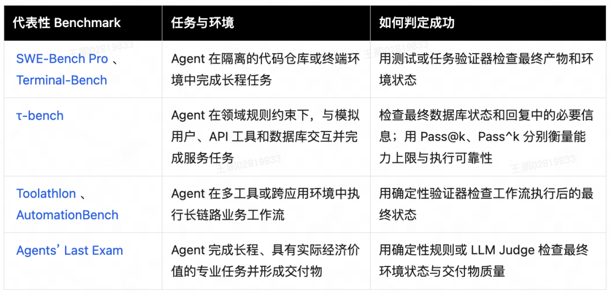

---

## 二、商家广告助手的 Benchmark 设计

设计 Benchmark，首先要明确**测哪些业务场景**以及**每个场景下怎样算成功**，再落实为 Task 集、执行环境、判定机制和评测协议，让不同 Agent 版本可在相同条件下比较。

### 2.1 评测场景设计

起步困难：该用哪些任务来测试它？

- **从线上 Bad Case 入手**：能抓住真实问题，但样本容易集中在已暴露的错误上，难以系统覆盖；对未上线或用量少的 Agent 案例有限。
- **由团队主动构造**：需要回答应该设计哪些场景、怎样判断关键流程和风险已覆盖，避免选题只依赖个人经验。

结论是两条互补路径：

1. **自顶向下**：从业务 SOP 拆解，确保核心流程和关键分支不遗漏
2. **自底向上**：从线上使用和离线测试的 Bad Case 补齐，覆盖设计阶段难以预见的边界与风险

#### 从业务 SOP 拆解评测场景

评测场景 = 准备拿什么样的题来考 Agent。历史对话只能说明用户过去"怎么问"，核心流程和关键分支不一定完整覆盖。

做法：把每个 Skill 还原为**业务状态图**，明确六类要素：

- 业务状态
- 数据依赖
- 条件分支
- 提前停止点
- 能力边界
- 跨 Skill 的转交点

由此得到的**不只是测试用例列表，更是一张"在什么条件下应该做什么、何时应该停止或转交"的行为规范**。

以到店 KA 业务每日巡检为例，其主流程需要按"**状态驱动的分支流程**"理解，而不是从头执行到尾的固定链路：

- 未发现异常门店时，跳过投放层下钻，但仍要生成巡检报告
- 账户余额不足时，只产生账户级预警，不单独触发门店下钻
- 只有发现问题投放后，才进入分层归因
- 命中预算、余额、状态或时段等直接根因后，停止后续弱证据检查
- 如果用户实际要做投放日报复盘、计划诊断或计划编辑，则转交相应 Skill，并结束当前巡检流程

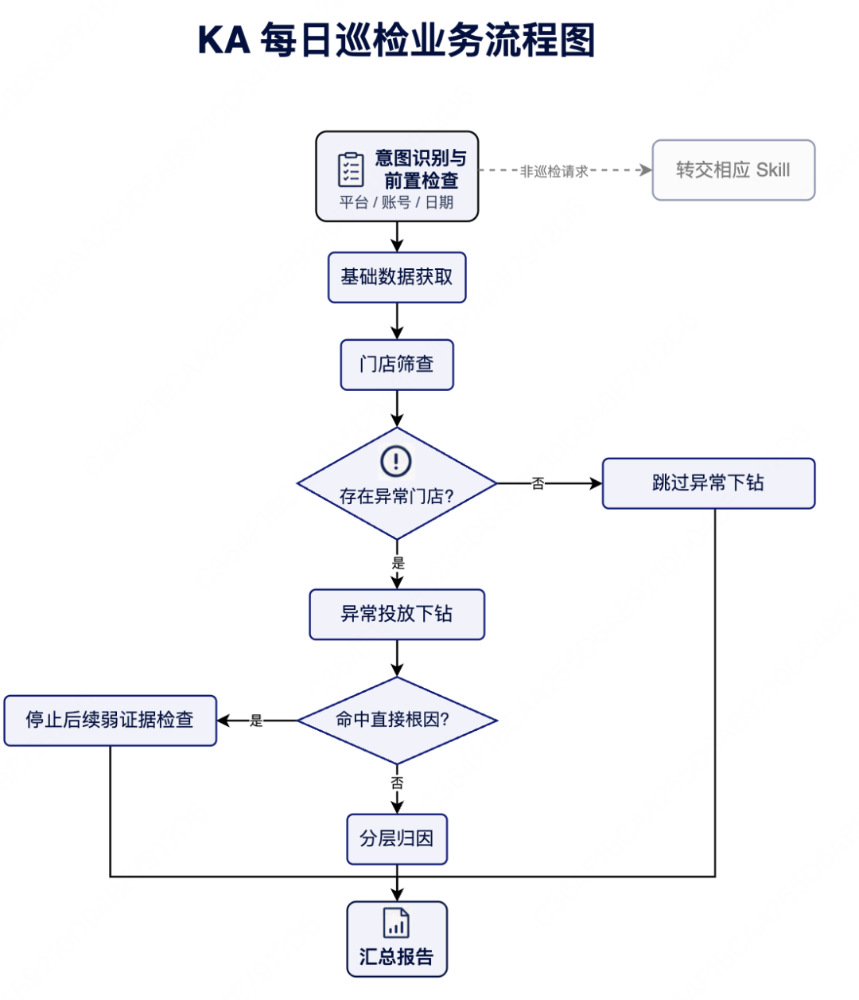

业务状态图的价值：把"应该怎么做"从**隐含在专家经验中的知识**，转化为设计评测场景的明确依据。

#### 用真实 Bad Case 补齐边界与回归

业务 SOP 描述的是预期行为，却无法穷举 Agent 在实际执行中的非预期失效。

做法：从线上使用和离线测试收集 Bad Case → 把具体错误**抽象为可复用的失效模式** → 扩展为边界、异常和回归场景。

真实例子：一次线上任务抽检中，商家要求巡检昨日投放，Agent 输出了一份结构完整的报告，但 Trace 显示其**实际查询的是当天数据**。

在评测中，这不会只作为一道错题保留，而会被抽象为"**日期理解与计算失效**"，并进一步覆盖今日、昨日、历史日期和周末等不同情况。

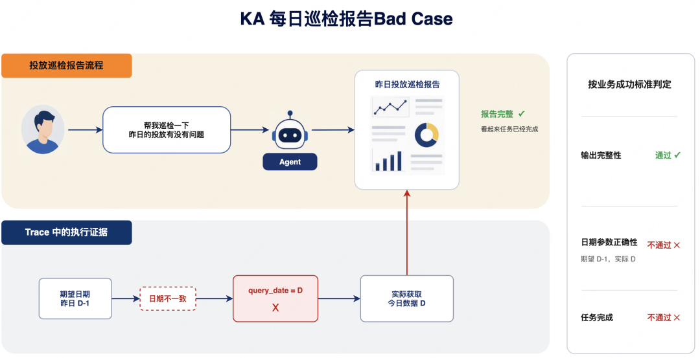

#### 丰富维度

通过两条路径，为 KA 每日巡检设计了**六类共 41 个评测场景**。核心流程场景保证主链路及关键分支覆盖，其他分组补充触发词变体、业务变量和能力边界等变化。

其中，**路由转交与核心主流程同样重要**：生产可用的 Agent 不仅要知道"应该做什么"，还要知道**什么时候不应启动完整巡检，而应追问、转交或拒绝**。

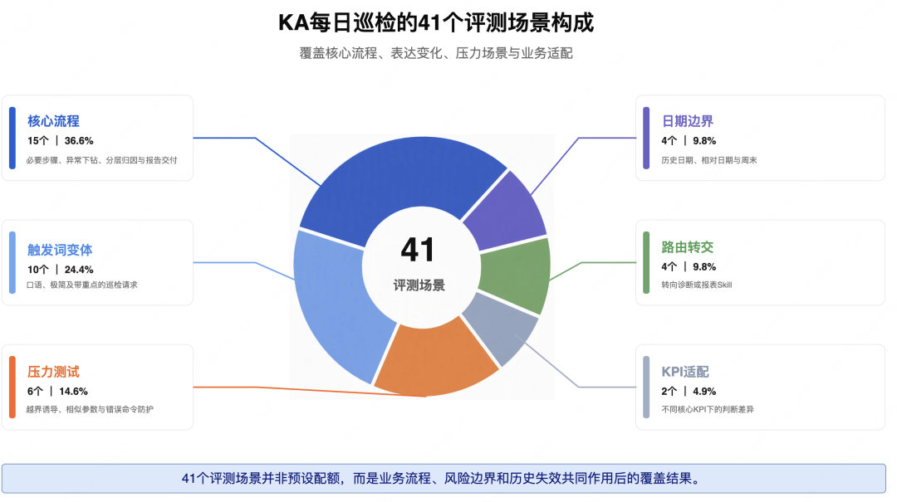

### 2.2 定义成功标准与判定方法

#### 定义成功

以到店 KA 巡检任务为例，商家让 Agent"巡检昨日投放"，收到一份报告就算完成了吗？从三个方面拆解：

**1. 执行流程遵循业务 SOP 了吗？**

- 观测工具调用顺序是否符合 SOP 设计，例如是否先调用取数工具，再进行门店筛查，接下来再下钻分析，最后输出巡检报告
- 必要步骤是否都覆盖到，例如数据查询、门店筛查
- 是否存在低效工具调用
- 是否存在重复工具调用
- 是否存在非必要步骤或低效步骤，例如多门店下钻分析时，是否并行分析
- 条件分支逻辑是否正确执行，例如未发现异常门店时，是否跳过投放层下钻，直接生成巡检报告

**2. 执行过程和结论有据可依吗？**

- 工具的参数值是否与任务上下文语义一致，例如查询日期是否对应商家要求的"昨日"
- 是否选择了正确的工具
- 调用工具时是否违反静态参数约束
- Agent 输出是否忠实于工具实际返回的数据

**3. 确定输出的巡检报告是可交付的吗？**

- 输出结果是否缺失内容，例如是否真的输出了一份巡检报告
- 输出格式是否遵循必要模板，例如巡检报告必要的表格是否输出了
- 输出结论是否存在模糊表述

这些检查项构成任务的**评分细则（Rubric）**：

| 类别 | 检查项 | 是否影响任务成功 |
|---|---|---|
| **成功必需项** | 必要步骤、顺序调用、正确工具、参数一致性、参数合规性、输出忠实性、输出完整性、输出遵守必要模板 | 决定任务是否成功 |
| **质量分层/诊断项** | 低效与重复工具调用、规划效率、结论表达 | 不影响成败，用于分层与诊断 |

判定成功时：**可从 Trace 中精确取证的检查项由确定性 Grader 判定**，**需要理解业务语义和证据关系的部分交给 LLM Grader**。

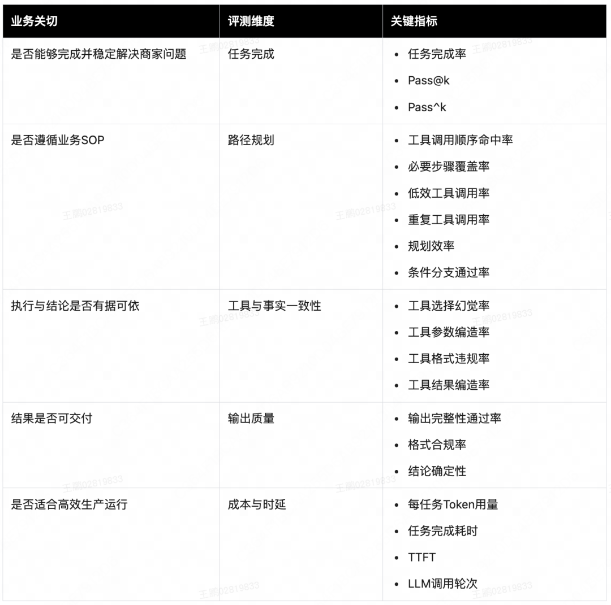

#### 评测指标

一次巡检通过了检查，还不能说明 Agent 已经可靠，还要回答：换一种业务场景还能完成吗？同一任务多跑几次会不会时好时坏？完成任务要花多少时间和成本？

汇总各场景、多次执行的检查结果，结合运行中的资源消耗，形成五个维度：

| 维度 | 指标 | 作用 |
|---|---|---|
| 整体成功 | **任务完成率** | 反映整体成功情况 |
| 能力上限 vs 稳定性 | **Pass@k** / **Pass^k** | 分别衡量能力上限与执行稳定性 |
| 失败定位 | 工具调用顺序命中率、必要步骤覆盖率等 | 帮助定位任务成功/失败的主要原因 |
| 输出质量 | 规划效率、结论确定性等 | 观测输出质量 |
| 资源消耗 | Token、LLM 调用轮次、端到端时延、TTFT | 衡量资源消耗与生产运行效率 |

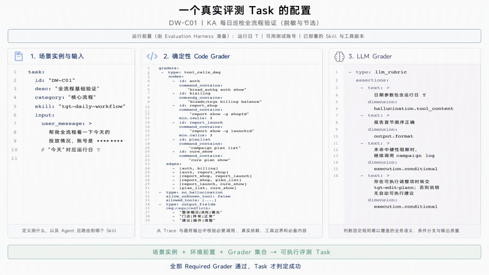

### 2.3 评测 Task Schema

评测场景明确"测什么"，成功标准明确"怎样算做对"。组织成可执行的 Task，还需要明确**测试账号、运行日期、业务数据状态和必要权限**等前置条件。

对 2.1 节的 41 个场景实例，为每个实例补充 Grader 和执行环境前置条件后，形成 **41 个可执行评测 Task**。

字段映射关系：

- `tool_calls_dag` → 路径规划
- `no_hallucination` 和 `hallucination.*` → 工具与事实一致性
- `output_fields` 和 `output.*` → 输出质量
- `execution.conditional` → 检查条件分支
- 任务完成率、Pass@k、Pass^k 及成本时延 → 由 **Harness 基于多次 Trial 聚合**，不属于单个 Task 的 Grader

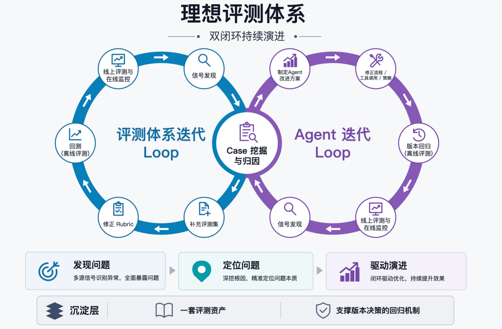

这条 Task 通过一组确定性规则和语义 Rubric，分别约束 Agent 的**工具调用、参数边界、事实依据和最终交付**。

---

## 三、评测优化与 Agent 迭代（Error Analysis）

Error Analysis 同时驱动两条迭代闭环：

1. **修正 Task、Grader 和数据**，使评测更加可信
2. **优化 Skill、工具和模型**，使 Agent 持续提升

**Case 挖掘与归因是连接两条闭环的枢纽。**

### 3.1 校准评测器

评测器本身也会出错。**OpenAI 审计 138 道难以攻克的 SWE-bench Verified 任务时，发现其中 59.4% 存在任务描述或测试设计缺陷。** 这说明即使广泛使用的 Benchmark，也需要持续校准。

商家 Agent 同样如此：Trace 解析、确定性 Grader 或 LLM Rubric 一旦存在偏差，就可能导致错误归因。因此，**在依据评测优化 Agent 前，需要先确保"尺子"可信**。

#### 可信

评测器投入规模化使用前，需要先证明它能够稳定复现业务专家的判断。建立由业务专家确认的**校准集**，同时覆盖明确的 Good Case、Bad Case 和边界 Case，并**分别验证** Trace 解析、确定性 Grader 和 LLM Rubric，避免用一个总体一致率掩盖不同环节的问题。

**确定性 Grader 校准重点**：检查规则是否准确表达了必要的业务约束。

早期评测 Task 使用**线性顺序**描述工具调用，适合表达简单的前后依赖，却容易将合理的并行与汇聚路径判为失败。人工复核发现这类**假阴性**后，将复杂路径升级为 **DAG**：节点表示必要工具调用，边只保留真实的数据依赖，互不依赖的步骤允许采用不同顺序。规则修正后，再回放历史样本，确认误判得到消除且没有引入新的问题。

**LLM Grader 校准重点**：验证它与业务专家在语义判断上的一致性。对 LLM Rubric 进行人工抽检，分析和判断问题来自 Rubric 表述、证据缺失，还是业务标准本身存在歧义。

> 对于证据不足的高风险问题，评测器也应**允许返回"无法判断"**，而不是强制给出缺少依据的二元结论。

**特别注意**：评测误判减少说明尺子变得更准确，**不代表 Agent 能力得到提升**。只有使用校准后的同一套标准重新执行 Benchmark，才能判断 Agent 是否真正变强。

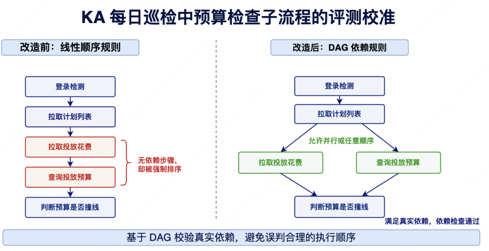

#### 长期可信

通过初始校准并不意味着评测器会永久正确。模型、Agent 和 Skill 持续迭代，业务 SOP 和能力边界会变化，账号状态、工具接口和 Trace 格式也可能漂移。因此，**评测器需要像被评对象一样持续维护**。

持续校准 ≠ 永久全量人工复核。三种机制结合：

| 机制 | 做法 |
|---|---|
| **自动回归** | 每次修改 Trace 解析、确定性 Grader 或 LLM Rubric 后，在固定校准集和历史样本上重新执行，检查是否引入新的误判 |
| **稳定抽检** | 评测运行稳定后，定期随机抽取少量样本人工复核，监测人机一致性和数据分布是否变化 |
| **触发复核** | 模型、Skill 或执行环境较大变化，指标分布突然异常，或线上反馈与离线判断明显不一致时，提高人工复核比例 |

人的职责是：**校准标准、处理争议、复核高风险结果和识别新的失效模式**。新的问题经过确认后，再回流到校准集、Grader 和历史回归样本中，形成评测器自身的持续迭代闭环。

### 3.2 根因分析

任务失败只是一个结果，并不是根因。任务完成指标告诉我们"是否失败"，**分层指标**则将问题进一步定位到路由、必要步骤、工具参数、条件分支、事实依据或最终输出等具体检查项。

> **原子指标能够指出问题发生在哪里，但根因仍需要从执行证据中确认。**

同一个"必要步骤缺失"，既可能是 Skill 没有明确约束，也可能是模型在长上下文中遗漏了要求，还可能来自数据、环境或 Grader 异常。

定位到具体检查项后，直接查看与该指标关联的**局部 Trace、工具参数和返回结果**，通常即可确认问题原因和对应的优化点。

只有当以下情况才进一步查看完整 Trace、重复执行或补充控制变量验证：

- 指标与 Trace 结论冲突
- 局部证据不足
- 同一问题随机出现
- 仍无法区分 Skill 与模型问题

这样既利用指标缩小分析范围，也保留 Trace 作为最终判断依据，**避免每个 Bad Case 都从头排查完整执行链路**。

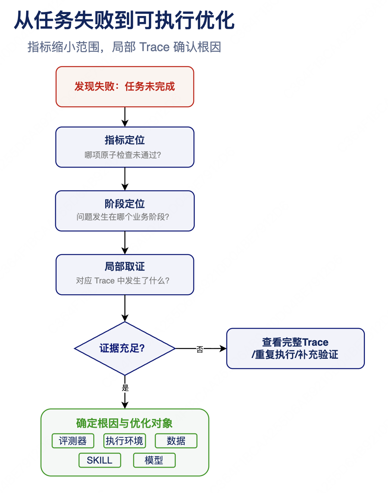

### 3.3 具体例子——巡检任务优化

#### 定位问题

分层指标显示，每日巡检的问题主要集中在四个方面：

1. 配置职责混杂
2. 命令路由不唯一
3. 条件分支和停止条件不明确
4. 稳定逻辑过度依赖模型

结合相关局部 Trace 确认根因后，将问题转化为对应的系统优化动作。

**优化遵循同一原则：减少模型需要记忆和自由判断的确定性约束。**

| 职责 | 承担方 |
|---|---|
| 平台、账号和参数红线 | 公共配置统一管理 |
| 业务分支与停止条件 | 写入 Skill |
| 解析、计算和筛选 | 确定性代码 |
| 流程调度、条件理解和业务表达 | 模型聚焦 |

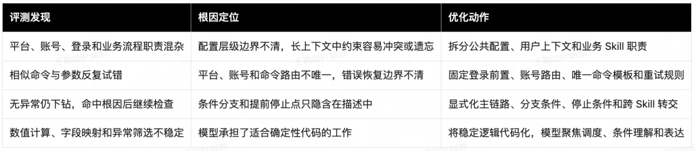

#### 验证优化

优化后，使用同一套 KA 每日巡检 Benchmark 进行回归，主要正向变化如下（原表标注：优化幅度经过了脱敏处理）：

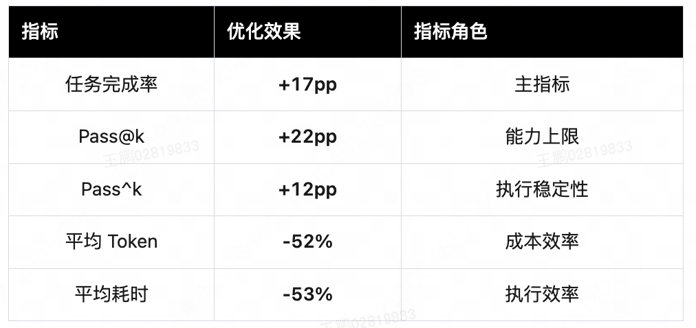

> 结果表明，Agent 的能力上限和执行效率均明显提升，但 **Pass^k 仍显著低于 Pass@k**，主要瓶颈已从"**不会做**"转为"**不能稳定做对**"，这对后续优化思路具有指导意义。

#### 离线到线上

离线 Benchmark 可以验证能力、稳定性、事实性、Token 和时延，**却不能直接等同于商家业务收益**。完整的证据链还需要结合线上过程指标进行验证，并进一步关联到用户采纳、问题解决和投放效果。

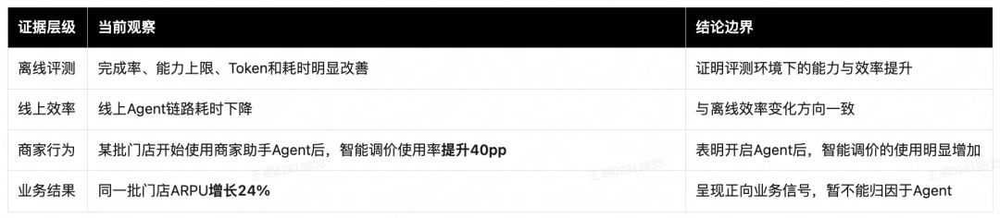

> 原文备注：由于当前使用商家数较少且缺少同期对照组，上述变化还可能受到季节、活动和商家经营状态等因素影响。因此，**将其视为业务价值的初步信号，而非因果收益**；后续还需通过扩大样本和对照实验完成验证。

---

## 四、评测体系的工程化落地

随着模型、Skill 和工具持续更新，团队需要复用任务与判定标准、批量执行评测，并保留问题复核和版本比较所需的证据。借助**图灵评测平台**，将评测准备、执行判定和分析回归组织为可重复运行的流程。

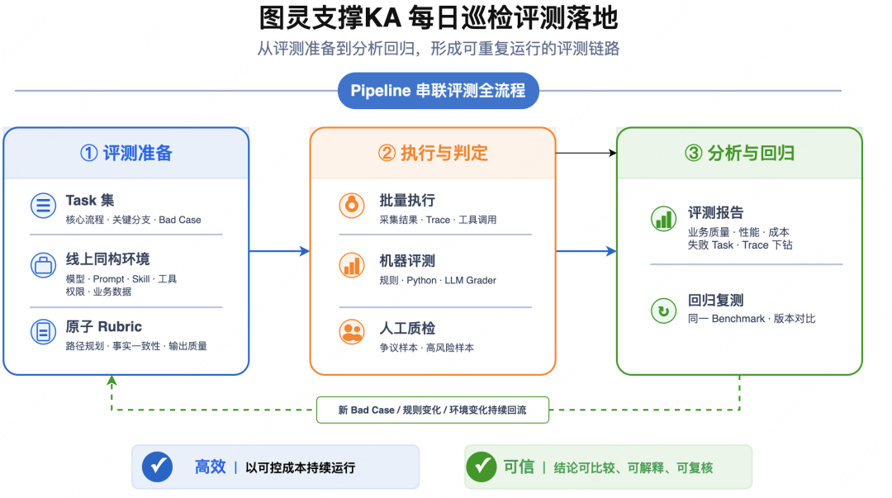

### 4.1 构建可信的评测流程

即使 Agent 生成了一份完整报告，团队仍需确认：它是否查询了正确日期、执行了必要的筛查与下钻、依据真实数据得出了结论。图灵通过**任务与环境管理、逐项判定、证据下钻和人工质检**，为**条件可核对、结论可追溯、偏差可修正**提供支撑。

#### 统一任务与配置，让版本比较有可核对的基线

比较两个版本的巡检完成率，首先要确认它们面对的是**同一批任务和同一套要求**。

- 通过 **Task 集管理**维护任务输入、前置条件和预期行为
- 通过**环境配置**复制线上 Agent 配置作为评测基线，明确模型、Prompt、Skill、工具和权限
- 验证某项改动时，需明确变更项，并核对其余配置是否一致

例如，验证新版 Skill 能否正确处理"昨日"，应复用相同任务与判定标准，对照查询日期和任务上下文。

> **复制配置并不等于固定了业务数据。** 真实账户数据会随时间变化，团队还需核对运行日期、账号和数据状态。只有运行条件可比，完成率变化才具有解释意义。

#### 将业务标准落为检查项，让判定能够追溯到执行证据

在图灵的 Evaluator 中，将 Rubric 配置为可执行检查项：**可精确取证的内容由脚本判定，涉及语义理解的内容由 LLM 判定**。成功必需项决定任务是否完成，质量诊断项用于分析优化，并在多轮评测中复用统一口径。

进行根因分析时，团队可从评测报告**下钻到具体 Task、失败检查项和执行片段**，复核日期是否正确、结论是否忠实于数据。检查项帮助定位偏差，根因确认仍需结合上游证据，必要时通过复现或对照验证。

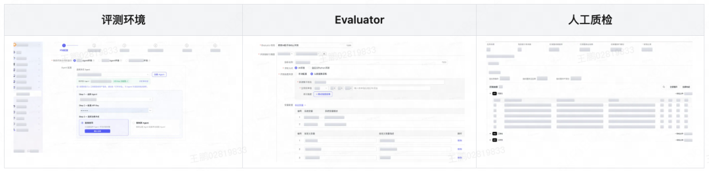

#### 把人工复核接入评测流程，让误判能够被发现和修正

通过图灵的**人工质检**抽检 LLM Judge 的判定结果，以**人机一致率**衡量其与业务专家判断的一致程度，并重点复核争议样本和高风险结果。对不一致的样本，结合执行证据排查 Rubric 表述、证据理解或业务标准歧义，调整后通过历史样本回归验证。

真实分歧案例：

> 工具返回"**投放消耗下降**"，Agent 却在报告中写成"**投放效果变差**"。LLM Judge 判为忠实于数据，业务专家则认为消耗下降不足以证明效果变差，判为**不通过**。针对这类分歧，团队明确 Rubric 中"结论必须有数据支撑"的要求，再用历史样本验证人机一致率是否改善。

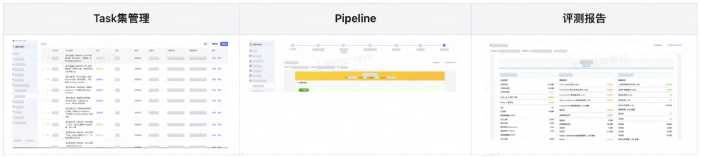

### 4.2 评测效率：从单次评测到持续回归

首次评测完成后，后续每次迭代都要回答：**改动是否解决了目标问题，其他场景是否退化，成本与耗时是否发生变化。** 图灵将 Task 集、Evaluator 和 Pipeline 保留为**可复用的评测资产**。

#### 复用已有评测资产，减少每轮准备工作

首次建立巡检 Benchmark，需要配置任务、执行环境和检查项，并校准评测器。后续更换模型或调整 Skill 时，若任务与成功标准不变，可复用 Task 集、Evaluator 和 Pipeline，重点更新被测配置、补充必要场景。

#### 批量串联执行与判定，减少人工操作和数据搬运

图灵通过 **Pipeline 串联任务批量执行、结果采集和机器评测**，并关联 Task、执行环境及 Agent 版本。巡检报告、查询参数、工具返回和 Trace 随执行过程采集，再由已配置的 Evaluator 完成逐项判定。

#### 从修复单个问题走向持续回归

修复一个失败任务后，还需要检查改动对其他场景的影响。评测报告汇总任务完成情况、各维度指标、耗时与 Token 用量，并支持下钻到具体 Task、检查项和相关 Trace。

例如，显式化停止条件后，既要验证"**无异常时不继续下钻**"，也要检查"**存在异常时仍能完成必要诊断**"。团队在可比条件下复用 Task 集、Evaluator 和 Pipeline 执行回归，对照优化前后的目标检查项、整体完成率与成本耗时，确认收益与退化情况。

---

## 五、Takeaway

业务 Agent 评测体系**不是一次性建设完成的测试平台**，而是一套从业务任务出发，逐步形成场景、指标、证据、诊断和迭代闭环的业务基础设施。其他业务不必复制这套 Task 和指标，但可以复用这条建设路径。

1. **从业务任务出发，而不是从公开数据集出发。** 公开 Benchmark 提供通用参照，业务 Benchmark 负责定义真实生产要求。
2. **从业务风险推导指标，而不是先有指标再寻找解释。** 每个指标都应对应具体风险和执行阶段。
3. **指标既要能够衡量，也要能够诊断。** 任务失败后，应能够下钻到原子检查项和局部证据。
4. **评测器和 Agent 分别迭代。** 尺子变准和能力变强是两个不同的闭环，不能混为同一类收益。
5. **离线 Benchmark、线上过程指标和业务结果共同构成证据链。** 离线提升是必要条件，但不能自动推导出业务收益。

## 六、结语

当 Agent 从"生成内容"走向"完成业务任务"，评测也需要从判断答案好不好，转向判断它**是否沿着正确路径、基于真实证据、以可接受的成本稳定完成交付**。

一套真正有价值的业务 Agent 评测体系，不以 Task 数量、指标数量或自动化程度为终点。它的价值在于：**业务问题能够被稳定复现，失败能够被快速定位，优化能够被可信验证，线上变化又能持续反哺下一轮评测和业务迭代。**

---

## 附：招聘、互动与尾部素材

- 美团商业增值技术部招聘大模型应用方向工程师（Agent Harness、大模型后训练），简历投至 liumo06@meituan.com
- 美团图灵评测团队招聘 Agent 评测平台产品经理、Agent 评测工程师，简历投至 zhengzhenzhen02@meituan.com
- 评论区活动：精选 3 条评论送美团定制手机磁吸支架，截止 11 月 24 日 10:00

