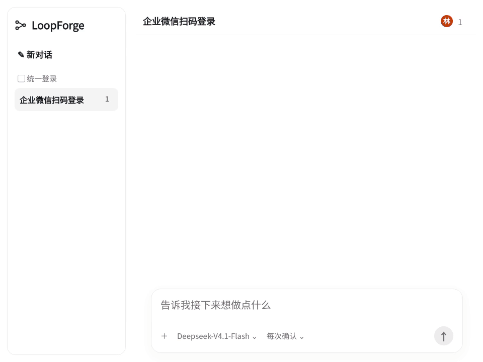
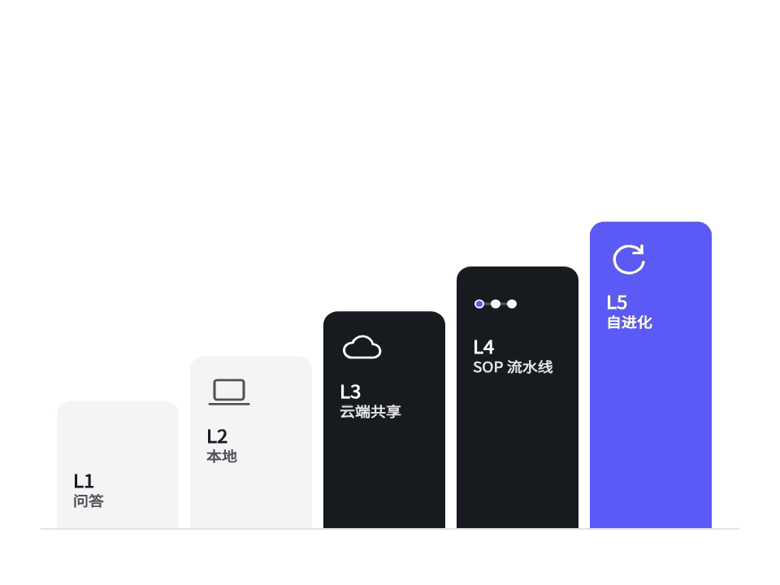
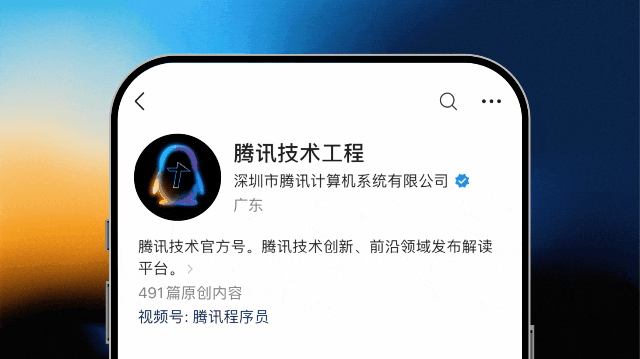

# 登上 GitHub Trending｜腾讯开源 LoopForge

> **一句话**：单机 Coding Agent 写代码很快，但走进研发团队后，"合盖断流、多人上下文割裂、Vibe Coding 质量失控、日常盯单耗时、同类问题反复踩坑"五道坎会把团队卡在「单兵提效、全局内耗」的瓶颈里。腾讯轻量云团队把这五道坎逐个工程化，做成了开源平台 LoopForge。
>
> **落地数据**（原文口径）：服务内部 20+ 业务，单月自动完成 200+ 需求与日常单据交付。

**开源仓库**：[github.com/Tencent/LoopForge](https://github.com/Tencent/LoopForge) ｜ **官网**：[loopforge.cn](https://loopforge.cn) ｜ **在线预览**：[loopforge.cn/demo](https://loopforge.cn/demo/)

---

## 零、与 DeepSeek《Super-agent 设计探索》的定位差异

这篇文章是腾讯技术工程在 DeepSeek 发布《Super-agent 设计探索：迈向更自主的 Agent 系统》并开源研究原型之后写的。原文直接给了一张五维对照表——**这是理解两套方案边界最清晰的材料**，完整转录如下：

| 对比维度 | DSH Super-agent 原型 | LoopForge |
| --- | --- | --- |
| **核心定位** | 面向个人或轻量团队的异步工单调度原型 | 面向研发团队多人协同与工程交付的云端平台 |
| **交互与入口** | 浅层 Router 只做事件分发，不直接写代码 | Main Bot 主副驾：小改动直接改代码提 MR，大需求派发 SOP |
| **协作拓扑** | 单工单绑定单 Worker 独立干到底（跨角色协同留作开放问题） | 产品 / 设计 / 研发同会话共享工作区 + 五层解耦多角色 SOP 流水线 |
| **中途接管** | 黑盒后台自治为主（中途如何介入与接管留作开放问题） | 共享工作区随时 暂停 / 恢复 / 直接接管，支持在线 IDE 与终端介入 |
| **质量与演进** | 外部 Watchdog 监控 + 人工调整提示词（长程演进留作开放问题） | 内环客观门禁当场自愈 + 外环工程级 RSI 自动复盘开处方改写 SOP |

值得注意的是第四列和第五列：DeepSeek 原文标注为「开放问题」的三项（跨角色协同、中途接管、长程演进），LoopForge 都给出了工程答案。它不是在复刻原型，而是在补原型的留白。

---

## 一、五步演进总览

原文强调：**不是第一天就设计了庞大架构，而是顺着团队真实落地的痛点一步步跨过五道坎**。

| 阶段 | 痛点 | 走向 |
| --- | --- | --- |
| 1 | 本地跑 Agent 合上电脑就断流 | 云端运行（7×24） |
| 2 | 多人窗口孤立、跨角色靠人肉传话 | 云端共享上下文 |
| 3 | 多人自由 Vibe Coding 质量难兜底 | 工程级 SOP |
| 4 | 例行事务与零散问题仍需人工盯守触发 | 无人值守自动化 |
| 5 | 静态流程不长记性、同类问题反复踩坑 | 工程级 RSI 自进化 |

---

## PART 01｜从本地 Agent 到云端 7×24 小时运行

### 本地运行的三个物理瓶颈

- **合上电脑就断流**：跑一个耗时半小时的重构或全量测试，人不敢关机、不敢断网，下班合上笔记本任务直接中断。
- **本地环境重、并发受限**：同时开三五个需求分支，本地端口冲突、容器把内存吃满，个人电脑扛不住多任务并行。
- **换台机器就丢现场**：改了一半的代码、还没提交的分支和环境变量全锁在个人电脑里，换设备或让同事帮忙看看都无从下手。

### 三层云端运行底座

**1. 云端隔离工作区，全程免本地起环境**

每个任务对应一个独立的云端容器或安全沙箱工作区，可同时拉取前后端多个代码仓库并自动切好工作分支。编码、编译、单测、联调与提 MR 全程在云上完成——本地不用再起开发环境。

**2. 存算分离与自有机器一键接入**

工作区既可以跑在平台托管的云端容器里，也可以把团队的云主机或闲置开发机一键接入平台，7×24 小时在线接单。底层执行环境与具体编码工具解耦（支持自由切换 Claude Code、Codex、CodeBuddy 等），**代码仓库凭证由网关按身份临时注入、任务结束自动擦除，模型全程接触不到明文密钥**。

**3. 自动快照休眠，随时无损唤醒**

7×24 小时在线不等于 7×24 小时空烧算力。当云端工作区闲置回收或跨机器切换时，系统自动将未提交的代码修改与分支状态打包保存为云端快照；第二天回来继续对话时，系统自动从快照完整恢复代码现场。

---

## PART 02｜从个人单机到团队共享上下文

### 为什么放弃多 Bot 群聊

如果每个人还在各自孤立的窗口里跟 Agent 对话，团队上下文依然割裂：产品经理让 Agent 梳理了需求，设计师出了设计稿，到了研发手里又得把背景、仓库分支和设计约束重新贴一遍。

**那直接把一堆 Bot 拉进群里自由群聊呢？** 原文明确否掉了这条路，理由是具体的：消息刷屏、上下文互相污染，而且在多人对话里放开写权限，还容易被他人随口发言误导引发越权操作。

### 两个设计

**1. 共享会话 + Main Bot + 云端工作区**

坚持「一个对话同一时间只绑定一个云端工作区，且只有一个 Main Bot 对接全组成员」。每次任务对应一个团队共享会话，产品、设计、研发直接进入同一个会话与 Main Bot 对话，**成员换人发言时底层自动续接同一个会话上下文**，操作的也是背后同一个真实工作区。

改行文案、调样式、修小 Bug 这类日常需求，任何成员说一句，Main Bot 当场打开云端工作区改代码、跑验证并一键提交 MR，全组实时可见、无需二次同步。

**2. 独立审查模型代批 + 三挡权限放行**

原问题很真实：所有写操作一刀切弹窗拦截，跑完一个任务要点十几次确认；但在多人共享对话里直接开全自动，又怕被群内他人随口一句话误导越权执行高危命令。

三挡权限模式：

| 模式 | 行为 |
| --- | --- |
| **每次确认**（稳妥受控） | 涉及修改的操作一律生成待确认草稿，人工确认后自动继续执行下一步 |
| **智能代批**（风险自审） | 每次改代码、跑命令或提 MR 前，由**无工具、无凭证**的独立审查模型同时评估操作风险与**当前发起人的授权意图**；常规操作自动放行，高风险或未授权转人工 |
| **完全自动**（高效直通） | 在授权范围内按顺序一次性自动执行完毕，仅在遇到破坏性冲突警告时强制拦截确认 |

其中「智能代批」这一挡的措辞值得细读：**严格隔离群内其他成员发言与提示词注入，他人发言不能替当前操作人授权**。它防的不只是模型幻觉，而是把「谁有权发起」和「操作本身多危险」拆成两个独立判断。

---

## PART 03｜从自由对话到工程级 SOP

### Vibe Coding 在跨角色长链路上的三个痛点

1. **流程随意、假装完成**：没有标准的澄清、设计、评审与测试卡点；Agent 动不动自称"已改好"，实际连编译或单测都没跑通。
2. **跨角色交接靠聊天记录**：长对话越滚越长，上游对齐的边界条件被淹没在几十轮聊天记录里，下游编码频繁漏改。
3. **中途跑偏难接管、同类的坑反复踩**：任务跑到一半方向偏了，人在对话里强行插话容易把现场搞乱。

### 设计 1：五层标准解耦

把专业岗位能力与 SOP 流程拆成五层独立标准：

| 层 | 内容 |
| --- | --- |
| **岗位角色** | 封装"架构师 / 前端 / 后端 / 测试"等岗位的职责说明、编码规范、专属技能与客观验证门禁 |
| **SOP 流程** | 定义澄清、设计、编码、测试等节点的先后依赖、并行分支与失败打回重做路径 |
| **执行引擎** | 自由切换 Claude Code、Codex、CodeBuddy 等编码工具，岗位能力与具体工具解耦 |
| **运行环境** | 绑定云端持久化容器、安全沙箱或团队自有机器，提供一致的执行环境 |
| **交付物契约** | 明确上下游节点之间交接的结构化产物要求，保留完整历史版本 |

这些资产**全组共享**：正式需求可直接串成 SOP 流水线自动流转（每个节点只加载该岗位专属的规范与技能，并**自动屏蔽仓库里杂乱的个人本地配置**）；日常共享对话中，成员也可随时 `@专家角色` 做独立的只读咨询，获取建议后同步给 Main Bot 统筹——**专业能力共享，平时绝不乱插嘴**。

### 设计 2：主副驾三层秩序

协作收敛为可进可退的「人 ↔ Main Bot ↔ SOP 节点」三层结构。SOP 运行时，共享会话上方实时展示节点流水线，点任意节点可看它的思考过程与执行日志。中途发现方向偏了，不用去底层乱插话，跟 Main Bot 说一声即可三种方式受控接管：

- **暂停介入**：流水线在当前节点安全停下，由 Main Bot 或研发直接修改文件、跑命令验证
- **恢复续跑**：改完带着修改说明恢复流水线，交还后续节点继续完成测试与交付
- **直接接管**：终止后续流水线，接管工作区已有成果，改完由 Main Bot 直接推送原分支发起或更新 MR

### 设计 3：工程级 RSI（这是全文最硬的一节）

原文对 RSI 的处理很清醒：**靠重新训练模型权重既不现实也太慢**，所以做的是工程级 RSI——让执行轨迹反哺系统自身的 SOP、角色规范与验证门禁，形成「执行 → 客观检验 → 复盘诊断 → 改写流程 → 下一轮更准」的飞轮。

**内环（单次运行内，客观门禁当场自愈）**

每个 SOP 节点内置编译、单测、代码规范等客观验证门禁——**不通过绝不放行**，Agent 拿着真实报错自动进入纠错循环当场修复（同时设重试上限防止死循环），把低级错误消灭在节点内部。

**外环（跨运行，递归复盘与资产自进化）**

每当一条 SOP 运行结束，复盘引擎自动回溯全链路轨迹（各节点耗时、失败门禁、无效重复尝试与返工原因），给出 **0~100 分健康度评分**，并让 Agent 自己为 SOP 和角色开出**结构化"改进处方"**：

| 处方类型 | 改什么 |
| --- | --- |
| **进化流程拓扑** | 针对容易卡壳或空转的环节，自动调整重试上限、失败回退路径与修复策略 |
| **沉淀防呆记忆** | 把本次踩坑提炼的经验与边界约束，自动追加到对应岗位的角色规范中 |
| **收紧验收卡点** | 针对漏网的缺陷类型，自动为角色新增或升级客观校验门禁，堵死同类问题 |

人在界面上只需审阅处方、点一下「一键应用」，系统自动改写对应的 SOP 或角色资产并生成新版本。**单次运行靠内环把代码改对，跨次运行靠外环把流程改强。**

---

## PART 04｜定时任务与 Issue 全链路自动化

### 三个真实工程卡点

- **人工盯单派单成本高**：缺陷单和体验问题散落在需求平台与代码仓库里，人肉巡检、手动复制上下文来启动 Agent，本身就是沉重机械劳动。
- **多个 Issue 并行修复极易撞车**：十几个 Bug 单在后台同时改完，往同一目标分支合并时频繁撞冲突，最后还得把研发拉回来手动解冲突。
- **个别卡点单会堵死整条流水线**：一两个复杂 Issue 停在关键门禁等人工确认，如果一直占着后台执行资源，后面的日常单子全被堵住。

### 三个对策

**01 定时自动拉单与双向同步**

系统通过定时调度任务与需求平台、代码仓库双向打通，按周期自动巡检待办池里新提的 Bug 与 Issue，自动按标签匹配对应修复 SOP、拉起云端工作区定位与修复；**执行过程状态与最终 MR 链接自动回写原单据**，研发不再手动建单、派单、搬状态。

**02 集成分支自动合流与冲突自愈**

同批次多个 Issue 并行修复完成、需汇总合入集成分支时，系统自动按序合并；遇到冲突时**自动提取冲突上下文，打回 SOP 的修复与验证节点自己解开冲突**并重跑编译与单测门禁，全部通过后再统一生成汇总 MR。

**03 主动健康巡检与审批挂起零阻塞**

可配置定时巡检任务（每日代码健康度扫描、依赖安全检查、构建失败自动排查），发现隐患直接生成修复方案。同时，流水线中任何需要人工拍板的单子，**进入「待我确认」队列的瞬间立即释放后台执行资源**，绝不阻塞后续大批量日常 Issue 的自动消化。

---

## SUMMARY｜用自动驾驶 L1~L5 衡量落地深度

| 级别 | 定义 |
| --- | --- |
| **L1 问答工具** | 问一句答一句，代码靠复制粘贴，关掉窗口就结束 |
| **L2 个人本地助手** | 能在本地 IDE / CLI 里改代码，但环境与上下文锁在个人电脑里，合上电脑就断流 |
| **L3 云端运行与团队共享空间**（阶段 1 & 2） | 工作区上云 7×24 运行，产品/设计/研发同一共享会话对接同一 Main Bot，配合独立审查模型代批 |
| **L4 工程级 SOP 与定时自动化流水线**（阶段 3 & 4） | 标准化 SOP、主副驾随时接管、客观质量门禁取代无序 Vibe Coding，定时拉单与自动解冲突实现无人值守交付 |
| **L5 自演进研发组织**（阶段 5 · 工程级 RSI） | 每次运行后自动统计效能、复盘返工根因，改进处方一键写回 SOP 与角色定义 |

### 原文最核心的一句判断

> 让 Agent 真正成为研发团队里的靠谱同事，从来不是靠写一段更长的提示词，也不是靠拉一个热闹的多 Bot 群聊，而是把"人的工程经验"转化为"系统的运行秩序"。

单机时代，我们把 AI 当作顺手的副驾驶，追求写出一段漂亮代码的即时爽感；但当它真正进入团队工程现场，**瓶颈很快就从"模型会不会写代码"，转移到了环境会不会断、上下文怎么对齐、质量怎么兜底、以及人怎么从繁琐的调度里解放出来**。

这五步本质上是一次次把「对人的依赖」沉淀为「工程机制」的过程。

---

## 附：开源信息

- **GitHub 仓库**：https://github.com/Tencent/LoopForge
- **官网**：https://loopforge.cn
- **平台在线预览**：https://loopforge.cn/demo/
- **部署**：克隆仓库运行 `bash scripts/install.sh`

---

## 相关阅读

- [[技能文档/2026-11-16-用Super-agent理念拆解Octop团队模式|用 Super-agent 的理念，拆解 Octop 团队模式]]（同源续作：DeepSeek《Super-agent 设计探索》的五组件拆解，本文与之互为对照）
- [[技能文档/2026-10-15-自托管AI-Agent开源项目-腾讯Octop|腾讯 Octop：自托管 AI Agent 开源项目]]（腾讯另一个 Agent 开源项目实测）
- [[技能文档/2026-11-16-Anthropic-Always-on-Agents-常驻智能体落地框架|Anthropic Always-on Agents 常驻智能体落地框架]]（常驻智能体的组件视角）
- [[技能文档/2026-11-17-Agent评测白皮书-业务实践篇-商家AI助手评测与优化闭环|美团 Agent 评测白皮书业务实践篇]]（客观门禁与质量兜底的另一条路径）
