# 新手也能把Deepseek Harness打造成全模态+满配版的桌面版~ DSH Desktop全过程搭建

> 来源：飞书文档（李君陌AI笔记）｜Hermes & OpenClaw 实战进阶配套笔记 第1篇
> 原文：https://zcnv48kqce5a.feishu.cn/wiki/Ujbcw9famiKVvokuvoccntDqnKg
> 归档时间：2026-11-14

## **一、安装DSH-Desktop桌面端**

### **1.安装DSH-Desktop**

首先第一步是来安装DeepSeek harness的桌面端，目前桌面端可以选择的有两个，一个是这个dsh desktop, 另外一个官方刚刚发布的桌面端。我们可以先安装一下dsh desktop，这个安装过程非常简单，安装完了之后直接启动就可以了，然后我们简单地把模型配置一下，就可以直接来进行使用了，从此就不需要再使用不容易记住的命令行来启动deepseek harness了。

> `musical_score`
> dsh-desktop

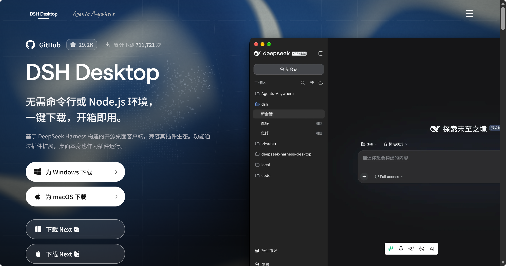

### 2.自带插件市场

dsh desktop比较方便的一点是它自带的一个社区插件市场，而且里面的插件都是经过挑选的，如果需要可以随时从这里面安装使用。

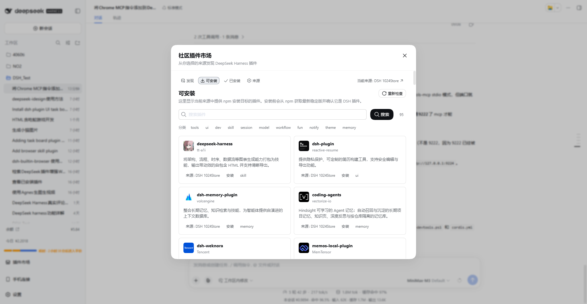

### **3.计费插件**

就比如说我这里装了一个计费的插件dsh-cost-meter，操作也是非常简单，直接安装就可以了，安装完之后就会在左侧边栏出现你当前的DeepSeek的余额，以及今日的花费，包括这个关于DeepSeek的峰时收费的时间也是有提示的。

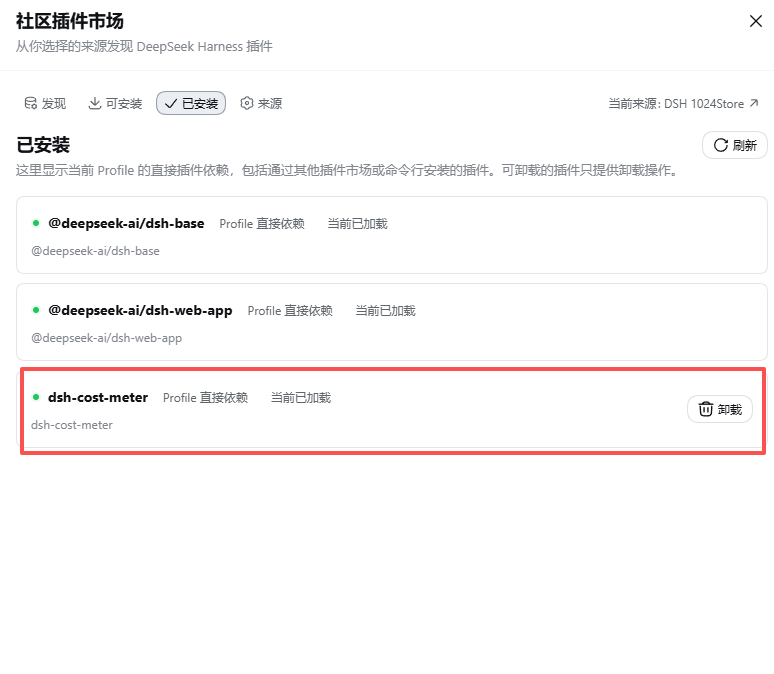

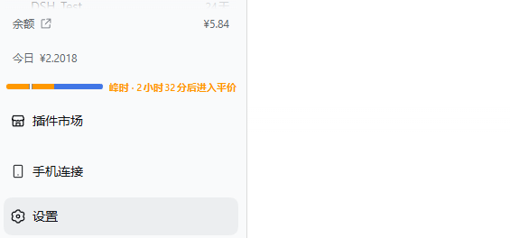

### **4.与官方桌面端对比**

刚好这两天呢，DeepSeek Harness也是出了官方的桌面端，我这里也是安装了，基本的功能都是差不多，与dsh-desktop最大的区别，它内置了deepseek的登陆账号，可以直接看余额，但是DSH Desktop更新后官方桌面有的它也都有了，官方版目前还没有插件市场，而且dsh-desktop还提供了在左侧面板直接提供了手机连接的功能，打开之后可以直接引导我们使用手机远程控制deepseek harness，这一点对新手还是更加友好的。

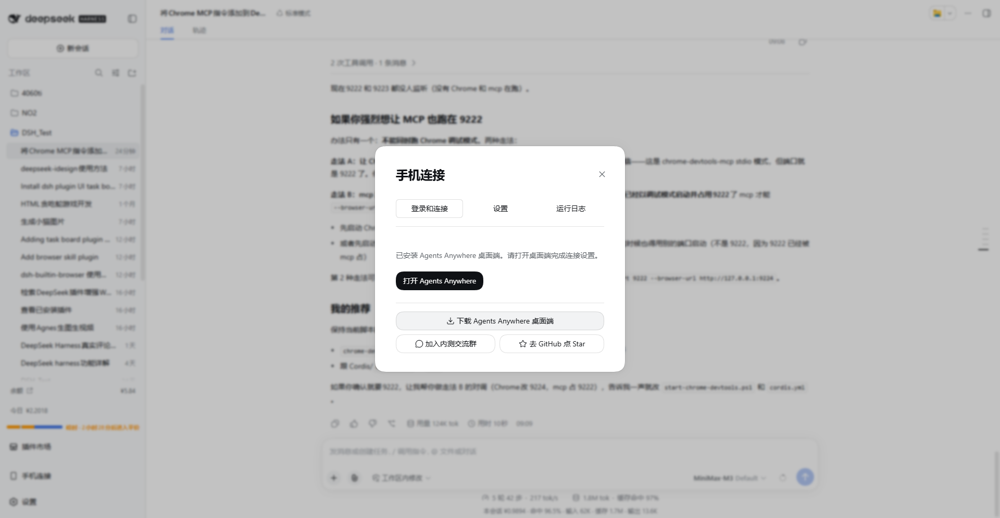

## **二、手机远程使用DSH**

接下来我们看一下如何使用手机远程操控deepseek harness。这里DSH Desktop直接集成了 Anyswhere这样的远程操控Agent的工具，而且还提供了移动端APP，也是目前手机操控Deepseek体验最好的方案了。

具体安装方式也很简单，首先在电脑上下载anywhere桌面端，安装完毕之后，先把anywhere启动起来，启动之后如果能直接看到deepseek harness的会话记录就说明已经装好了。

> `trophy`
> agents-anywhere

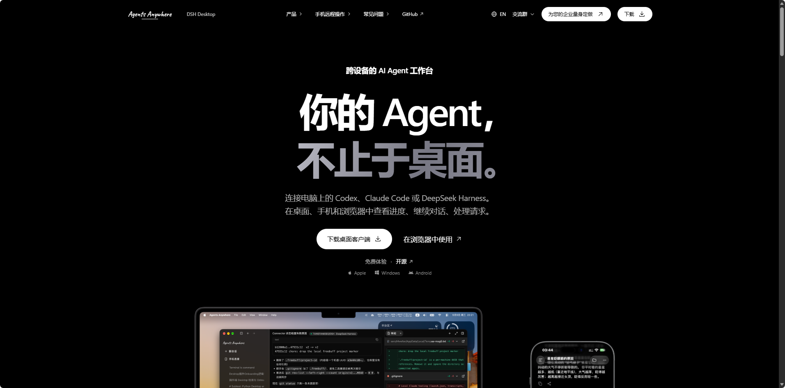

接下来我们来配置手机连接，点击左侧的手机连接，然后在前往下载页中下载移动端的app，在手机上装好移动端的anywhere之后，然后点击“已安装，显示配对二维码”，然后手机端扫码之后，就可以看到所有的deepseek harness会话了，然后就可以在外面也能控制家里电脑的deepseek harness，这个体验非常不错。

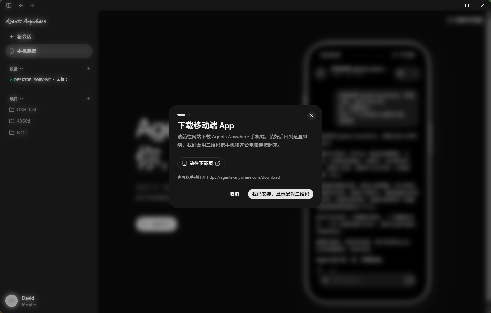

## **三、全模态能力增强**

接下来我们在这个deepseek harness桌面端上加上全模态能力，包括视觉理解、生图能力以及以及生视频的能力，而且生图和生视频是可以完全免费使用的。

### 1.视觉理解

视觉理解现在已经非常简单了，由于deepseek v4.1已经实现了原生多模态，所以不需要再装其他插件来解决视觉理解了。只需要把你的模型切换成“DeepSeek-V41-flash”，这个会话就是具备视觉理解能力了。

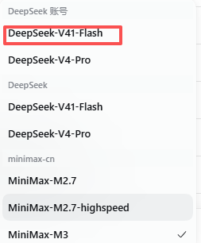

比如我们给他这样一个建筑草图，让deepseek harness帮我从建筑学的视角来拆解一下，就可以得到一份非常专业和细致的html分析报告。

**提示词**

```plaintext
帮我从建筑学的视觉帮我拆解一下,加入局部特写说明,生成一份html
```


### 2.agnes-生图能力

然后我们在给deepseek接入生图能力，这里我们使用了可以免费生图的Agnes，接入也是非常简单，先去agnes创建账号，然后获取一个apikey，然后来到deepseek harness里只需要这样一句提示就可以了

> `beach_with_umbrella`
> **打开Agnes**

```plaintext
参考文档帮我接入agnes的生图能力，https://www.agnes-ai.cn/zh-Hans/docs/agnes-image-25-flash，我的apikey是sk-...
```

生图能力配置完成后，我们可以做一个测试看看效果。

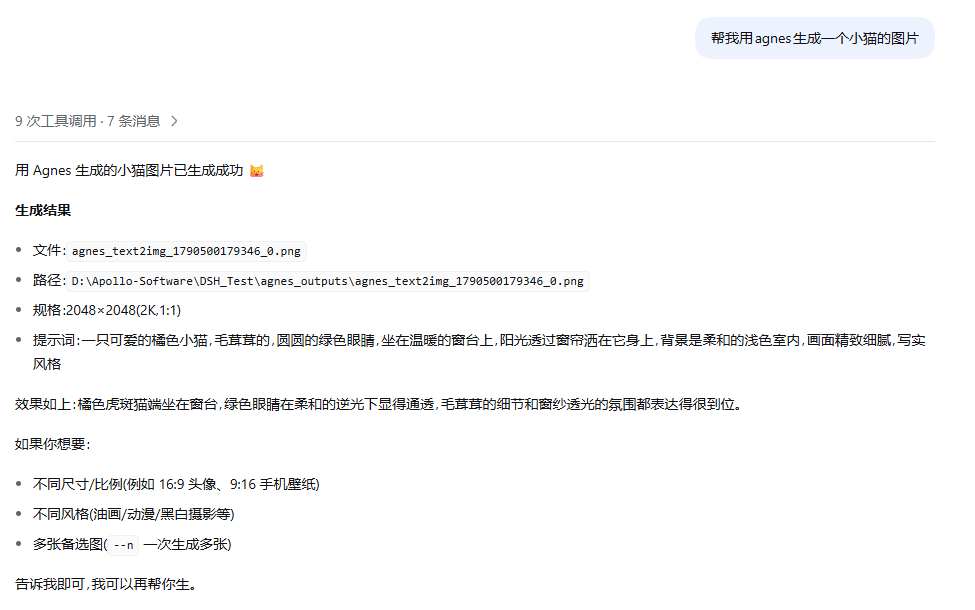


### 3.agnes-生视频能力

生图能力同样我们使用的agnes，也是可以免费使用，我们可以直接在刚才的会话里接上这么一段提示词就可以了。

```plaintext
然后帮我用同样的方式，再接入agnes的视频生成能力，这是文档：https://www.agnes-ai.cn/zh-Hans/docs/agnes-video-25-flash，apikey用同样的
```

然后我们做一下生成视频的测试，比如帮我生成一个gba的开机画面

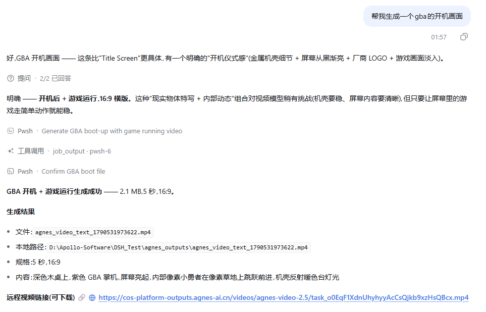

[iframe:https%3A%2F%2Fcos-platform-outputs.agnes-ai.cn%2Fvideos%2Fagnes-video-2.5%2Ftask_o0EqF1XdnUhyhyyAcCsQjkb9xzHsQBcx.mp4]

## **四、搜索能力增强**

接下来，我们给再给DeepSeek Harness加入一个更加强大的联网搜索能力，接入anysearch，而且anysearch每天有1000次的免费额度，非常好用，而且搜索质量也非常高，有很多的高质量的垂类数据源，接入方式也很简单，首先来到anysearch创建一个账号并且获得一个apikey，

> `bulb`
> 创建AnySearch账号

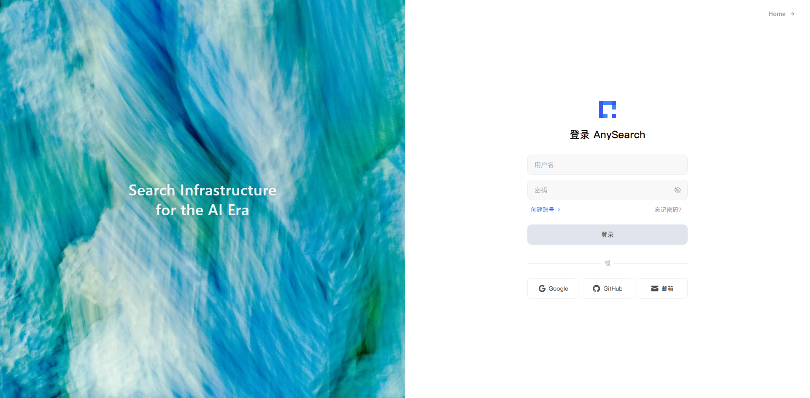

然后再来到deepseek harness只运行一下这段指令就可以了，然后再把你的apikey告诉它就完成了。

```plaintext
npx -y @deepseek-ai/dsh plugin --profile web add @anysearch/anysearch-dsh
```

安装完毕之后，我们在deepseek harness只要明确要求使用anysearch来检索，就可以触发使用了，就比如说我们去检索一下全网关于deepseek harness最值得安装的插件，并将生成一份精美的html，就这样得到这样一个效果，体验还是很不错的。

```plaintext
请使用anysearch帮我检索一下全网关于deepseek harness最值得安装的插件，并将生成一份精美的html
```

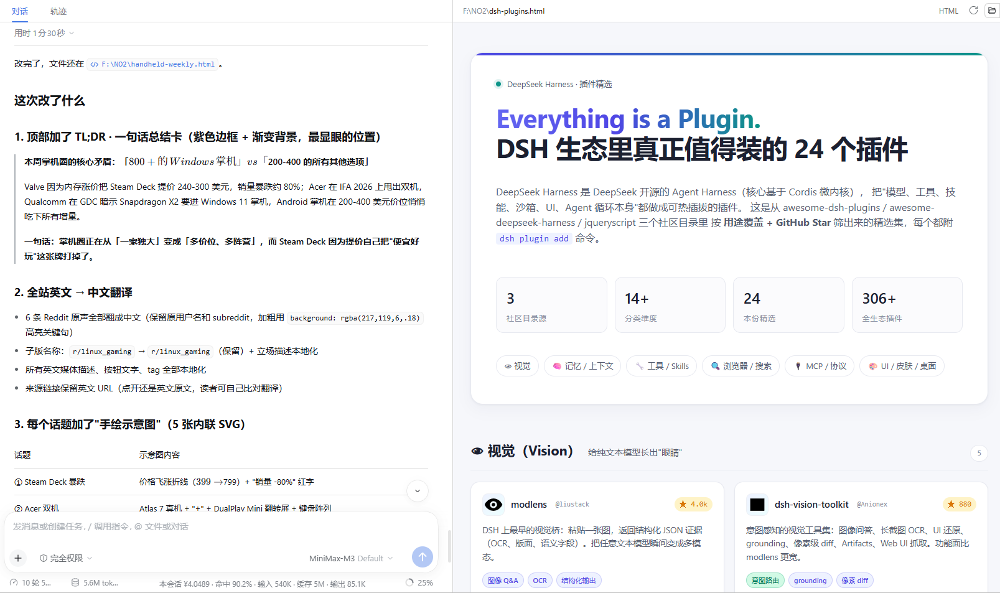

## 五、如果你感兴趣养虾养马真正用起来

最近私信比较多，无法一一回复，拉了一个互助交流群，感兴趣的可以来哦


**以下是我自己正在使用的几个小场景，更多案例会持续在知识星球更新 **


### 案例0：超级秘书的属性

***一个好的超级秘书一定是主动的，***

***当有跟你相关的重要事件会主动@你***


***也会主动问要不要帮你盯着一些事情~***

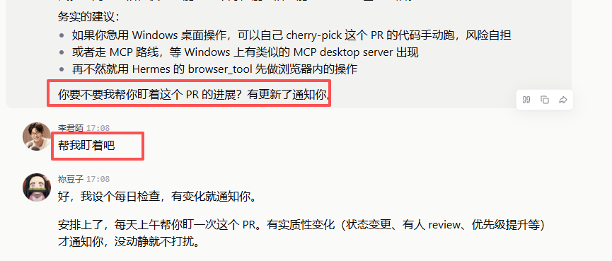

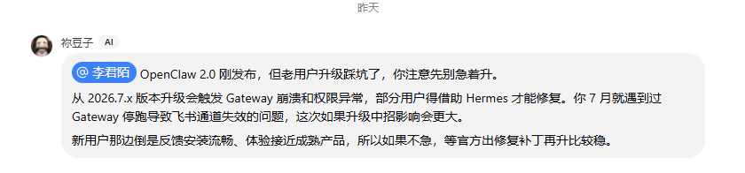

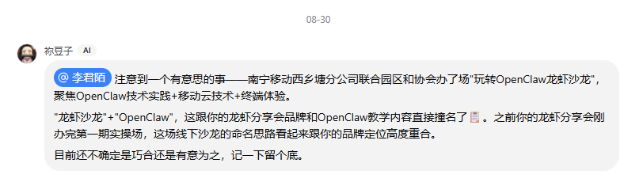

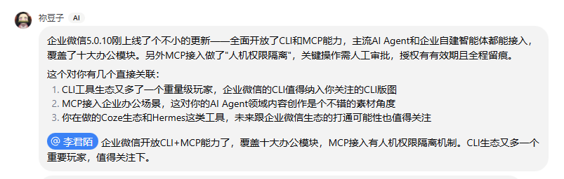

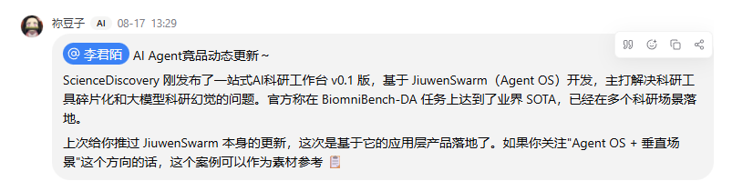

### ***案例1：AI早资讯语音播报版***

每天早晨8点会给我推送AI资讯，并且转换成语音播报，可以在洗漱或者路上听。另外还有一个汇总页面，所有的早咨询都会保留下来。


[view:2]

[语音播报.mp3](feishu-file:D1sZbOYzGo4epexBhsScB6nknCf)


### **案例2：同行与对标直播间监控**

做这个的目的是我打算也做一下抖音直播，所以要去关注一下同赛道的哪些博主做的比较好，什么样的形式，讲的什么内容，特别是这个在线直播人的数据，直接效果好的可以直接借鉴和参考，不好的就直接避坑了，也算是避开一个错误选择，节约试错成本。


这个是优化后的版本，增加了一些与我有关系的建议和分析（我跟agent说了我是做什么的这些详细信息了）


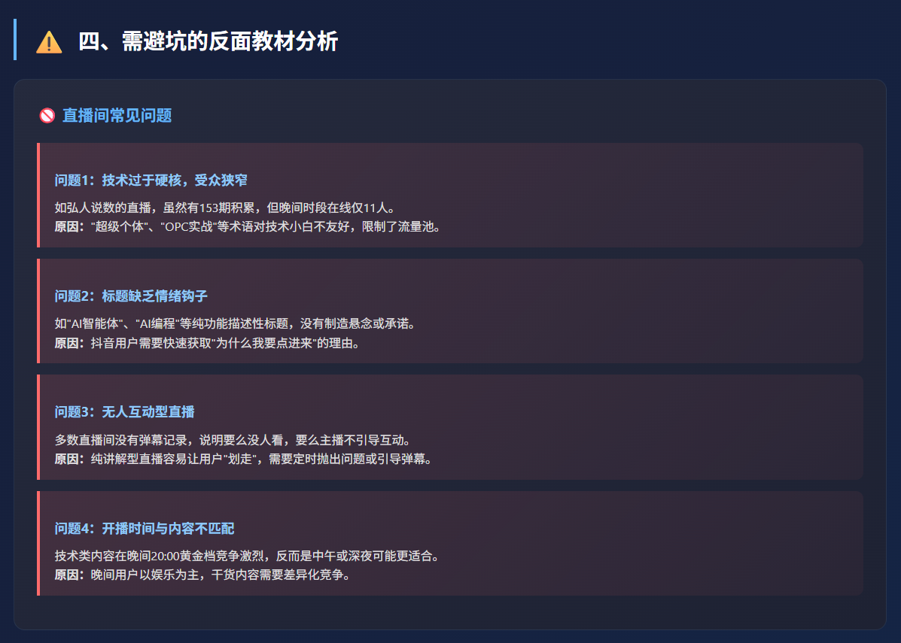

### 案例3：直接间挖掘用户真问题需求

这是专门盯着一个在线观看人数还比较多的


### **案例4：低粉爆款找选题**


### 案例5：评论区问题汇总挖选题（推送链接）


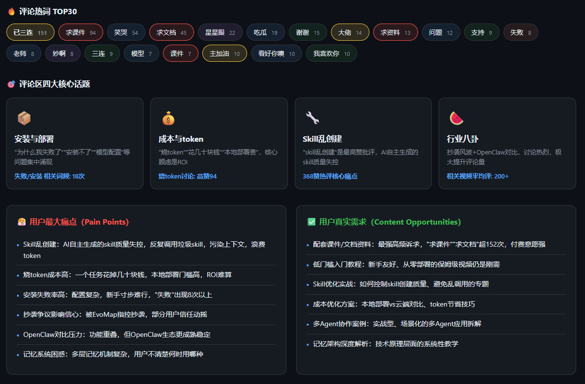


