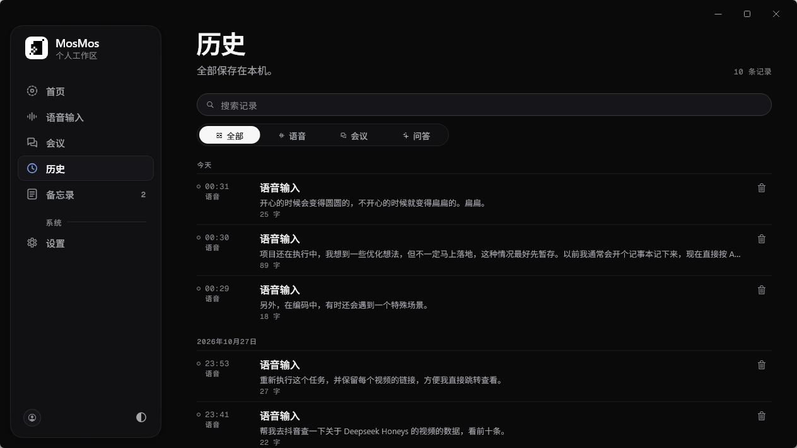
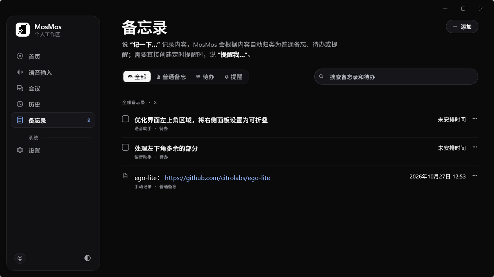
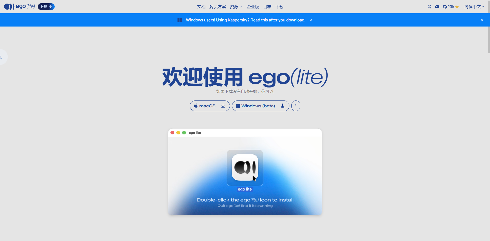
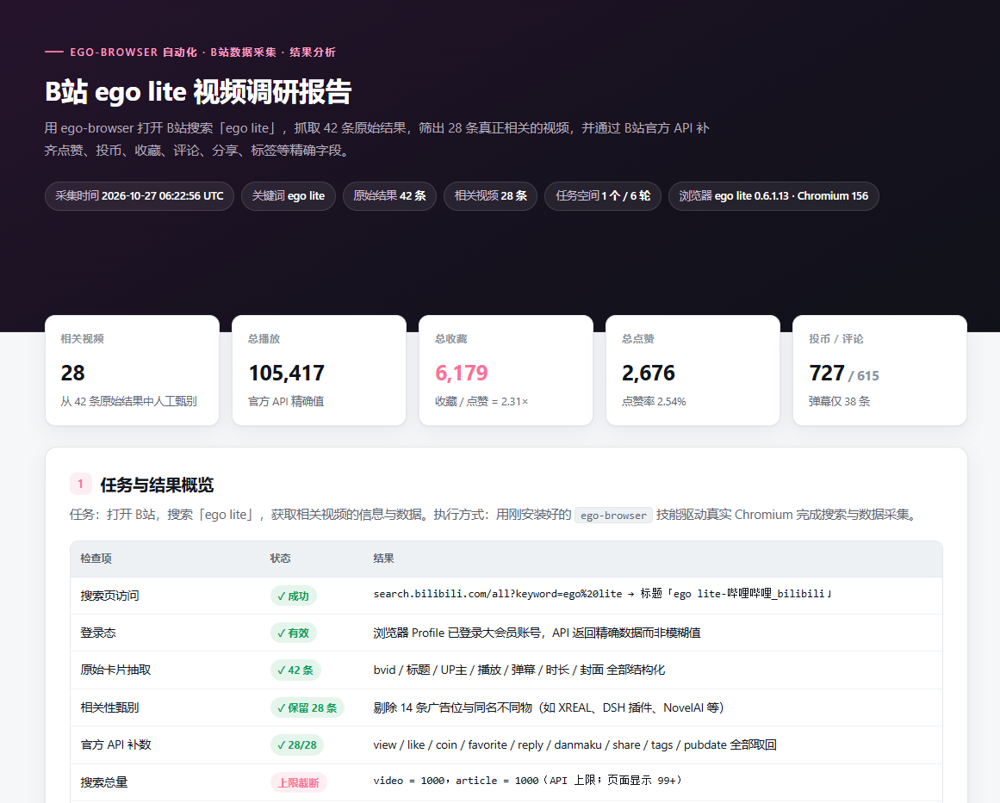
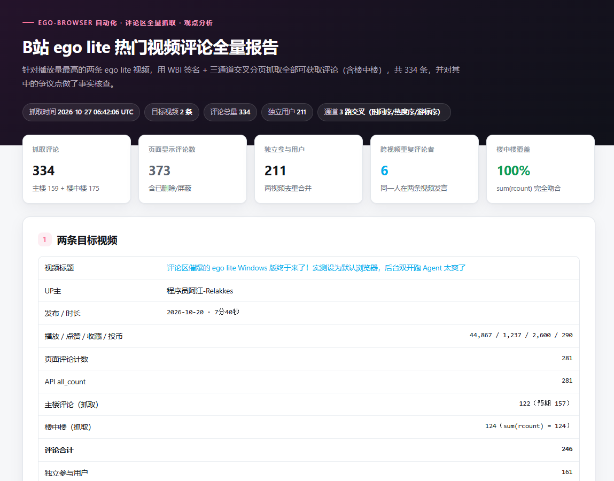
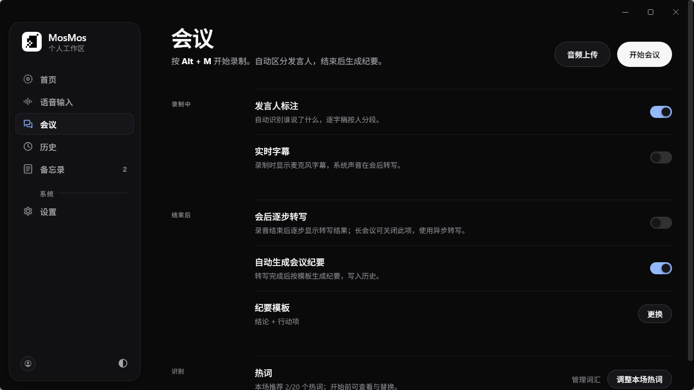
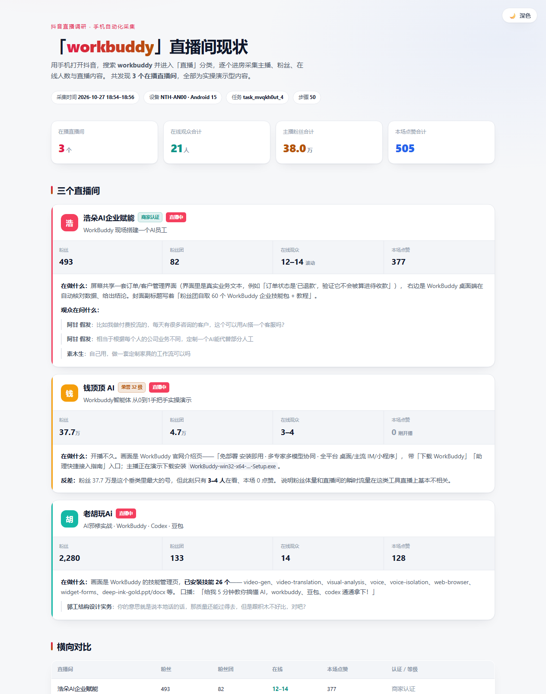
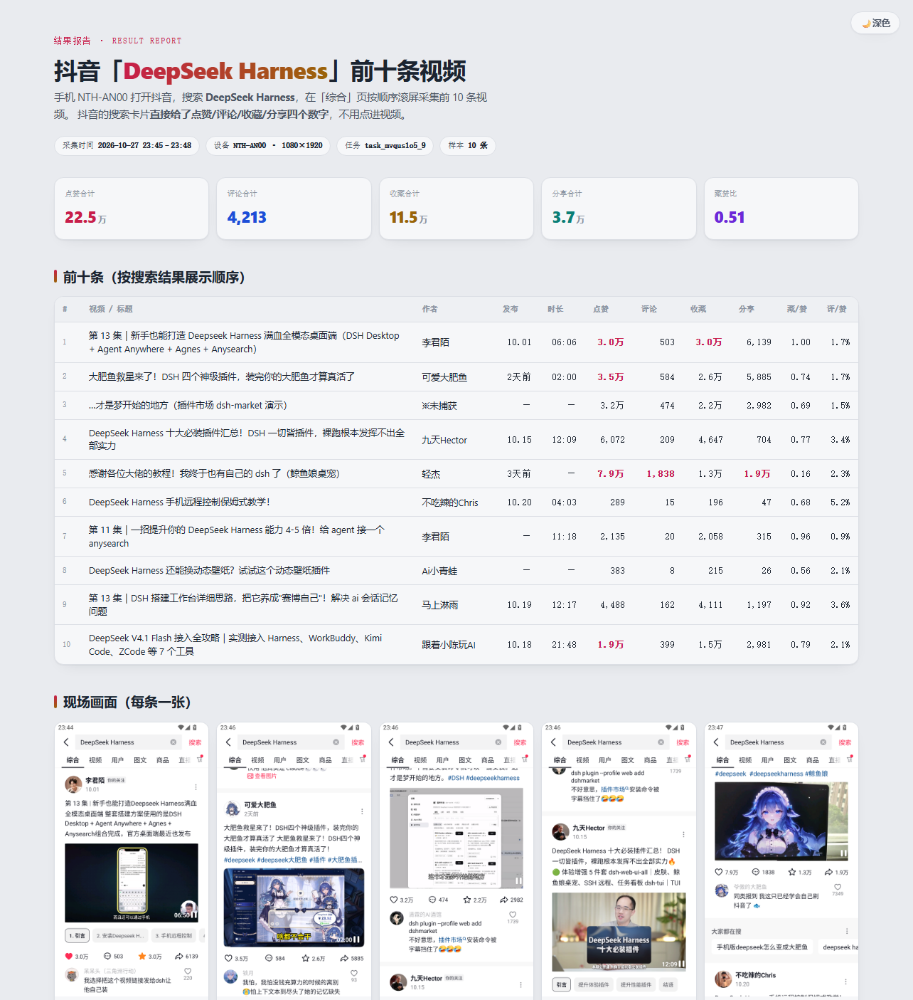
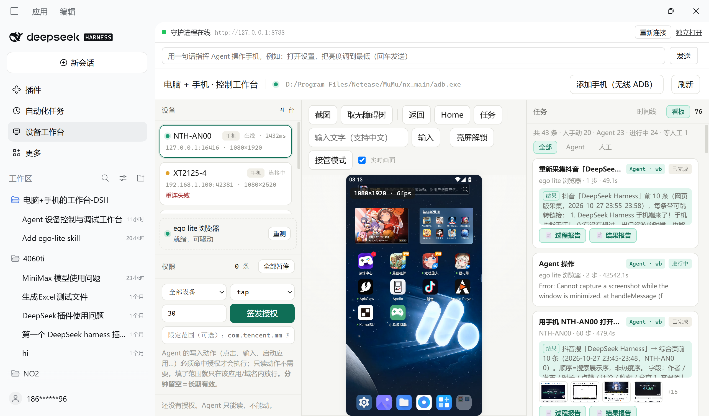
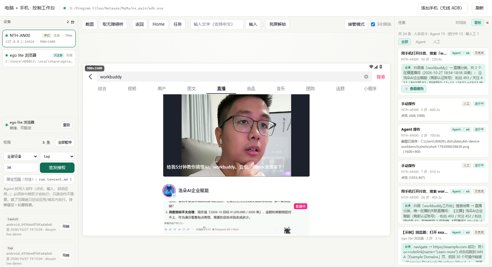

# 新手也可以给 DeepSeek Harness 接入操作浏览器和操作手机？能力边界扩大 5~6 倍！全程语音 vibe coding 就能搞定！

> 来源：飞书文档（李君陌AI笔记）｜Hermes & OpenClaw 实战进阶配套笔记 第13篇
> 原文：https://zcnv48kqce5a.feishu.cn/wiki/ITalwyV7jiIEbMkTkkycZsNUnyf
> 归档时间：2026-11-14

> `cake`
> **具体方案：**
> 是在DeepSeeK Harness中搭建egolite实现对浏览器的控制，然后让DSH自己手搓一个基于adb的手机控制，然后基于这两项能力再搭建一个可以同时监控浏览器和手机实时执行画面和任务的设备工作台，现在用deepseek Harness做这一套很容易，我全程基本都是语音输入来操作，视频中提到的MosMos的语音输入工具也很不错，完全免费，比起一般语音转文字的输入法，最大的优势是它能记录下所有的语音文字，这个对于长时间coding去找之前的提示词真的是非常方便。另外快捷键呼出语音备忘，说完直接自动记录，也非常适合用在DSH执行比较长的任务时，临时想起哪些要改动的内容，可以直接记下，在DeepSeek Harness中使用语音输入还是很不错的，大家也可以多多用语音输入来玩DSH，

> `round_pushpin`
> **MosMos的下载地址：****https://mosmos.moss.cn/****，**
> 可以填一下邀请码：**8WG2PYE2**，能够解锁更多免费权益~

今天来分享一个新手也可以给你的 DeepSeek Harness 接入操作浏览器以及操作手机的能力，而且还能将整套能力的执行和监控做成工作台，作为一个 DeepSeek Harness 的插件放在左侧菜单中。就比如说某些网站的评论内容只能通过浏览器才能拿到的话，那么我就可以通过调用 Ego Lite 的浏览器去抓取到，在获得的评论中挖掘到一些真实的问题，同时，也给我生成一份这样比较实用的报告，再或者是有些信息，比如对标直播间里的直播情况或弹幕只能在手机 APP 上看到，我们也可以通过调用真实的手机，像人一样去刷手机，去浏览直播间的在线人数和留言弹幕，同样也可以帮我生成一份这样的报告，从而完成一次对标行业直播的调研。而且不光是获取信息，有一些操作类的事情它也是可以做到的，就像我们人工做的大部分事情，也都是通过电脑浏览器或手机完成的。

到当然底还能解锁哪些可能的应用场景，你可以尽情畅想了。

而且通过我开发的这个设备工作台的deepseek harness插件，我们还能实时地看到本机浏览器以及已连接的不同手机，通过切换还能实时地看到它执行任务时的画面，当遇到需要人工辅助操作的时候，我们还可以接管，直接进行交互，方便我们与 Agent 共同完成一些复杂的操作。任务完成之后，可以直接在这里看到它的执行过程报告以及结果报告。这一套下来，这已经让你的 DeepSeek Harness 具备了非常强的操作电脑和手机的能力，应用边界扩大 5~6 倍也不是什么问题。

*实现过程也不复杂，全程在 DeepSeek Harness 中完成，而且整个实现过程我大部分时间都是用语音输入来完成，用语音 vibe coding 也是我比较喜欢的方式，速度更快，而且用说的方式更容易带出 coding 的创作灵感。这次我使用了 MosMos 这样一款专注于语音输入的免费工具，比起语音输入法，它最大的一个特点是保存了所有的语音记录，可以比较方便地去翻阅在一个比较长的 coding 过程中，说过的各种提示词。*



*而且在使用过程中，它还有一个 AI 润色功能。如果你说的内容里口头语或语气词比较多，它会给你去掉，并整理成一段比较通顺、完整的话，这一点也很实用。*

*另外，在编码中，有时还会遇到一个特殊场景。就是项目还在执行中，我有一些优化想法，但不一定马上落地，这种情况最好先暂存。以前我通常会开个记事本记下来，现在直接按 Alt+1，就会打开“MosMos”语音输入，结束后自动保存到备忘录里，特别方便，在编程过程中真的也很实用。*



*而且我们本次视频分享的“操作浏览器和操作手机”这个方面，其实本身就特别适合用语音去控制它们。因为这就好比是你的一个员工，你给他发了一台电脑加一部手机，你让他干什么，告诉他就行了，就是这么一种感觉，这个过程呢用语音输入的体验也是非常好的。*

**接下来我们看一下具体的实现过程**

## **实现过程**

### **1.Ego Lite 浏览器 + 实操案例**

**安装**



> `bulb`
> **Ego Lite**

首先我们看一下关于浏览器能力的接入，这里我们选用的是目前Agent浏览器 自动化做得比较好的一个工具： Ego Lite，安装方式也比较简单：首先来到这里把浏览器的安装包（exe）下载下来进行安装，打开命令行，输入以下指令，看看它能否返回一个安装路径。如果能返回路径就说明已经安装好了

```plaintext
where ego-browser
```

如果能返回安装路径，说明已经成功了，接下来是给你的deepseek harness配置上对应的skill，打开你的 DeepSeek Harness，输入以下指令，让它安装一个 ego-lite 的 skill。等待安装完成后，你的 DeepSeek Harness 就已经可以去操作浏览器了。而且这个浏览器，还可以将你的谷歌浏览器或者 Edge 浏览器里的登录状态同步过来。

```plaintext
npx skills add citrolabs/ego-lite
```

**案例测试**

接下来我们做一个案例测试，试一下操作浏览器的效果，就比如说

```plaintext
请打开B站，搜索一下ego lite的相关视频信息与数据，并将执行的详细过程和结果做成一份HTML
```

然后，过一会儿我们就得到了这样一份报告



接下来，我们再去挑战一下难度，抓取这里面几条热门的评论信息，通过评论挖掘出一些更有价值的问题，这个并不是特别容易操作的一件事，我们可以用这样的提示词去做这件事

```plaintext
把视频播放量最高的两个视频的所有评论帮我拿下来
```



好，做完这一组测试，基本上也就说明浏览器已经接好了，你可以看到它的能力还是很不错的，而且整个过程中的浏览器操作截图，也说明它确实是在操作浏览器。

接下来我们看一下 DeepSeek Harness 操作手机的方法。

### **2.接入真实手机 + 实操案例**

这个其实也非常简单，直接使用安卓的 ADB 调试工具就可以了。我们只需要在提示词里加入“同时最好支持无线 ADB”，这样使用起来也比较方便，不用非得插上线。前提是手机要先开启开发者选项，并完成无线调试授权。你可以在 DeepSeek Harness 里使用这样的提示词来操作。我们来试一下

```plaintext
先让我的 DeepSeek 具备接入操作真实手机的能力，使用安卓的 ADB 就可以了，而且支持无线 ADB。
```

*这个执行过程还是有点长的，执行到一半的时候，正好触发了我的 MiniMax token plan 的 5 小时限额，这种情况就没法继续了，然后这会儿，我刚好把自己的想法打开语音输入来录入一下，****我是直接按下了 ALT+M 按键****，触发了语音会议纪要的功能，这样整体说完之后，它会把我的整个记录都记下来，而且做了总结和整理，是非常方便的。而且可以标注发言人，还有自动生成会议纪要等能力。所以不管自己用，还是跟朋友讨论一些具体事项，都可以用这个功能来记录一下。*



**案例测试**

刚才的命令执行完之后呢，那我们就可以同样去做一下测试，看一看这个调用手机的效果怎么样，就比如说我们可以让他去看看直播间的一些信息，用手机打开某音，然后去检索一下workbuddy的直播间的一些情况

```plaintext
用手机打开抖音，然后看一下“workbuddy”的直播间的信息
```



我还可以再去让他看看视频，而且把他看的一些截图拿回来，对我们也是有参考意义的，你就可以使用这样的一句提示词。

```plaintext
用手机打开抖音，然后看一下“DeepSeek Harness”的前10条视频，然后把相关数据拿回来，并且每个视频的截图也要带回来
```



### **3.给 DeepSeek Harness 做一个设备工作台插件**

为了更方便的去管理和监控这些能力的运行情况，我们给他搭一个工作台，并且呢把这个工作台做成一个插件

浏览器端和手机端的能力都已接入。为了更方便地管理和监控这些能力的运行情况，我们搭建了这个工作台，也就是一个设备工作台的 HTML，前两步做完，这一步就比较简单了。

```plaintext
围绕刚才接入的这两个能力，再给它做一个工作台页面，可以看到设备的执行过程以及监控执行任务的过程，并且将这一套能力和这个工作台做成一个 DeepSeek Harness 的插件。
```





好，这个插件完成之后，它会直接以插件的形式出现在 DeepSeek Harness 左侧的菜单中，会多一个叫“设备工作台”的菜单，设备工作台左侧可以看到已连接的 Ego Lite 浏览器，以及连接的手机。而且它还能在开发时自动找到我电脑上的安卓模拟器，同样可以像操作真实手机一样去操作，这里就需要使用无线 ADB，然后我们可以使用刚才的案例再去测试一下这个设备工作台。

（演示插件）

当然，一开始的时候，你也可以使用这种不给他指定方法，只明确目标的提示词。当然在这个过程中，他会需要给你反复确认一些问题。大家也可以去尝试一下这种方式。如果你一开始就是想要这个工作台，而不是分别单独进入两种能力，用这种方式更合适。

```plaintext
我现在想给 DeepSeek Harness 或 Workbuddy 这样的 Agent 产品接入两种能力：
1. 控制电脑（主要是先控制浏览器）；
2. 控制手机。

围绕这两个能力，再给它做一个工作台页面，用于调试、查看任务、启动权限等。
```

## **总结**

好的，我们总结一下。给你的 DeepSeek Harness 加入了操作浏览器和操作手机的功能，其实是让它更像是具备了人能干的一些事，而不仅仅是 Agent 能干的。整个 coding 过程，其实我个人是非常推荐用语音去输入的，像 MosMos 这样专注于语音输入、还配套了语音备忘功能的工具，对 coding 整个过程也是挺实用的。而且等我们做完之后，去安排 Agent 操作浏览器和操作手机，其实也更像是安排一个人，同样也是用语音输入下指令，这种感觉也是很不错的。大家如果感兴趣的话，可以比着我的这个操作来做一下。
