# 接管浏览器搞不定？小白版能学会的免折腾版本~让openclaw完全接管浏览器！

> 来源：飞书文档（李君陌AI笔记）｜Hermes & OpenClaw 实战进阶配套笔记 第3篇
> 原文：https://zcnv48kqce5a.feishu.cn/wiki/ZZhiwtwA9ixTqQksqo3c7zXVnKe
> 归档时间：2026-11-14

[iframe:https%3A%2F%2Fwww.bilibili.com%2Fvideo%2FBV1R4XSBaEmT%2F]

---

能快速稳定用上chrome mcp控制浏览器！一只虾你就够用！

用《鬼灭之刃》动漫给你推送英语学习卡！让养虾不再闹心！

> `glass_of_milk`
> 1.注意尽量用小号登在chrome，还是有风险的
> 2.目前只能连接chrome
> 3.目前QClaw相当于只是养了一只虾，可以多做不同的skill来解决不同的场景应用
> 4.做skill可以通过跑通一个小流程，让Qclaw（Openclaw）给你总结成一个skill

# 效果展示


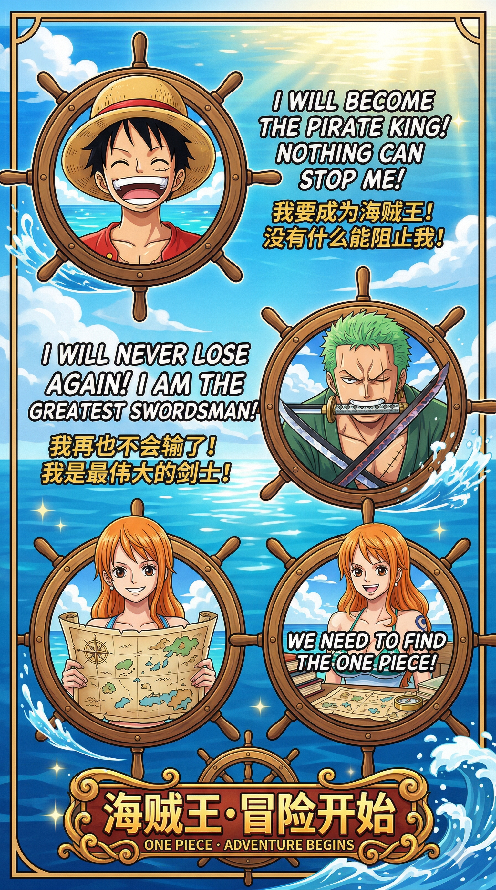

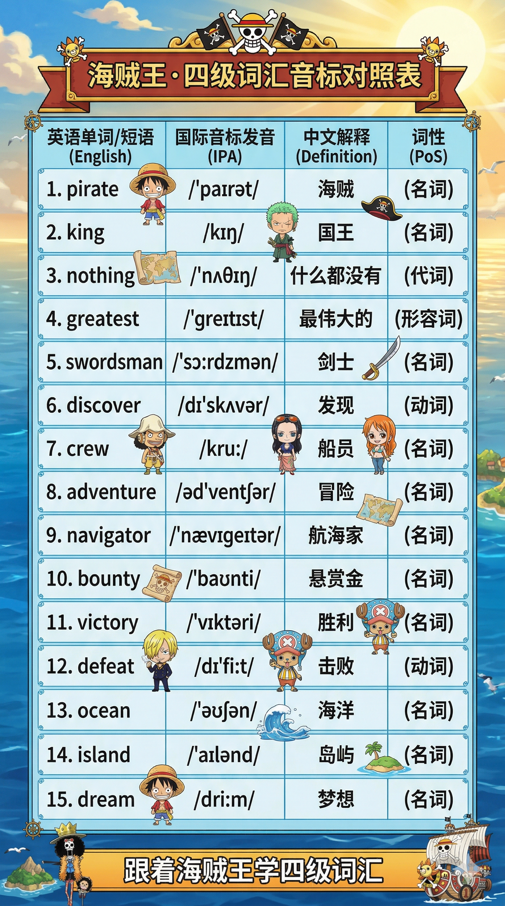

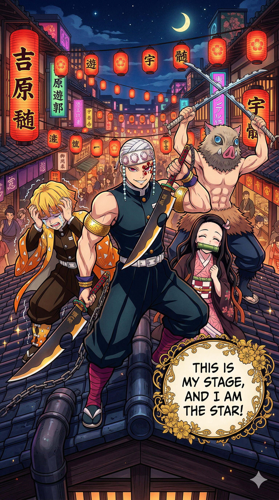

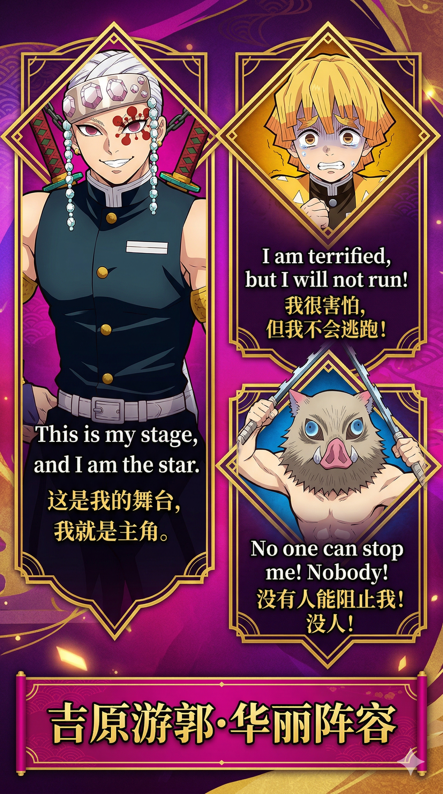

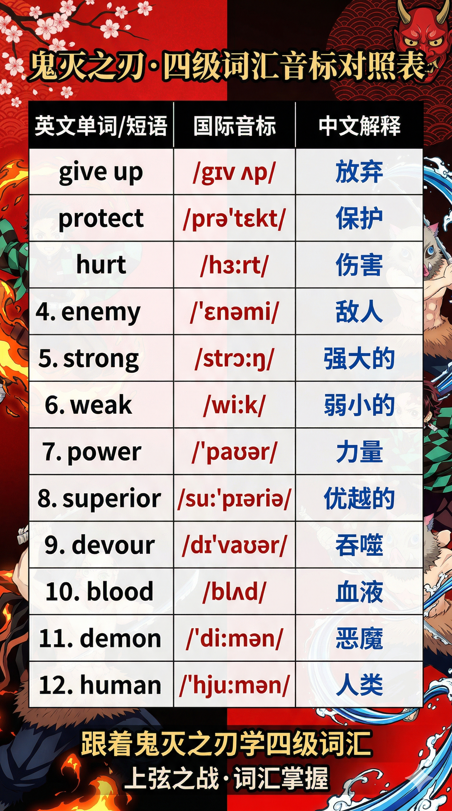

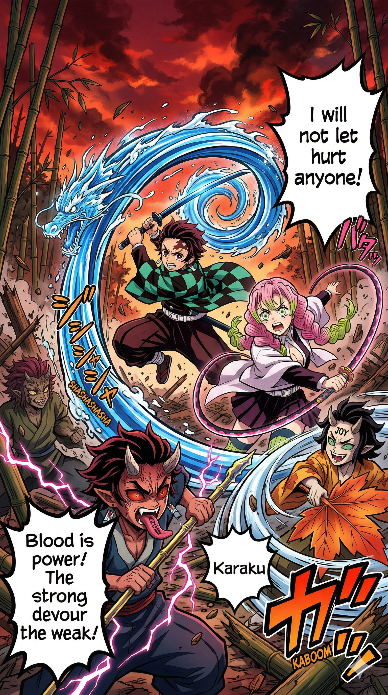

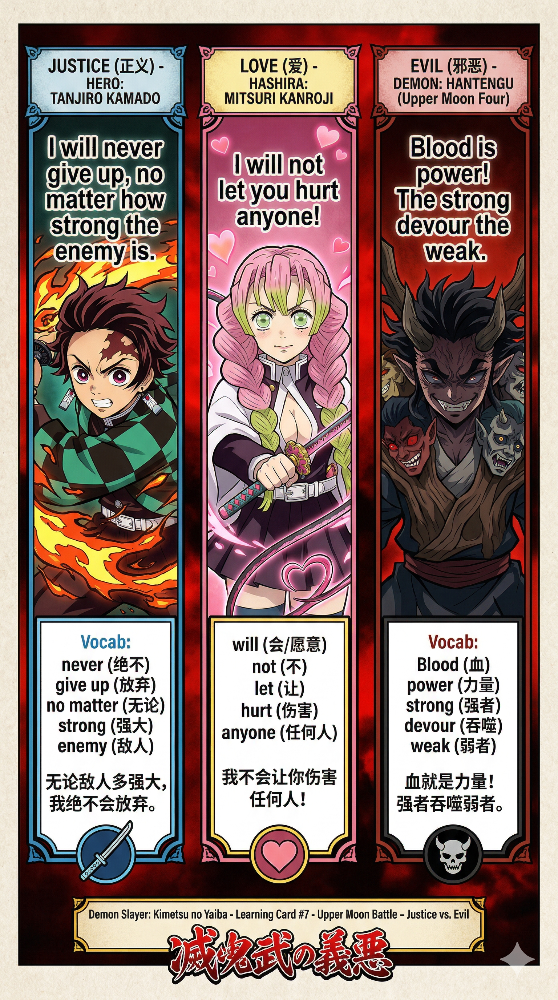

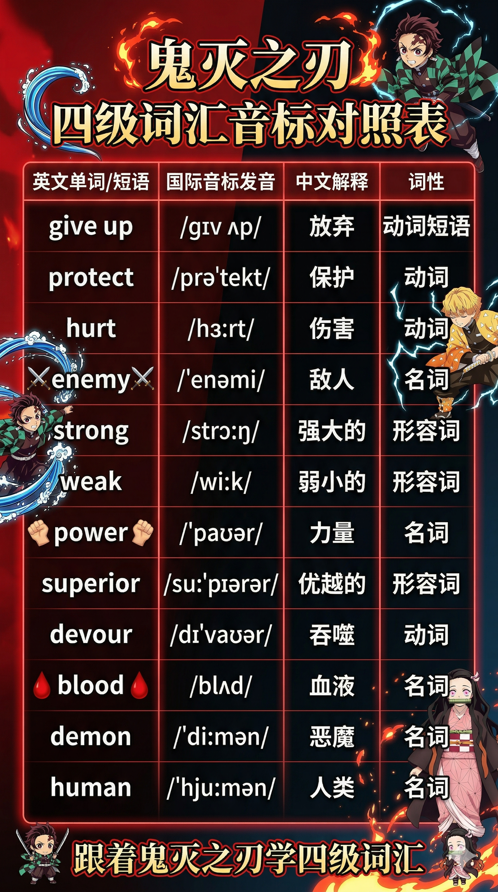

# 一、安装与配置QClaw

## 1.安装QClaw

内置的openclaw的版本是3.13

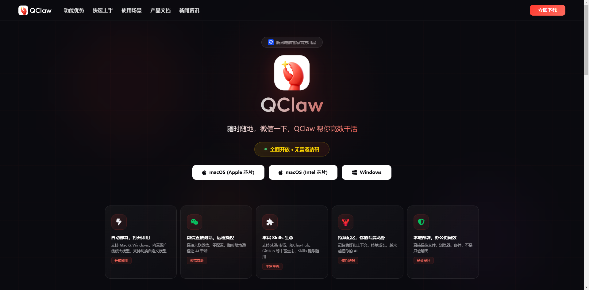

> `art`
> **点击下载QClaw：****https://qclaw.qq.com/?channel=5019**

注意：有安全的沙箱机制，重启之后openclaw.json的配置文件有时会重置

## 2.配置大模型

默认的大模型是要充值的，不过好处是可以使用其他大模型的**coding plan（按次计算）z**

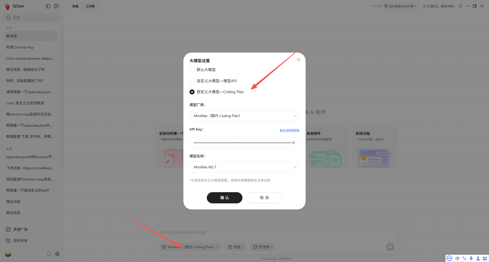

## 3.连接微信

点击左下角可以直接绑定扫码微信。

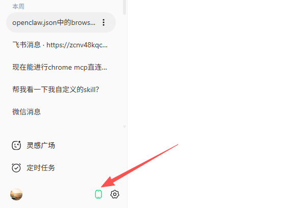

# 二、配置QClaw与Chrome MCP

## 1.配置Chrome的Debug模式

**启用远程调试**：

```plaintext
chrome://inspect/#remote-debugging
```

#### 1.勾选 "Discover network targets"

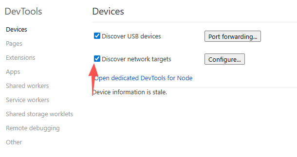

#### 2.启用 "Enable remote debugging"

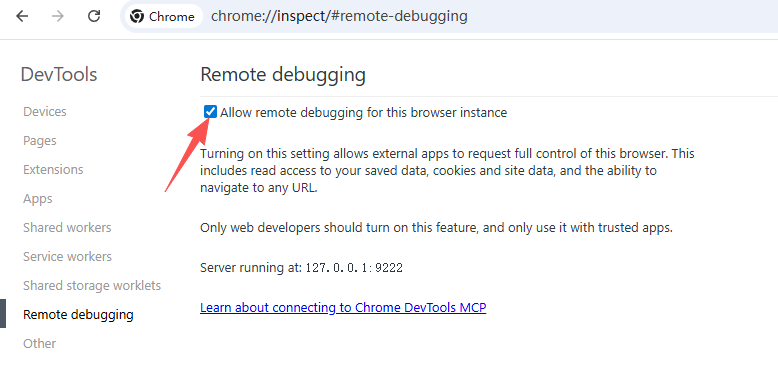

## 2.修改QClaw配置chrome mcp部分

### （1）修改browser节点信息

```yaml
  帮我修改openclaw.json的browser节点的信息：
  browser: {
    enabled: true,
    defaultProfile: 'user',
    profiles: {
      user: {
        cdpPort: 9222,
        driver: 'existing-session',
        color: '#00AA00',
      },
    },
  },
```

### **（2）测试一下是否mcp直连成功**

```plaintext
openclaw browser --browser-profile user open https://www.baidu.com
```

### **（3）每次启动QClaw需要检查一下**

查看openclaw配置信息，Qclaw会重置openclaw.json的信息

```plaintext
openclaw.json中的browser节点信息看一下
```

# **三、案例与Skill**

## 1.测试案例

```plaintext
用chrome mcp直连的方式gemini帮我生成一张“路飞、鸣人、炭治郎的漫画合影照”，然后将图片存到“D:\20260318”
```

## 2.封装好的Skill

**1.Gemini图片生成**

```yaml
---
name: gemini-image-wechat
description: 使用 Google Gemini 生成图片并通过微信发送给用户。当用户要求生成图片并发送到微信时触发。
---

# Gemini 图片生成 + 微信发送

## 工作流程

1. 打开 Gemini 网页 → https://gemini.google.com
2. 输入提示词并生成图片（约20-25秒）
3. 下载完整尺寸图片
4. 主会话发送微信（必须由主会话，不能是子任务）

## 注意事项
- 不要用 browser screenshot 作为图片来源，只用下载的文件
- 下载失败重试1次
- 每张间隔约45-60秒
- 子任务发微信会失败（缺 contextToken），必须由主会话发送
```

**2.用动漫来学英语**

```yaml
---
name: anime-english
description: 使用动漫风格生成图片来学习英语。每次生成三张配套图片，均基于同一动漫剧情场景：
(1)动漫漫画图带英语对话 
(2)角色词汇卡（台词版） 
(3)纯词汇表（音标+中文+词性）。触发条件：用户要求"用动漫学英语"、"生成英语学习卡"、"动漫英语单词卡"时使用。
---

# 动漫学英语技能

## 核心概念

每次生成 **3张配套图片**，均基于同一个动漫剧情场景，三张图片内容完全呼应：

1. **📺 动漫漫画图** — 动漫风格场景 + 英语台词对话气泡
2. **📚 词汇卡（角色台词版）** — 基于漫画场景的角色对话，场景感强
3. **📝 纯词汇表（音标对照版）** — 从台词中提炼的独立词汇，含IPA音标+中文+词性

**三张图片必须基于同一个剧情场景，保持词汇和主题一致。**

## 工作流程

### 第0步：Chrome Tab 数量检查与清理

**每次执行本技能前，必须先执行此检查。**

使用 `browser` 工具获取当前所有 tabs：

```
browser action=tabs profile=user
```

**判断逻辑：**
- 如果 tab 数量 ≤ 5：直接进入第1步
- 如果 tab 数量 > 5：执行清理，**只保留最新打开的 2 个 tab**，其余全部关闭

**保留策略（tab 数量 > 5 时）：**
1. 获取所有 tab 的 ID 和打开时间
2. 按时间倒序排列
3. 保留最新 2 个 tab（设为 pinned 或不移除）
4. 关闭其余所有 tab

**执行清理时，逐个关闭（先关闭最旧的）：**
```
browser action=close targetId=<tab_id>
```

> ⚠️ 清理过程中每关闭 1 个 tab 等待 1 秒，避免频繁操作导致浏览器崩溃。

---

### 第1步：打开 Gemini

```
browser action=open profile=user url=https://gemini.google.com
```

### 第2步：生成动漫漫画图（第1张）

**提示词模板：**
```
生成一张{动漫名}风格的{颜色}漫画图片，{场景描述}，{角色名}{动作描述}，说：{英文台词1}！{角色名2}回应：{英文台词2}！背景是{背景描述}，9:16竖幅，{颜色描述}，对话气泡清晰
```

**示例（鬼灭之刃·上弦之战）：**
```
生成一张鬼灭之刃风格的彩色动漫图片，上弦之鬼半天狗变成多个分裂体围攻炭治郎和甘露寺蜜璃，炭治郎施展水之呼吸·拾之型，蜜璃大喊：I will not let you hurt anyone！半天狗分裂体尖叫：Blood is power! The strong devour the weak!背景是愤怒的红色天空和破碎的竹林，9:16竖幅，色彩强烈震撼，战斗动漫风格，对话气泡醒目
```

### 第3步：下载漫画（第1张）

点击下载按钮，等待12秒后验证新文件：
```powershell
Get-ChildItem "$env:USERPROFILE\Downloads" -Filter "Gemini_Generated_Image_*" | Where-Object { $_.LastWriteTime -gt (Get-Date).AddMinutes(-2) } | Sort-Object LastWriteTime -Descending | Select-Object Name, LastWriteTime -First 3
```

### 第4步：生成词汇卡（第2张）

**提示词模板：**
```
生成一张英语单词学习卡图片，{动漫名}{篇名}主题，彩色设计风格，卡片分为{角色数量}个人物头像区：左侧{角色1}：{台词1英文} / {台词1中文}。中间{角色2}：{台词2英文} / {台词2中文}。右侧{角色3}：{台词3英文} / {台词3中文}。底部写着"{篇名}"，背景是{配色}渐变，每个人物用{形状}框住头像，台词醒目，9:16竖幅
```

**示例（鬼灭之刃·上弦之战）：**
```
生成一张英语单词学习卡图片，鬼灭之刃上弦之战篇·正邪对决主题，彩色设计风格，卡片分为正邪两方头像区：左侧英雄方炭治郎：I will never give up, no matter how strong the enemy is. / 无论敌人多强大，我绝不会放弃。中间甘露寺蜜璃：I will not let you hurt anyone! / 我不会让你伤害任何人！右侧敌人方半天狗（鬼）：Blood is power! The strong devour the weak. / 血就是力量！强者吞噬弱者。底部写着"上弦之战·正邪对决"，背景是红黑双色渐变，台词醒目，9:16竖幅
```

### 第5步：下载词汇卡（第2张）

同步骤3的验证方法。

### 第6步：生成纯词汇表（第3张）

**提示词模板：**
```
生成一张{动漫名}{考试级别}词汇音标对照表图片，彩色设计风格，背景是{配色}双色渐变，上方写着"{动漫名}·{考试级别}词汇音标对照表"，下方分为{列数}列词汇列表，每个词汇包含：英文单词/短语、国际音标发音（IPA）、中文解释、词性，共{数量}个词汇整齐排列：{词汇列表}。底部写着"跟着{动漫名}学{考试级别}词汇"，每个词汇用表格形式排列，英文用白色，音标用红色，中文用蓝色，词性用绿色，9:16竖幅
```

**示例（鬼灭之刃·上弦之战）：**
```
生成一张鬼灭之刃上弦四级词汇音标对照表图片，彩色设计风格，背景是红黑双色渐变，上方写着"鬼灭之刃·四级词汇音标对照表"，下方分为四列词汇列表，每个词汇包含：英文单词/短语、国际音标发音、中文解释、词性，共12个词汇整齐排列：1.give up /ɡɪv ʌp/ 放弃（动词短语）2.protect /prəˈtekt/ 保护（动词）3.hurt /hɜːrt/ 伤害（动词）4.enemy /ˈenəmi/ 敌人（名词）5.strong /strɔːŋ/ 强大的（形容词）6.weak /wiːk/ 弱小的（形容词）7.power /ˈpaʊər/ 力量（名词）8.superior /suːˈpɪəriər/ 优越的（形容词）9.devour /dɪˈvaʊər/ 吞噬（动词）10.blood /blʌd/ 血液（名词）11.demon /ˈdiːmən/ 恶魔（名词）12.human /ˈhjuːmən/ 人类（名词）。底部写着"跟着鬼灭之刃学四级词汇"，每个词汇用表格形式排列，9:16竖幅
```

### 第7步：下载纯词汇表（第3张）

同步骤3的验证方法。

### 第8步：主会话发送微信（按顺序发3张）

微信 ID: `###`

**漫画发送消息模板：**
```
🤖 {动漫名}{颜色描述}版·{考试级别}英语 🖤
{角色名}: {英文台词1}
{角色名}: {英文台词2}
{篇名}
```

**词汇卡发送消息模板：**
```
📚 {动漫名}·{考试级别}词汇卡（角色台词版）

{emoji} {角色1}: "{台词1英文}" — {台词1中文}
{emoji} {角色2}: "{台词2英文}" — {台词2中文}
{emoji} {角色3}: "{台词3英文}" — {台词3中文}

{篇名}
```

**纯词汇表发送消息模板：**
```
📝 {动漫名}·{考试级别}词汇音标对照表

{序号}. {词汇} /{IPA}/ {词性} — {中文}

共{数量}个词汇，跟着{动漫名}学{考试级别}词汇 📖
```

## 剧情场景词汇库

### 场景1：蜘蛛山篇（炭治郎 vs 累）

**漫画台词：**
- 炭治郎: I will never give up!
- 累: You are too weak!
- 炭治郎: Please let my sister go.
- 累: You should not be here.

**独立词汇：**
1. give up /ɡɪv ʌp/ 放弃
2. weak /wiːk/ 弱小的
3. sister /ˈsɪstər/ 姐妹
4. protect /prəˈtekt/ 保护
5. family /ˈfæməli/ 家人
6. water /ˈwɔːtər/ 水
7. flow /fləʊ/ 流动
8. pain /peɪn/ 痛苦

### 场景2：无限列车篇（炎柱·炼狱杏寿郎）

**漫画台词：**
- 炼狱: I will protect everyone on this train!
- 炼狱: I will never back down!
- 炼狱: I am the Flame Hashira!

**独立词汇：**
1. protect /prəˈtekt/ 保护
2. train /treɪn/ 列车
3. flame /fleɪm/ 火焰
4. hashira /hɑːˈʃiːrə/ 柱
5. duty /ˈdjuːti/ 职责
6. defeat /dɪˈfiːt/ 击败

### 场景3：吉原游郭篇（音柱·宇髄天元）

**漫画台词：**
- 音柱: This is my stage, and I am the star!
- 伊之助: No one can stop me!
- 善逸: I am terrified, but I will not run!

**独立词汇：**
1. stage /steɪdʒ/ 舞台
2. star /stɑːr/ 明星
3. stop /stɒp/ 停止
4. terrified /ˈterəfaɪd/ 恐惧的
5. marry /ˈmæri/ 结婚
6. sacrifice /ˈsækrɪfaɪs/ 牺牲

### 场景4：上弦之战（正邪对决）

**漫画台词：**
- 炭治郎: I will never give up, no matter how strong the enemy is.
- 蜜璃: I will not let you hurt anyone!
- 半天狗: Blood is power! The strong devour the weak.
- 无惨: Demons are superior to humans.

**独立词汇：**
1. enemy /ˈenəmi/ 敌人
2. hurt /hɜːrt/ 伤害
3. blood /blʌd/ 血液
4. power /ˈpaʊər/ 力量
5. strong /strɔːŋ/ 强大的
6. weak /wiːk/ 弱小的
7. superior /suːˈpɪəriər/ 优越的
8. devour /dɪˈvaʊər/ 吞噬
9. demon /ˈdiːmən/ 恶魔
10. human /ˈhjuːmən/ 人类

## 操作技巧

- **三张图必须基于同一个剧情场景**，词汇要一致
- 每次选择**不同的剧情场景**，避免重复
- 对话要有**剧情张力**（战斗、感动、搞笑等）
- 词汇卡包含**3-4个**角色台词句子
- 纯词汇表包含**8-12个**从台词中提炼的独立词汇
- 下载每张图后都要**等待至少12秒**再检查文件

## 注意事项

- **每次执行前必须先完成第0步：Chrome Tab 检查与清理**，这是强制前置步骤
- 下载失败重试1次，每次下载后等待12秒
- 不要用 browser screenshot 作为图片来源
- 微信发送必须由主会话执行
- 每张间隔约50-70秒（生成25秒+下载12秒+操作10秒）
- 记录每张图的生成顺序，通过文件时间戳判断哪张是哪张
```

## 3.扩展

1.写自己的故事学英语四级单词（去学习其他的知识）

2.用动漫中的人物，生成的多了可以生成pdf绘本
