# 学会Vibe Coding，自己动手给自己的Hermes做工具

> 来源：飞书文档（李君陌AI笔记）｜Hermes & OpenClaw 实战进阶配套笔记 第7篇
> 原文：https://zcnv48kqce5a.feishu.cn/wiki/Sf8jwAyTcicL40kTIu0c17Hon0g
> 归档时间：2026-11-14

> `monkey_face`
> 本期分享**新手零代码门槛**的 Vibe Coding 实操教程，教大家为 Hermes 搭建仿热门 Marvis UI 的可视化智能体办公室工具。
> 该工具可直观展示所有 AI 智能体员工，点击单个智能体，就能查看其每日进化档案、习得技能、运行状态、记忆数据、工作任务记录及基础配置，还能直接和智能体对话，真正将 AI 智能体当作虚拟员工管理，实用性极强。
> 整套搭建流程简单易懂，**无编程基础也能完成**，核心分为四步：
> 1. 选用合适的 AI Coding 工具；
> 2. 准备并配置大模型；
> 3. 搭建可视化 UI 界面；
> 4. 初步实现功能，完成与 Hermes 的基础对接（本期仅讲解基础开篇搭建内容）

**视频讲解**

[iframe:https%3A%2F%2Fwww.bilibili.com%2Fvideo%2FBV1QbVE6GE9a]

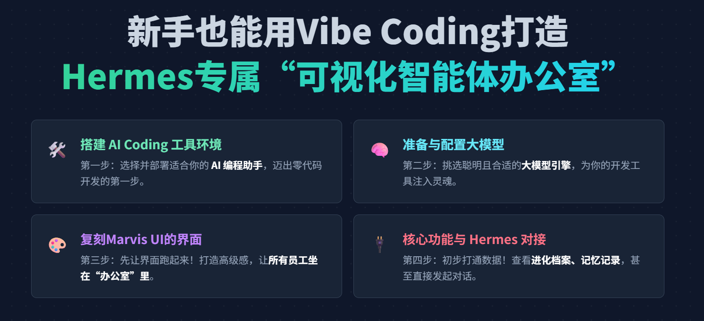

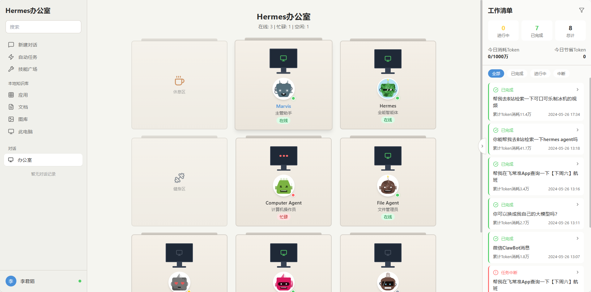

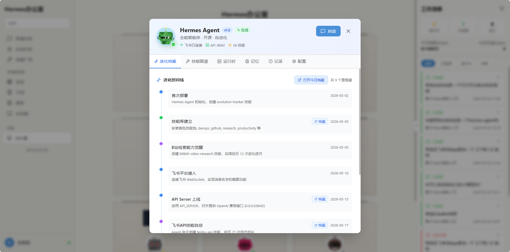

## 视频讲解

[iframe:https%3A%2F%2Fwww.bilibili.com%2Fvideo%2FBV1QbVE6GE9a%2F]

## **1.搭建一个Vide Coding工具**

选择的工具都是不用折腾的，能比较方便用上的，也是比较适合新手的。能用上codex和claude code肯定更好了，不过对新手来说是有点折腾

### **1.1 安装Trae Solo**

比较推荐的就是Trae Solo，不是太需要IDE，当然你装一个Trae也是没有问题的

> `cake`
> https://www.trae.cn/ide/download

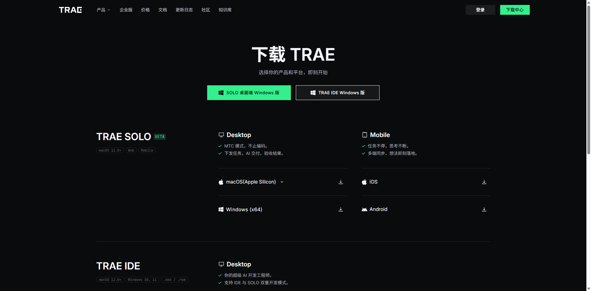

Trae Solo的优势是什么呢？就是它其实是内置了很多模型，而且它是免费的，然后像我们国内编程比较厉害的模型，比如Kimi2.6和GLM5.1

### **1.2 新建项目**

一个项目就是一个工作空间，需要指定一个文件夹

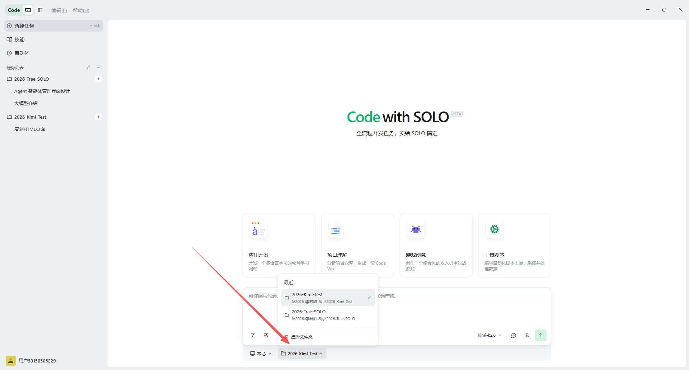

## **2.准备并配置大模型**

现在国内的大模型也不差，但是需要了解不同的模型是来做不同的事情的，这样才能用好模型

> `musical_score`
> **Kimi K2.6**：原生多模态 / 视觉编程强，**前端 & 界面级交付能力顶尖**。
> **GLM-4.6**：**复杂工程 & 大块逻辑最强**，适合系统级、企业级重代码。
> **DeepSeek V4**：代码能力顶级 + **性价比天花板**，适合**批量、日常、体力活编码**。

### 2.1.准备大模型（Token Plan）

其实DeepSeek无所谓，直接用官网的就行，也是比较有性价比的，如果说是用Kimi或者GLM的话，这两个其实都是价格还算是比较高的，而且GLM还不容易抢，而且对于一个新手来说的话，最好是Kimi和GLM同时来用，就是让Kimi来做这种原前端的设计，GLM来负责一些复杂的逻辑，然后DeepSeek去干体力活就行了，对于新手来说，怎么去判断是复杂的逻辑还是体力活，就看你感觉这个事儿它是个整体的事儿，还是一个局部的事儿。

#### **优云智算 Token Plan准备**

> `star2`
> **Kimi2.6&GLM5.1：****https://passport.compshare.cn/register?referral_code=DzKOV5Iik6lG9svK0phShR&ytag=GPU_YY_YX_bl_ljm053****1**

#### **DeepSeek-V4准备**

> `soccer`
> **deepseek：****https://platform.deepseek.com/**

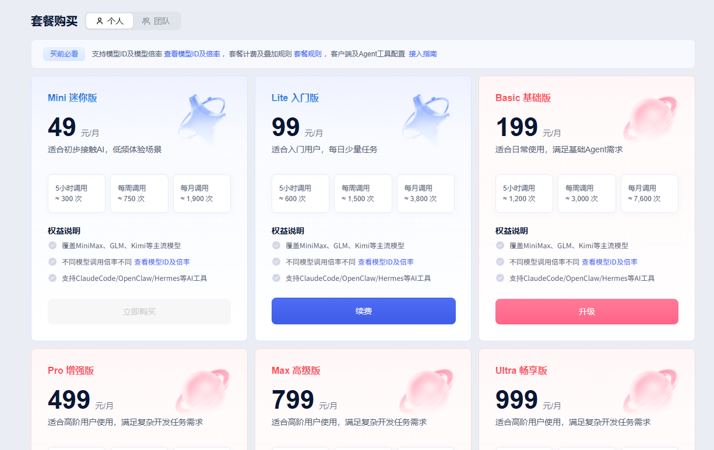

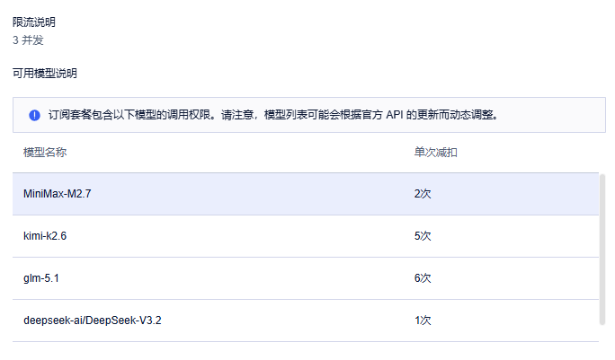

**模型中心**

> `pushpin`
> https://console.compshare.cn/light-gpu/model-manage

### **2.2 将大模型接入Trae Solo**

```plaintext
在Trae SOLO里接入步骤

注册优云智算 → compshare.cn，开通Coding Plan或Agent Plan
获取API Key → 控制台 → API Key管理 → 创建并复制
Trae里配置自定义模型：
打开Trae → 设置 → 模型管理 → 添加模型
选择「自定义配置」
API格式：OpenAI Chat Completions（用Kimi/GLM/DeepSeek时选这个；Claude选Anthropic）
自定义请求地址：https://api.modelverse.cn/v1
API密钥：粘贴优云智算的Key
模型ID：如 kimi-k2.6、glm-5.1、deepseek-v3.2
```

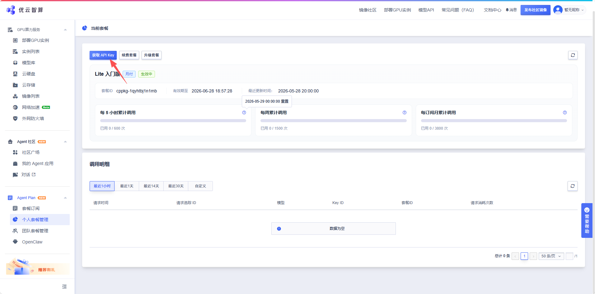

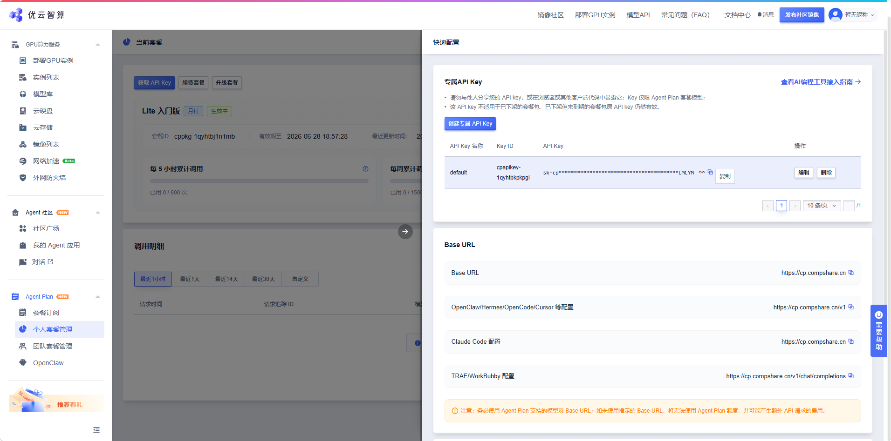

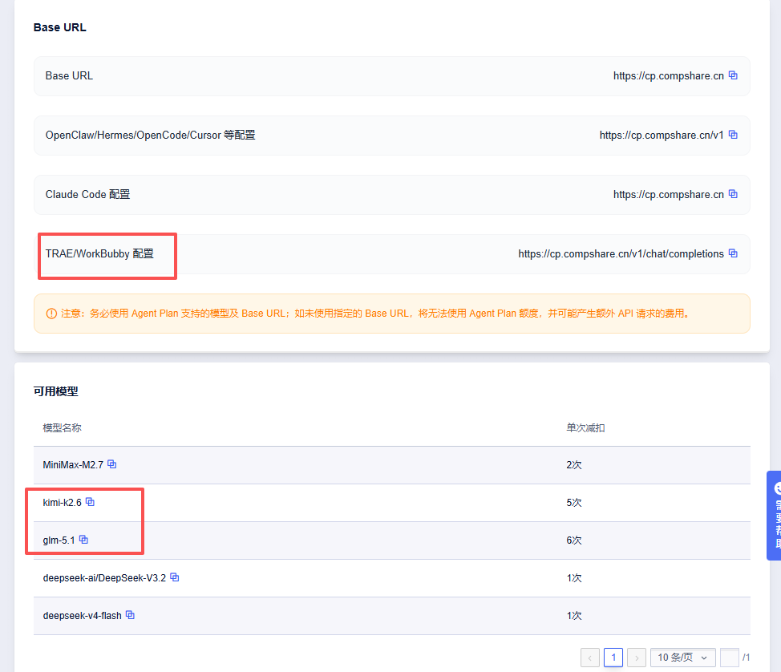

在trae solo中配置好大模型

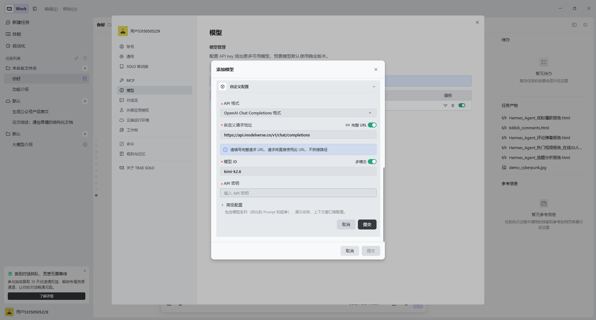

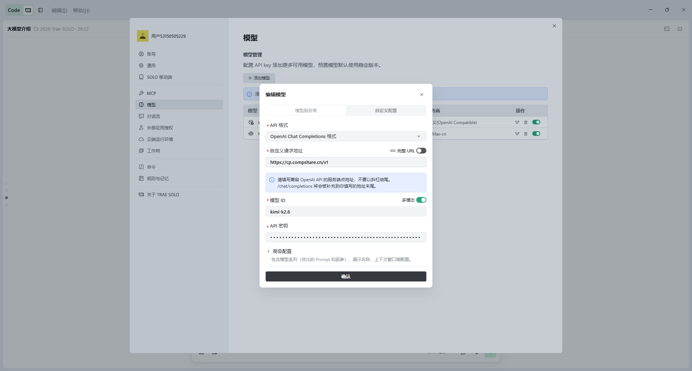

### 2.3 测试并查看额度使用

以前配置好大模型，你都是可以直接问他一下，你现在是什么大模型。但是现在很多工具都给相当加了系统提示词，给把这句给屏蔽掉了，所以你现在怎么问他都是回答我是Trae Solo。

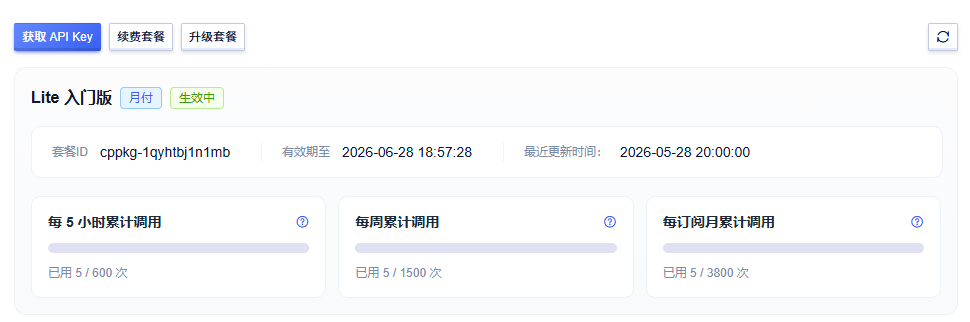

## **3.搭建Hermes办公室界面**

前面就已经把整个开发环境以及大模型都准备好了，接下来就开始进入AI Coding 的节奏了。首先是搭建界面。

### **3.1 找一张参考界面，Marvis界面**

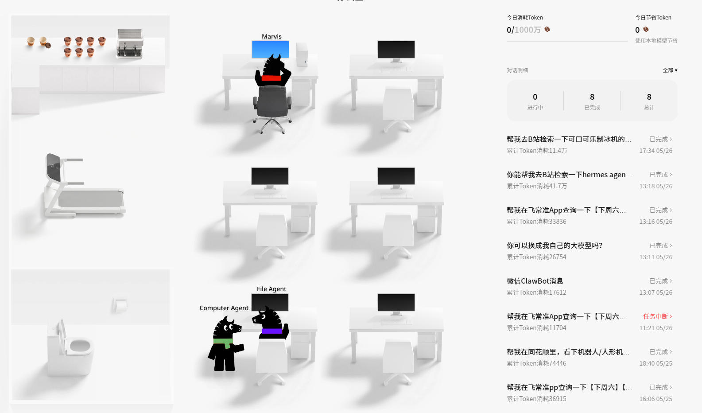

### **3.2 模型选择Kimi2.6复刻这个页面**

```markdown
参考上传图片复刻一个web版的页面，具体细节如下：

# Hermes Agent 可视化办公室界面构思
对于Hermes的使用者而言，每一个Agent都相当于一名**智能员工**，因此建议打造一套直观的可视化界面，整体风格参考休闲小游戏，以**平面办公室**为核心场景，具体功能与布局设计如下：

## 一、整体场景展示
以办公室工位为视觉载体，直观呈现所有智能Agent：
1. 每个Agent拥有独立名称，界面可清晰区分**在线/忙碌**状态；
2. 工位布局一目了然，模拟真实办公场景，交互体验轻松直观。

## 二、全局待办工作表
界面侧边设置统一**待办事项清单**，类似工作台账：
1. 实时展示所有Agent正在执行的任务；
2. 任务完成后可标记对勾，支持点击回溯查看任务详情。

## 三、单个Agent详情页（点击工位进入）
点击任意智能员工工位，可查看该Agent完整信息档案，包含四大板块：
1. **配置文档**：查看该Agent对应的MD配置文件；
2. **技能列表**：展示其已搭载、可调用的全部技能；
3. **工作记录&记忆库**：留存历史工作内容、长期记忆数据；
4. **即时交互**：支持直接和该Agent发起对话、下达指令。
```

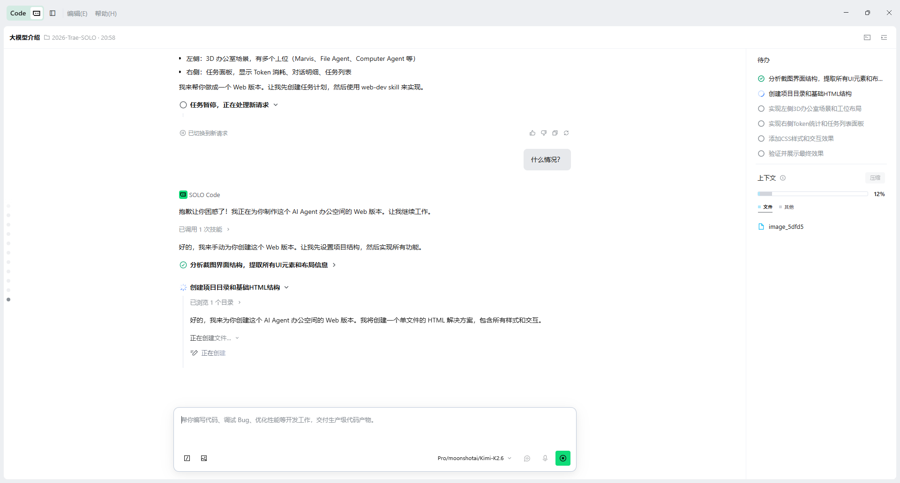

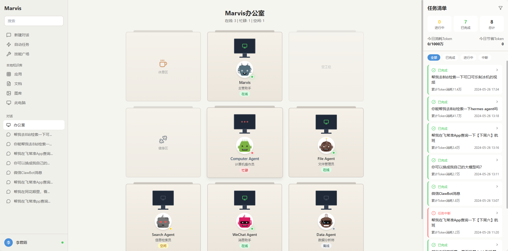

## 4.接入并实现与Hermes交互功能

这里要做API Server配置和dashboard的配置。分别控制和hermes的交互，以及hermesAgent的各种配置文件的管理。

### 4.1 Hermes API Server配置

那些Hermes主要是提供一个API server来与来对外进行一种交互，比较坑的一点是，它的APIKey必须要设到32位以上。

#### **1.关闭gateway**

```plaintext
hermes gateway stop
```

#### **2. 启用 API Server**

```plaintext
hermes config set API_SERVER_ENABLED true
```

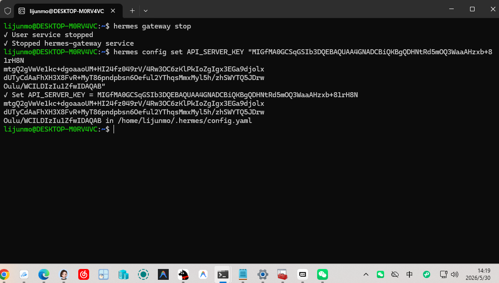

#### **3、设置一下APIKEY**

```plaintext
hermes config set API_SERVER_KEY "MIGfMA0GCSqGSIb3DQEBAQUAA4GNADCBiQKBgQDHNtRd5mOQ3WaaAHzxb+81rH8N
mtgQ2gVwVe1kc+dgoaaoUM+HI24fz049rV/4Rw3OC6zKlPkIoZgIgx3EGa9djolx
dUTyCdAaFhXH3X8FvR+MyT86pndpbsn6Oeful2YThqsMmxMyl5h/zhSWYTQ5JDrw
Oulu/WCILDIzIu1ZfwIDAQAB"
```

注意这里的密钥是示例，改成你自己的，必须大于32位，否则报错。密钥用于与CamphorAgents配对时使用。

> `pencil2`
> **密钥生成器生成：****https://www.oschina.net/tool/rsa-key-pair-generator**

```plaintext
MIGfMA0GCSqGSIb3DQEBAQUAA4GNADCBiQKBgQDHNtRd5mOQ3WaaAHzxb+81rH8N
mtgQ2gVwVe1kc+dgoaaoUM+HI24fz049rV/4Rw3OC6zKlPkIoZgIgx3EGa9djolx
dUTyCdAaFhXH3X8FvR+MyT86pndpbsn6Oeful2YThqsMmxMyl5h/zhSWYTQ5JDrw
Oulu/WCILDIzIu1ZfwIDAQAB
```

#### **4. 配置监听所有 IP（允许远程访问）**

```plaintext
hermes config set API_SERVER_HOST 0.0.0.0
```

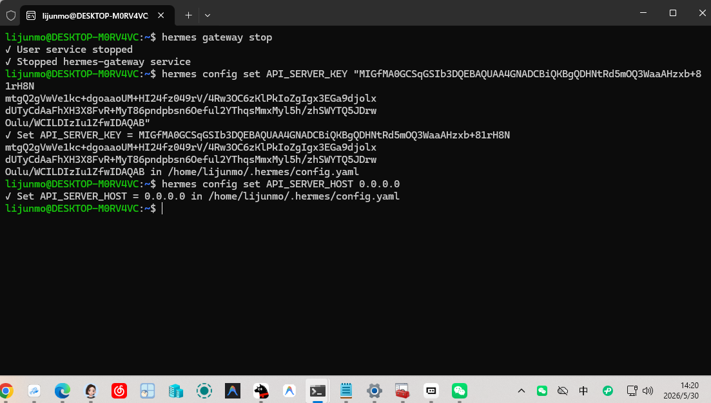

#### **5. 固定默认端口（8642）**

如果你wsl和windows都有，可以一个设置为8642，另外一个设置7642这样

```plaintext
hermes config set API_SERVER_PORT 8642
```

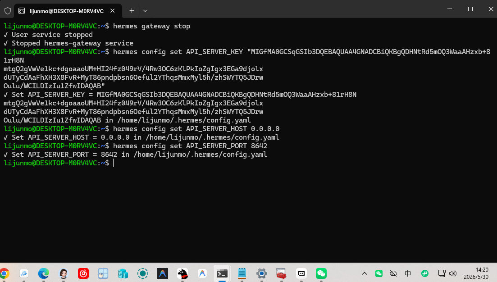

#### **6.重新启动gateway**

```plaintext
hermes gateway
```

### 4.2 实现第一个接入Hermes的功能

> `trophy`
> **这里要注意一下：模型要选择GLM5.1**

```plaintext
在空工位这个位置，也就是说第一行第三个，帮我把Hermes agent里边的这个Agent给接入进来，并且点击之后能够去查看它的进化档案吧，Hermes Agent的APIKey是：MIGfMA0GCSqGSIb3DQEBAQUAA4GNADCBiQKBgQDHNtRd5mOQ3WaaAHzxb+81rH8N
mtgQ2gVwVe1kc+dgoaaoUM+HI24fz049rV/4Rw3OC6zKlPkIoZgIgx3EGa9djolx
dUTyCdAaFhXH3X8FvR+MyT86pndpbsn6Oeful2YThqsMmxMyl5h/zhSWYTQ5JDrw
Oulu/WCILDIzIu1ZfwIDAQAB（这个apikey换成你在上面生成的）
```


### **4.3 根据需要完善其他功能**

***可以把你想要的继续完善更多功能。。。***

完善细节使用Deepseek-v4-flash

## 5.如果你感兴趣养虾养马真正用起来

**我是李君陌，专注于如何用AI来解决具体问题，**


微信号


公众号

**最近私信比较多，无法一一回复，拉了一个互助交流群，感兴趣的可以来哦**


**以下是我自己正在使用的几个小场景，更多案例会持续在知识星球更新 **


### 案例0：超级秘书的属性

***一个好的超级秘书一定是主动的，***

***当有跟你相关的重要事件会主动@你***


***也会主动问要不要帮你盯着一些事情~***


### ***案例1：AI早资讯语音播报版***

每天早晨8点会给我推送AI资讯，并且转换成语音播报，可以在洗漱或者路上听。另外还有一个汇总页面，所有的早咨询都会保留下来。


[view:2]

[语音播报.mp3](feishu-file:JGq1b4EOUo4D8cxyWe2cEVSCnzh)


### **案例2：同行与对标直播间监控**

做这个的目的是我打算也做一下抖音直播，所以要去关注一下同赛道的哪些博主做的比较好，什么样的形式，讲的什么内容，特别是这个在线直播人的数据，直接效果好的可以直接借鉴和参考，不好的就直接避坑了，也算是避开一个错误选择，节约试错成本。


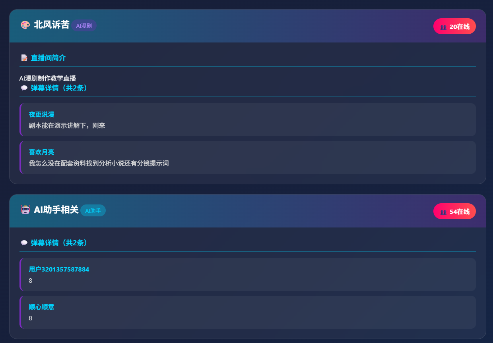


这个是优化后的版本，增加了一些与我有关系的建议和分析（我跟agent说了我是做什么的这些详细信息了）


### 案例3：直接间挖掘用户真问题需求

这是专门盯着一个在线观看人数还比较多的


### **案例4：低粉爆款找选题**


### 案例5：评论区问题汇总挖选题（推送链接）


### 案例6：招聘网站找B端客户

### 案例7：每天定时推送漫画（可定制）单词卡

### 案例8：电商同行产品负评挖掘分析

### 案例9：招聘网站挖掘成长行业与项目

### 案例10：自动检索对标博主新内容的知识点以PPT推送

### 案例11：定时对标直播间话术改写（完成录制+文案提取+自动改写）
