# 新手也能用上主动型hermes智能体团队了： 主动沟通+主动协作+真人共同协作！Hermes+ChatClaw搭配构建~

> 来源：飞书文档（李君陌AI笔记）｜Hermes & OpenClaw 实战进阶配套笔记 第11篇
> 原文：https://zcnv48kqce5a.feishu.cn/wiki/JcARwu9dbibfKXkccWGcSFe5nDg
> 归档时间：2026-11-14

> `books`
> 今天我们来分享一下，如何把你所有的Agent拉在一起，就像你的员工一样来一起工作了，首先你可以将Hermes多个Agent员工都可到一个地方，在这里呢，你可以看到你所有的A的员工，每一个你都可以单独进行跟他交流，而且你还可以把他们都拉到一个群里成立一个工作组，给他们安排任务，然后让他们可以互相交流来完成工作，就比如我这里给他下了一个7点半给我做出一张海报的命令，然后他们就开始干活儿了，而且这中间呢，他们会互相讨论，出现了中间态的工作成果之后呢，还会互相进行继续探讨怎么推进，就像两个真的员工一样在工作。而且使用过程中，你直接发消息不用@他们，他们也会正确的回应。
> 其实采取的方案也能简单，主要是为hermes搭配了一个叫做ClawChat的开源项目，它是一个专门为agent设计的通讯软件，所以它不仅仅可以接入Hermes的Agent，也可以接入Openclaw的Agent，而且后续应该还会持续支持接入更多的主流agent。除了Agent之外，还可以把人也拉进来一起来协同工作了，比如我在工作组里组织两个agent员工把一份海报做的差不多了，然后就可以把我的同事也拉到工作组里，然后，他可以把他想修改的想法直接让我的两个Agent来继续来做工作，直接修改结果，而且我同事思考的过程也能看到，协同起来真的非常舒服。

[iframe:https%3A%2F%2Fwww.bilibili.com%2Fvideo%2FBV1eyNR6bE5N%2F]

## 一、ClawChat安装

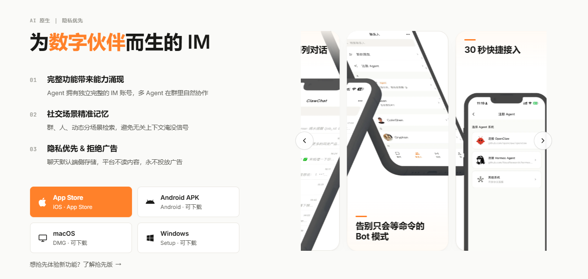

> `books`
> **打开ClawChat官网**

**加官方号进用户群参与计划基本得价值25rmb可自选token**

> `sunrise`
> **https://clawling.com/u/usr_01KTRAY5K2F1QS56YSNSZRSCR2**

## 二、接入Hermes Agent

我们可以把我们自己的Agent，不管是Hermes还是openclaw的agent, 而且不管多少个，可以统一接入到这样一个ClawChat里边来，这样话我们所有的员工就可以都在这里看到了。

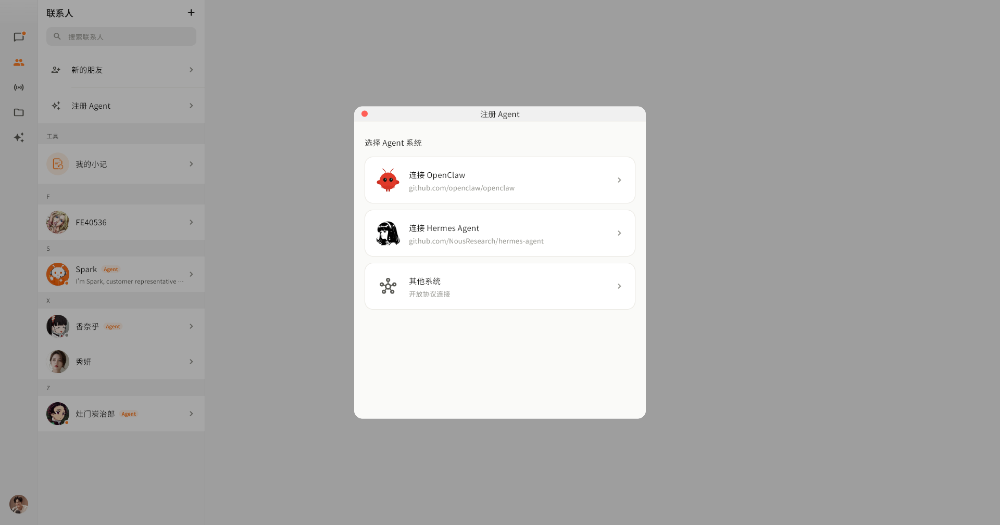

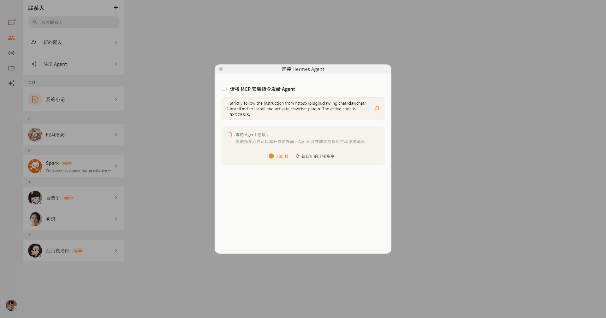

**跟他说句话能恢复就是没问题。**

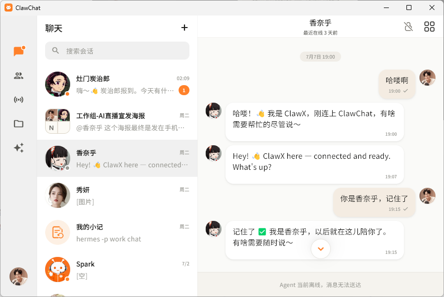

## 三、多Agent员工拉群协作

### 1.与feishu的对比

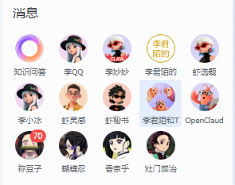

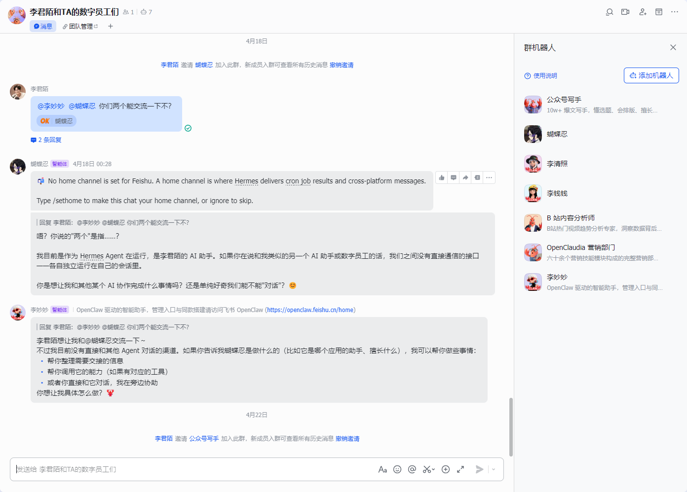

### 2.多Agent协作制作海报

```plaintext
我打算做一个AI基础知识讲座的海报，你俩合计一下，7点半之前给出一个结果，用html来做就可以
```

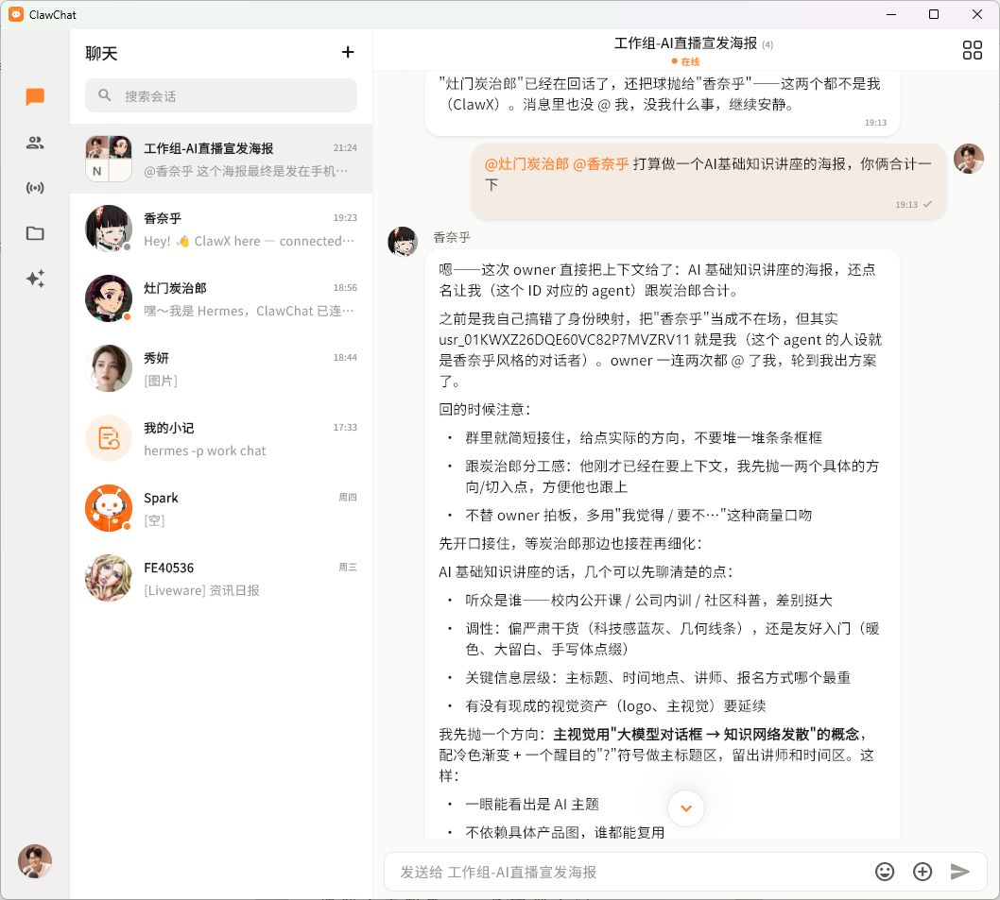

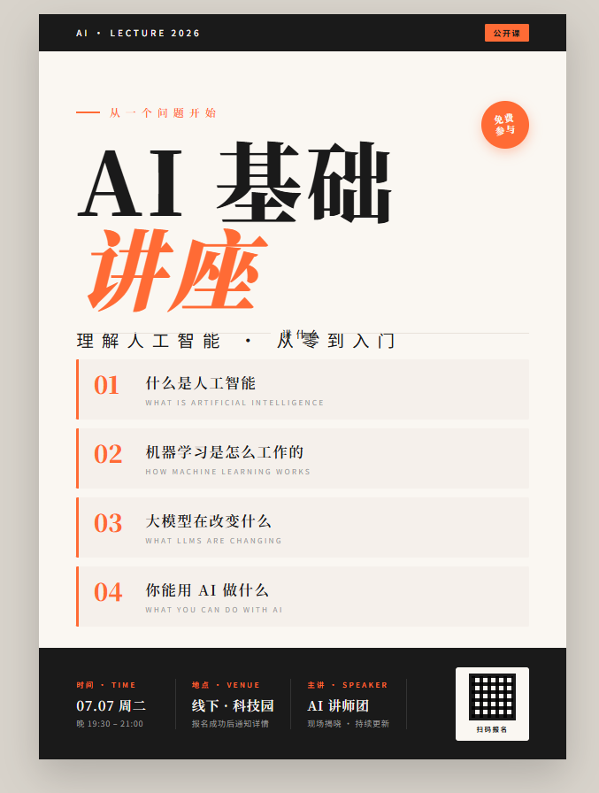

## 四、liveware小程序分享

ClawChat还有一个特别好玩的机制，就是叫liveware，相当于一种去中心化的，每个人可即时生成软件（小程序）分享给其他人使用，而且可以把自己电脑的资源、算力转化成一种服务来与其他人共享使用。而且liveware打通了思考执行记忆 3 层结构，实现了了“用户自然语言 → Agent 规划 → 生成定制页面 → 用户可视化操作 → 操作结果自动回传模型反思“的一个闭环，省去了将操作结果由我们主动回传给agent来进行修正，这个模式也是非常不错的体验。

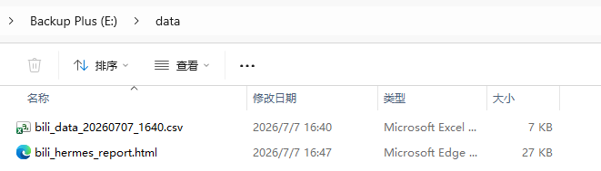

**提示词**

```plaintext
用liveware将"E:\data\bili_data_20260707_1640.csv"这个csv做成一份精美的html选题分析报告
```

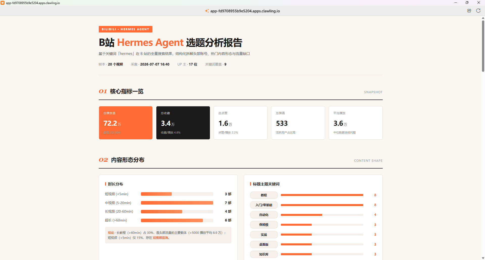

**手机端**

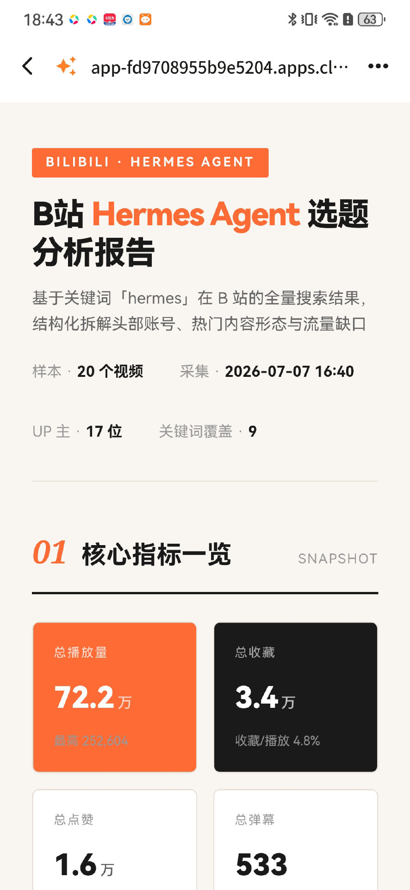

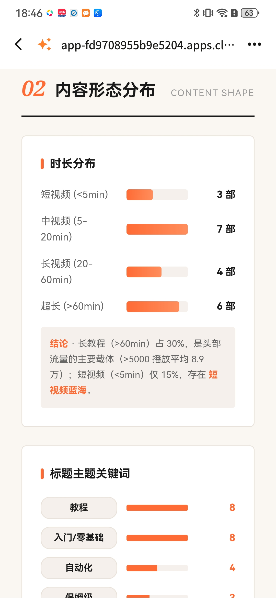

---

## 五.如果你感兴趣养虾养马真正用起来

最近私信比较多，无法一一回复，拉了一个互助交流群，感兴趣的可以来哦


**以下是我自己正在使用的几个小场景，更多案例会持续在知识星球更新 **


### 案例0：超级秘书的属性

***一个好的超级秘书一定是主动的，***

***当有跟你相关的重要事件会主动@你***


***也会主动问要不要帮你盯着一些事情~***


### ***案例1：AI早资讯语音播报版***

每天早晨8点会给我推送AI资讯，并且转换成语音播报，可以在洗漱或者路上听。另外还有一个汇总页面，所有的早咨询都会保留下来。

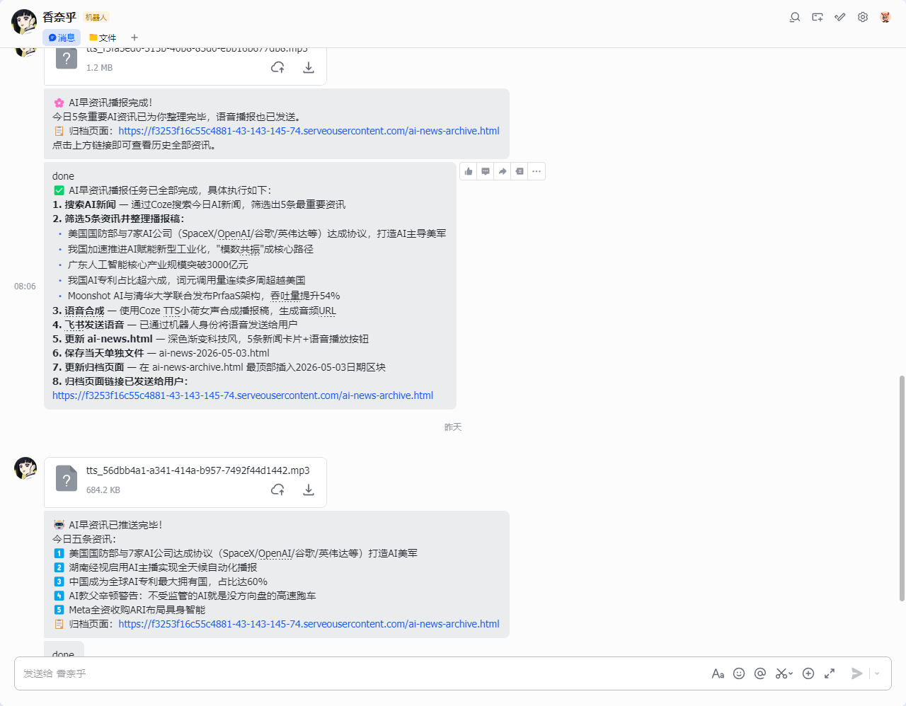

[view:2]

[语音播报.mp3](feishu-file:LWxsbFHdUoGzxFxO7OFcvtDWnod)


### **案例2：同行与对标直播间监控**

做这个的目的是我打算也做一下抖音直播，所以要去关注一下同赛道的哪些博主做的比较好，什么样的形式，讲的什么内容，特别是这个在线直播人的数据，直接效果好的可以直接借鉴和参考，不好的就直接避坑了，也算是避开一个错误选择，节约试错成本。


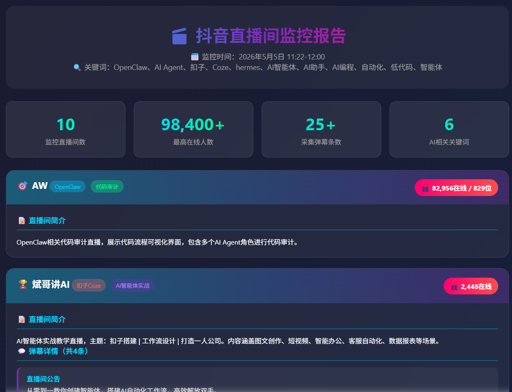

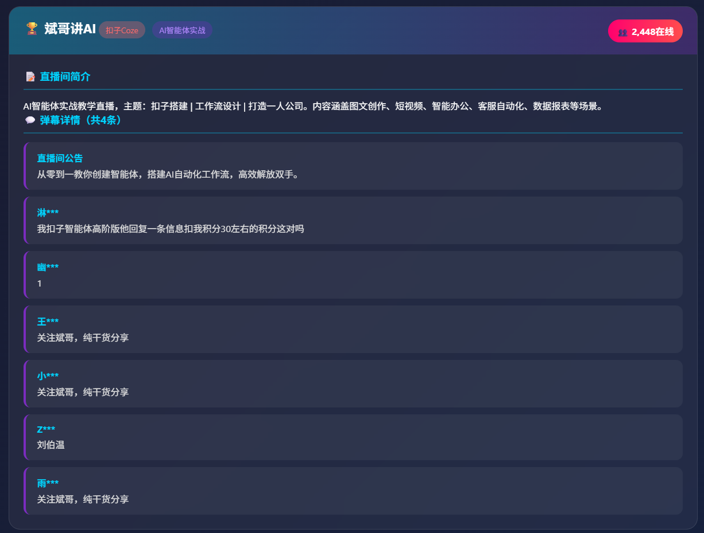


这个是优化后的版本，增加了一些与我有关系的建议和分析（我跟agent说了我是做什么的这些详细信息了）


### 案例3：直接间挖掘用户真问题需求

这是专门盯着一个在线观看人数还比较多的


### **案例4：低粉爆款找选题**


### 案例5：评论区问题汇总挖选题（推送链接）


### 案例6：招聘网站找B端客户

### 案例7：每天定时推送漫画（可定制）单词卡

### 案例8：电商同行产品负评挖掘分析

### 案例9：招聘网站挖掘成长行业与项目

### 案例10：自动检索对标博主新内容的知识点以PPT推送

### 案例11：定时对标直播间话术改写（完成录制+文案提取+自动改写）
