# 养虾先别弃坑！做完这5件事你会爱上养虾~

> 来源：飞书文档（李君陌AI笔记）｜Hermes & OpenClaw 实战进阶配套笔记 第2篇
> 原文：https://zcnv48kqce5a.feishu.cn/wiki/PT60wo4axilSiVkjOOPcZhFuntd
> 归档时间：2026-11-14

[iframe:https%3A%2F%2Fwww.bilibili.com%2Fvideo%2FBV1EGcQzFEAy%2F]

**token自由+增加联网搜索+模拟控制浏览器+定时任务**

> `beach_with_umbrella`
> **装完龙虾之后可能普通遇到的问题**
> 1.太烧token了！
> 2.各种指令和连接特别烦
> 3.怎么控制浏览器帮我看信息

### **1.如何省token**

Coding Plan建议使用

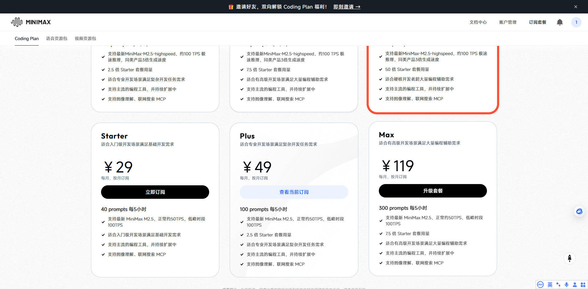

> `beach_with_umbrella`
> **Coding Plan订阅：**https://platform.minimaxi.com/subscribe/coding-plan?code=Jj0bqhwQT1&source=link

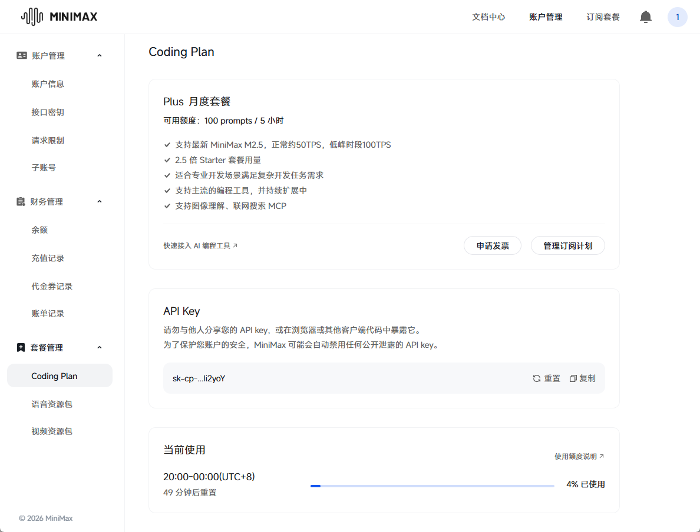

> `writing_hand`
> **查看Coding Plan使用情况**：https://platform.minimaxi.com/user-center/payment/coding-plan

**给OpenClaw配置coding Plan**

```plaintext
pnpm openclaw onboard
```

注意：minimax是选Oauth—>cn—>在网页上点确认。

### **2.如何安装Skill**

#### 通过对话就能安装Skill

```plaintext
安装一下这个skill：https://clawhub.ai/Jacky1n7/openclaw-tavily-search，我的apikey是：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
```

**不仅仅是安装skill，连创建skill、创建Agent也可以用对话来完成，甚至各种配置的修改也是可以的。**

#### 最常用的skill安装站

##### ① ClawHub

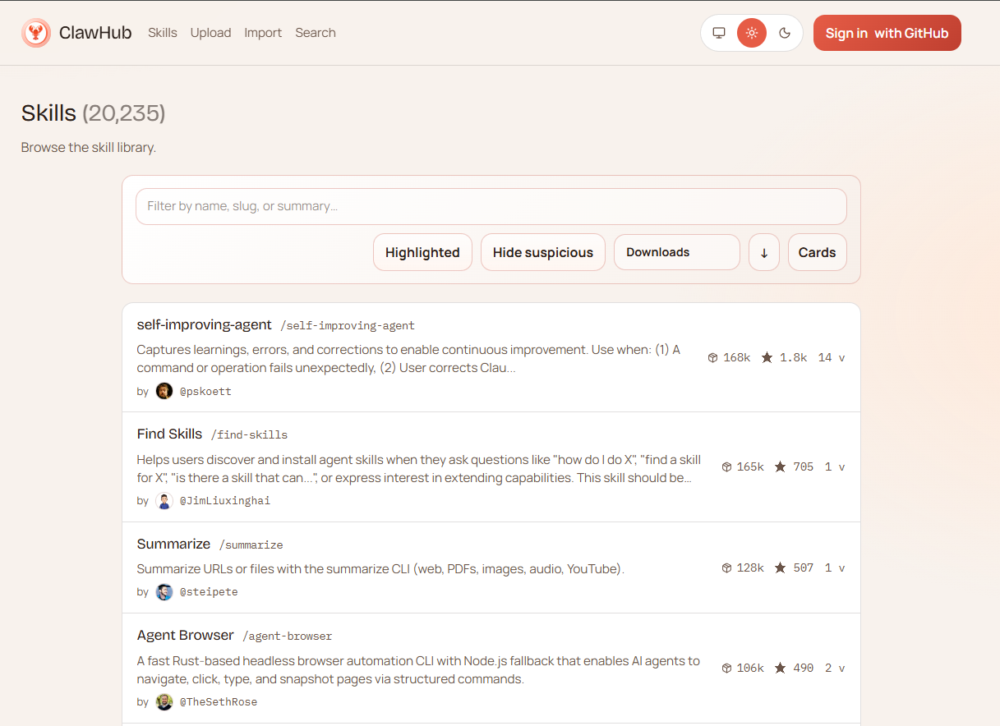

> `pencil2`
> https://clawhub.ai/skills?sort=downloads

##### ② awesome-openclaw-skills

按使用场景进行了分类

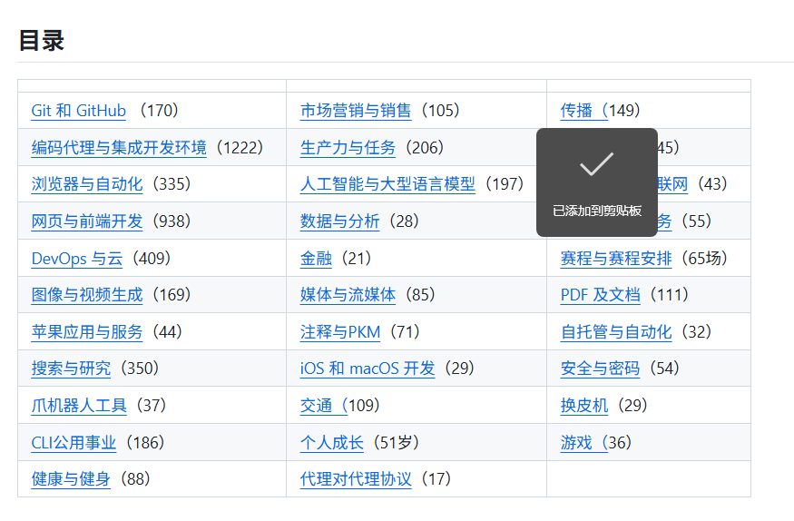

> `sunrise`
> https://github.com/VoltAgent/awesome-openclaw-skills

### **3.增强联网搜索-Tavily**

```plaintext
安装一下这个skill：https://clawhub.ai/bert-builder/tavily，我的apikey是：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
```

Tavily的搜索效果要比默认的web_fetch用起来效果更好更稳定一些。

> `bread`
> **Tavily的skill地址：****https://clawhub.ai/bert-builder/tavily**

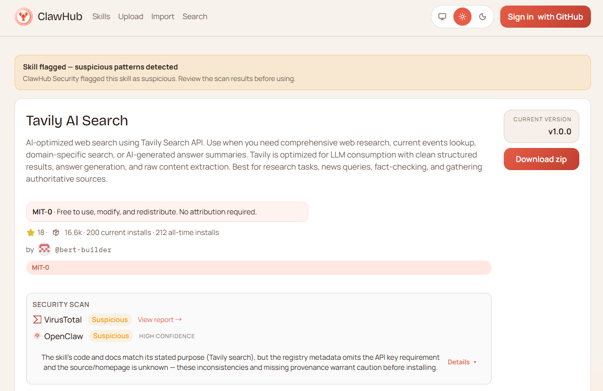

**申请一下Tavily的apikey，每个月可以免费用1000次**

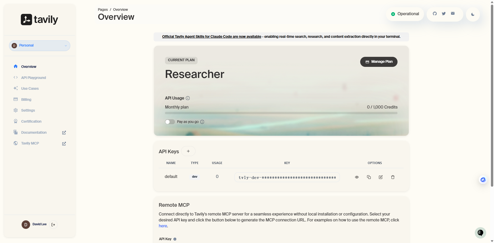

> `musical_score`
> **申请Tavily的API Key：****https://www.tavily.com/**

### **4.浏览器控制-OpenClawBrowser**

#### 4.1 安装插件

插件名称：

```plaintext
openclaw browser relay
```

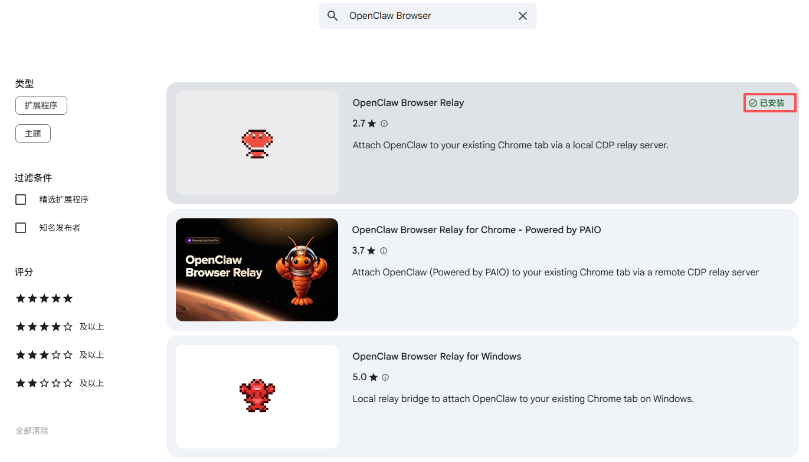

#### **4.2 配置插件**

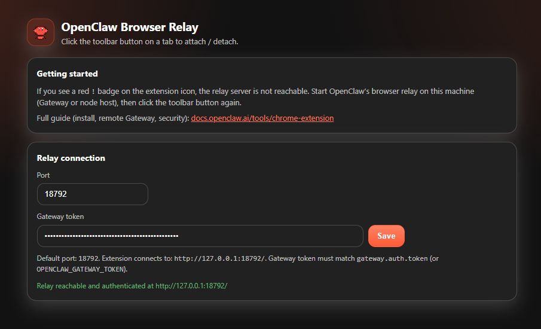

token可以从启动的命令行找到。

```plaintext
pnpm openclaw dashboard
```

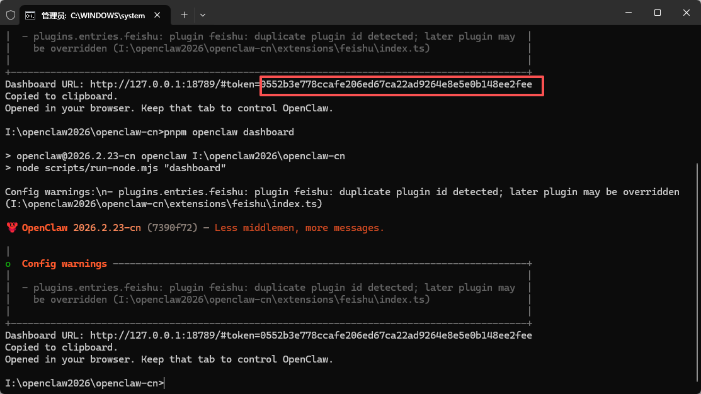

#### **4.3 Attach一个网页**

**打开任意网页，点击插件图标，attach一下，看到图标带了一个“on”，就是attach成功了**

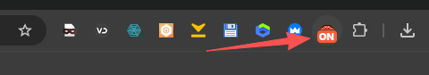

**4.4 修改浏览器方式**

增加browser的配置信息，明确指定为“openclaw”，不写该节点是“chrome”

```plaintext
 "browser": {
    "enabled": true,
    "defaultProfile": "openclaw"
  },
```

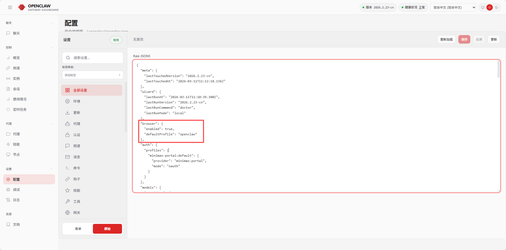

**可以使用以下命令查看是否已经生效，没生效就重启一下gateway**

```plaintext
pnpm openclaw browser status
```

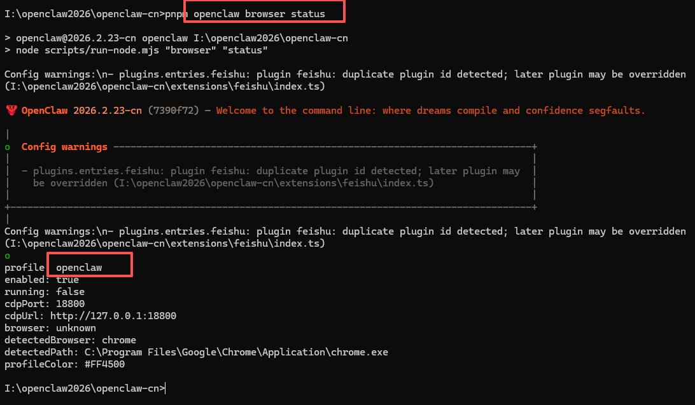

#### 4.4 启动浏览器

```plaintext
pnpm openclaw browser start
```

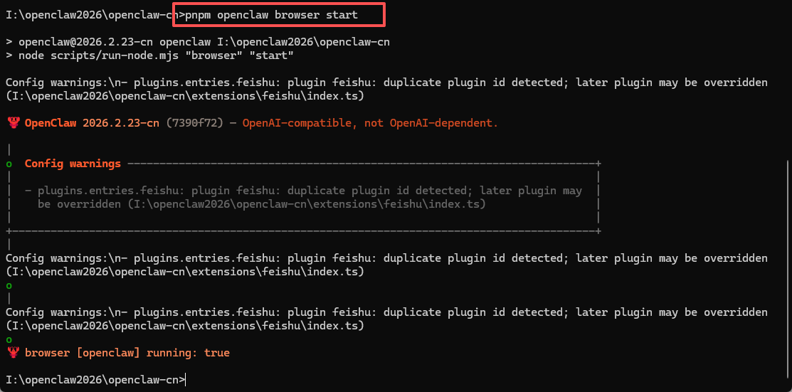

#### **4.5 采集某条B站视频的评论**

```plaintext
使用浏览器工具每帮我抓取https://www.bilibili.com/video/BV1mYPSzmEkV/中的评论，并且给出选题建议
```

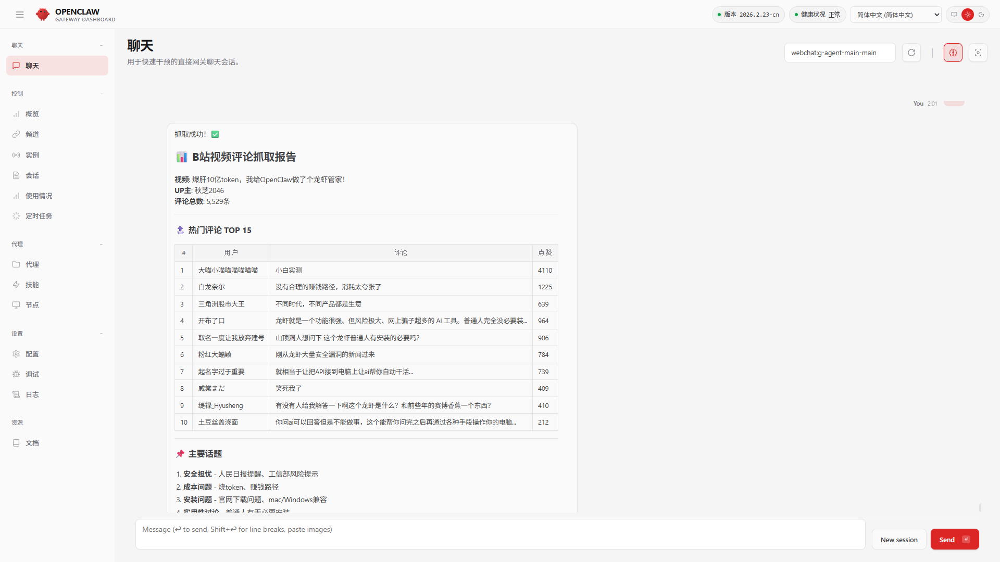

### **5.模拟操作浏览器—进阶**

控制鼠标点击，获取隐藏内容

```plaintext
openclaw browser snapshot
pnpm openclaw browser highlight e505
pnpm openclaw browser hover e505
```

> `unicorn_face`
> https://next.ithome.com/

```plaintext
打开 https://next.ithome.com/ 并发送日榜新闻给我。
日榜新闻获取方法，需要如下步骤：
1.打开网址
2.通过 openclaw browser snapshot 命令，获取日榜的 ref
3.通过 openclaw browser hover [ref] 命令，模拟鼠标移动事件并将日榜显示
4.通过 openclaw browser snapshot 命令，获取日榜信息
5.打开每条信息阅读一下，给我总结
6.告诉我你在浏览器上做的所有操作
```

### 6.定时执行爬评论

```plaintext
帮我创建一个定时任务，使用浏览器工具每分钟帮我抓取https://www.bilibili.com/video/BV1mYPSzmEkV/中的评论，周期为每5分钟一次
```

同样可以通过对话就能完成定时任务

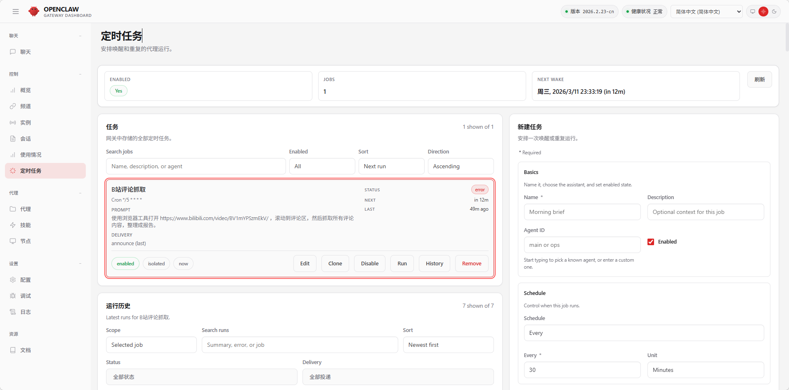

### 7.创建一只新虾（Agent）

查看所有agents

```plaintext
pnpm openclaw agents list
```

创建一个Agent

```sql
# 创建名为 "mediasupport" 的 Agent，指定其工作目录和模型
openclaw agents add mediasupport --workspace ~/.openclaw/workspace-mediasupport --model "minimax-portal/MiniMax-M2.5"
# 给它设置一个帅气的显示名称和表情符号
openclaw agents set-identity --agent mediasupport--name "媒体抓虾"
```

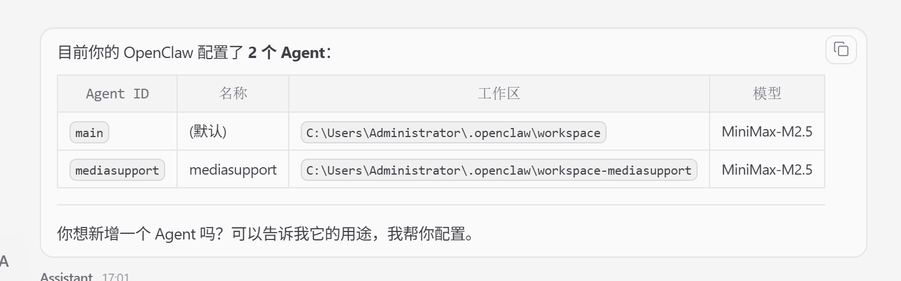

目前无法直接跨 Agent 发送消息，因为配置中限制了跨 Agent 访问。

要执行 `mediasupport` Agent，你需要：

**修改配置允许跨 Agent 访问**

```json
{
  "tools": {
    "sessions": {
      "visibility": "all"
    }
  }
}
```
