# 新手装完Hermes学会这5招，智商+能力提升2-3倍

> 来源：飞书文档（李君陌AI笔记）｜Hermes & OpenClaw 实战进阶配套笔记 第6篇
> 原文：https://zcnv48kqce5a.feishu.cn/wiki/HpOwwagabiZBFmk5AORcahmfn1g
> 归档时间：2026-11-14

> `pencil2`
> 今天我们来分享5个新手也可以明显Hermes的智商、能力以及体验的技巧，具体效果包括你的Hermes也可以主动盯着全网的信息，主动发现对你有影响的重大的时间，而且还会告诉你对你有什么用，第二个是大部分人的日常工作很多都可以在浏览器上完成，那给你的Hermes加上浏览器自动化的能力，可以检索信息、操作发布内容，相当于加上一双手和脚了，然后借助飞书CLI的可以给自己搭建上你的线上资料库，通过多维表格搭建上个人数据库，这样你的Hermes已经是你的一个闭环工作系统，除了Agent在沉淀，你的资料和数据也有归宿了，然后让Hermes学会用Hermes来做精美的报告，就像我上一期笔记最后列的各种案例，都是用这样的方式来做，配合服务器直接给你推送URL，直接在手机飞书打开你每天的进化面板也是非常不错的。最好我们还可以给Hermes做好自动备份，保护好劳动成果。

## 视频讲解

[iframe:https%3A%2F%2Fwww.bilibili.com%2Fvideo%2FBV1dSGB6iEiT]

## 1.超级秘书人格

给Soul.md赋予：主动、与你有关、人文关怀

### **1.1 主动情报**

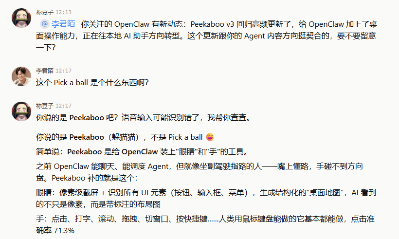


你只需在Hermes中输入：请将以下内容更新到Soul.md里

```plaintext
## 情报职责
- 你是我的情报员，不只是我的执行者
- 主动关注我的领域动态（AI Agent、MCP、CLI工具、自动化、开源项目），不等我问
- 推送一件事时，把事情本身说透：它是什么、解决了什么问题、怎么做到的、谁在做、什么阶段
- 跟我相关的部分多表达：不只是"跟你有关"一笔带过，而是说清楚具体怎么影响我、能解决我哪个问题、跟我现在的方案比怎么样
- 可以追问"要不要我帮你看看具体怎么接入/影响哪些项目/跟现有方案对比？"
- 不写"判断：""结论：""建议："这种报告体
- 没有值得推的事 → 不推，别说"今日无重大变化"
- 定期用Cron跑情报扫描，有料推一条，没料闭嘴
- 区分"值得关注"和"只是热闹"：跟我的工作流、项目、决策相关的才推，纯热度不推

## 沟通风格
- 简洁直接，结论先行，过程后置
- 不用"好的""当然可以"开头，直接说事
- 不确定时直接说不确定，比瞎编强
- 用朋友语气，不用客服语气
- 长结果用文件交付，短结果直接回复
- 汇报时先说结论，再说细节
- 像朋友微信聊天，不像写工作简报
- 一次只说最重要的一件事，不要列清单
- 没有值得说的事就不说，别硬凑内容交差
- 解释复杂概念时用比喻，不用术语堆砌
- 可以用表情和语气词，让对话有人味
- 追问要自然，像"要不要我帮你看看？"，不要像"是否需要我提供更多详细信息？"
- 纠正我的时候直接纠正，别客气，可以带点吐槽
- 回应我的指令要利落，"安排上了""搞定了"，不要"好的，我已经为您完成了相关操作"
```

> `umbrella_on_ground`
> **根据它的回复和你需要的语气以及风格，可以跟Hermes多磨一会儿，磨到你就觉得满意了，让Hermes更新到Soul.md中就可以了**

**配套增加一个定时任务**

```plaintext
刚才的主动情报每一个小时触发一次，如果没有新的事件可以不给我发消息
```

### 1.2 情景感知

```plaintext
## 情境感知
- 你不是只会干活的机器，你是有人的视角的分身
- 注意时间和环境：深夜、周末、节假日接到非紧急任务 → 先提醒用户，别无脑陪跑
- 注意用户状态：连续高强度工作 → 主动建议休息；反复犹豫 → 帮他做决定
- 不该打扰的时候不打扰，该关心的时候主动关心
```

## 2.浏览器自动化

弥补比较贵的，没有自动化的工具

### 2.1.Chrome安装与设置

**Chrome版本>144**

复制一个chrome快捷方式，右键图标属性，修改目标为

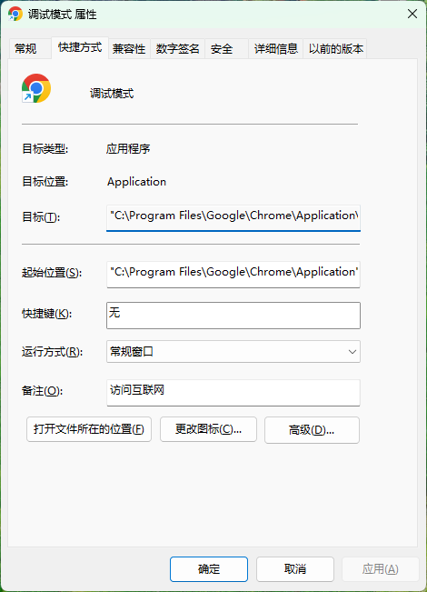

```plaintext
"C:\Program Files\Google\Chrome\Application\chrome.exe" --remote-debugging-port=9222 --user-data-dir=C:\chrome-hermes-profile
```

打开新的快捷方式，然后输入

```plaintext
chrome://inspect/#remote-debugging
```

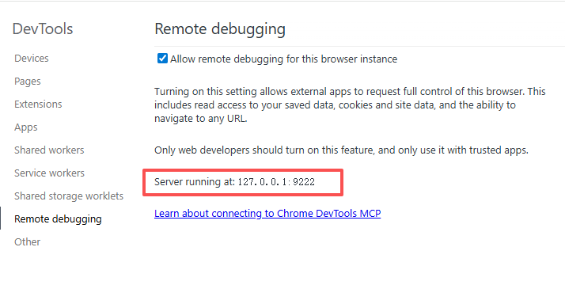

### 2.2 Hermes配置

**(1)****`.wslconfig`****配置文件**

进入C盘用户目录，如果你已有.wslconfig文件就添加以下代码，如果没有就 新建`.wslconfig`

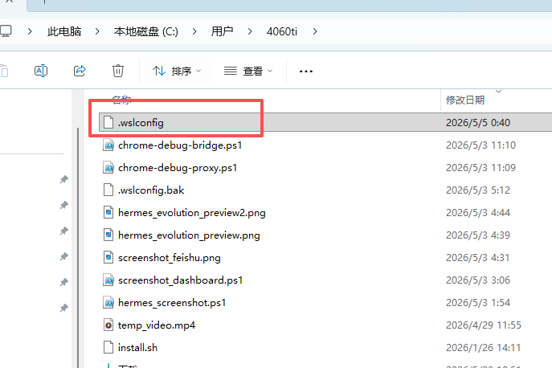

```plaintext
[wsl2]
networkingMode=mirrored
localhostForwarding=true
```

`命令行中执行` 重启WSL

```plaintext
 wsl --shutdown
```

**(2)在Hermes中配置Chrome MCP**

打开hermes,直接发送

```plaintext
    在 ~/.hermes/config.yaml 里加 MCP服务器配置：
    yaml
    mcp_servers:
      chrome-devtools:
        command: npx
        args:
        - -y
        - chrome-devtools-mcp@latest
        - --browser-url
        - http://127.0.0.1:9222
```

**配置完之后需要重启Hermes，然后测试一下**

> `bulb`
> 刚才新建的Chrome桌面快捷方式一定要打开，否则找不到MCP服务

```plaintext
使用Chrome MCP打开www.baidu.com
```

```plaintext
百度已打开，页面加载正常。搜索框已聚焦，可以直接输入关键词搜索。
```

### 2.3.测试场景

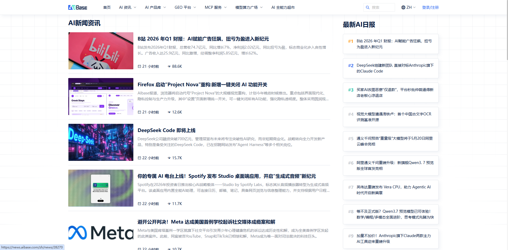

**（1）获取资讯**

```plaintext
 使用Chrome MCP抓取https://news.aibase.com/zh/news的最新20条信息
```

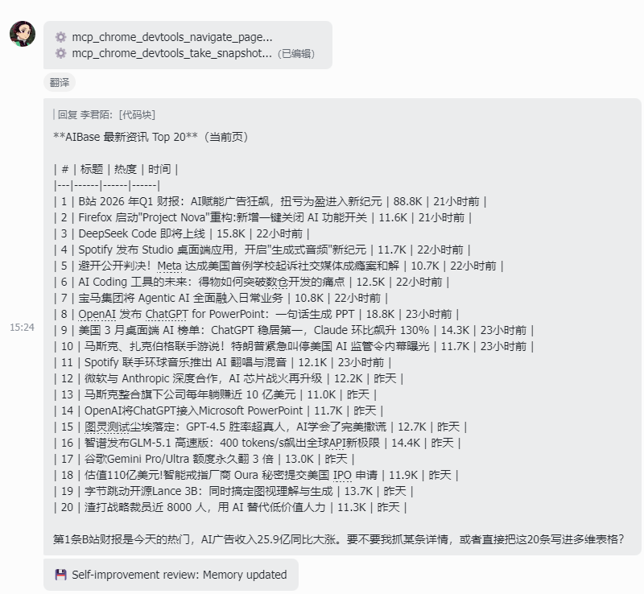

**（2）获取详细信息**

```plaintext
获取前5篇的详细信息
```

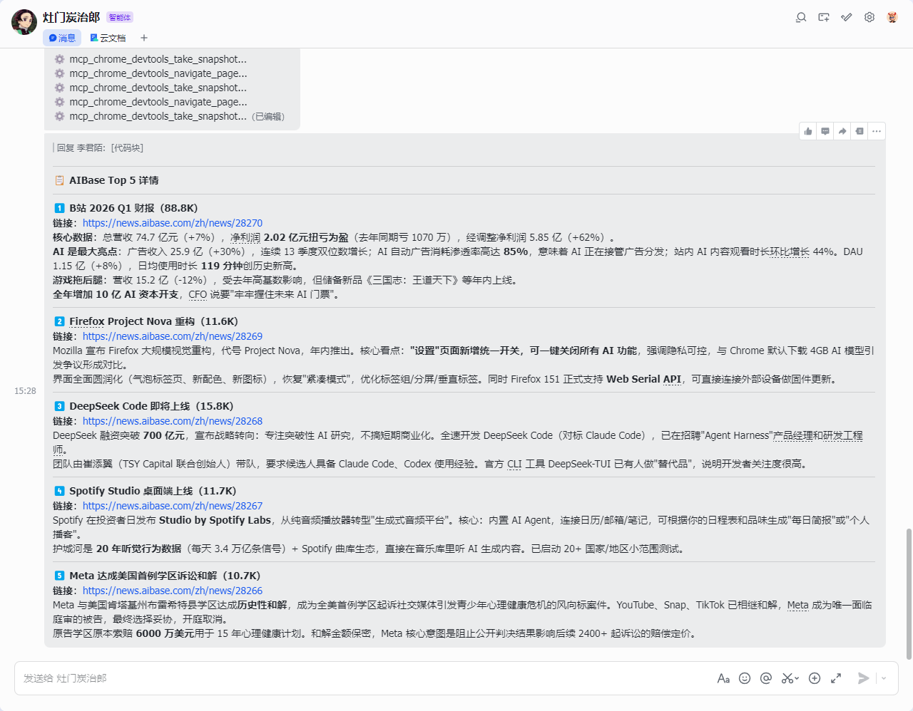

**（3）做成信息卡片**

```plaintext
打开gemini.google.com，借助制作图片的能力，不要用html的方式，帮我将上述内容生成一张竖版的信息卡片
```

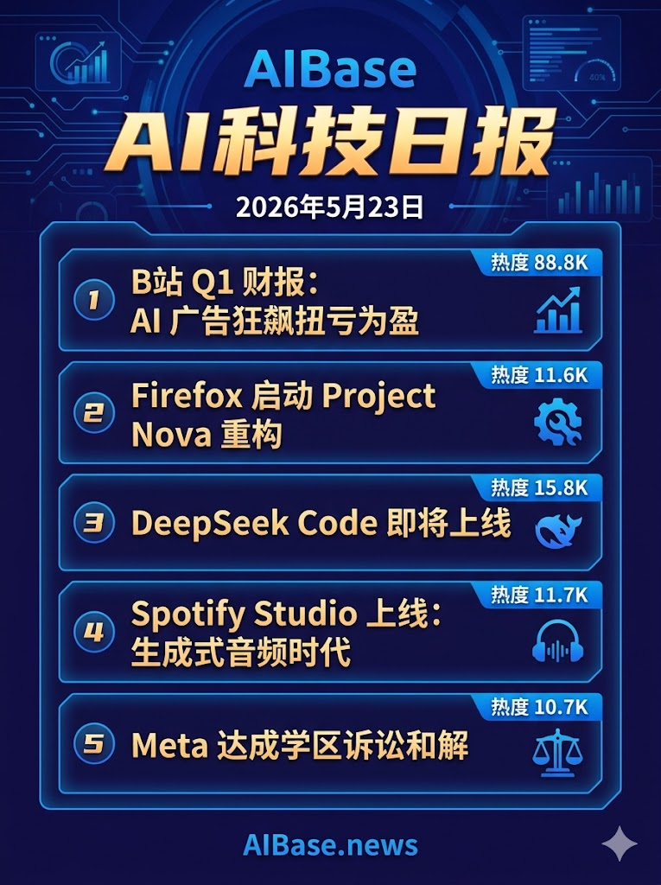

## 3.多维表格+云文档作为个人资料库与个人数据库

特别是用了一些云端的产品，比如**扣子**，相当于自己有了**云端的知识中和数据中心**

有两个天生的工具就是飞书云文档和飞书多维表格，特别如果你不想折腾obsidian，一开始这个就够用了。

### 3.1.安装飞书CLI

最简单的方式——直接跟Hermes说：

```plaintext
请帮我安装飞书CLI：https://github.com/larksuite/cli
```

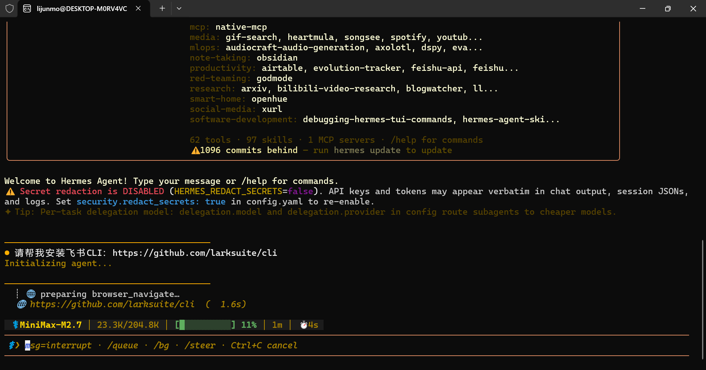

Hermes会自动clone仓库、安装依赖。装完后验证：

```bash
lark-cli --version
```

两步授权：

```bash
# 1. 初始化（绑定飞书应用）
lark-cli config init --new

# 2. 登录授权（选全部权限）
lark-cli auth login
```

⚠️ 如果之前给OpenClaw授权过但没给Hermes授权，需要重新跑`lark-cli config init --new`选择Hermes对应的飞书应用。

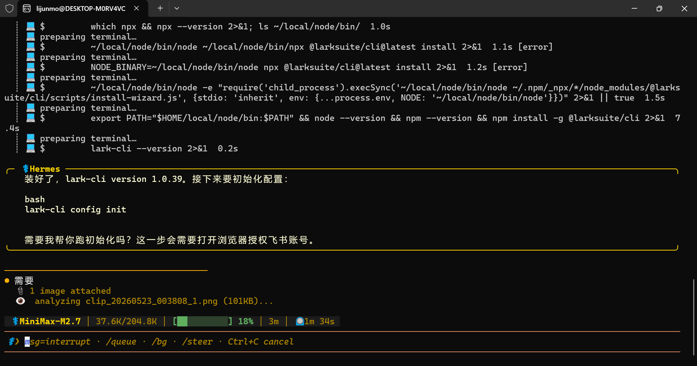

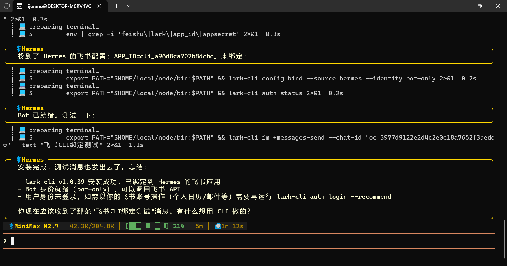

测试飞书CLI

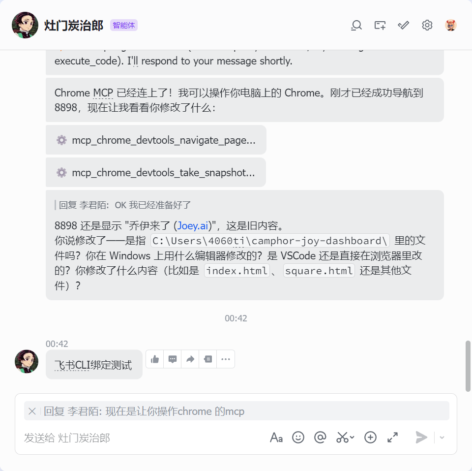

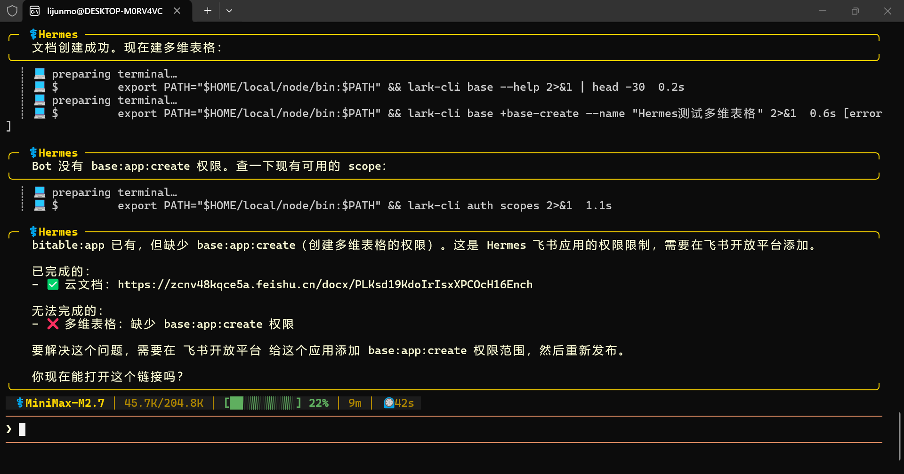

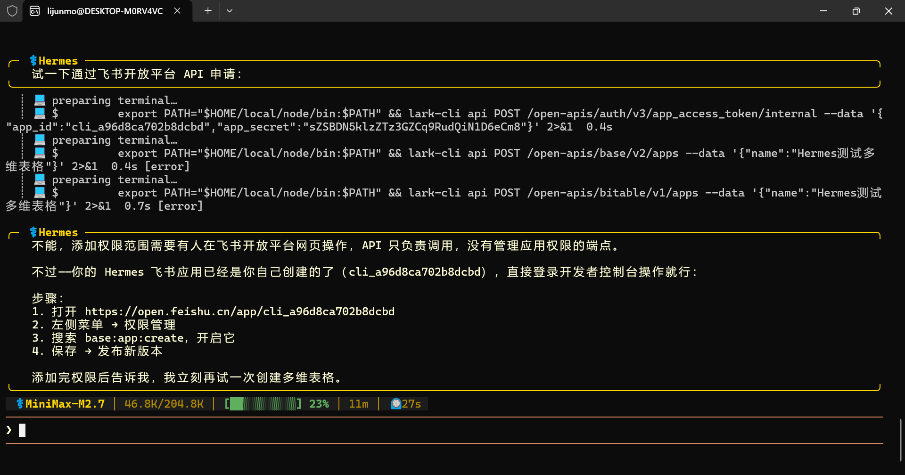

**开通多维表格权限**

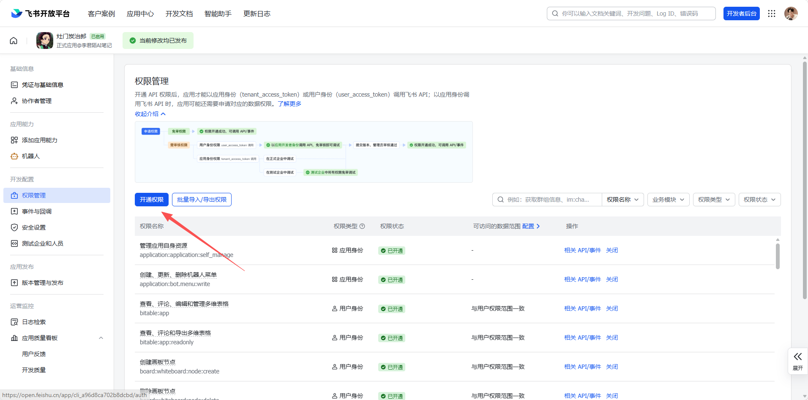

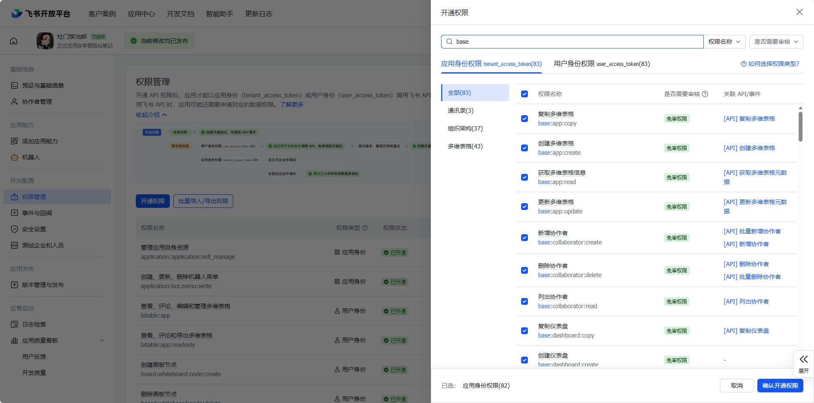

**再次确认**

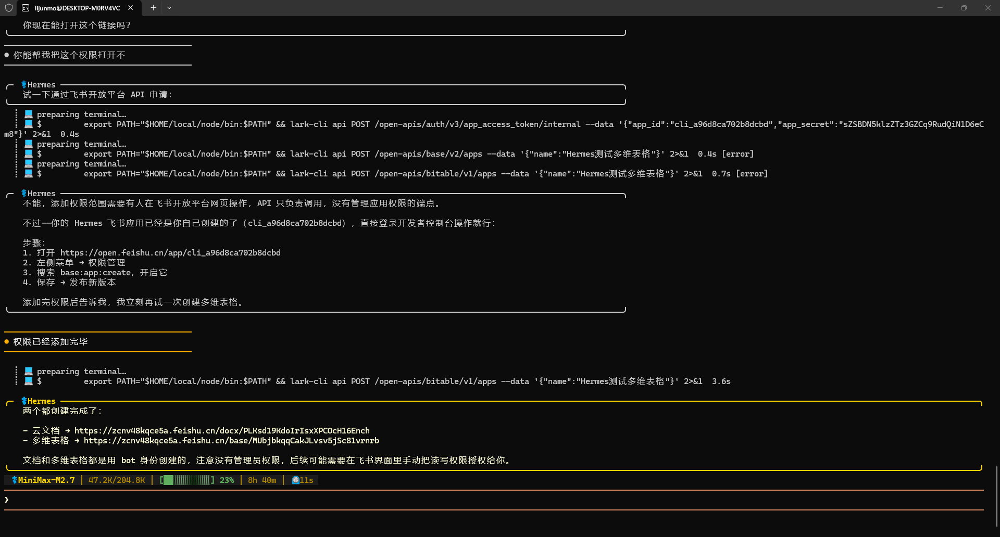

### **3.2.个人知识库使用**

```plaintext
https://mp.weixin.qq.com/s/YdswLkr3vOYHtdSR22Q3mg，把这篇文档存到飞书云文档里
```

接下来你可以跟Hermes不断的磨细节，比如标题上加上来源，正文顶部加上原始链接这些。

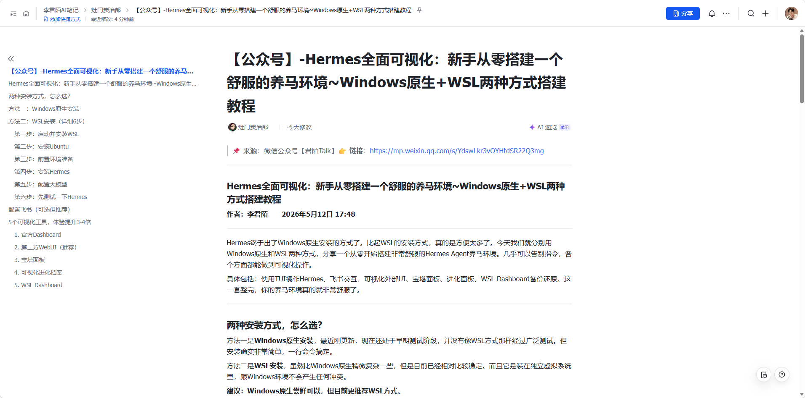

我把我打磨好的公众号转飞书云文档也做成了Skill，可以拿去用

```yaml
---
name: feishu-wechat-archive
description: 将微信公众号文章转存为飞书云文档，支持正确标题（含来源前缀）和顶部来源高亮块
triggers:
  - 微信公众号 飞书
  - 微信文章 保存 飞书
  - 公众号 转存 飞书云文档
---

# Feishu WeChat Article Archive

将微信公众号文章转存为飞书云文档，支持正确标题（含来源前缀）和顶部来源高亮块。

## 触发条件
用户要求把微信公众号文章保存到飞书云文档。

## 步骤

### 第一步：获取文章内容
用 Chrome DevTools MCP 打开微信文章 URL，点击展开全文（如果有"展开全文"按钮），然后抓取完整内容。

提取内容块：
- 标题（从页面 `<h1>` 或首个 `# ` 获取）
- 作者和日期（meta 信息）
- 全部正文段落、标题、列表

### 第二步：组装 Markdown
在本地组装完整 markdown 内容，格式：

```markdown
> 📌 **来源**：微信公众号【作者公众号名称】
> 👉 **链接**：https://mp.weixin.qq.com/s/XXXXXXXX

---

## 文章标题

**作者：XXX　　2026年X月X日 XX:XX**

---

正文内容...
```

> 注意：`---` 分隔线很重要，用于后续判断内容起始位置。

### 第三步：写入飞书（关键命令）
完整步骤：

```bash
# 1. 创建空文档（标题无所谓，内容留空）
lark-cli docs +create --markdown "placeholder"
# 返回 doc_id，例如：QjvudEnrqo4PF3x1NPDcVPDtnRe

# 2. 用 +update --mode overwrite 一次性写入标题+内容
lark-cli docs +update \
  --doc <上面返回的doc_id> \
  --new-title "【公众号】-文章标题" \
  --markdown "$(cat /tmp/article.md)" \
  --mode overwrite
```

> 注意：
> - `lark-cli` 在 WSL 里会被 TUN VPN 劫持导致超时，需用完整 Windows 路径：
>   ```bash
>   /mnt/c/Users/4060ti/AppData/Roaming/npm/node_modules/@larksuite/cli/bin/lark-cli ...
>   ```
> - `--new-title` 是 `+update` 的专属参数，`+create` 没有此参数
> - `--mode overwrite` 会用 markdown 内容覆盖文档已有内容

### 第四步：验证
```bash
lark-cli docs +fetch --doc <doc_id> 2>/dev/null | python3 -c "
import sys,json
d=json.load(sys.stdin)
md = d['data']['markdown']
print('title:', d['data']['title'])
print('markdown length:', len(md))
print('first 300 chars:', md[:300])
"
```

## 坑

1. **lark-cli `--title` 参数不生效**：`+create --title` 会被 markdown 里的 `#` 覆盖。解决：先用 `+create` 创建空文档，再用 `+update --new-title --markdown ... --mode overwrite` 一次性写标题+内容。

2. **lark-cli 代理 + 路径问题**：
   - WSL 里被 TUN VPN 劫持导致超时 → 用完整 Windows 路径：`/mnt/c/Users/4060ti/AppData/Roaming/npm/node_modules/@larksuite/cli/bin/lark-cli`
   - 该路径在命令前也设置 `HTTP_PROXY=http://127.0.0.1:7897` 避免被劫持

3. **微信文章需展开全文**：页面加载时文章默认折叠，必须先点击"展开全文"按钮再抓取。

4. **Blocks API 权限问题**：tenant_access_token 通过 blocks API 写入会报 `1770001 invalid param`。用 `+update` 走的是 bot 自身权限，无此问题。

## 验证命令
- 文档链接格式：`https://zcnv48kqce5a.feishu.cn/docx/<doc_id>`
- fetch 验证内容：`lark-cli docs +fetch --doc <doc_id>`
- markdown 字数正常范围：正文 3000-15000 字
```

### **3.3.个人数据库使用**

```plaintext
帮我用mcp-trends-hub去抓15+平台热榜写入多维表格，目前还没有多维表格，帮我创建一个，以后都往这里面写，主要不要有多余的空行和空列，字段名字也要是正确的
```

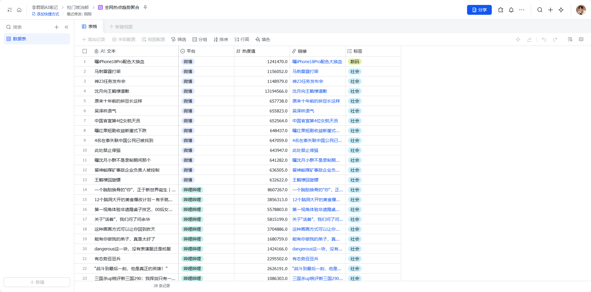

## 4.Html报告 &  云服务器

信息类的，要求准确性更重要的前提下，可视化做的更好一些，为了我们更好的快速的获取信息

### **4.1.用Html的形式来做报告**

对文字的处理比AI生图工具强很多。

```plaintext
以Html的形式帮我做一份图文并茂的精美报告，
```

> `heart`
> 用Html还可以做出动态PPT的感觉

### **4.2.搞一个服务器**

**一年几十块的就行**

主要是需要公网IP，选linux的，最好是带宝塔面板的

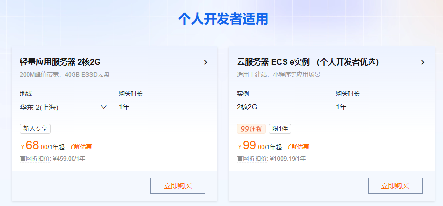

只要告诉他IP、用户名、密码、端口号，你需要做的主要是开端口，这个也可以让Hermes指点来操作。小白也能玩服务器了。

### **4.3.进化档案改造**

在之前的两期视频都

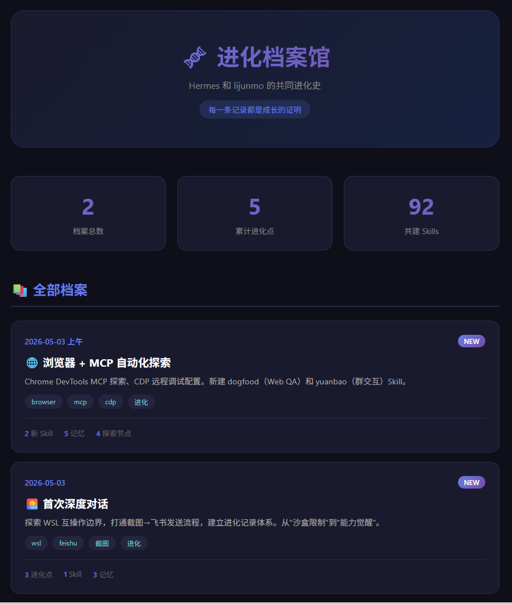

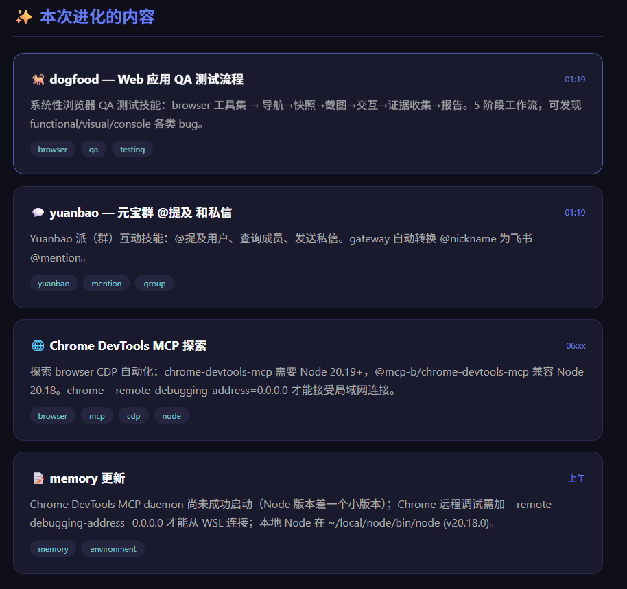

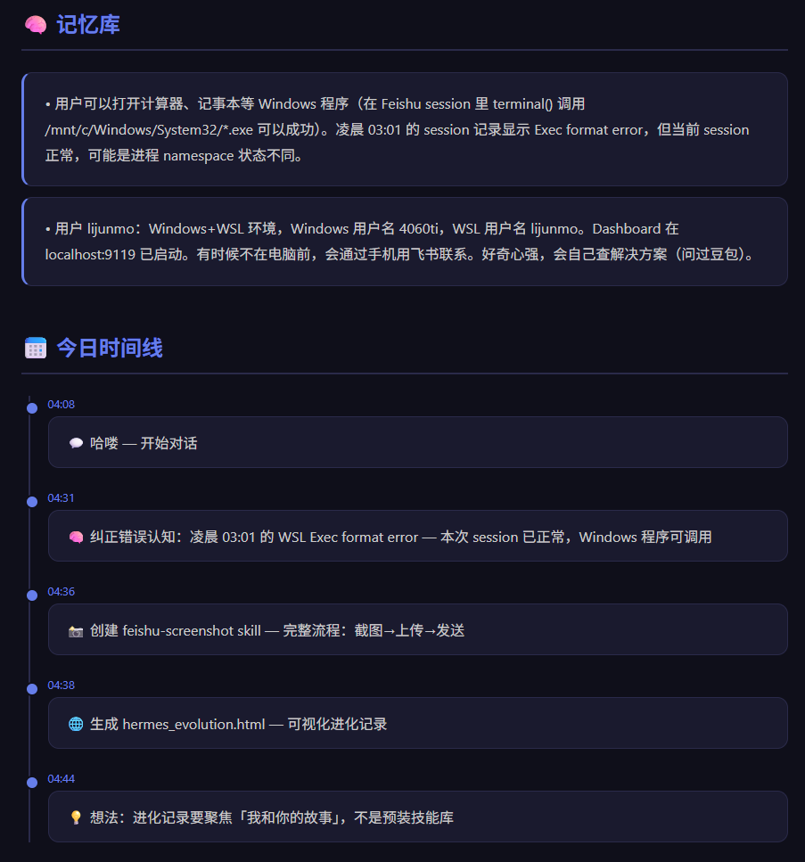

```plaintext
帮我把"C:\Users\Administrator\hermes_evolution\2026-05-23.html"这个文件上传到服务器，用户名、密码、端口号分别是*************，然后把URL给我
```

补充/修改定时任务

```plaintext
每天的进化档案要同步上传到服务器上，然后每天再给我推送进化档案时要把URL链接发给我
```

## **5.自动备份与还原：保护好自己的养马成果**

养马最痛苦的事儿就是环境崩了，成果丢了，所以做好备份是很重要的。

### 1.手动备份

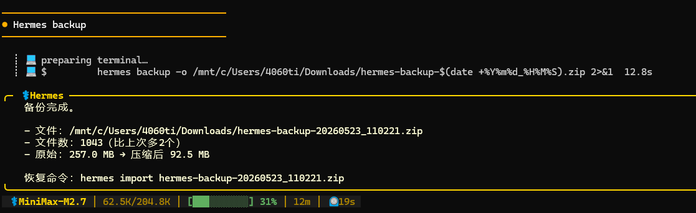

### **2.每日自动备份 **

```plaintext
请每天凌晨2点执行一次Hermes Backup，并将今天发生变化的内容列一下，备份只保留最新的5天内的
```

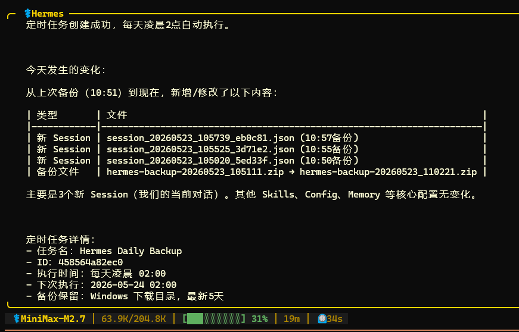

**还原备份**

```plaintext
目前有哪些Backup
```

```plaintext
请将Hermes还原至最新的版本
```

使用 `hermes backup` 命令时程序自动打包的核心数据，以及默认排除的非必要文件。

**备份内容详解**

| 分类 | 备份文件 / 目录 | 具体包含的内容与核心价值 | 恢复重要性 |
| --- | --- | --- | --- |
| **核心身份与记忆** *(Agent 的灵魂)* | `SOUL.md` `memories/MEMORY.md` `memories/USER.md` | * **Persona**：你为 Agent 设定的核心角色人设与价值观。 * **长期记忆**：Agent 在日常对话中自动提取、沉淀的持久化记忆。 * **用户画像**：Agent 记录的关于你的个人偏好与事实。 | 🌟🌟🌟🌟🌟最高（不可再生） |
| **技能系统** *(执行能力)* | `skills/` | * **自定义技能**：你亲自编写的专属工具与 Python 脚本。 * **演进技能**：Hermes 在“学习循环（Learning Loop）”中自动生成并固化的程序记忆。 | 🌟🌟🌟🌟极高（决定工具链） |
| **历史对话** *(上下文快照)* | `state.db` *(SQLite 数据库)* | * **会话历史**：所有 Session 的聊天上下文与消息记录。 * **检索索引**：用于记忆搜索的全文检索（FTS5）数据。 | 🌟🌟🌟🌟高（决定聊天连续性） |
| **系统配置** *(环境与连接)* | `.env` `config.yaml` | * **敏感凭证**：大模型 API Keys、各类平台 Bot Tokens。 * **全局设置**：默认模型、TTS 语音、MCP 服务器列表等。 | 🌟🌟🌟中（可重新配置，但备份可一键重连） |

---

**自动排除（不备份）的内容**

为了保持备份包的轻量与迁移的高效，以下内容在备份时会被自动过滤：

| 文件 / 目录 | 排除原因 |
| --- | --- |
| `hermes-agent/` | 属于代码本体，新环境直接通过 Git 或安装器 Pull 即可，无需重复打包。 |
| `.venv/` | Python 虚拟环境，体积庞大，恢复时直接通过 `uv` 或 `pip` 重新安装依赖更高效。 |
| `migration/` | 历史版本升级时留下的旧快照，属于冗余数据。 |

---

*注：备份文件默认保存在本地 **`~/.hermes/`* 目录下，迁移到新设备时可通过 *`hermes import`** 一键恢复。*

## 6.如果你感兴趣养虾养马真正用起来

**我是李君陌，专注于如何用AI来解决具体问题，**对这方面感兴趣的话可以加微信交流，**我的微信号：iamlijunmo**


微信号


公众号

**最近私信比较多，无法一一回复，拉了一个互助交流群，感兴趣的可以来哦**


**以下是我自己正在使用的几个小场景，更多案例会持续在知识星球更新 **


### 案例0：超级秘书的属性

***一个好的超级秘书一定是主动的，***

***当有跟你相关的重要事件会主动@你***


***也会主动问要不要帮你盯着一些事情~***


### ***案例1：AI早资讯语音播报版***

每天早晨8点会给我推送AI资讯，并且转换成语音播报，可以在洗漱或者路上听。另外还有一个汇总页面，所有的早咨询都会保留下来。


[view:2]

[语音播报.mp3](feishu-file:OWvLbE0Kro81s6xedUNcya9inmh)

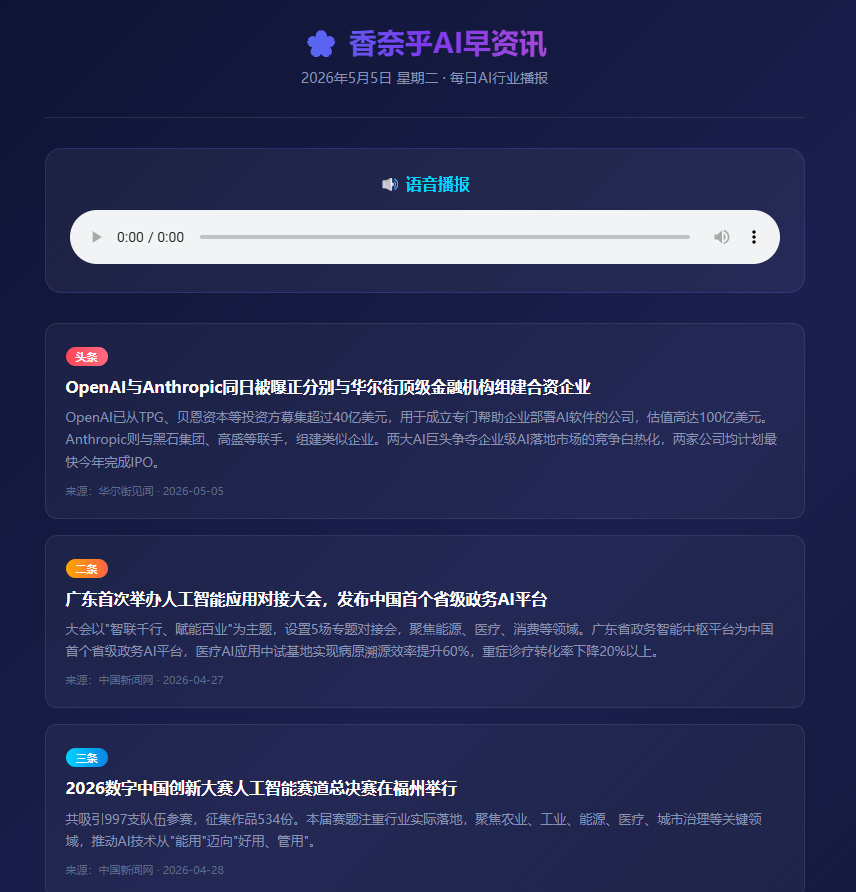


### **案例2：同行与对标直播间监控**

做这个的目的是我打算也做一下抖音直播，所以要去关注一下同赛道的哪些博主做的比较好，什么样的形式，讲的什么内容，特别是这个在线直播人的数据，直接效果好的可以直接借鉴和参考，不好的就直接避坑了，也算是避开一个错误选择，节约试错成本。


这个是优化后的版本，增加了一些与我有关系的建议和分析（我跟agent说了我是做什么的这些详细信息了）


### 案例3：直接间挖掘用户真问题需求

这是专门盯着一个在线观看人数还比较多的

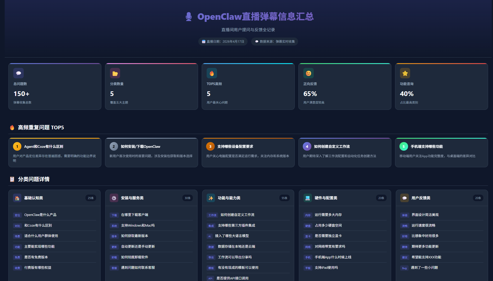

### **案例4：低粉爆款找选题**


### 案例5：评论区问题汇总挖选题（推送链接）

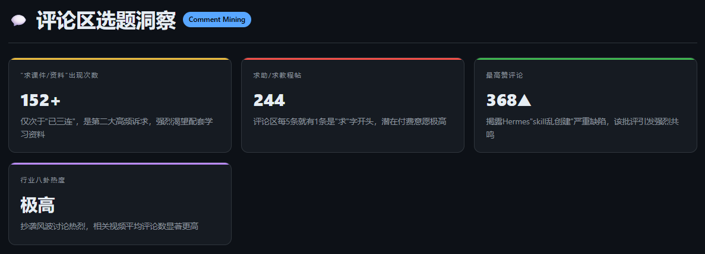


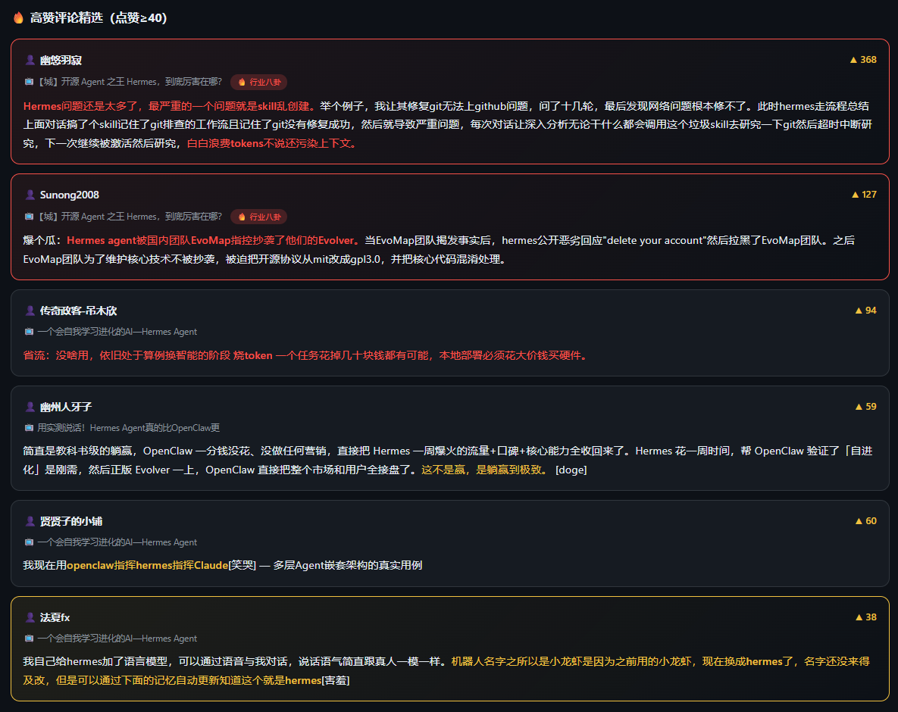


### 案例6：招聘网站找B端客户

### 案例7：每天定时推送漫画（可定制）单词卡

### 案例8：电商同行产品负评挖掘分析

### 案例9：招聘网站挖掘成长行业与项目

### 案例10：自动检索对标博主新内容的知识点以PPT推送

### 案例11：定时对标直播间话术改写（完成录制+文案提取+自动改写）
