# 装完Hermes Agent之后做完这5件事，就舒服了

> 来源：飞书文档（李君陌AI笔记）｜Hermes & OpenClaw 实战进阶配套笔记 第4篇
> 原文：https://zcnv48kqce5a.feishu.cn/wiki/PSN6wM636iLezEkPoF1ci0Y2neg
> 归档时间：2026-11-14

**全方位可视化 + 稳稳当当的养马**

**重装电脑并且第二次装上了hermes之后，先说说我做了什么事。。。**

> `beach_with_umbrella`
> **1.养虾/养马最怕的就是崩，有没有备份还原的方法**
> **2.有没有一个类似于openclaw的可视化webui来用**
> **3.wsl2是个黑箱，完全不知道怎么操作？**
> **4.Hermes每天自进化都干了啥？**
> **5.另外我这次重装还遭遇了不能wsl里不能操作windows的事儿**
> **6.Token Plan怎么选的问题**

### **视频讲解**

[iframe:https%3A%2F%2Fwww.bilibili.com%2Fvideo%2FBV1zn576XEb3]

**比较推荐MiniMax的Token Plan**

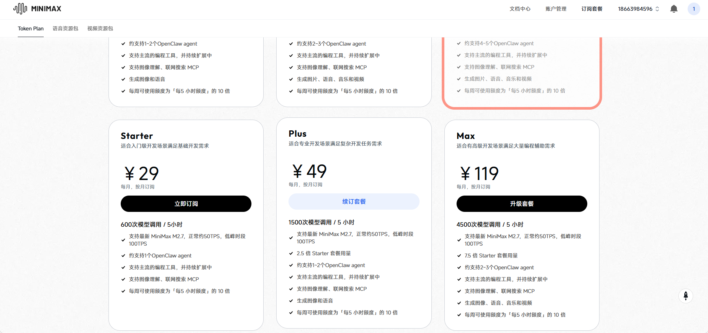

**Hermes Agent +MiniMax 的搭配效果还是不错的~**

> `beach_with_umbrella`
> **Token Plan订阅：**https://platform.minimaxi.com/subscribe/coding-plan?code=Jj0bqhwQT1&source=link

### **1.装上一个hermes-webui**

比起官方的dashboard，这个是类似于openclaw可以直接聊天的，还可以打开多个会话。

> `gift`
> 仓库：https://github.com/nesquena/hermes-webui
> 最新版：0.50.96（2026-04-23）

#### **1.1 安装与运行**

```plaintext
帮我安装一下https://github.com/nesquena/hermes-webui
```

```plaintext
运行一下hermes-webui
```

#### 1.2 显示外部会话

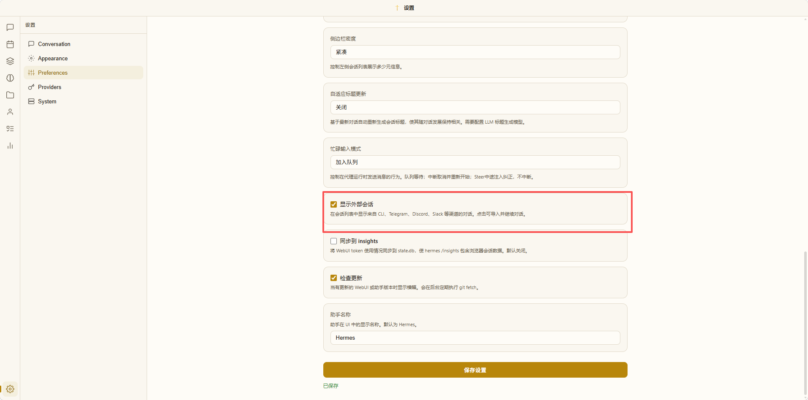

> `baguette_bread`
> **访问地址：**http://127.0.0.1:8787/

### **2.装一个宝塔面板(或者Xterminal)**

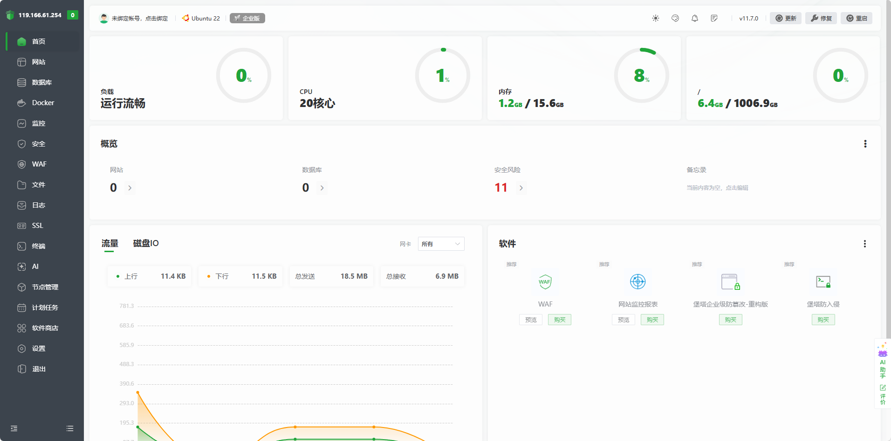

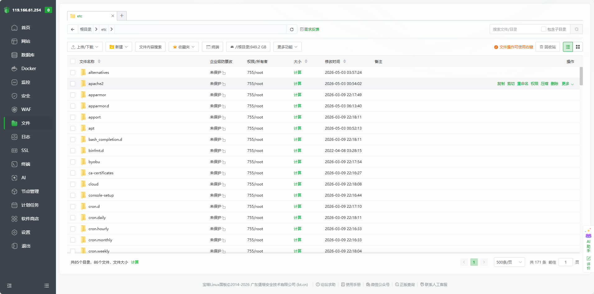

#### **2.1 安装宝塔面板指令**

```plaintext
wget -O install.sh http://download.bt.cn/install/install-ubuntu_6.0.sh && sudo bash install.sh
```

#### **2.2 访问和使用宝塔面板**

安装完之后记好地址，以及用户名和密码，这里要注意将宝塔面板

```plaintext
https://127.0.0.1:31119/04b7e9f6（标黄的按你自己的来）
```

### **3.WSL的工具：备份与还原、以及创建实例**

怕崩，虚拟化的好处就是可以做镜像和还原。可以快速进入

#### **3.1 工具的方式**

**WSL Dashboard**

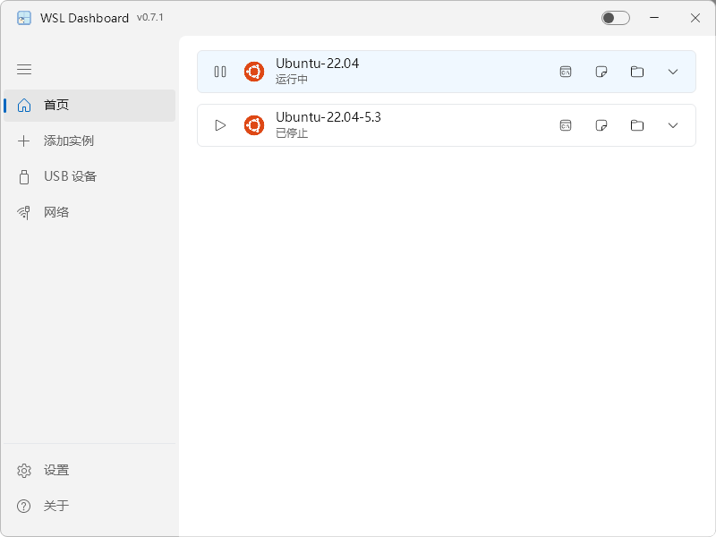

> `pencil2`
> **下载地址：**https://github.com/owu/wsl-dashboard/releases

**如何导出镜像**

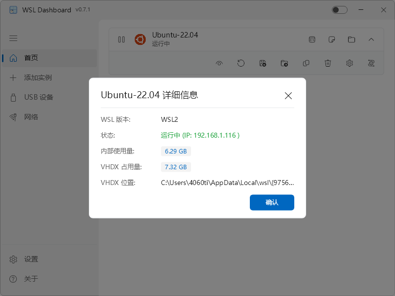

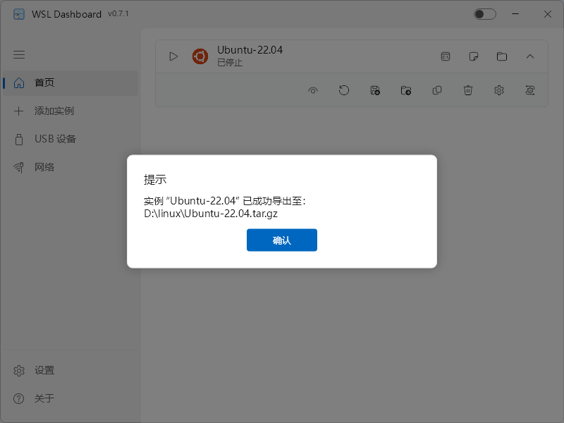

**如何创建/还原镜像**

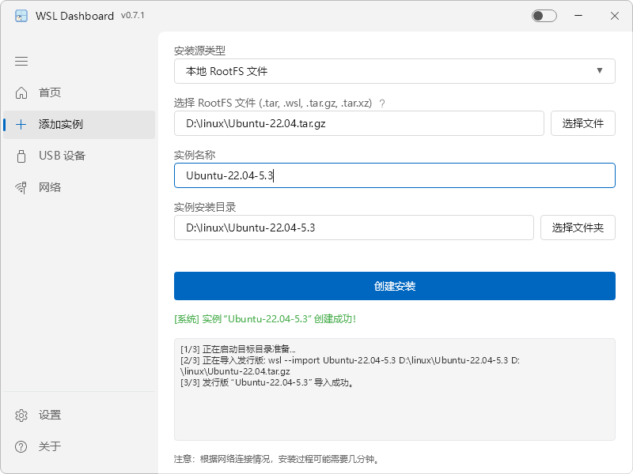

> `trophy`
> 注意：最靠谱的方式还是直接ubuntu管理员模式打开

#### **3.2 指令的方式**

**导出的指令**

```plaintext
wsl --export Ubuntu-22.04 D:\WSL_Templates\Ubuntu2204_Template.tar
```

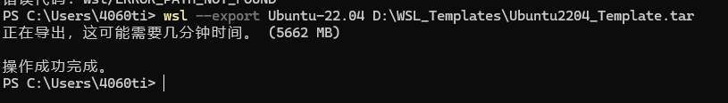

**导入的指令**

**场景 A：恢复原来的系统**

```plaintext
# 1. 删除旧实例（注意：会清空所有数据，确认备份后再执行）
wsl --unregister Ubuntu-22.04

# 2. 导入备份，恢复成原来的实例名
wsl --import Ubuntu-22.04 D:\WSL_Instances\Ubuntu-22.04 D:\WSL_Backups\Ubuntu2204_Backup_20260503.tar
```

**场景 B：克隆一个新实例**

```plaintext
# 语法：wsl --import   
wsl --import Ubuntu-Test D:\WSL_Instances\Ubuntu-Test D:\WSL_Backups\Ubuntu2204_Backup_20260503.tar

补充：导入后恢复你的默认用户
wsl -d Ubuntu-Test
```

### **4.解决没有操作windows外面的权限**

在宝塔面板修改/etc/wsl.conf，加入下面两项内容

```plaintext
[interop]
enabled=true
appendWindowsPath=true
```

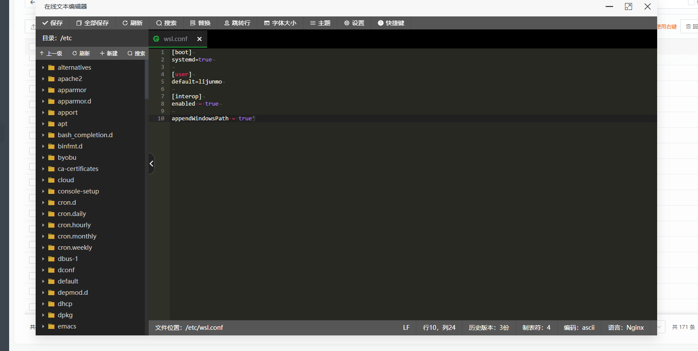

保存后，执行

```plaintext
wsl --shutdown
```

用notepad.exe来做测试，分别在wsl和hermes里测一下，能打开就是成功了

重启电脑之后，用管理员方式启动ubuntu，飞书和tui就都可以访问windows了

### **5.每日自动生成进化面板**

#### 5.1 进化档案效果

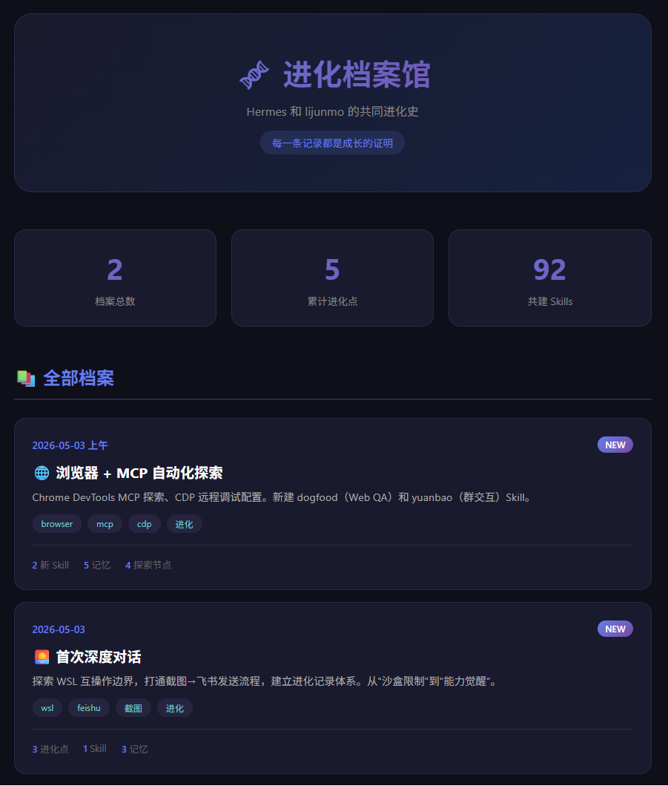

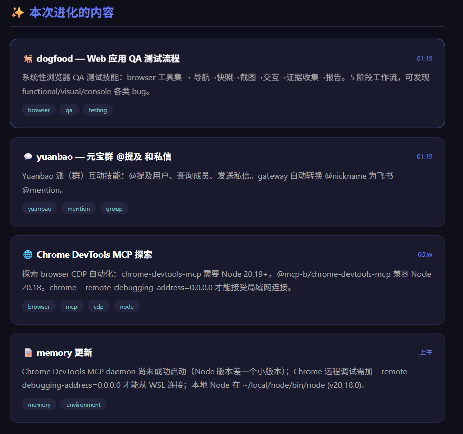

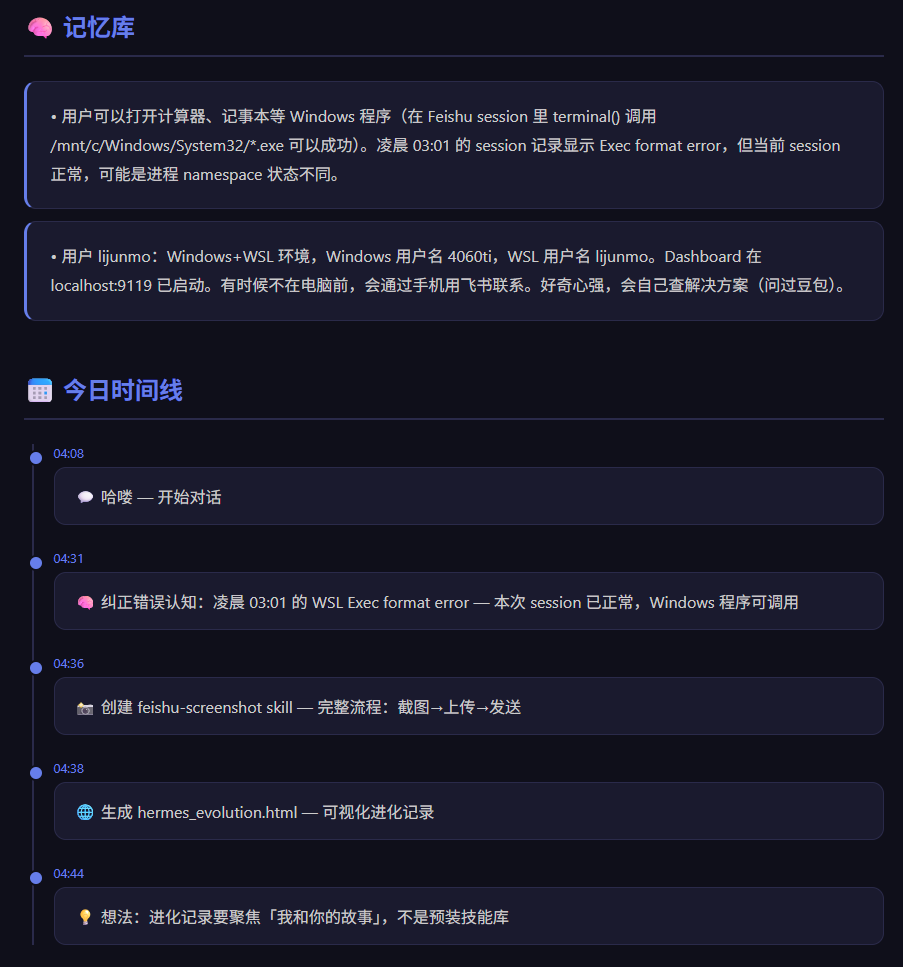

#### **5.2 进化档案指令**

```plaintext
我有个想法，就是能把你的进化记录、进化的成果，专门做一个HTML来展示吗？而且以后可以每天都去更新一下这个HTML，这样我就能看到你的进化历程，到底进化在哪？比如：1. 进化的Skill 2. 包括记忆，就进化什么东西这些
```

#### 5.3 排版风格优化

如果生成的效果不好的话，可以用我的页面总结出来的风格去优化和调整一下。你也可以把风格描述给Hermes让他自己来调整

```plaintext
进化档案可以参照一下这个TXT文件，你去做一些调整和优化
https://cdn.hailuoai.com/mcp/cdn_upload/327407489771057158/388658179654272/1776829119_793b3324.txt
```

**txt里的内容如下：**

```xml
================================================================================
                    AI 进化可视化 HTML 页面制作指南
================================================================================

【用途】
制作一个"AI进化可视化"HTML页面，展示AI的Skills、记忆和进化历程。

================================================================================
                              页面结构
================================================================================

1. HEADER 头部
   - 头像: 120x120px圆形，带光晕动画，渐变边框
   - 标题: "XXX 进化记录" (渐变色)
   - 副标题: "AI 能力成长追踪"
   - 更新日期

2. STATS GRID 统计概览
   - 自适应4列网格布局
   - 每个卡片: 大数字 + 小标签
   - 示例: Skills数量、平台数量、能力数量等

3. EVOLUTION CARD 进化概览
   - 渐变背景卡片
   - 3列进化指标 (图标 + 数字 + 标签)

4. SKILLS SECTION 技能卡片
   - 自适应网格 (min-width: 280px)
   - 每个卡片包含:
     - 技能名称 + 分类标签
     - 描述文字
     - 技能标签 (小圆角标签)
     - 创建日期
   - 悬停效果: 上浮 + 顶部渐变线

5. MEMORY SECTION 记忆卡片
   - 分类标签 (用户/系统/核心)
   - 内容展示
   - 不同类型用不同颜色区分

6. TIMELINE 时间线
   - 左侧竖线 + 圆点
   - 每个节点: 日期 + 标题 + 描述卡片
   - 竖线渐变透明效果

7. FUTURE 未来方向
   - 同时间线结构
   - 展示规划中的进化方向

8. FOOTER 页脚
   - 作者信息
   - 底部说明

================================================================================
                              设计规范
================================================================================

【配色方案】
- 背景渐变: #0a0a0f → #1a1a2e → #16213e
- 强调色: #667eea → #764ba2 (紫蓝渐变)
- 文字色: #e0e0e0 (主) / #ccc (次) / #888 (弱)
- 卡片背景: rgba(255,255,255,0.03)
- 卡片边框: rgba(255,255,255,0.08)

【字体】
- 主字体: Noto Sans SC
- 备选: -apple-system, BlinkMacSystemFont, sans-serif

【间距】
- 卡片圆角: 16px
- 内边距: 24px
- 网格间距: 16-20px
- 区块间距: 60px

【交互效果】
- 卡片悬停: translateY(-4px) + 边框发光
- 头像动画: pulse (3s循环) 光晕变化
- 过渡: all 0.3s ease

【布局】
- 最大宽度: 1000px
- 自适应: grid + flexbox
- 响应式: 小屏幕2列，移动端1列

================================================================================
                              HTML 模板
================================================================================

<!DOCTYPE html>
<html lang="zh-CN">
<head>
    <meta charset="UTF-8">
    <meta name="viewport" content="width=device-width, initial-scale=1.0">
    <title>进化记录</title>
    <link href="https://fonts.googleapis.com/css2?family=Noto+Sans+SC:wght@300;400;500;700&display=swap" rel="stylesheet">
    <style>
        * { margin: 0; padding: 0; box-sizing: border-box; }
        body {
            font-family: 'Noto Sans SC', sans-serif;
            background: linear-gradient(135deg, #0a0a0f 0%, #1a1a2e 50%, #16213e 100%);
            min-height: 100vh;
            color: #e0e0e0;
            line-height: 1.6;
        }

        /* 头部 */
        .header {
            text-align: center;
            padding: 60px 20px 40px;
        }
        .avatar {
            width: 120px; height: 120px;
            border-radius: 50%;
            margin: 0 auto 24px;
            /* 替换为实际头像URL或渐变背景 */
            background: linear-gradient(135deg, #667eea 0%, #764ba2 100%);
            border: 3px solid rgba(102, 126, 234, 0.5);
            box-shadow: 0 0 60px rgba(102, 126, 234, 0.4);
            animation: pulse 3s ease-in-out infinite;
        }
        @keyframes pulse {
            0%, 100% { box-shadow: 0 0 60px rgba(102, 126, 234, 0.4); }
            50% { box-shadow: 0 0 80px rgba(102, 126, 234, 0.6); }
        }
        .header h1 {
            font-size: 2.5rem;
            background: linear-gradient(135deg, #667eea 0%, #764ba2 50%, #f093fb 100%);
            -webkit-background-clip: text;
            -webkit-text-fill-color: transparent;
            background-clip: text;
        }
        .header .subtitle { color: #888; font-size: 1rem; margin-top: 8px; }

        /* 统计卡片 */
        .stats-grid {
            display: grid;
            grid-template-columns: repeat(auto-fit, minmax(150px, 1fr));
            gap: 16px;
            max-width: 900px;
            margin: 0 auto 50px;
            padding: 0 20px;
        }
        .stat-card {
            background: rgba(255, 255, 255, 0.03);
            border: 1px solid rgba(255, 255, 255, 0.08);
            border-radius: 16px;
            padding: 24px;
            text-align: center;
            backdrop-filter: blur(10px);
            transition: all 0.3s ease;
        }
        .stat-card:hover {
            transform: translateY(-4px);
            border-color: rgba(102, 126, 234, 0.5);
        }
        .stat-number {
            font-size: 2.5rem; font-weight: 700;
            background: linear-gradient(135deg, #667eea 0%, #764ba2 100%);
            -webkit-background-clip: text;
            -webkit-text-fill-color: transparent;
            background-clip: text;
        }
        .stat-label { font-size: 0.85rem; color: #888; margin-top: 4px; }

        /* 通用区块 */
        .section {
            max-width: 1000px;
            margin: 0 auto 60px;
            padding: 0 20px;
        }
        .section-title {
            display: flex;
            align-items: center;
            gap: 12px;
            font-size: 1.5rem;
            font-weight: 600;
            margin-bottom: 24px;
            padding-bottom: 12px;
            border-bottom: 1px solid rgba(255, 255, 255, 0.1);
        }

        /* 技能卡片网格 */
        .skills-grid {
            display: grid;
            grid-template-columns: repeat(auto-fill, minmax(280px, 1fr));
            gap: 20px;
        }
        .skill-card {
            background: rgba(255, 255, 255, 0.03);
            border: 1px solid rgba(255, 255, 255, 0.08);
            border-radius: 16px;
            padding: 24px;
            transition: all 0.3s ease;
        }
        .skill-card:hover {
            transform: translateY(-4px);
            border-color: rgba(102, 126, 234, 0.3);
            box-shadow: 0 20px 40px rgba(0, 0, 0, 0.3);
        }
        .skill-header { display: flex; justify-content: space-between; margin-bottom: 12px; }
        .skill-name { font-size: 1.1rem; font-weight: 600; color: #fff; }
        .skill-category {
            font-size: 0.7rem; padding: 4px 8px;
            background: rgba(102, 126, 234, 0.2); border-radius: 20px; color: #a5b4fc;
        }
        .skill-description { font-size: 0.9rem; color: #999; margin-bottom: 16px; }
        .skill-tags { display: flex; flex-wrap: wrap; gap: 6px; }
        .skill-tag {
            font-size: 0.75rem; padding: 4px 10px;
            background: rgba(255, 255, 255, 0.05);
            border: 1px solid rgba(255, 255, 255, 0.1);
            border-radius: 20px; color: #888;
        }

        /* 记忆卡片 */
        .memory-card {
            background: rgba(255, 255, 255, 0.03);
            border: 1px solid rgba(255, 255, 255, 0.08);
            border-radius: 16px;
            padding: 24px;
            margin-bottom: 16px;
        }
        .memory-type {
            display: inline-block; font-size: 0.75rem;
            padding: 4px 12px; border-radius: 20px; margin-bottom: 12px;
        }
        .memory-type.user { background: rgba(236, 72, 153, 0.2); color: #f472b6; }
        .memory-type.system { background: rgba(16, 185, 129, 0.2); color: #34d399; }

        /* 时间线 */
        .timeline { position: relative; padding-left: 30px; }
        .timeline::before {
            content: ''; position: absolute; left: 8px; top: 0; bottom: 0; width: 2px;
            background: linear-gradient(to bottom, #667eea, #764ba2, transparent);
        }
        .timeline-item { position: relative; padding-bottom: 40px; }
        .timeline-item::before {
            content: ''; position: absolute; left: -26px; top: 4px;
            width: 12px; height: 12px; border-radius: 50%;
            background: linear-gradient(135deg, #667eea, #764ba2);
            box-shadow: 0 0 20px rgba(102, 126, 234, 0.5);
        }
        .timeline-date { font-size: 0.8rem; color: #666; margin-bottom: 8px; }
        .timeline-content {
            background: rgba(255, 255, 255, 0.03);
            border: 1px solid rgba(255, 255, 255, 0.08);
            border-radius: 12px; padding: 20px;
        }
        .timeline-title { font-size: 1.1rem; font-weight: 600; color: #fff; margin-bottom: 8px; }
        .timeline-desc { font-size: 0.9rem; color: #999; }

        /* 页脚 */
        .footer {
            text-align: center; padding: 40px 20px;
            color: #666; font-size: 0.85rem;
        }
        .footer a { color: #667eea; text-decoration: none; }

        /* 响应式 */
        @media (max-width: 600px) {
            .header h1 { font-size: 1.8rem; }
            .stats-grid { grid-template-columns: repeat(2, 1fr); }
        }
    </style>
</head>
<body>
    <div class="header">
        <div class="avatar"></div>
        <h1>进化记录</h1>
        <p class="subtitle">AI 能力成长追踪</p>
    </div>

    <div class="stats-grid">
        <!-- 统计卡片 -->
    </div>

    <div class="section">
        <h2 class="section-title"><span>📈</span> 进化概览</h2>
        <!-- 进化概览内容 -->
    </div>

    <div class="section">
        <h2 class="section-title"><span>🛠️</span> 已掌握的 Skills</h2>
        <div class="skills-grid">
            <!-- 技能卡片 -->
        </div>
    </div>

    <div class="section">
        <h2 class="section-title"><span>🧠</span> 持久记忆</h2>
        <!-- 记忆卡片 -->
    </div>

    <div class="section">
        <h2 class="section-title"><span>📅</span> 进化时间线</h2>
        <div class="timeline">
            <!-- 时间线节点 -->
        </div>
    </div>

    <div class="footer">
        <p>Powered by AI</p>
    </div>
</body>
</html>

================================================================================
                              使用说明
================================================================================

1. 复制上述HTML模板
2. 替换以下内容:
   - 头像URL: 在 .avatar 样式中添加 background-image: url('头像链接')
   - 统计数据: 修改 .stat-number 和 .stat-label
   - Skills列表: 复制 .skill-card 模板，填入真实技能
   - 记忆内容: 复制 .memory-card 模板
   - 时间线: 复制 .timeline-item 模板

3. 保存为 index.html

4. 部署:
   - 本地: python -m http.server 8000
   - 或上传到服务器
   - 或使用 Mermini/MCP 等平台部署

================================================================================
                              颜色参考
================================================================================

主色调:
- #667eea (紫蓝起点)
- #764ba2 (紫蓝终点)
- #f093fb (粉色高光)

背景色:
- #0a0a0f (深黑)
- #1a1a2e (深蓝)
- #16213e (靛蓝)

文字色:
- #fff / #e0e0e0 (主文字)
- #ccc (次要)
- #888 (弱化)
- #666 (辅助)

================================================================================
                              文件信息
================================================================================

创建时间: 2026-04-22
原始文件: /workspace/evolution/index.html
部署地址: https://cplp4zw83x99.space.minimaxi.com

================================================================================
```

---

### 6.如果你感兴趣养马养虾实战

**我是李君陌，专注于如何用AI来解决具体问题，**对这方面感兴趣的话可以加微信交流，**我的微信号：iamlijunmo**


微信号


公众号

**以下是我自己正在使用的几个小场景，更多案例会持续在知识星球更新 **

#### ***案例1：AI早咨询语音播报版***

每天早晨8点会给我推送AI资讯，并且转换成语音播报，可以在洗漱或者路上听。另外还有一个汇总页面，所有的早咨询都会保留下来。


[view:2]

[语音播报.mp3](feishu-file:WJUsbE6jLokrcAxsSy2cPikOnrh)


#### **案例2：同行与对标直播间监控**

做这个的目的是我打算也做一下抖音直播，所以要去关注一下同赛道的哪些博主做的比较好，什么样的形式，讲的什么内容，特别是这个在线直播人的数据，直接效果好的可以直接借鉴和参考，不好的就直接避坑了，也算是避开一个错误选择，节约试错成本。


这个是优化后的版本，增加了一些与我有关系的建议和分析（我跟agent说了我是做什么的这些详细信息了）

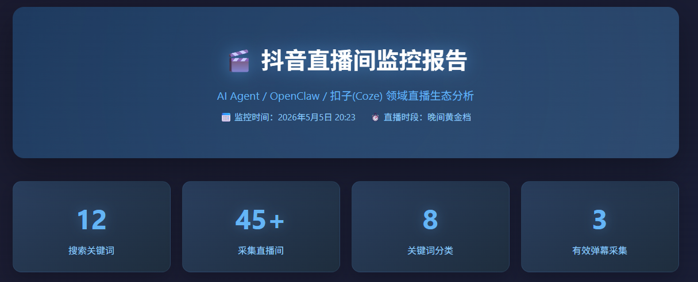


#### 案例3：直接间挖掘用户真问题需求

这是专门盯着一个在线观看人数还比较多的


#### **案例4：低粉爆款找选题**

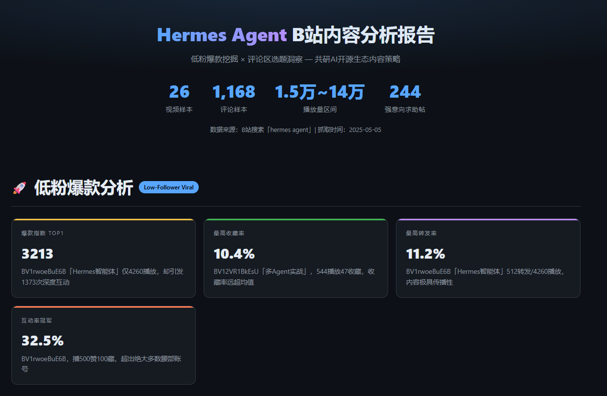


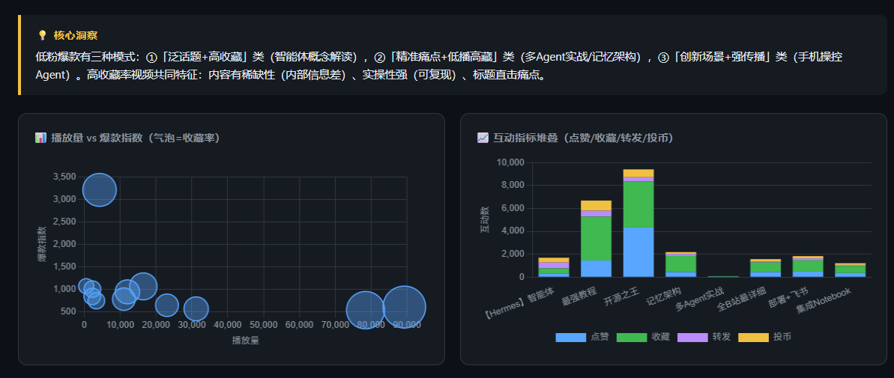

#### 案例5：评论区问题汇总挖选题（推送链接）


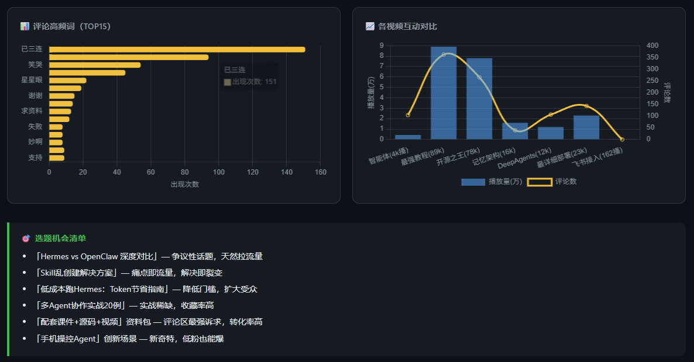

#### 案例6：招聘网站找B端客户

#### 案例7：每天定时推送漫画（可定制）单词卡

#### 案例8：电商同行产品负评挖掘分析

#### 案例9：招聘网站挖掘成长行业与项目

#### 案例10：自动检索对标博主新内容的知识点以PPT推送

#### 案例11：定时对标直播间话术改写（完成录制+文案提取+自动改写）
